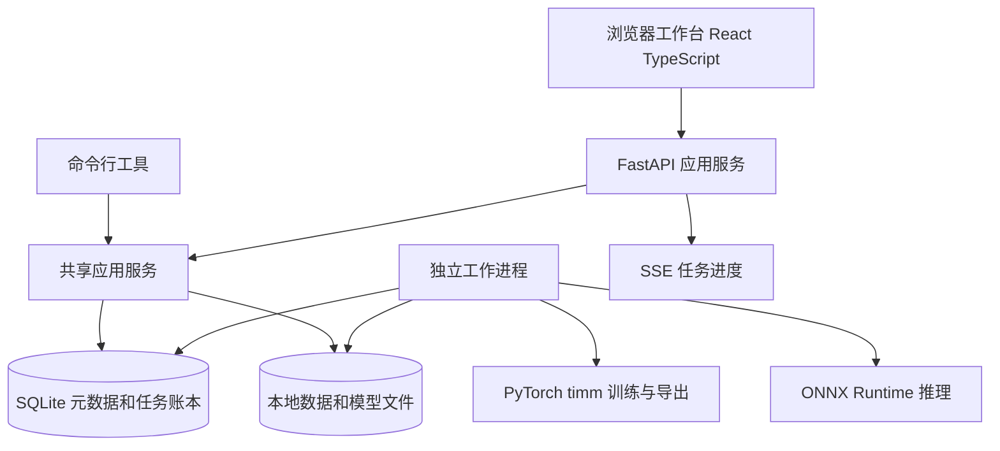

# 架构与技术决策

## 系统形态

采用模块化单体和独立工作进程。API 与 CLI 调用相同应用服务；训练和长批量任务不放在 HTTP 进程或 FastAPI BackgroundTasks 中。首版不引入 Redis、Celery、对象存储或 Kubernetes。



## 技术选择

| 层次 | 首版建议 | 原因与约束 |
| --- | --- | --- |
| 模型训练 | Python 3.12、PyTorch、timm | 复用编码器接口，只实现业务所需训练逻辑 |
| 默认候选 | DINOv2 ViT-S/14 和 ResNet18 | 少样本效果候选与速度基线，实测后保留默认 |
| 推理 | ONNX Runtime GPU，CPU 显式诊断模式 | 推理侧不依赖训练框架；GPU 不可用不能无提示降级 |
| 预处理 | Pillow、NumPy，共用版本化实现 | 控制 EXIF、透明度、补边与缩放行为 |
| API | FastAPI、Pydantic、SQLAlchemy、Alembic | 类型校验、OpenAPI、迁移与事务 |
| 数据 | SQLite WAL，磁盘文件与清单 | 单机部署容易；数据库放本地磁盘，不放共享盘 |
| Web | React、TypeScript、Vite、Ant Design、TanStack Query | 管理工作台，成熟表格表单与请求缓存 |
| 任务进度 | 数据库心跳、SSE、断线后轮询恢复 | 推送只用于显示，账本是事实来源 |
| 开发环境 | 项目隔离 Python 环境、Node 22、pnpm | 不复用用户 Anaconda base 作为产品环境 |

这些是架构建议，不是已安装的依赖锁。具体版本须经过 P0 的安装、导出与 GPU 测试后写入锁文件。

## 模块职责

| 模块 | 职责 | 不承担的职责 |
| --- | --- | --- |
| projects | 类别规范、标签版本、项目设置 | 模型内部类别排序 |
| datasets | 资产登记、标注、分组、划分、数据版本 | 修改源文件 |
| preprocessing | 确定性解码到输入张量 | 业务分类决策 |
| encoders | 加载固定权重、提取特征 | 自动拉取不固定的最新版 |
| training | 特征缓存、线性头训练、实验记录 | HTTP 请求生命周期 |
| evaluation | 指标、阈值选择、导出一致性 | 修改锁定测试集 |
| model_registry | 模型包校验、版本发布与回退 | 代替任务选择历史模型 |
| jobs | 任务状态、租约、恢复、取消、逐项结果 | 以 CSV 作为唯一账本 |
| inference | 有界解码、GPU batch、逐项结果 | 复制或移动原图 |
| review | 抽样、人工确认、标注修订 | 把未确认预测当作真值 |
| archive | 按结果复制图片、重名处理、失败统计 | 覆盖、移动或删除源文件 |

## 任务与恢复设计

任务提交时固化数据快照、模型包哈希、预处理版本和接受策略版本。任务唯一项使用 `(job_id, item_id)`；同内容不同路径保留两个输入项，可复用计算，但不能在结果清单里漏掉其中一个。

工作进程通过 SQLite 短事务抢占任务，更新 owner、lease token、lease 到期时间与心跳。每次写结果同时校验 token，租约失效的旧进程不能提交。GPU 进程默认一次只处理一个训练或推理任务，避免显存争用；CPU 解码与写入可以流水并发。

每个 batch 完成后，以单个事务写入结果并更新计数；crash 发生在提交前时允许重算，提交后以唯一键去重。语义是“可能重算，但每个任务项只有一份生效结果”，不宣称计算恰好一次。CSV 和 JSONL 从账本导出，避免数据库与追加文件双写产生不一致。

恢复时先检查模型包哈希、清单哈希、配置哈希和源文件身份。路径、大小、mtime 只用于扫描优化，内容 SHA256 才是稳定身份。源文件变更记为 `input_changed`，不得静默按原版本处理。租约超时后将未提交项重新置为待处理，已经成功提交的项跳过。

推理中请求暂停：结束当前 batch、提交结果、释放资源后进入 paused。取消：提交已有结果并标记剩余项 cancelled。训练任务首版支持取消；训练断点恢复是后续能力，推理暂停接口不得承诺训练暂停。单项读取失败后继续；GPU OOM 降低 batch 后有限重试，batch 为 1 仍失败则记录错误并按故障范围决定终止。

## 有界流水线

目录扫描分批写入输入快照；CPU 解码队列、GPU 输入队列与结果写入队列都设容量上限。以 224/336 分辨率和 batch 16/32/64 做小范围基准，根据显存与吞吐选择。所有图片均在需要时读取，不能预读 15 万张至内存。

Windows 多进程采用 spawn，入口使用 main guard；GPU session 只在对应子进程创建。先用可观测的单 GPU 工作进程实现，再决定是否增加独立设备 worker。长任务进程与 Web 服务可各自重启。

## 文件布局建议

```text
image-classification-platform/   代码和开发准备材料
  apps/api/                     后续实现
  apps/web/                     后续实现
  packages/core/                领域逻辑与预处理
  packages/ml/                  训练与模型适配
  packages/runtime/             独立 ONNX 推理封装
  tools/                        准备和诊断工具
  configs/ schemas/ docs/

E:/image-platform-data/          与代码分离的数据目录
  database/                     SQLite 与备份
  assets/                       托管资产或外部只读目录登记
  manifests/                    数据清单版本
  models/                       不可变模型包
  features/                     特征缓存和索引
  thumbnails/                   可重建缩略图
  jobs/                         任务导出与日志
  caches/                       权重下载与依赖缓存
```

原图可采用只读引用模式，也可导入到内容寻址的托管目录。引用模式必须在训练和推理前验证身份；模型包独立保存清单和标签快照。备份使用 SQLite backup API 或一致性备份流程，不能只复制运行中的主数据库而遗漏 WAL。

## 通用性与扩展路径

编码器适配器输出稳定形状 `[N,D]`，分类头输出 `[N,C]`。标签标识是稳定业务 ID，模型类别索引只在该模型版本内有效。项目预处理配置作为模型包的一部分，不能用全局设置覆盖历史模型。

数据服务、调度服务和文件存储都通过明确接口访问。若出现多台工作节点、多人写入或大规模任务争用，再将 SQLite 改为 PostgreSQL、任务调度改为服务队列、文件改为对象存储。多标签、OCR、检测与向量检索属于独立任务类型或扩展，不用在首版单标签逻辑中预埋所有分支。

## 部署边界

开发机只监听 localhost，文件访问限定在管理员登记的数据根目录。内网部署开启身份认证与角色控制，所有列表、模型和文件访问按项目授权。上传验证实际文件格式和解码像素上限；目录路径解析后校验根目录约束并拒绝越界软链接。模型包只允许已校验的 ONNX 与声明文件，推理部署不加载任意 pickle 或训练脚本。

这些措施直接保护用户提供的数据与模型访问边界；公网多租户的隔离、账单和配额需要单独产品设计。
