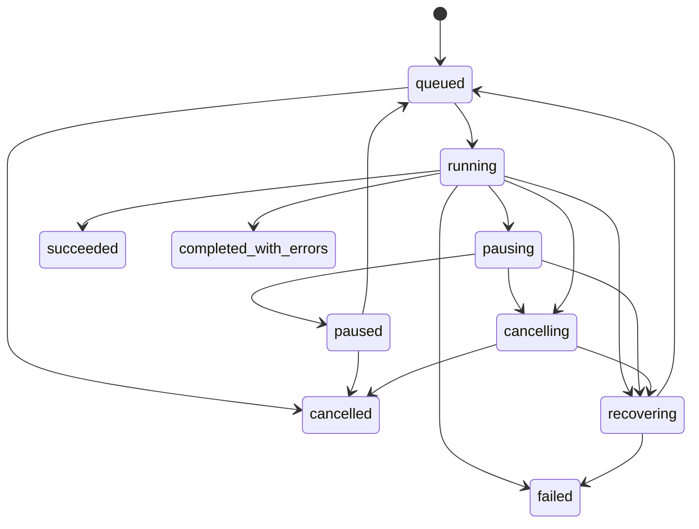

# 数据与接口契约

## 版本与实体

所有业务实体使用 UUID 或服务端生成的稳定 ID，时间使用 UTC RFC3339，显示时转本地时区。下面是逻辑模型，P1 需补齐正式 SQLAlchemy 定义与数据库迁移。

| 实体 | 关键字段 | 约束 |
| --- | --- | --- |
| Project | id name task_type active_model_version_id | 首版 task_type 固定 single_label |
| LabelSetVersion | id project_id version labels definition_hash | 发布后不可修改；显示名与稳定 label_id 分离 |
| Asset | id project_id relative_path content_sha256 size_bytes width height | 同内容不同路径仍可登记；根目录单独登记 |
| AnnotationRevision | id asset_id label_id status actor created_at replaces_id | 追加修订；保留预测与人工确认区别 |
| DatasetVersion | id project_id label_set_version_id manifest_sha256 state | 发布后不可变，关联具体标注修订 |
| DatasetItem | dataset_version_id item_id asset_id label_id group_id split | 项目内 item_id 唯一，跨 split 的内容与组不得重复 |
| Experiment | id dataset_version_id config_hash encoder_sha256 state seed | 绑定数据版本、软件锁、特征契约 |
| ModelVersion | id project_id experiment_id package_sha256 state | 可用状态须通过模型包与推理一致性校验 |
| Job | id type input_snapshot_sha256 model_version_id policy_hash state owner lease_token | 幂等键约束；固定版本，不能中途换模型 |
| JobItem | job_id item_id state attempts error_code | 唯一键 job_id 与 item_id |
| Prediction | job_id item_id class_index label_id score status model_version_id | 已提交结果只增不改；重跑建立新任务或尝试记录 |
| ReviewItem | id prediction_id batch_id assigned_state annotation_revision_id | 记录抽样原因、来源和人工确认 |
| ArchiveItem | archive_job_id item_id target_path state error_code | 与推理结果分开计数和重试 |

数据集版本的校验成功与训练就绪是不同状态：未标注池只做结构登记；训练版本必须满足每类训练样本、独立组数与划分规则。

## 数据清单

CSV 使用 UTF-8，工具兼容 UTF-8 BOM。列名固定如下，允许扩展列；平台保留已声明扩展但不以其改变核心含义。

| 列 | 定义 |
| --- | --- |
| item_id | 本次清单内唯一字符串 |
| relative_path | 相对于登记根目录的 POSIX 风格路径，禁止绝对路径和 `..` |
| content_sha256 | 原始文件字节 SHA256，64 位十六进制 |
| label_id | train val test 必填，pool 留空 |
| group_id | 来源、模板、近重复或同一对象形成的防泄漏组 |
| split | train val test pool 之一 |
| source_id | 来源批次或采集源，便于分层评价与审计 |
| annotation_status | human_confirmed 或 unlabeled；评估数据须人工确认 |

近重复或共同来源构成的组须在划分前确定；需要综合多个关系时，使用连通分量合并 group_id，而非挑一个方便的字段。清单校验可以证明已给 group_id 没有跨集合，不能证明近重复已经找全。

实例见 `examples/dataset-manifest.csv`。样例哈希仅用于结构示例，没有对应业务文件。

## 模型包

```text
model-v001/
  model.onnx
  metadata.json
  metrics.json
  training-config.json
  label-set.json
  dataset-manifest.csv
  environment-lock.txt
  checksums.json
  licenses/
```

训练侧还需保留分类头检查点，便于恢复或重导出；最小推理分发包可以只包含 ONNX、metadata、label-set、checksums 与所需许可证。训练原图和完整数据清单是否随分发包交付由数据权限决定，内部注册表仍保留可追溯引用。

`metadata.json` 必须满足 `schemas/model-metadata.schema.json`。其字段固定：模型 ID、编码器权重哈希、输入输出名称和形状、预处理契约、特征方式、类别索引、接受策略与版本。checksums 记录包内每个文件哈希，不包含自身；package_sha256 由按路径排序的相对路径与内容哈希规范化计算，避免自引用。

### 输入输出

输入 `images` 为 float32 `[N,3,H,W]`，H/W 固定、N 动态且 N≥1。图内包括编码器、确定的特征归一化、分类头，输出 `logits` 为 float32 `[N,C]`。解码、EXIF、RGB 转换、缩放补边、像素归一化在封装层；不能重复进行 normalization。

封装层用数值稳定 softmax 将 logits 转为 score。按最大分数决定预测索引，平分时选择最小 class_index；当分数大于等于预测类别阈值时 accepted，否则 needs_review。模型无已验证接受策略时允许试验输出，但禁止注册为可自动接受的正式版本。阈值范围 [0,1]，有限数；NaN 或 Inf 记推理失败。

阈值更新创建新的策略版本与模型包修订，不覆盖已有文件。类别展示名可以修改下一版本；同一包内 label_id 与 class_index 一一对应，索引必须连续 0 到 C−1。

## 任务状态



这是批量推理状态机。恢复流程保留暂停与取消意图，在重新执行前先应用对应控制请求。训练子集为 queued/running/cancelling/cancelled/succeeded/failed，首版训练崩溃标 failed 并允许创建新任务。终态重试不直接清空旧结果：批量失败项可建立关联的重试任务。

输入快照阶段结束后 `total = pending + running + succeeded_items + failed_items + cancelled_items`。needs_review 是 succeeded_items 中的分类决策，不是执行失败。扫描阶段显示 discovered 与 scan_complete，不显示虚假的完成百分比。

## API 草案

统一前缀 `/api/v1`，JSON 使用 snake_case。列表默认 limit=50，最大 200，使用稳定 cursor；长任务立即返回 202 与 job_id。前后端实现前由 P1 把此草案生成并冻结 OpenAPI，不把本文当成已运行服务。

| 方法 | 路径 | 行为 |
| --- | --- | --- |
| POST GET | /projects | 建立与列出项目 |
| GET PATCH | /projects/{project_id} | 读取与修改项目设置 |
| POST | /projects/{project_id}/label-set-versions | 创建下一版标签定义 |
| POST | /projects/{project_id}/imports | 按已登记根目录导入，返回 import job |
| POST | /projects/{project_id}/uploads | 小批量文件上传，返回资产或导入任务 |
| GET | /projects/{project_id}/assets | 分页查询缩略图、标签、质量与来源 |
| POST | /projects/{project_id}/annotations | 批量追加人工标注修订 |
| POST GET | /projects/{project_id}/dataset-versions | 创建与列出数据版本 |
| POST | /dataset-versions/{version_id}/validate | 校验清单、分组、文件与图像可解码性 |
| POST | /dataset-versions/{version_id}/publish | 冻结通过校验的数据版本 |
| POST GET | /projects/{project_id}/experiments | 提交或查询实验，绑定配置与数据版本 |
| GET | /experiments/{experiment_id}/metrics | 获取计数、每类指标、错误样本与指标定义 |
| POST | /experiments/{experiment_id}/export | 提交模型包导出与校验任务 |
| GET | /projects/{project_id}/models | 列出模型与验证状态 |
| PUT | /projects/{project_id}/active-model | 指定默认可用版本，支持切回历史版本 |
| POST | /projects/{project_id}/predictions | 单图试用，指定资产与模型版本 |
| POST | /projects/{project_id}/batch-jobs | 按快照创建批量任务 |
| GET | /jobs/{job_id} | 阶段、计数、资源与心跳 |
| GET | /jobs/{job_id}/events | SSE 进度；事件丢失后从任务快照恢复 |
| POST | /jobs/{job_id}/actions | action 为 pause resume cancel retry_failed，按任务类型验证 |
| GET | /jobs/{job_id}/results | 分页结果与状态筛选 |
| POST | /jobs/{job_id}/exports | 创建 CSV 或 JSONL 导出任务 |
| POST | /jobs/{job_id}/review-batches | 按预算选出代表样本 |
| POST | /review-batches/{batch_id}/decisions | 人工确认，保留修订历史 |
| POST | /jobs/{job_id}/archive-jobs | 从指定结果创建复制任务 |
| GET | /health /runtime | 存活与依赖设备诊断，敏感信息限管理员 |

### 任务创建示例

```json
{
  "model_version_id": "model_v001",
  "input_snapshot_id": "snapshot_v001",
  "runtime_profile": "local_gpu",
  "batch_size": 32
}
```

创建类接口接受 `Idempotency-Key`。同键同请求返回原结果，同键不同请求体返回 409。键按用户、项目、接口作用域存储。状态控制重复请求返回当前状态；不允许的转换返回 409。

### 错误响应

```json
{
  "error": {
    "code": "MODEL_NOT_VALIDATED",
    "message": "该模型尚未通过推理一致性校验",
    "request_id": "req_001",
    "details": {"model_version_id": "model_v001"}
  }
}
```

400 为输入错误，401/403 为身份与权限，404 为不可访问或不存在的资源，409 为版本和状态冲突，422 为结构校验错误，503 为工作进程或必需 GPU 不可用。单图片失败属于任务结果，不让整批 HTTP 请求失败。

## 导出结果

至少包括 job_id、item_id、relative_path、content_sha256、model_version_id、policy_version、label_id、class_index、score、status、error_code、error_message、processed_at。失败行的 label_id、class_index 与 score 留空。CSV 按 RFC4180 转义，并为可直接用 Excel 打开的版本处理公式开头文本；无损接口使用 JSONL。复制导出使用 item_id 前缀或内容哈希消除同名冲突，并验证目标文件哈希。
