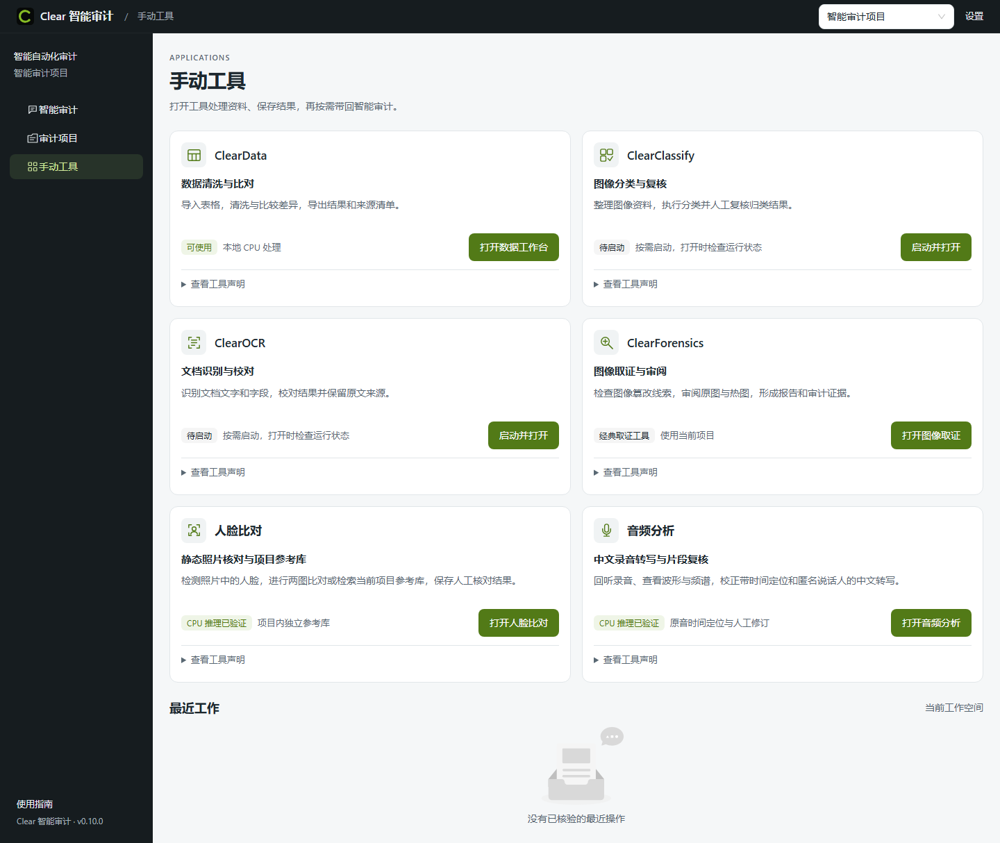

# Clear 审计平台使用说明书

更新日期：2026-10-19。正式入口目前登记 **Clear 0.14.0 agent-foundation candidate-006**，共享运行时/模型来自 0.10.0。本文说明主界面、项目管理、资料、任务、成果及正式审计档案；各工具的完整步骤见配套分册。

当前正式版首先提供DSH通用对话与执行：普通问题自然回答，文件任务可读取、搜索、编辑任务副本，运行PowerShell、Python及已有库，生成实际文件并下载。识字、多文件多列清洗、任务内OCR选参和新底稿由组合服务处理，普通任务无需先建立正式审计档案或维护审计计划。明确本地操作入口仍可无需模型执行；开放聊天需要已配置模型。MCP、技能脚本、子助手和主控图片输入按实际连接与能力提供。事实、固定版本、原件来源、人工复核及署名边界继续有效。实际范围与限制见[通用能力实施记录](platform-automation/Agent通用能力恢复实施与验收-20261019.md)。

**2026-10-15 本机更新：** Agent 已显式启用，原主控模型连接、流式响应和真实工具查询流程通过检查，固定启动器会沿用 `agent_enabled: true`。见[启用与实测](platform-automation/Agent启用与实测-20261015.md)。当前固定入口继续启用Agent；无需模型的本地明确操作与需要模型的开放分析分别按实际能力运行。新版 8910 门户见[首页说明](platform-automation/门户首页评估与补齐-20261015.md)。

## 阅读导航

| 文档 | 阅读对象与内容 |
|---|---|
| 本说明书 | 首次使用、主界面、审计项目、资料与成果、异常恢复和备份 |
| [手动工具使用说明](Clear手动工具使用说明.md) | Data、分类、经典/深度取证、人脸、音频、印章逐项操作 |
| [ClearOCR 详细使用说明](ClearOCR详细使用说明.md) | OCR 原生界面、识别、表格校对、视觉审校、导出与恢复 |
| [架构设计与实现思路](Clear架构设计与实现思路.md) | 开发者理解模块、数据流、任务、证据、运行时与扩展方式 |
| [源码整理说明](../products/Clear/README.md) | GitHub 中源码快照、原始开发目录和离线发行包的对应关系 |
| [内网部署与验收说明](platform-automation/多模态手动审计验收与内网部署说明.md) | 完整介质、目标设备、现场验证和迁移 |
| [取证稳定性候选补充说明](../products/Clear/platform/docs/forensics-stability-20261014.md) | 0.11.1-rc1 独立候选的热图叠加、坐标、历史结果兼容与回退；正式入口仍按本文基线 |

### 版本与范围先确认

本机统一入口是 `F:\OCR\release\Clear\启动智能审计.cmd`，登记文件为 [current.json](../release/Clear/current.json)。该登记当前选择 `F:\OCR\output\agent-foundation-upgrade-20261019\delivery\Clear-0.14.0-agent-foundation-candidate-006`，已有工作区位于 `F:\OCR\output\ai-audit-product-dev-20261004\workspace`，服务端口为 8879。工作区路径是当前安装的登记值，其他机器以自己的实际配置为准。

Clear 版本号与独立 OCR 版本号分别管理。根目录 `src/`、`frontend/` 是独立 OCR 研发线；`products/Clear/` 保存本轮整理的三应用开发源码快照。当前正式 ClearOCR 运行的是发行根 `ocr/src` 与 `ocr/frontend/dist`，OCR 数据 schema 为 17；根仓研发线 schema 为 18。嵌套 `program/bundles/ocr` 中保留的旧源码、网页属于依赖资产包，不能仅凭它们判断正式界面版本。不要把研发功能、旧版说明或底层包的页面当成当前已交付功能。

当前版本新增的印章、人脸、音频和 CAT-Net 已完成开发机 CPU 工程验证，新增 GPU 路线保持关闭。原有 OCR、分类 GPU 能力仍按各自运行环境使用。业务精度、A4000/A6000 目标设备资格、长录音专项尚未验收。智能审计 Agent 在本机固定入口保持启用；手动工具、明确本地操作和人工档案流程可独立于模型连接使用。

## 1. 第一次启动与十分钟上手

### 1.1 启动前准备

1. 使用完整离线介质或当前已登记的安装目录。GitHub 源码仓库不包含数十 GiB 的模型、Python 运行环境及完整安装包，不能直接当作便携安装目录双击运行。
2. 本项目所有源码、模型、业务资料、日志、缓存、临时文件、截图、导出和备份只写入本机 F 盘。执行开发或诊断命令前，按[文件存储规范](项目文件存储规范.md)配置临时及应用数据目录；仅改变工作目录或传 `--data` 不足以覆盖所有缓存位置。
3. 双击固定入口 `启动智能审计.cmd`。启动器核验候选身份、数据兼容性、必要文件和端口，再启动服务。首次校验及模型冷加载可能较慢。
4. 浏览器打开 [手动工具目录](http://127.0.0.1:8879/apps)。如果浏览器仍显示旧版页面，按 `Ctrl+F5`，并核对侧栏底部版本。
5. 在右上角选择当前项目；首次使用可从“审计项目”新建，或点击工具入口后按照提示“选择项目后继续”。

### 1.2 推荐的首次操作

推荐先从[智能审计](http://127.0.0.1:8879/agent)选择项目、添加并选中图片，再在主输入框发送“帮我识别一下这张图片里的文字”。系统完成服务准备和资料关联，全文及TXT出现在当前任务成果区。单份PDF可直接说明页码；需要比较时把比较口径一并写在同一目标中，缺少影响结果的信息时再回答业务问题。

原文已完成而分析暂停时，可先下载原文；修好连接后点继续原任务，无需重述或重新提取。识别运行中可补充后续要求。已接受的原件、范围及引擎保持固定；要改变它们，先按提示停止后续步骤，再在原会话修订。

需要对照原图人工校对时，也可使用下面的手动路线。以一份普通文档图片为例：

1. 新建项目“使用演示”，从项目二级导航进入“资料”，上传一张文档图片。
2. 勾选图片，点击“固定输入集合 → 在 OCR 中使用”。若 OCR 尚未就绪，先通过应用状态页按需启动，再回到这个工作流。
3. 在门户 OCR 工作流中选择已有原生项目并“关联当前工作空间”，或填写名称后“新建并关联”。
4. 点击“导入到当前项目”，等待资料交接显示“导入完成”；选择识别引擎后“提交识别”，从任务中心核实完成。
5. 点击“打开原生项目”，对照原图校正文字；如有表格，检查单元格、跨行跨列和金额。保存修订并导出一份 TXT 或 XLSX，打开文件核对。
6. 回到保留了交接记录的门户 OCR 工作流，点击“归集识别成果”。PDF 则先在原生工作台按页处理，再使用“归集已处理的文档成果”。
7. 回到“审计项目 → 成果”核对来源、版本和文件下载。需要审计引用时，再选择固定成果形成证据。

若从工具目录快捷入口打开 OCR，并直接在原生工作台导入文件，可以完成原生处理和下载；这条快捷路线没有自动建立共享资料交接记录。需要门户归集时应使用上述资料库交接流程。原生导出、平台归集和正式调查引用分别完成。

没有配置大模型时，明确本地提取、支持的固定Data操作、已有模型预测以及以上手动路线仍可使用；开放比较和解释需要可用模型连接。

## 2. 主界面各区域怎么用



图为2026-10-13历史发行截图，保留供定位控件；当前版本的真实浏览器、模型与原生任务验收另见通用能力实施记录。

| 区域 | 看到什么 | 应当怎么用 |
|---|---|---|
| 顶部左侧 | Clear 智能审计标识、当前位置 | 点击品牌回首页；面包屑帮助确认当前栏目 |
| 顶部右侧 | “当前项目”下拉框、“设置” | 切换项目后再操作；设置用于主控连接和专业能力状态 |
| 左侧主导航 | 智能审计、审计项目、手动工具 | 分别进入对话任务、项目资料/档案、各工具工作台 |
| 内容区 | 页面标题、表单、列表、状态及错误 | 先确认项目，再看状态和可用按钮；灰色按钮通常表示条件未满足 |
| 项目页二级导航 | 项目概况、资料、发现、成果 | 在同一项目范围内切换数据视角 |
| “正式档案与运行详情” | 正式档案与人工记录、待办事项、模板批次、运行任务 | 展开后进入较深入的审计记录和任务管理 |
| 左栏底部 | 使用指南、版本号 | 快速回看基本步骤，核对正在运行的版本 |

窗口变窄时左侧导航会收起。使用左上角展开/收起按钮；页面内的表格可能需要横向滚动。顶部项目是数据范围，不是登录账号。本版的“复核人”“本机姓名”属于人工署名记录，尚未提供多人账号和权限系统。

### 2.1 四个容易混淆的概念

| 名称 | 实际含义 | 例子 |
|---|---|---|
| 平台项目 / 工作空间 | 统一组织资料、关联原生项目、任务与成果的范围 | “2026 第三季度费用核查” |
| 原生工具项目 | OCR 或分类工具自己的数据库对象 | OCR 中的一批合同扫描件 |
| 正式审计项目 | 平台项目内的正式目标、程序、调查及署名档案 | 合同主体核查程序及调查结论 |
| 固定成果 / 固定证据 | 针对某次输入和修订保存的版本 | 印章人工核准 v2 的 ZIP 及证据快照 |

一个平台项目可以关联多个工具项目和正式档案。相同显示名称不代表同一个对象；以工具中的实际关联和版本为准。

## 3. 项目与资料管理

### 3.1 新建、选择与继续项目

1. 点击“审计项目”。未选项目时显示已有项目列表和“新建项目”。
2. 点击“新建项目”，输入名称，点击“创建”。名称为必填，最长 256 字符。
3. 创建成功后进入项目范围。工具前置页面中的同一操作显示“创建并继续”，会直接回到原工具。
4. 从右上角选择其他项目。切换后检查页面内容和原生关联，避免把另一项目的资料加入当前成果。
5. 如出现“项目不存在或已失效”，使用“清除项目选择”后重新选择。

创建操作响应不明时，页面保留原请求与名称，按原名称重试核实。不要反复改名称创建多个项目来解决暂时的网络或服务错误。

### 3.2 项目概况

Agent 服务启用时，概况页展示审计对象、期间、目标，以及最近审计任务、资料、发现、成果数量；下方可继续已有任务、查看发现与成果，或进入正式审计档案。当前固定入口已启用Agent；概况加载失败时先核对服务状态与具体错误，也可直接进入二级导航的“资料”“成果”，或展开进入“正式档案与人工记录”和手动工具。

“开始智能审计”“让 Agent 汇总项目”会进入首页对话流程。只有 Agent 已启用且主控可用时才能实际调用模型。“手动工具”可直接进入人工处理路线。没有发现或底稿时，空状态表示尚无对应记录，不代表资料丢失。

### 3.3 上传和整理资料

进入“资料”，选择文件后点击“上传资料”。平台资料库单文件上限 128 MiB；各工具还可能有更严格的格式、大小、像素或时长限制，详见工具分册。上传到资料库并不等于已经 OCR、分类或转写。

资料表提供名称、类型、大小、标签、登记时间，以及三个主要操作：

- **打开原件**：在新页查看当前版本内容。
- **来源**：查看登记渠道、原始相对位置及版本。
- **标签**：添加或修改业务标签，逗号可以分隔多个标签。

使用“搜索”按文件名、来源或标签查找；类型和标签下拉框可组合筛选。列表每页 30 条，翻页后仍须确认具体选中项。该搜索不检索文件正文；正文应在工具结果或任务的资料读取中核查，图片还需先完成 OCR。

### 3.4 固定输入集合

1. 在资料列表中明确勾选需要处理的文件。
2. 点击“固定输入集合”，形成包含所选资料及其版本的集合。
3. 在“当前输入集合”查看成员数量和名称。
4. 根据文件类型使用“选择模板启动处理批次”“在数据工作台使用”“在 OCR 中使用”或“在图像分类中使用”。入口只在资料类型满足时显示。
5. “清除选择”退出当前集合视图，不删除原资料或既有集合记录。

固定集合用于明确某次处理到底使用哪些版本。后来新增资料不会自动加入旧集合；要改变范围，应重新固定集合并发起新的处理。

## 4. 六个手动工具与两个扩展入口

| 界面入口 | 主要用途 | 典型产物 | 详细步骤 |
|---|---|---|---|
| ClearOCR | 图片/PDF 文字、表格识别与校对 | TXT、JSON、Markdown、XLSX 等实际可用格式 | [OCR 分册](ClearOCR详细使用说明.md) |
| ClearClassify | 图像标注、训练、模型管理、分类与人工复核 | 标签、分类结果、模型包和导出 | [手动工具分册](Clear手动工具使用说明.md) |
| ClearData | 清洗、筛选、汇总与精确台账比对 | 明细、差异表、来源清单 | 同上 |
| ClearForensics | 经典图像取证线索和人工审阅 | 分析预览、观察、取证报告 | 同上 |
| 人脸比对 | 检测选脸、两图比对、项目参考库 Top-K | 相似度、候选和人工说明 | 同上 |
| 音频分析 | 回听、中文转写、时间定位和片段修订 | TXT、SRT、VTT、JSON 与分析音轨 | 同上 |
| OCR 内“印章识别” | 章区域定位、章内文字、编号与主体核对 | 人工核准字段、ZIP、Data 输入 | 同上 |
| 取证内“深度图像取证” | 原始 JPEG 的 CAT-Net 区域分析 | 区域热图、人工标注和报告 | 同上 |

交付记录中的模块名 ClearClassification，在当前界面显示为 **ClearClassify**，指同一分类工具。

工具卡片中的“待启动”表示原生服务按需启动；不表示模型文件必然缺失。点击“启动并打开”，等待状态确认。可以展开“查看工具声明”了解输入、运行依赖和限制。打开状态页时，服务、界面、CPU、GPU、模型是分别报告的，不能只看到“服务可用”就认为全部模型已验证。

人脸、音频、印章、深度取证采用共同流程：选择项目 → 添加新资料 → 上传未提交资料 → 选择已导入资料与参数 → 开始分析 → 打开记录 → 对照原件并人工修订 → 保存人工复核 → 导出或归集。选择本地文件后仍需上传；人工编辑后仍需保存。

## 5. 智能审计首页与模型设置

### 5.1 当前正式版本的可用状态

当前0.14.0固定入口已启用Agent。普通聊天、文件处理与开放分析使用已配置模型；明确本地操作入口按实际能力可无需模型执行。普通任务不强制创建正式档案或先调用交付工具。

模型临时故障会保存原目标和已完成工作。连接修复后使用“继续原任务”或“核对任务并继续”；旧版可恢复的失败历史也提供原任务继续入口。已完成成果可先读取下载，分析未完成会如实标注。未知业务写入先核对原请求回执，无法核实会继续阻止重发。用户主动停止后不会自动重启。

### 5.2 首页各控件

| 控件 | 用途 |
|---|---|
| 新任务 | 建立新的目标上下文，与既有任务区分 |
| 最近任务 | 按已有任务继续，刷新页面后也从这里找回 |
| 任务详情 | 查看目标、项目背景、工作安排、资料、结果和运行状态 |
| 审计目标或问题 | 描述范围、规则、期望交付；同一任务内可补充条件 |
| 添加资料 | 上传或选择项目资料，明确本任务处理范围 |
| 更多 → 保存目标 | 在 Agent 已启用时先保存内容，不启动处理 |
| 发送 / 补充并继续 | 提交目标，或为已有活动补充需求 |
| 回到最新消息 | 对话有更新且正在阅读历史内容时定位到最新内容 |
| 手动接管 | 停止 Agent 后续动作，转到工具处理；已提交原生任务可能继续运行 |
| 停止后续步骤 | 停止后续安排，已有成果保留 |
| 停止并取消支持取消的本轮任务 | 同时请求取消可取消任务，仍应刷新核实原生实际状态 |
| 核对任务并继续 | 服务重启或响应不明后，先核实原运行再恢复 |

页面上的示例“台账核对”“重复与汇总”“凭证与制度”“取证线索”会填写建议目标。应按实际业务补充关键字段、日期、金额单位、容差和输出范围，避免仅写“帮我审计一下”。

一个可执行的目标例子：

> 在本项目所选两份演示台账中，以供应商编号为键核对含税金额；编号保留前导零，金额单位为元，不自动容忍尾差。分别导出匹配、金额不符、仅左侧、仅右侧和重复键候选，保留原文件、工作表与行号。

这只是示例口径，不是程序自动应用的默认业务规则。模型需要依赖真实工具返回，资料不具备结构化表格时应先做提取并人工确认。

### 5.3 主控连接

在 Agent 已启用的环境，打开“设置 → 配置或更换主控”：

1. 填写 API 地址与模型 ID；也可以点击“读取服务模型列表”再选择模型。
2. 填写 API Key。已配置时留空可保留原凭据；更换地址或协议需要重新填写。本地匿名服务按界面提示填写。
3. 在“高级连接参数”选择“OpenAI 兼容工具调用”或“Anthropic Messages”，确认输出长度参数和流式响应选项。
4. 按服务实际容量填写本地上下文预算、单次输出上限和超时。页面允许预算 4096–200000、输出 256–8192、超时 10–600 秒；本地预算不会证明或改变供应商真实容量。
5. 点击“测试并保存”，等待工具调用探针通过，再点击“完成”。模型列表读取和连接测试会联系所填写服务；连接测试使用探针，不发送业务资料。

主控连接与 OCR 内的外部视觉审校连接分别配置。主控负责安排任务，OCR 视觉模型负责对已有文字或单元格给出审校建议，两者不能混用配置含义。正式发送审计目标时，启用的外部主控会收到实际请求上下文及工具返回内容，应按项目允许的资料范围使用。

### 5.4 人工接管后带回结果

1. 在当前任务点击“手动接管”，确认任务进入人工模式。
2. 点击“打开手动工具”，保持顶部项目和返回任务不变。
3. 打开对应原生项目，处理、校对并保存结果；需要时先归集成果。
4. 使用“带回结果”选择明确的结果版本并填写处理摘要。
5. 回到原对话，提交继续要求。出现“原操作待核实”时，先核实接管或返回请求，避免另外建一项相同任务。

“手动接管”不会自动撤销已有任务，也不会自动采用工具里未保存的编辑。

## 6. 发现、固定证据与正式审计档案

### 6.1 发现与底稿草稿

“发现”页按所属审计任务展示草稿。可点击“新建发现草稿”，填写标题、观察事实、解释与判断、采用口径、待补信息、处理建议，并选择实际结果固定为证据，再“保存草稿”。状态可为草稿、已确认或已排除。

点击“查看来源”可以打开固定证据、原资料和工具结果版本。若提示“来源有更新”，当前显示的仍是保存时快照，应查看更新内容后明确产生新修订，不能把旧记录视为已经随来源自动刷新。

“生成底稿草稿”形成可下载成果，可能包含 Markdown、可编辑 HTML、发现/证据 JSON 和来源 CSV，具体以成果文件列表为准。草稿不要求正式编制复核齐全；进入正式档案后另按正式流程核验。当前Agent保持启用；草稿仍按来源、版本和人工复核状态标注，不能将模型交付直接当作正式审计结论。

### 6.2 正式档案与人工记录

从“审计项目 → 正式档案与运行详情 → 正式档案与人工记录”进入。顶部先填写本机操作姓名，再按以下顺序建立记录：

1. **项目目标**：创建正式审计项目，填写项目名称、审计对象、期间开始/结束、审计目标；结束日期不得早于开始日期。
2. **审计程序**：新增程序，记录名称、审计依据、程序范围、说明、结论；需要批次时明确选择实际处理批次及所见版本。
3. **调查事项**：从程序进入调查，填写名称、优先级、解释、结论及“尚未解决/已解决”状态，选择证据后“生成调查事项”或“保存调查说明与结论”。
4. **证据选择**：可以使用批次事项、已审阅经典取证记录、归集后的多模态人工复核成果；选中范围和版本会固定。不要仅在说明文字中写一个文件名而遗漏实际引用。
5. **编制与复核**：先“登记编制”，再“登记复核”。记录绑定当前内容与项目背景；修改目标、程序或调查内容后，旧署名可能过期，必须核对新版本。
6. **审计底稿**：使用“生成中间审计底稿”保留未解决条件；条件齐全后使用“生成最终审计底稿”。最终操作会核实调查是否解决、署名是否当前，以及明确选择的批次最终复核成果；项目目标、程序依据/范围/结论、有效关联证据、调查解释和结论也应完整。

不依赖处理批次的直接工具证据也可以进入正式调查。印章、人脸、音频和深度取证须先保存人工复核并归集成果，再在调查证据选择中引用。不要为引用一份手动成果额外伪造处理批次。

### 6.3 草稿转正式档案

在“发现与底稿”中点击“转入正式档案”，选择目标正式项目及程序，核实来源、证据和草稿版本后提交。正式记录保留转档来源与固定版本。源草稿后来改变，正式记录会标识来源更新，不能静默覆盖原档案。回执未确认时使用“核实原转档”，沿用原请求核对。

### 6.4 署名的实际含义

本机姓名与编制/复核记录用于追溯人工动作，本版没有提供统一账号认证、电子签章或多人权限控制。记录齐全是程序生成最终底稿的条件之一；审计结论仍需按实际业务制度确认。

## 7. 模板批次、待办事项与运行任务

### 7.1 模板批次

从固定资料集合进入模板处理，或者从项目的“模板批次”页面创建。选择已确认模板及输入，启动一次；模板固定的版本、参数和资料用于本批次，后续模板修改不会重写旧结果。

批次详情分别呈现执行情况、待处理项及成果。成功处理与人工确认分别记录：模型或计算完成，不等于人工已确认。按事项打开原件和来源，记录说明后确认、暂缓或重新打开；批量按钮只作用于明确勾选的事项。

OCR 需要回原生工具修字或改表格时，完成保存后再刷新门户采用关系。分类模型建议与人工标签同样分别保存。只在门户点击“确认”不能代替实际原生内容修订。

生成“中间材料”时未解决项会一同保留；生成“正式复核成果”前要满足执行、覆盖和复核条件。处置或执行版本变化后，旧成果可能显示“已过期”，原文件继续保留，应完成本次复核再生成新版本。

### 7.2 待办事项

待办页集中查看批次事项和调查事项，可按类别、事项类型、场景、批次处置、调查状态、执行状态、正式项目、程序、优先级和排序组合筛选。

打开事项后核对来源、固定值、当前状态与原件；使用“下一待办事项”连续处理。事项处理后不再符合筛选，页面仍按原事项身份保留上下文，属于正常行为。使用“刷新全部并保留筛选”重新取得列表；原件暂不可读取时，固定证据值仍可能保留，先解决原件可用性再作结论。

### 7.3 运行任务中心

任务中心跟踪原生工具任务的阶段、原生状态、错误和支持的控制动作。已有原生任务可以选择关联项目，填写原生任务 ID，再点击“加入任务中心”。

控制请求“已送达”只说明请求接收，仍需“刷新状态”核实实际运行结果。取消、重试、继续等按钮只在该任务明确支持且实例可用时出现。不要把浏览器关闭视为后台任务已停止。

### 7.4 状态的处理原则

| 看到的状态 | 应采取的动作 |
|---|---|
| 排队、等待资源 | 等待当前资源释放，避免重复提交 |
| 运行中 | 看阶段和进度；需要停止时用任务取消入口 |
| 已完成 / 成功 | 打开实际结果，对照原件并人工复核 |
| 部分完成 | 确认成功与失败的范围，保留已有成果，只处理失败支路 |
| 失败 | 查看错误和日志，修复输入/依赖后按原任务提供的入口重试 |
| 需要核实 | 核实原生任务、原操作回执和已有结果，再恢复 |
| 待处理 / 暂缓 | 属于人工处置状态，填写理由后确认或继续调查 |
| 版本冲突 / 来源更新 | 刷新核对所见版本，保留原请求与说明，再明确保存新修订 |

## 8. 成果中心、下载与交付

进入“成果”按固定成果包查看文件、来源、版本、参数、采用关系和状态。常见类型包括处理输出、批次复核包、取证报告、多模态人工复核成果和审计底稿。

正确交付顺序：

1. 在工具中完成并保存所需人工修订。
2. 导出或归集明确的结果版本，等待成功回执。
3. 在成果中心打开该成果，核实输入、人工修订版本、文件数量及状态。
4. 下载到本机 F 盘专用交付目录；浏览器默认下载位置也必须事先改到 F 盘。
5. 打开 TXT/XLSX/HTML/字幕等实际文件，核对关键内容和来源。ZIP 含清单时，按清单验证成员哈希。
6. 如用于正式调查，再引用该固定成果的证据；不要交付“已过期”成果却称其包含最新修订。

“导出”生成文件，“归集成果”登记平台固定版本，“引用证据”把固定观察带入调查，这些动作分别完成。之后修改工具结果不会自动改写之前已经下载的文件。

## 9. 日常退出、备份与回退

### 9.1 查询和停止固定入口

先在工具内完成或取消活动任务，保存人工修订，再在 PowerShell 中运行：

```powershell
& 'F:\OCR\release\Clear\product-entry.ps1' -Action status
& 'F:\OCR\release\Clear\product-entry.ps1' -Action stop
```

固定入口只停止核实身份的本产品进程。浏览器标签页关闭后后台服务可能继续运行；不要通过随意结束所有 Python 进程来退出。

### 9.2 应备份什么

冷备份前停止门户与原生工具。备份完整平台工作区、OCR 与分类原生数据，以及业务分类模型和必要配置；不能仅复制 SQLite 文件而遗漏原件、导出、任务结果或模型包。当前原生数据通常分别在登记工作区的 `native/ocr` 与 `native/classification`，仍须核对实际原生安装登记。

平台提供 `platform/scripts/backup_workspace.py` 的 `create`、`verify` 和 `restore`；OCR 可用其支持的 `--kind ocr`，分类按自身备份/重定位工具处理。具体命令应使用当前发行的 Python 与脚本，并以实际原生数据登记路径为准。下面是平台备份的示例，不会自动替你停止服务：

```powershell
# 先按存储规范设置 F 盘 TEMP/TMP/LOCALAPPDATA/APPDATA；确认服务已停止。
$clearPython = 'F:\OCR\release\Clear\versions\0.10.0\program\runtimes\platform\python.exe'
$clearRegistration = Get-Content -LiteralPath 'F:\OCR\release\Clear\current.json' -Raw | ConvertFrom-Json
$clearBackupTool = Join-Path $clearRegistration.candidate 'platform\scripts\backup_workspace.py'
& $clearPython -B $clearBackupTool create --data-dir 'F:\OCR\output\ai-audit-product-dev-20261004\workspace' --output 'F:\OCR\output\backups\clear-20261014-platform'
& $clearPython -B $clearBackupTool verify --backup 'F:\OCR\output\backups\clear-20261014-platform'
```

输出须为新的目录；示例日期目录已存在时另选名称。平台备份命令不能替代三应用实际登记数据及业务模型的完整迁移。恢复用 `restore --backup ... --target ...` 写入新的 F 盘目录，核对 SQLite 完整性、资料哈希、修订与导出后再切换登记。

### 9.3 升级和回退

升级前保存程序版本、当前入口登记和完整冷备份。新版本写入多模态记录后，旧 reader 会拒绝不兼容数据。回退应使用升级前备份的副本和匹配旧程序，新工作区保留；不能删除新记录强行降级。

独立 OCR 研发线已经有高于 Clear 正式版的 schema。不得用研发程序打开生产工作区进行测试，也不得把新 schema 的数据库交回旧版直接写入。

## 10. 常见问题与定位

| 问题 | 先检查 | 后续处理 |
|---|---|---|
| 页面打不开 | 固定入口 status、8879 端口、启动日志 | 等待启动；确认端口归属，不重复启动不同历史入口 |
| 页面仍是旧版 | 侧栏版本、浏览器缓存 | `Ctrl+F5`，确认地址和 current.json |
| 工具要求选择项目 | 顶部当前项目、项目是否存在 | 选择或新建项目后继续 |
| 开始按钮灰色 | 本地文件是否已上传、是否选中资料、参数是否齐全 | 先完成上传，再选择已登记资料 |
| Agent 不可用 | 固定入口status、启动日志及健康检查 | 本机登记已启用；核对具体初始化错误。明确本地操作无需模型连接，开放分析另需有效连接 |
| GPU 选项不可选 | 是否属于新增四类 CPU 能力 | 维持 CPU；新增 GPU 未交付，不能改标志冒充可用 |
| 分析长时间无结果 | 冷加载、资源排队、任务阶段、磁盘空间 | 查原任务进度；需要时取消，保留日志后重试 |
| 上传被拒绝 | 文件大小、扩展名、像素或时长 | 按该工具限制处理；不要将扩展名改掉伪装格式 |
| 导出没有最新编辑 | 是否保存、导出/归集的修订版本 | 保存后生成新版本成果，再重新下载 |
| 热图很红、相似度很高 | 原图、来源、参数及人工观察 | 用作调查线索，不能直接视为真伪或身份结论 |
| 原件无法读取 / 哈希不符 | 原文件是否移动/修改、工作区是否完整 | 恢复匹配原件，保留固定证据，停止基于错误来源下结论 |
| 保存响应不明 | 原请求、版本、回执是否存在 | 用“核实原操作/原转档”等入口，避免重复写入 |
| 升级后旧程序拒绝打开 | 数据能力声明、schema 与读者版本 | 用匹配新版；回退从升级前备份副本恢复 |

报错记录建议包含：Clear 版本、发生页面、项目/任务身份、输入格式与大小、实际设备、可重现步骤、错误信息、相关日志路径；不要把 API Key 放进截图或报告。

## 11. 当前能力边界

本版没有完成多人账号权限、局域网协作、视频人脸、活体/换脸判定、声纹身份识别、音频反伪及跨录音身份匹配。项目参考库限项目内使用；匿名说话人标签需人工核对。印章识别用于区域、文字、编号及主体核对，不提供印章真伪鉴定。

CAT-Net 首版限原始 JPEG 的区域分析。正常扫描、压缩、二次拍摄也可能产生异常线索；不能把热图当作整图真实性概率。OCR、分类和转写会出错，尤其是金额、日期、人名、编号和密集表格；正式引用前必须对照原件。

历史验收详见[多模态工程交付记录](platform-automation/多模态手动工具升级交付记录-20261013.md)。本轮说明书整理只核对源文件、版本、既有截图和提交内容，没有重新进行模型效果、目标硬件或业务精度验收。

## 12. 界面与实现依据

主要界面依据：[门户布局](../products/Clear/platform/apps/portal/src/App.tsx)、[路由](../products/Clear/platform/apps/portal/src/router.tsx)、[项目概况](../products/Clear/platform/apps/portal/src/features/agent/ProjectHome.tsx)、[资料库](../products/Clear/platform/apps/portal/src/features/assets/AssetLibrary.tsx)、[Agent 首页](../products/Clear/platform/apps/portal/src/features/agent/AgentWorkbench.tsx)、[模型连接](../products/Clear/platform/apps/portal/src/features/agent/ControllerSettings.tsx)、[正式档案](../products/Clear/platform/apps/portal/src/features/audit/AuditWorkbench.tsx)、[成果中心](../products/Clear/platform/apps/portal/src/features/artifacts/ArtifactCenter.tsx)。源码快照的来源、HEAD 和逐文件哈希记录在 [source-manifest.json](../products/Clear/source-manifest.json)。
