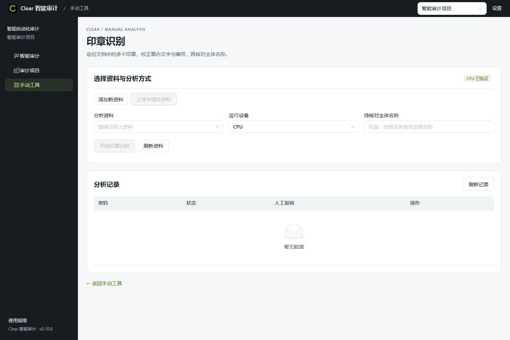
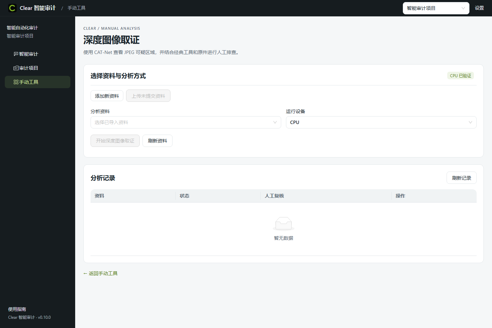
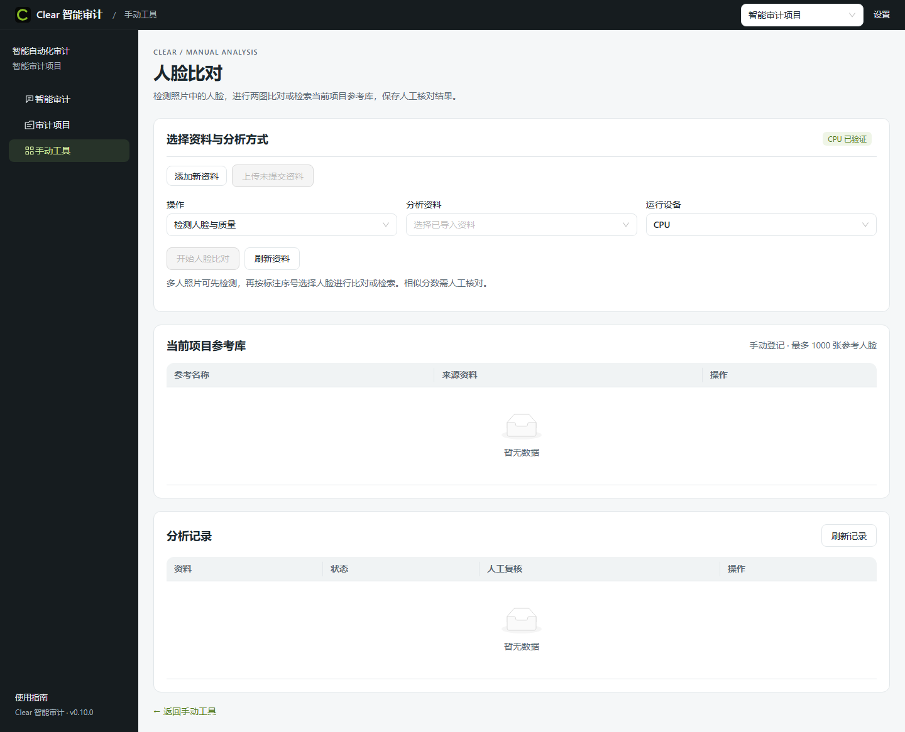
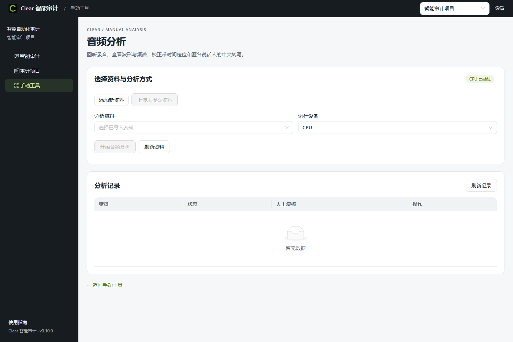

# Clear 手动工具详细使用说明

> 使用范围（2026-10-23）：正式入口为0.16.0，具体以 [current.json](../release/Clear/current.json) 为准。下文标明0.17.1等候选的功能仅适用于对应候选；本轮0.20.0易用性改进基于0.17.1，完成与发布状态见[实施记录](platform-automation/Clear易用性优先与Agent简化实施-20261023.md)。

日常使用从选择资料、运行工具、查看结果或下载开始。手动处理不依赖 Agent，也不要求先建正式审计档案；只在需要人工修订、正式复核或成果归集时进入相应步骤。各工具实际要求的复核条件仍有效，普通处理不会自动产生人工署名。

适用版本：Clear 0.10.0 多模态手动工具 CPU 版。核对日期：2026-10-14（Asia/Hong_Kong）。本文按当前门户、原生分类工作台及多模态服务源码核对按钮和处理行为；工程版本、验收状态以 [0.10.0 交付记录](platform-automation/多模态手动工具升级交付记录-20261013.md) 为准。

本文说明六个工具入口、两个扩展页面及完整的人工处理流程。平台主界面、项目、资料库、任务、调查事项和底稿操作见 [Clear 审计平台使用说明书](Clear审计平台使用说明书.md)；系统分层、持久化、模型隔离和跨工具来源设计见 [Clear 架构设计与实现思路](Clear架构设计与实现思路.md)。ClearOCR 的识别、编辑与表格校对细节另见 [ClearOCR 详细使用说明](ClearOCR详细使用说明.md)。

## 1. 从手动工具目录开始

通过正式启动入口启动程序后，进入门户的“手动工具”。本机当前固定地址为 `http://127.0.0.1:8879/apps`。页面提供 ClearOCR、分类、ClearData、ClearForensics、人脸比对、音频分析六个入口；印章位于 OCR 入口内，CAT-Net 位于取证入口内。


| 入口 | 适合解决的问题 | 常见交付物 | 页面位置 |
|---|---|---|---|
| ClearOCR | 从图片/PDF 提取文字、表格，并人工校对 | 校对文本、结构化表格及导出文件 | `/apps/ocr`、`/apps/ocr/start` |
| ClearClassification | 按项目定义的类别整理图片，训练业务分类头，复核预测 | 分类模型包、CSV/JSONL 分类结果 | `/apps/classification`、`/apps/classification/start` |
| ClearData | 两表导入、类型化清洗、精确比对与来源导出 | 当前表和差异结果文件 | `/apps/data` |
| ClearForensics | 检查图像文件、噪声、压缩及重复区域线索 | JSON 报告、热图、完整报告 ZIP | `/apps/forensics` |
| 人脸比对 | 检测静态照片人脸、两图比对、检索项目参考库 | 相似分数、候选、人工复核包 | `/apps/face` |
| 音频分析 | 中文转写、匿名说话人分组、按时间回听与校正 | 转写文本、CSV、SRT/VTT 字幕、音轨和图表 | `/apps/audio` |
| 印章识别扩展 | 定位章体、识别章内文字、校正主体/编号并转表核对 | 印章核准字段和人工复核包 | `/apps/ocr/seals` |
| CAT-Net 深度取证扩展 | 从原始 JPEG 查看深度模型区域响应并人工标注 | 热图、可疑区域、人工复核包 | `/apps/forensics/deep` |

分类模块在交付资料中称 ClearClassification，当前门户及原生页面显示品牌 **ClearClassify**，两者指同一工具。本文使用“分类工具”描述具体操作。

### 1.1 项目上下文与启动状态

建议先选择或新建平台项目，再进入工具。人脸、音频、印章、取证的任务和参考库直接属于当前项目；原生 OCR/分类工作台还拥有自己的工具项目，由平台建立关联。不要把平台项目名、工具项目名和单次任务 ID 当成同一对象。

OCR/分类卡片的主要按钮按实际状态变化：

| 页面状态或按钮 | 含义与操作 |
|---|---|
| 正在校验 / 等待校验 | 正在核对包内文件。可查看文件计数、当前文件和用时；等待完成后启动。 |
| 校验失败 / 未安装 / 存储未配置 | 按显示原因检查程序包或 F 盘数据目录；完成处理后重试。 |
| 待启动 / 启动并打开 | 程序按需启动原生工具，不代表已经加载并执行某个模型。 |
| 实例已核实 / 打开工具 | 平台已确认当前工具实例，可以打开。 |
| 核实原请求 | 上一次启动响应未确认，先核实同一次请求。 |
| 明确新启动 | 只有决定开始新的启动请求时使用。 |
| 再次核实并打开 | 重新确认有效实例，再打开窗口。 |

原生工具使用动态端口和导航票据。旧浏览器收藏页、旧端口或过期票据失效时，回到门户重新打开。弹出窗口被浏览器阻止时，允许该本地站点弹窗，再按“再次核实并打开”。“已检测到 GPU”描述硬件；本次任务真正采用的设备应查看模型/任务记录。

目录底部“最近工作”提供“继续（先核实实例）”，用于恢复以前打开的工具。它不是任务完成清单。选中平台项目时，还应检查最近记录是否属于当前项目。

### 1.2 先确认每种输入上限

门户上传成功并不表示每个处理工具都能处理该文件。下表为当前实际入口/执行器限制，不是容量承诺；更大的资料应先在 F 盘制作适合本次处理的副本，并保留原件。

| 路径 | 当前支持与限制 |
|---|---|
| 门户资料上传队列 | 非空文件；单文件不超过 128 MiB。界面文字写作 128 MB，代码按 `128 × 1024 × 1024` 字节限制。 |
| ClearData 直接上传 | CSV、XLSX、Parquet；单文件不超过 64 MiB。XLS/XLSM 不属于此入口的支持格式。 |
| 原生分类工具 | JPEG、PNG、静态 WebP、BMP；单图不超过 100 MiB、8000 万像素；拒绝动画/多帧图。 |
| 经典图像取证 | 单帧 JPEG、PNG、WebP、BMP、TIFF；不超过 32 MiB、1200 万像素。 |
| 人脸比对 | JPEG、PNG、WebP、BMP；执行器限制 4000 万像素；最多保留前 100 个检出人脸。 |
| 音频分析 | WAV、MP3、M4A、FLAC、OGG、AAC、WMA；需可解码音轨；解析上限四小时，同时受门户 128 MiB 限制。 |
| 印章识别 | JPEG、PNG、WebP、BMP、PDF；仍受门户上传及执行时限约束。 |
| CAT-Net | JPEG/JPG 原件；不要把 PNG 改后缀或转成 JPEG 后视为保留原始压缩证据。 |

当前新增人脸、音频、印章和 CAT-Net 走 CPU 工程版本，GPU 选项保持禁用。原有 OCR/分类设备能力按其自身的安装与任务记录判断。当前程序尚未完成业务精度校准和 A4000/A6000 现场资格验收。

### 1.3 通用资料上传与断点恢复

多模态页和经典取证页复用门户上传队列：

1. 点击“添加新资料”选择文件；出现未完成记录时，入口名称为“添加或重选原文件”。选择文件后先计算身份，表内显示“未提交”。
2. 点击“上传未提交资料”。逐文件上传完成后，状态变为“成功”。发生问题时，成功项保留，后续文件暂停提交。
3. 出现“失败”或“待核实”时，点击“核实并恢复失败与未提交”。系统先检查原请求是否已经完成，再继续必要上传。
4. 页面重载后，浏览器不保留可继续读取的原文件对象。重新选择原文件，其名称、大小和 SHA256 必须与原请求一致。同名但内容不同的文件不能替换恢复请求。
5. 全部成功后，可点击“清除已完成上传记录”。这清理的是浏览器中的上传队列记录，已进入项目资料库的资产仍然保留。
6. 在“分析资料”或“取证图片”下拉框选择已成功导入的文件；找不到时点击“刷新资料”或“刷新图片”。

本项目所有工作文件、下载、缓存、临时文件与导出必须位于本机 F 盘。浏览器下载前也应确认下载目标；完整要求见 [项目文件存储规范](项目文件存储规范.md)。

## 2. ClearOCR 与印章识别

### 2.1 常规文字和表格识别

ClearOCR 用于图片/PDF 的文字识别、表格识别和人工校对。平台先关联 OCR 项目，再打开原生工作台；原生页包含文件/文档树、页选择、原图区、识别结果编辑区、识别操作和设置、处理队列及导出入口。

常用流程是：选择平台项目 → 打开 ClearOCR → 继续关联项目或“开始处理” → 在原生页导入资料 → 选择识别模式、范围和已安装引擎 → 执行 → 对照原图校正文句/表格 → 保存 → 重开核对 → 导出或在平台归集。当前包包含 PP-OCRv6、PaddleOCR-VL-1.6、GLM-OCR、HunyuanOCR；具体可执行模式和设备以页面状态为准。

在原生窗口点击品牌区可返回审计平台首页；从任务跳入的页面还可使用“返回平台”。平台“项目输出”中的“打开结果与导出”会打开关联工具作业，供查阅和下载已有结果。原生下载与平台归集是不同步骤，下载文件后仍应核实其是否已进入预期项目成果。

需要从项目资料集完成交接时，专业流程页提供“打开原生项目”“提交识别”“核实原处理请求”“查看任务中心”，并按流程显示“归集已处理的文档成果”或“归集识别成果”。已在原生页完成处理的文档可走相应归集动作。保存文本、表格候选替换、疑点审校和编辑冲突等细节见 [ClearOCR 详细使用说明](ClearOCR详细使用说明.md)。

### 2.2 印章页面的结构

从 OCR 快速入口点击“印章识别与主体核对 →”，或进入 `/apps/ocr/seals`。该页直接使用平台当前项目，与原生 OCR 编辑页是两个处理入口。



页面自上而下分为“选择资料与分析方式”“分析结果与人工复核”“分析记录”。结果区提供原页预览及定位框、逐章字段、人工复核、下载、归集和转入 ClearData 的入口。模型结果与人工改动分开保存。

### 2.3 完成一次印章核对

1. 选择项目，上传图片或 PDF，确认队列成功，再在“分析资料”选择本次原件。
2. 在“待核对主体名称”中填写合同主体或供应商名称，可留空，最长 256 个字符。当前自动核对是识别文字中的名称检查，应结合原章确认。
3. “运行设备”使用 CPU，点击“开始印章识别”。查看排队、准备资料、执行或失败原因；首次模型加载可能较慢。
4. 分析完成后，在“印章原页”选择原件页码。图上 `#1`、`#2` 等定位框对应结果表中的印章；点击“打开完整原件对照”核查整份文件。
5. 逐章核对并修改“章内文字”“主体名称”“编号”。注意页码、多枚章、圆弧字序、近似字和编号前导零。章下遮挡的文字可能无法辨认，不应根据业务预期补写成已识别事实。
6. 阅读“自动核对”：可能为“包含目标名称”“有差异，待人工核对”“未指定核对主体”。该列来自初次模型结果，人工改字段后仍需在复核说明中记录真实核查结论。
7. 填写“复核人”，选择“复核结论”，写入依据和改动说明，点击“保存复核与校正”。保存成功后记录中的复核版本更新；只在表格中输入而未保存的文字属于浏览器草稿。
8. 通过“分析记录 → 查看结果”重开，确认字段和说明已保存。再点击“下载已保存版本（含 JSON / CSV / 字幕）”或“归集到成果中心”。印章包包含适用的 JSON、字段 CSV、原页/相关输出及清单；字幕适用于音频，印章包不生成字幕。

### 2.4 将核准字段送入 ClearData

完成并保存人工复核后，点击“将已保存印章字段转入 ClearData”。系统按该次分析和复核版本生成核准字段 CSV，新建同项目的数据作业，并将字段导入**左表**。转换保留原件、页码、印章位置和复核来源；相同分析与复核版本的重复操作会核实原业务操作。

进入 ClearData 后，先确认左表导入完成，再上传右侧供应商主数据或合同台账。核对列映射，选择主体/编号等适当匹配键，然后执行比对。不要把印章序号误作跨文件业务匹配键。没有检出章或没有字段行时，不能转入一张假定存在的核准字段表。

印章识别和名称一致性均不等于真伪鉴定；当前还没有参考章精细对齐、印油/材质鉴定或章体真实性自动裁决。

## 3. ClearClassification / ClearClassify 分类工具

### 3.1 界面与项目创建

分类工具是一张图片一个类别的项目工作台，适合发票、合同、收款码截图等互斥类别整理。它不直接在单张图片上划分多个目标类别，也不是人脸身份工具。

| 原生左栏页面 | 主要用途 |
|---|---|
| 项目概览 | 查看图像总数、已标注数、类别数、可用模型、活动任务、类别分布；进入工作流程。 |
| 图像与标注 | 上传/导入、按类别和名称检索、批量人工标注、设置来源分组。 |
| 训练与实验 | 冻结数据版本，配置编码器和分类头，提交训练与 ONNX 导出。 |
| 模型库 | 查看模型指标和混淆矩阵，设为默认，下载模型包。 |
| 分类与复核 | 创建分类任务，跟踪任务和日志，逐图/批量处置，CSV/JSONL 导出。 |
| 运行环境 | 查看硬件、显存、依赖版本、数据目录和可用空间。 |

从平台项目快速入口首次进入时，在“分类类别”中每行填写一个显示名称，需要 2–1000 类、名称不重复、每类不超过 60 字符，再点击“开始处理”。以后可继续关联作业，点击“打开并开始处理”；有多个关联作业时先在“继续工具作业”选择。

在原生工作台独立创建项目时，点击“新建项目”或“创建第一个项目”，填写项目名称、项目说明和“类别定义”。格式为每行 `英文ID,显示名称`，例如：

```text
invoice,发票
contract,合同
payment_qr,收款码截图
other,其他
```

ID 使用小写字母、数字、下划线，创建后保持固定。可点击“填入文档四分类”使用示例。原生项目在左上角切换；从平台票据进入时会定位平台关联项目，票据失效应回平台重新打开。

### 3.2 导入与人工标注

1. 进入“图像与标注”，选择“上传图片”或“导入文件夹”。
2. “上传图片”支持多选。若当前筛选为一个具体类别，上传时会带入该类别；在“全部类别”或“未标注”下上传时不据此赋予具体类别。导入后检查实际标签。
3. “导入文件夹”填写**服务器所在本机**可读取的完整 F 盘路径和可选来源名称。勾选“根据第一级子文件夹名称匹配类别”后，按类别 ID 或显示名称匹配；未匹配图片进入未标注池。原图保持只读。
4. 上传有部分失败时，提示已导入数量和失败原因。进入“分类与复核”查看文件夹导入任务，不以关闭导入弹窗判断成功。
5. 使用类别筛选和“搜索图片名称”找到样本，勾选缩略图。在批量标注条中选择类别或“移至未标注”，填写可选“来源分组”，点击“保存标注”。
6. 相同文档不同截图、连拍、近重复图片应设置相同来源分组，避免同一来源跨训练/验证/测试集合。翻页或切换类别会清空当前图片选择。

图像当前标签是后续数据准备的人工标签；分类任务保留的原始预测和该次处置仍是独立记录。改变样本标签不会改变已经冻结的数据版本。

### 3.3 冻结数据版本与训练

在“训练与实验”点击“发布数据版本”，填写版本名称和划分种子，点击“冻结并发布”。系统使用已标注图片形成不可变快照，按来源分组划分训练、验证和测试集。**每一类至少需要 3 个独立来源组**，只有 3 张近重复图并不满足要求。

首次划分以约 60%/20%/20% 为目标，但按整组分配，实际数量不一定精确等于比例。后续版本保留既有验证/测试划分，新组进入训练；修改或移除锁定的验证/测试样本、或用新分组连接旧的不同划分，会被拒绝。确需重新定义评估基准时另建项目，并记录基准变化。

创建训练实验时可设置：

| 参数 | 页面选项与使用要点 |
|---|---|
| 数据版本 | 选择已冻结的不可变快照。 |
| 预训练编码器 | ResNet18、DINOv2 ViT-S/14、MobileNetV4 Conv-S、RepViT M0.9。编码器冻结，只训练分类头。 |
| 分类头方法 | AdamW 线性分类头；或“逻辑回归 · 验证集正则化搜索”。后者用验证集选 C，训练轮数输入会禁用。 |
| 输入分辨率 | 224×224 或 336×336。 |
| 计算设备 | NVIDIA GPU 或 CPU；实际后端须看任务及模型校验记录。 |
| 分类头训练轮数 | 1–500，默认 100，仅适用于相应训练方法。 |
| 特征提取批大小 | 8、16、32、64，默认 16。 |
| 随机种子 | 默认 42，用于可复现配置。 |
| 验证集精确率目标 | 0.5–1，默认 0.95；用于选自动接受阈值，不是业务准确率保证。 |

点击“开始训练并导出 ONNX”，转至任务页查看进度和日志。包内已准备四种预训练编码器；旧页面提示“首次训练会下载预训练权重”是通用提示，当前离线部署应先核实包内资源完整性，缺资源应补齐受控离线介质，不能依赖自动联网下载。

### 3.4 模型库与批量分类

在“模型库”查看验证准确率、验证宏平均 F1 和 ONNX 校验。“评估详情”展示测试集样本数、精确率/召回率/F1、接受阈值、覆盖率、接受结果精确率、实际执行后端和混淆矩阵。矩阵**行为真实类别，列为预测类别**；超过 20 类时界面优先显示最多 30 组主要误分，完整矩阵随模型包下载。

“设为默认”只影响新任务；旧任务仍绑定旧模型。点击“下载”保存模型包到 F 盘，并保留其数据/配置/评估记录。

在“分类与复核”点击“新建分类任务”：选择模型版本、图片范围（未标注图片/项目内全部图片）、批大小和设备，点击“开始分类”。“按验证集阈值自动接受结果（试验）”默认关闭，默认所有结果进入待复核。开启后仍需独立抽查，模型分数不代表正确概率或审计风险。

任务表包括导入、训练和推理任务。“详情”显示“结果与复核”或“运行日志”；已知总量才显示百分比，总量尚未返回时显示“处理总量待返回”。推理任务可按状态使用“暂停”“恢复”“取消”“重试”；取消保留已提交结果，重试用于失败、部分错误或取消后的未完成处理。训练/导入不应假定拥有与推理相同的暂停能力。

### 3.5 逐项复核、批量处置与导出

1. 打开推理任务“详情 → 结果与复核”。默认筛选“待复核”，可切换全部、已确认、暂缓、重开、失败、待处理、自动接受等状态。
2. 查看结果卡中的“原始建议”“模型分数”“本次确认”“资产当前标签”。不同字段表达不同版本的事实，不应只看当前资产标签代替本次任务复核。
3. 点击“查看并处置”，对照原图；需要放大时点击“打开原图”。选择“人工确认类别”，填写可选的人工处置说明。
4. 点击“保存并下一项”确认类别；证据不足时用“暂缓并下一项”；需重新处理的项目用“重开并下一项”。暂缓和重开仍计入待处理，原始预测持续保留。
5. 批量复核时，勾选当前页成功结果或“选择当前页可复核结果”，选择“批量确认类别”，点击“确认所选 N 项”。也可“暂缓所选”“重开所选”。这里的选择仅涵盖当前页，不代表全项目全选。
6. 保存响应异常时，重复同一操作会核对原请求。版本冲突后点击“刷新结果并重新核对”，根据新版本重新处置，避免用过期页面覆盖他人的新处置。
7. 点击 CSV 或 JSONL 导出任务结果，保存到 F 盘；保留原始预测、人工标签、处置说明及任务身份供复核。通过平台专业交接流程运行的任务，还可在平台任务终态后“归集成果”。

独立原生工具的结果在平台“项目输出 → ClearClassify 结果与导出”中可通过“打开结果与导出”继续查看。没有归集为固定成果时，不应把浏览器中可见的原生结果当成已发布的项目证据包。

0.20.0 易用性实现还提供 Agent 分类组合入口：说明使用本项目已有模型预测所选图片并提供文件后，服务完成资料准备、预测、结果读取和导出。它保留原始建议与未复核状态，不自动训练新模型或改动人工标签；模型或输入选择存在实质歧义时再补充。正式登记切换前，该入口仅适用于对应候选。

## 4. ClearData 数据清洗与比对

### 4.1 页面结构与作业恢复

ClearData 以一份“数据作业”保存左右输入、清洗版本、配方、比对历史和导出记录。页面顶部选择“数据作业”，历史按每页 20 项分页；平台项目内点击“开始新的比对”，独立模式填写新作业名称后点击“新建作业”。刷新页面可继续读取原作业。

工作区按三个步骤组织：`01 输入与清洗 → 02 比对设置 → 03 结果与导出`。宽屏左右表并列，窄屏按顺序阅读；表格在自己的容器内滚动。顶部显示作业版本和最近操作状态。进入了属于其他项目的作业时，页面会提示重新选择当前项目作业。

从项目资料集进入时，可在“从资料库导入”分别选择左右资料，再点击“新建作业并导入”。该路径要求两份不同的 CSV/XLSX/Parquet 资料；导入等待超时后先检查当前已创建作业状态，避免连续创建重复作业。

### 4.2 导入两份表格

1. 在左右表分别设置导入参数，再点击“上传文件”。已导入后按钮变为“更换文件”。
2. CSV 可选择 `utf-8-sig`、`utf-8`、`gb18030`、`utf-16`，以及逗号、制表符、分号、竖线分隔符。中文乱码或整行落进一列时，检查编码和分隔符。
3. “表头行”默认 1，0 表示无表头。文件上方有标题、空行或说明文字时，将表头行设为实际字段名所在行。
4. XLSX 首次导入后，展开“导入设置”，选择目标工作表，点击“按设置重新导入”。重新选择工作表是对已上传原件的再次解析，不会改写原文件。
5. 检查文件名、格式、行数、列名、“源文件提示”以及预览中的“原行”。预览每页 20 行，页面仅显示当前页，不表示全部记录都在首屏。

鼠标悬停单元格可查看类型、原值和警告。`NULL`、空字符串、公式结果未知分别表达不同状态。XLSX 公式没有缓存结果时会显示“公式结果未知”；ClearData 不作为 Excel 公式重算引擎，不能当作 0 或有效空值比对。需在受控表格工具中核实公式结果后重新提供输入，并记录版本。

### 4.3 清洗算子与版本

选择“清洗操作”、相应字段和参数，再点击“应用步骤”。操作生成新版本，原件和旧版本保留。

| 清洗操作 | 参数/效果 | 应注意的边界 |
|---|---|---|
| 去除首尾空白 | 选择一列，清除文本首尾空白 | 与“比较时去首尾空白”不同：此项生成清洗版本。 |
| 列改名 | 输入新列名 | 只改字段标题，列内部身份仍供来源和配方使用。 |
| 值映射 | 输入原值和新值 | 当前界面每步定义一组映射；多组可重复执行。 |
| 类型转换 | 金额/十进制、整数、日期 `YYYY-MM-DD`、真假值 | 查看转换异常；标识码和前导零通常应保持文本。 |
| 筛选 | 等于、不等于、为空值、非空值 | 留意空字符串与 NULL 的区别。 |
| 识别重复 | 选择一个或多个字段，可勾选包含空值 | 记录重复分组，不自动删行、合并或选唯一代表。 |
| 类型化区间筛选 | 十进制数/日期/文字；大于、大于等于、小于、小于等于、闭区间 | 闭区间包含两端；明确上下限及比较类型。 |
| 分组计数与金额合计 | 选择分组字段和可选金额列 | 金额先转数值类型；未知/错误金额生成异常，不伪造完整合计；保留全部来源行。 |

每次执行后检查输入/输出行数、“转换异常 N 条 · 重复分组 N 组”和错误样本。点击“撤销一步”回到上一步；通过“历史版本”选择任一保存版本。后续比对固定当时使用的左右修订，即使之后清洗继续变化，既有比对结果也不会自动改写。

“导出当前表”用于导出单侧当前清洗版本，不要求先做两表比对。

### 4.4 保存和重放清洗配方

至少应用一个清洗步骤后，展开“清洗配方”，填写名称，点击“保存配方”。复用时选择已保存配方，点击“应用到当前表”，在“确认配方列映射”逐列对应新文件字段，再点击“应用配方”。

界面可按同名表头给出映射，操作者仍需逐项确认。配方不代表所有新批次都结构一致；列名相同但业务含义、单位、日期格式或空值规则不同，也要重新核实。旧版本保留，可撤销或选择历史版本查看。

### 4.5 匹配键、比对值与金额策略

在“匹配键与比对列”区域，为每个左列选择右侧对应列及用途：

| 用途 | 含义 |
|---|---|
| 匹配键 | 确定左右属于同一业务记录的字段，可设置多列联合键。 |
| 比对值 | 在键匹配后比较内容的字段。 |
| 忽略 | 本次不参与匹配或字段比较。 |
| 金额复选框 | 对“比对值”启用十进制金额比较与指定容差。 |

首次界面会按同名字段、再按列位置提出映射，并把第一列设为匹配键。**这是待确认初值**，执行前必须确认第一列确实是业务主键，所有非忽略列都对应正确字段。

展开“高级比对策略”：

- “区分列类型”是默认策略；“按文本比较”按文本表示比较。两者对数字、文本编号等可能产生不同结果。
- “空值不匹配”是默认策略；“空值视为相同”需要符合本次业务口径。公式结果未知不会因此变成可支持相等的值。
- “金额容差”默认 `0`，按十进制字符串提交。例如 `0.01` 表示金额绝对差不超过 0.01 时按相等处理，不是百分比。
- 0.17.1 调试候选的金额列比较支持合法三位千分组（如 `1,234.50`）及会计括号负数（如 `(20.00)`）。仅勾选为金额的比对列使用该规则，原件文字、编号和导出原值保持；畸形分组不猜测。历史保存的比较继续按当时规则导出，新规则生成独立比较版本。
- “比较时去首尾空白”“忽略大小写”只改变本次比较策略，并不替代清洗版本。

至少设置一组匹配键，并为全部非忽略列选择右列后，点击“开始比对”。当前是确定性精确键匹配；不提供任意模糊实体匹配、猜测缺失字段或自动解决重复键。

### 4.6 阅读结果、来源与导出

“差异结果”显示五类计数：相同、差异、仅左、仅右、重复键。前两项是配对计数，重复键是存在歧义的键组数；不要把五个数字直接相加当作输入总行数。

| 结果分类 | 如何处理 |
|---|---|
| 相同 | 匹配成功且比对字段符合当前策略。抽查主键、策略和金额容差。 |
| 差异 | 匹配成功，但至少一个需比较字段不相等。逐列结合左右原行核查。 |
| 仅左 / 仅右 | 在另一侧未找到可配对记录，可能是真正缺失、键格式不同或空键问题。 |
| 重复键·左 / 重复键·右 | 同一键不能唯一配对；单独调查，工具不会自动挑一条配成一致。 |

通过“历史比对”切换保存的比对，按“结果分类”筛选，再查看“左原行”“右原行”和两侧字段。结果每页 30 行。由证据引用进入时，顶部可能展示“固定版本来源”；它读取引用时的表格版本，下方仍可继续处理当前版本，点击“关闭来源预览”结束查阅。

点击“生成下载文件”，成功后在“已生成的固定版本文件”中下载。比较结果通常提供 `results.csv`、`results.xlsx`、`results.parquet`、`summary.json`、`provenance.json`。后两项保留计数/规则和左右来源。导出当前表形成相应的表导出，不应与两表差异文件混淆。

CSV 对可能被表格软件执行的文本添加安全前缀；完整原值、类型和来源保存在配套清单中。XLSX/Parquet 导出采用文本保留标识码及 Decimal 字符串，不应因表格软件自动显示格式而判断精度已改变。

项目内作业的导出可在“查看项目输出”找到；独立作业进入某项目后，可使用“归集到成果中心”发布固定成果。界面提供“交给 Agent 继续处理”时属于可选后续动作，手动导入、清洗、比对和导出不依赖 Agent。

0.20.0 易用性实现中，也可在 Agent 一次说明两份资料、匹配键、比较列、金额口径和所需文件，由组合服务完成两表导入、必要清洗、核对及导出。无需逐项建立内部作业；列名、工作表或业务口径不明确时仍需补充。下载保持实际来源、编号前导零和金额原文。正式登记切换前，此组合入口仅适用于对应候选。

## 5. ClearForensics 经典图像取证

### 5.1 页面和六项检查

进入 ClearForensics 后选择项目，展开“选择图片与取证工具”。上传完成后用“取证图片”选择原件；可按名称搜索、刷新图片并在每页 50 项的资料选择中翻页。展开“处理设置”选择本次检查，默认六项。

| 检查 | 帮助观察的内容 | 解释时需保留的限制 |
|---|---|---|
| 文件画像 | 文件格式、元数据和总体质量信息 | 元数据可能缺失或被转发改变。 |
| 噪声残差 | 局部高通残差差异 | 文字边缘、纹理、压缩也会引起差异。 |
| 高频分布 | 分块高频能量变化 | 与噪声残差相关，不能当作相互独立的两份证据简单叠加。 |
| JPEG 重压缩差异 | 最终 JPEG 重压缩差异是否分布不均 | 不等于证明发生过多次编辑或多次 JPEG 压缩。 |
| JPEG 网格 | JPEG 网格不连续性 | 裁剪、缩放、文字也会改变统计量。 |
| 重复区域 | 空间上重复的特征点组 | 正常重复文字、标志、纹理也可能匹配。 |

非 JPEG 的 JPEG 检查会显示“不适用 · 已跳过”，不是失败，也不是“未篡改”。噪声、高频、JPEG 检查要求两边至少 64 像素，重复区域至少 96 像素；小图或缺少适用条件时应查看具体跳过原因。

### 5.2 执行、看图与人工审阅

1. 选择原件和至少一项检查，点击“开始本地取证”。任务可显示排队、取证中、报告已生成、部分工具或归集失败、执行失败、执行中断待核实。
2. 响应未确认时，使用“查询并续接原提交”恢复同一次提交；“结束此提交草稿”只结束浏览器中的未确认提交草稿，不应解释为已取消后台任务。经典取证页当前没有与多模态页相同的“取消任务”按钮。
3. 生成报告后，用“查看取证热图”切换工具，左右对照原图和热图。经典取证预览采用相同的 EXIF 校正坐标，检查方向与位置是否一致。
4. 阅读每项的执行情况、适用与限制、版本/耗时。展开“查看原始指标和来源身份”核对输入身份、报告哈希和原始指标。
5. 点击“下载完整报告（含图片）”保存报告包，也可独立下载 `report.json`。热图只表达相对统计量，不是篡改概率。
6. 展开“可选：添加人工审阅说明”，填写“本机审阅人”“当前证据支持的判断”“审阅说明（可疑位置、依据与限制）”，点击“保存人工审阅”。可选择“需要进一步调查”“无法判断”“当前工具未提供可支持的线索”。
7. 保存响应丢失时用“核对原请求”；出现版本冲突时，使用“放弃此未确认草稿并刷新”，先读最新保存结果，再重新修改。
8. 点击“归集固定报告到成果中心”，通过“查看取证成果”查阅。报告也可能已自动归集，该按钮用于核实和补做归集。

“图像取证任务”每页 20 项，通过“查看报告与审阅”重开已有记录；中断记录提供“恢复此中断任务”。恢复使用新的执行尝试，旧报告及热图保持已有身份。

关联审计调查时，选择已生成报告且已填写人工审阅的任务，系统固定报告和审阅版本。纯图像证据无需虚构表格批次。工具执行完成、报告生成与审计调查结论是不同环节，应在人工说明中交代依据和限制。

## 6. CAT-Net 深度图像取证

在 ClearForensics 点击“打开 CAT-Net 深度区域分析 →”。深度分析与经典取证保留各自记录，可对同一原件分别执行。



1. 上传并选择原始 JPEG，在“运行设备”使用 CPU，点击“开始深度图像取证”。当前不会为了推理重压缩原始 JPEG，利用其存储像素及 JPEG 压缩信息。
2. 查看“分析结果与人工复核”中的原件预览和 `CAT-Net 可疑区域热图`。大图按 1024 像素网格推理，块边界可能影响定位；热图反映模型区域响应，不是整图真实性概率。
3. 在原图上拖动绘制可疑框；也可点击“添加可疑区域”，输入左、上、右、下边界百分比。最多 200 个区域，每个区域可填写说明；调整时保持左小于右、上小于下。
4. 写明为什么该位置值得核查，例如文字边界、局部重存、拼接线或与自然纹理的区别，避免仅写“颜色亮所以造假”。
5. 点击“使用经典取证工具继续核查”，在同项目中对照噪声、压缩或重复区域工具结果。经典页面仍需确认所选原件。
6. 填写复核人、结论和依据，点击“保存复核与校正”，再下载已保存版本、归集成果并重开核对。

CAT-Net 和经典取证坐标处理不同：经典工具预览明确做 EXIF 校正，CAT-Net 当前按 JPEG 存储像素处理。需要跨报告描述位置时，应以各报告中的原件预览和坐标声明对应，不能直接抄同一组坐标。

当前 CAT-Net 训练域与手机屏拍、文档改字、正常扫描重压缩未完成本项目业务校准；对正常文字/纹理的强响应也应保留替代解释。无明显热区不支持认定文件真实。

## 7. 人脸比对

### 7.1 三种操作与参考库

人脸页使用 YuNet 检测和 SFace 特征比对，面向静态照片。项目参考库相互独立，当前每个项目最多登记 1000 张参考人脸。



“选择资料与分析方式”中的“操作”提供：

| 操作 | 输入与结果 |
|---|---|
| 检测人脸与质量 | 一张照片，返回人脸位置、序号、裁剪及质量提示。 |
| 两张照片比对 | 两张照片，各选择一个人脸序号，返回余弦相似度及参考阈值提示。 |
| 检索项目参考库 | 一张查询照片和一个人脸序号，在当前项目库中返回最多 5 个参考候选。 |

多人照片建议先执行检测，再按图上序号选择比对对象。页面人脸序号从 **1** 开始，不能凭照片左右顺序猜测检测序号。

### 7.2 检测和两图核对

1. 上传并选择照片，选择“检测人脸与质量”，点击“开始人脸比对”。虽然按钮统称比对，本次实际执行由“操作”决定。
2. 查看每张原图的人脸编号和下方裁剪图。“可用于人工比对”只是质量门槛提示；过小或模糊时会显示限制，不能加入参考库。
3. 切换“操作”为“两张照片比对”。切换操作会清空输入选择，重新选择“照片 1”“照片 2”和各自“人脸序号”。
4. 执行后查看“两图余弦相似度”。界面保留四位小数，结果提示“达到参考阈值，需人工核对”或“未达到参考阈值”。当前参考阈值为 0.363，版本明确标为未业务校准，不提供身份概率。
5. 对照双方原图和裁剪，记录角度、清晰度、遮挡、光照及可能混淆。填复核人、结论和说明后“保存复核与校正”。

“未检出可用人脸”“图片质量不足”是有效处理结果，应更换合适原图或记录证据不足；不应当作对某人身份的反证。

### 7.3 登记参考与检索

在成功结果的“参考人脸名称”填写姓名或参考标签，最长 128 字符。核对某张裁剪确为应登记对象，再点击该裁剪下的“加入项目参考库”。同一张多人照片中每个裁剪有各自登记按钮，名称需与本次选中的人脸对应。

“当前项目参考库”展示名称与来源，可“移出参考库”。这改变以后的检索范围，不会改写历史分析中的固定候选结果。

选择“检索项目参考库”，选择查询图和人脸序号，执行后查看候选名称、余弦相似度和参考阈值提示。空库、全部候选低于参考阈值时显示“未找到达到参考阈值的候选”。候选排名仅表达当前库内相似性，不是已识别身份；需要人工核对参考原件与查询来源。

保存后通过“分析记录”重开，下载或归集固定成果。人脸特征向量保留在服务端，浏览器响应和导出不提供 embedding；导出保留模型、来源、分数、裁剪/相关图像以及人工复核记录。

当前没有视频跟踪、活体检测、反换脸或跨照片声纹身份认证。静态照片相似不能独立认定真实到场、本人操作或排除照片翻拍。

## 8. 音频分析

### 8.1 输入、页面与处理内容

音频页组合 Paraformer 中文时间戳转写、FSMN-VAD、ct-punc 和 CAM++。分析时从文件首个音轨解码，并生成 16kHz 单声道分析音轨；原音文件保持保留。当前不提供逐声道独立转写编辑，复杂多人重叠和长录音仍需专项验证。



结果区包含播放器、原音采样率/声道提示、“下载原音”、全长振幅波形、频谱、分段转写表和人工复核。波形纵轴为约 −1 至 1；频谱上方为 8kHz、下方为 0Hz；横轴从起点至结束。

### 8.2 转写、定位回听与校正

1. 上传录音，确认成功后在“分析资料”选择文件，点击“开始音频分析”。总时长不得超过四小时，且文件仍须满足门户上传限制。首次加载可能较慢，不把示例耗时当作长录音性能承诺。
2. 完成后核对原件采样率、声道和分析时长。需要查阅原始多声道音频时使用“下载原音”，在 F 盘保存并通过合适播放器核对。
3. 转写表每页 20 段，“原音时间”显示开始–结束，点击时间按钮从该段开始处播放。播放器不会自动限制只播放该段，应自行控制停止。
4. 回听后修改“说话人”及“转写与人工校正”。姓名、机构、日期、金额、否定词等应逐项核查。说话人默认是**本录音内匿名分组**，人工命名需有额外依据，不代表声纹身份鉴定。
5. 时间戳为模型估计，适合定位回听；当前页面可修改文字与说话人，未提供手工改起止时间的控件。边界不精确时在说明中记录，引用时复核原音。
6. 无语音时可能显示“未识别出语音”。先排查静音、空轨、过低音量、非中文或解码问题，再决定更换输入或登记无法判断。
7. 填写复核人、结论和校正依据，点击“保存复核与校正”，重开确认，再下载或归集。

### 8.3 导出与使用

已保存版本 ZIP 按结果提供 `result.json`、`reviewed.csv`、`transcript.txt`、`transcript.srt`、`transcript.vtt`、`playback.wav`、`waveform.png`、`spectrogram.png` 和文件哈希清单。无转写段时不会生成字段行 CSV；以实际包内清单为准。

文本和 CSV 可表达已保存的说话人校正；当前 SRT/VTT 字幕按分段时间及已保存文字导出，不把人工命名的说话人自动嵌入字幕正文。引用片段时同时保留原件、时间范围、复核版本和说明，不能只传一段脱离上下文的转写句子。

## 9. 多模态任务共同的保存、重开与成果闭环

本节适用于人脸、音频、印章和 CAT-Net；经典取证使用第 5 节中的独立审阅按钮。

### 9.1 任务状态和恢复

“分析记录”每页 10 项，显示资料、任务状态、人工复核是否保存及版本，点击“查看结果”恢复当前分析。结果区提供“刷新结果”，记录区提供“刷新记录”。

排队、执行中和取消中的任务可用“取消任务”；后台确认后才变为已取消。失败、已取消、执行中断待核实的任务提供“重试此任务”。异常时先展开“查看失败原因”，分清输入格式、模型资源、超时和环境错误，再重试。

分析创建响应未确认时，按钮变为“核实原分析请求”，使用原请求核实任务。需修改输入或分析方式时，先点错误区“修改分析请求”，再重新设置；不要一边保留原请求，一边误以为新参数已经用于旧任务。

### 9.2 模型结果、浏览器草稿与已保存复核

结果表/区域标注中的改动会暂存为当前浏览器、当前项目、任务及修订的草稿。只有“保存复核与校正”成功后，才写入服务端的人工复核版本。当前三个“复核结论”为：

- 已人工确认所记录结果。
- 需要进一步调查。
- 无法判断。

复核人最长 128 字符，依据/修改说明最长 10000 字符，二者均需非空才能保存。CAT-Net 区域说明随该次复核版本一起保存。页面中的姓名是本机操作者填写的记录，不等于组织账号认证或电子签名。

保存失败时保留原请求，界面提供“刷新版本并修改复核请求”。先检查最新版本，重新确认后再提交；网络响应丢失和版本冲突应分别核实，不能以再次点击后按钮停止转动就判断已保存。

### 9.3 下载、归集和审计引用

手动页面的“下载已保存版本”读取服务端当前保存版本，不包含浏览器内尚未保存的修改；模型运行完成即可下载技术结果。手动页“归集到成果中心”属于正式审计成果路径，仍须保存当前版本的人工核准，复核结论为“已人工确认所记录结果”。

Agent 的技术结果文件是另一条已有服务路径：0.20.0 易用性实现可在分析完成后按固定结果快照生成并归集下载文件，未人工核准时清楚标为未复核草稿，不要求先填写复核人。这不会建立人工核准记录，也不会使技术结果自动成为正式调查证据；用户明确要求人工确认后定稿时仍等待。正式登记切换前，此新增自动文件流程仅适用于对应候选。

归集固定实际来源与结果版本：包含原件身份、来源位置/时间、模型/算法身份、结果哈希、适用文件及真实复核状态。手动正式归集绑定人工核准版本，Agent 技术文件绑定结果快照；相同版本重复归集复用已有成果。保存人工修订产生新版本后，新旧固定成果分别保留。

普通技术文件可直接在当前任务读取下载。需要进入正式调查时，先完成上述人工核准与正式归集，再在“审计项目”的调查事项中刷新“多模态人工复核成果”，选择相应版本并保存调查证据。选择的是**已经核准并归集的固定版本**；任务有新修订不表示旧调查引用会自动更新。

展开“模型、来源及结果身份”可查结果哈希、原件 ID/修订和模型结果。此区面向复核和排错，正常使用不需要修改其中 JSON。

## 10. 常见问题与完整交付检查

| 现象 | 推荐操作 |
|---|---|
| 上传成功，但下拉框没有文件 | 点击刷新；确认格式后缀受本工具支持、当前项目正确。门户可保存的文件不一定适合本工具。 |
| 文件同名，上传恢复提示内容不同 | 重新选择与原请求大小和 SHA256 一致的原文件；新内容按新资料另行导入。 |
| 工具页面显示资源未齐 | 可先导入资料，核对包和模型清单；按显示原因修复后再分析，不通过改 GPU/能力标志跳过。 |
| 旧 OCR/分类窗口无效 | 从门户重新核实并打开，不沿用旧动态端口或票据。 |
| Data 已导入但金额/编号不对 | 先查类型、原值、编码、表头、工作表和公式缓存；编号不随意转数字。 |
| Data 重复键很多 | 检查联合键和数据唯一性；重复识别不删行，工具不自动挑一条记录匹配。 |
| Data 结果为空/报错 | 查看操作状态及失败信息；失败不能解释成零差异。 |
| 分类训练无法发布数据版本 | 检查每类独立来源组、冲突标签及锁定测试样本，不用复制同图凑组数。 |
| 分类结果和资产当前标签不同 | 分别核对原始预测、本次处置和资产当前标签；它们有各自的版本含义。 |
| 取证部分检查跳过 | 看格式/尺寸适用条件和单项原因；跳过不代表没有篡改。 |
| 人脸分数高，但仍需确认 | 阈值未校准，核查双方来源、质量、裁剪对象和替代解释。 |
| 音频有字但说话人不对 | 回听后人工修订说话人；匿名聚类不代表已认证身份。 |
| 修改后下载仍是旧内容 | 先“保存复核与校正”，重开确认版本；再下载/归集。 |
| 新复核已经保存，调查仍显示旧内容 | 重新归集新版本，并在调查事项中明确选择新成果；旧引用保留历史版本。 |

完成一项手动工作时，至少核查：当前项目正确；任务真正终态；原件身份和来源正确；人工改动已经服务端保存；下载文件可以读取且位于 F 盘；需要进入审计流程的成果已归集并选择正确复核版本；说明保留实际限制和待查事项。此处的保存、重开和文件核验是交付流程，不代表业务精度认证。

## 11. 源码与版本依据

本文所述行为以当前自有源码快照为依据，快照登记说明见 [Clear 源码目录](../products/Clear/README.md)。发布包的门户只携带构建产物，详细前端代码在快照中查阅；冻结包、模型哈希和现场验收以发布记录为准。

| 内容 | 主要依据 |
|---|---|
| 工具卡、状态、核实原请求、最近工作 | [ApplicationCards.tsx](../products/Clear/platform/apps/portal/src/features/catalog/ApplicationCards.tsx) |
| OCR/分类项目关联与快速打开 | [QuickNativeWorkbench.tsx](../products/Clear/platform/apps/portal/src/features/start/QuickNativeWorkbench.tsx)、[ProjectNativeOutputs.tsx](../products/Clear/platform/apps/portal/src/features/start/ProjectNativeOutputs.tsx) |
| 门户上传队列与 128 MiB 限制 | [UploadQueue.tsx](../products/Clear/platform/apps/portal/src/features/batches/UploadQueue.tsx) |
| 多模态页面按钮、字段和复核草稿 | [MultimodalWorkbench.tsx](../products/Clear/platform/apps/portal/src/features/multimodal/MultimodalWorkbench.tsx)、[RegionReview.tsx](../products/Clear/platform/apps/portal/src/features/multimodal/RegionReview.tsx) |
| 人脸/音频/印章/CAT-Net 执行与限制 | [worker.py](../products/Clear/platform/modules/manual_multimodal/worker.py) |
| 多模态导出、参考库、归集与印章转表 | [service.py](../products/Clear/platform/src/workbench_platform/multimodal/service.py)、[multimodal.json](../products/Clear/platform/config/multimodal.json) |
| 审计多模态成果选择 | [ManualEvidencePicker.tsx](../products/Clear/platform/apps/portal/src/features/multimodal/ManualEvidencePicker.tsx) |
| 经典取证页面、人工审阅和中断恢复 | [ForensicWorkbench.tsx](../products/Clear/platform/apps/portal/src/features/forensics/ForensicWorkbench.tsx)、[工具适用性目录](../products/Clear/platform/modules/image_forensics/forensic_toolbox/catalog.py) |
| Data 界面、算子、匹配策略及导出 | [DataWorkbench.tsx](../products/Clear/platform/apps/portal/src/features/data/DataWorkbench.tsx)、[精确比对](../products/Clear/platform/modules/data_workbench/comparison/exact.py)、[清洗引擎](../products/Clear/platform/modules/data_workbench/recipes/engine.py)、[结果导出](../products/Clear/platform/modules/data_workbench/exporting/results.py) |
| 分类导航与项目创建 | [workbench.tsx](../products/Clear/classification/apps/web/src/workbench.tsx) |
| 分类图片导入/标注、训练/模型、任务/人工处置 | [assets.tsx](../products/Clear/classification/apps/web/src/views/assets.tsx)、[models.tsx](../products/Clear/classification/apps/web/src/views/models.tsx)、[jobs.tsx](../products/Clear/classification/apps/web/src/views/jobs.tsx) |
| 分类上限、数据划分和快照保护 | [images.py](../products/Clear/classification/src/image_platform/images.py)、[datasets.py](../products/Clear/classification/src/image_platform/datasets.py) |

本文新增说明基于源码核对和既有正式发布证据，没有为编写文档启动新的推理、训练或修改业务资料。文中截图使用 0.10.0 已有正式页面画面，体现页面结构；不作为本次新增业务精度测试证据。尚未完成的业务精度、大文件/长音频、复杂多人和目标 GPU 验收见 [交付记录中的未完成项](platform-automation/多模态手动工具升级交付记录-20261013.md)。
