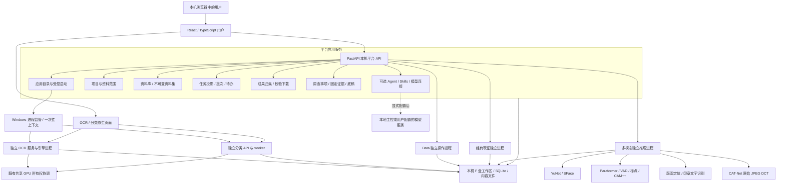
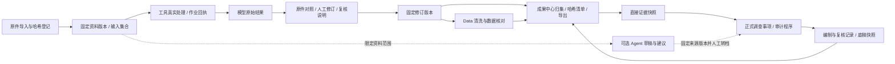
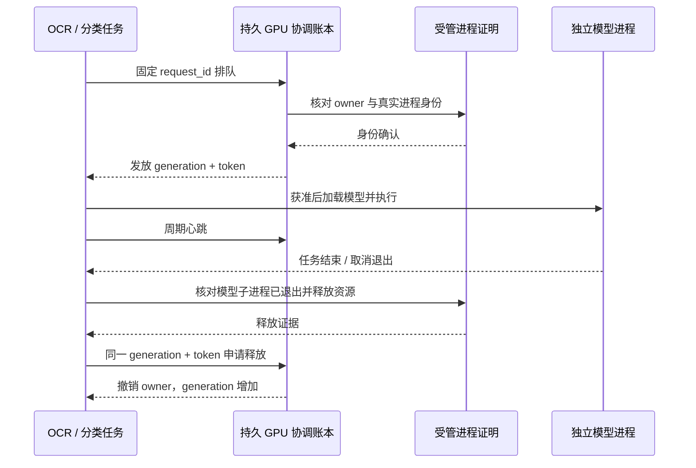

# Clear 架构设计与实现思路

更新日期：2026-10-24。当前正式入口登记 **Clear 0.20.0 易用性版 candidate-006**，以 `release/Clear/current.json` 为准；共享 Python/专业模型仍来自 0.10.0 封存程序，两者不是同一版本对象。本文面向维护者、交接人员和需要理解系统边界的使用者；逐项操作见[Clear 审计平台使用说明书](Clear审计平台使用说明书.md)。

当前主循环使用固定DSH alpha.4，恢复官方文件、搜索、PowerShell、后台作业、Skills、Web、MCP和按需子助手。新普通任务自然收尾；专业业务在现有应用服务内组合准备、等待、读取及导出，模型负责目标、真实来源和分析。仅最新运行快照进入模型请求，原始事件、回执、固定证据和下载核验继续保留。工具一次搜索加载，普通工作不要求审计建档或统一显式发布。rc.2仅在独立分支验证。设计取舍、110次同模型对照、兼容与发布证据见[通用能力实施记录](platform-automation/Agent通用能力恢复实施与验收-20261019.md)。

直接动作共用持久operation与原生幂等键。暂停恰好发生在intent后、提交前时，只接受绑定原项目/资料版本/参数/请求键的权威“未提交”证明，才沿原键继续；网络未知、缺失或不匹配回执仍保持封锁。模型/控制器恢复保留原用户任务，业务写入不盲目重放。已接受原生结果由独立观察器按固定版本发布，分析暂停也可下载；资源冲突按实际原生对象原子复查，兼容追加经同任务inbox承接。

以下早期章节保留 0.10.0 工程机制背景；涉及当前执行引擎、入口和修订行为时以上述更新及固定候选说明为准，不把页面入口、模型文件存在或源码同步视为业务验收完成。

2026-10-15 本机补充：固定启动器现读取可选布尔值 `agent_enabled`，本机已设置 true 并验证模型连接及真实 LangGraph 任务；历史“默认关闭”描述指未配置该字段的原发行策略。见[Agent 启用与实测](platform-automation/Agent启用与实测-20261015.md)。

## 当前开发取舍与范围

本轮基于已验收 0.17.1（e5ca875）完成 0.20.0 易用性版，并于2026-10-24将candidate-006切换到原工作区和8879。文档、MinerU Pro及已有修复保留，0.18.0文档主题对比和0.19.0 AIGC实验未合入正式发行。唯一计划、实用检查、正式启动与旧数据抽查见[易用性优先实施](platform-automation/Clear易用性优先与Agent简化实施-20261023.md)。

- DSH 负责理解目标与需要判断的下一步；固定的准备、等待、读取、保存由已有业务服务完成。保留一个模型决策循环，减少只为传递 ID 或重复状态而发生的模型请求。
- 普通工作直接提供结果、来源和下载；正式审计建档、人工复核与署名按用户实际目标进入。技术失败说明已完成什么及可采取的动作，内部诊断按需查看。
- 保留来源版本、回执、权限、幂等和恢复；简化默认呈现，不合并独立状态权威，也不把模型自然结束误作业务成功。
- 开发只验证受影响行为与风险，复用已有证据；不新建通用工作流、计划器、发布审批层或第二套业务执行链。

## 1. 先分清产品、开发源码和业务数据

### 1.1 三种版本视角

| 对象 | 位置 | 用途与边界 |
|---|---|---|
| 当前正式登记 | 本机 `F:\OCR\release\Clear\current.json` | 指定候选版本、候选清单哈希、共享程序根、工作区、端口和读取兼容声明；当前登记为0.20.0易用性版candidate-006 |
| 当前运行源码/门户 | 上述 current.json 的 `candidate` 所指目录 | 当前登记的platform、ocr、classification及前端；逐文件身份由candidate.json核对 |
| 共享离线依赖 | 本机 `F:\OCR\release\Clear\versions\0.10.0\program` | 当前候选只读复用的Python、专业运行环境、模型、DLL及底层资产；不能据此把实际运行源码称为0.10.0 |
| 唯一主线开发源码 | [`products/Clear`](../products/Clear) 中的 `platform`、`ocr`、`classification` | 同一分支维护的集成源码，包含屏拍专项、文档对比、AIGC 与 0.20.0 易用性行为；运行依赖和正式安装分别管理 |
| 独立 OCR 主仓 | 根目录 [`src/ocr_workbench`](../src/ocr_workbench) 和 [`frontend`](../frontend) | 独立 OCR 研发主线；不能与 Clear 内置 OCR 交叉替换数据库或前端 |
| 当前用户工作区 | 本机 `F:\OCR\output\ai-audit-product-dev-20261004\workspace` | 用户资料、原生项目、会话、修订、成果及审计记录；不属于可公开源码或程序包内容 |

当前开发统一到 `F:\OCR` 的 `main`，平台、OCR 与分类源码直接在 `products/Clear` 的三个同级目录维护。此前 `output` 下的开发仓只作保留来源；清单记录原始导入版本与当前集成文件哈希，日常刷新不再用旧源覆盖本仓改动。正式安装仍来自独立候选 `073a532`，源码整合不自动切换正式入口；新旧数据库兼容、专项接入及本轮检查见[整合记录](platform-automation/分支整合记录-20261024.md)。已有测试记录仅证明实际受测版本与范围。

独立 OCR 主仓、正式006及已登记 OCR 开发源码的 `SCHEMA_VERSION` 为 **18**；本次正式切换时既有原生 OCR 数据库的 `user_version` 仍为 **17**，兼容检查已通过，不代表本轮已经迁移该库。旧 Clear 0.10.0 原生 OCR 发行源码为 **17**。正式入口使用的程序版本与允许读取的数据范围应以当时的 `current.json` 登记和实际启动绑定为准。历史文档中的 schema 15 或更早版本属于对应阶段记录，不代表本次候选所用的源码。数据库迁移版本、产品版本、UI 契约版本和原生应用版本是不同编号，不能互相推导。

依据：原生 OCR [`store.py`](../products/Clear/ocr/src/ocr_workbench/store.py)、独立 OCR [`store.py`](../src/ocr_workbench/store.py)、[平台开发索引](platform-automation/README.md)、[0.10.0 交付记录](platform-automation/多模态手动工具升级交付记录-20261013.md)。

### 1.2 验收范围与历史证据

0.10.0 历史正式登记中的 `acceptance` 为：`engineering_cpu=true`，`business_accuracy=false`，`a4000_a6000=false`，`new_gpu_routes=false`。其含义是多模态 CPU 工程流程已发布；独立业务样本精度、A4000/A6000 现场资格和新增多模态 GPU 调度尚未完成。

原有 OCR 四引擎和分类四编码器已有开发机真实推理记录，但不能把 4070 Ti SUPER 16GB 上的结果自动推广到所有显卡、业务分类模型或长录音。包可离线运行与完成物理断网现场认证也分别登记。详细边界见[多模态手动审计验收与内网部署说明](platform-automation/多模态手动审计验收与内网部署说明.md)。

## 2. 产品结构：一个门户，多个保留原生能力的工具

Clear 的入口统一在本机门户。门户负责项目范围、资料传递、任务观察、结果归集和审计留痕；工具负责实际识别、预测、清洗、分析与人工复核。

三个主导航为“智能审计”“审计项目”“手动工具”，顶部项目选择器用 URL 中的 `workspace` 参数保持当前范围。项目内继续组织资料、发现、成果、程序、待办、批次和任务。品牌区返回首页，手动处理带回机制保存来源任务上下文。

| 页面族 | 主要路由 | 架构职责 |
|---|---|---|
| 门户首页 / 智能审计 | `/` / `/agent` | 首页导航与任务工作台；明确本地操作不依赖模型，开放分析由已启用Agent和可用连接编排 |
| 审计项目 | `/projects` | 项目背景、当前范围及项目内工作入口 |
| 手动工具 | `/apps` | 六个目录入口及应用可用性声明 |
| ClearOCR | `/apps/ocr/start`、`/apps/ocr/workflow` | 原生 OCR 的快捷启动和平台流程包装；深度校对保留原生页面 |
| ClearClassification | `/apps/classification/start`、`/apps/classification/workflow` | 原生分类项目、导入、预测、标注及模型工作流 |
| ClearData | `/apps/data` | 门户内双表清洗、核对和导出 |
| ClearForensics | `/apps/forensics` | 门户内经典图像取证及人工复核 |
| 人脸、音频 | `/apps/face`、`/apps/audio` | 共用多模态工作台，以不同任务类型装配页面与模型 |
| 印章、深度取证 | `/apps/ocr/seals`、`/apps/forensics/deep` | 分别扩展 OCR 和 Forensics，而非额外复制一套门户 |
| 配套工作区 | `/assets`、`/jobs`、`/artifacts`、`/batches`、`/audit`、`/todos`、`/findings` | 统一资料、任务投影、成果、批次、正式档案、待办和发现草稿 |
| 设置与帮助 | `/settings`、`/help` | 主控连接、Skills、工具说明与操作帮助 |

六个目录入口指 OCR、分类、Data、Forensics、人脸、音频；印章和 CAT-Net 是已有入口下的扩展页面。部分旧路由保留重定向，以便旧书签继续进入对应工具，并尽量保留查询参数与锚点。

依据：门户 [`router.tsx`](../products/Clear/platform/apps/portal/src/router.tsx)、[`App.tsx`](../products/Clear/platform/apps/portal/src/App.tsx)、[`ProjectNavigation.tsx`](../products/Clear/platform/apps/portal/src/features/agent/ProjectNavigation.tsx)。

## 3. 总体架构与职责分层



### 3.1 展示层

门户使用 React、TypeScript、React Router、TanStack Query 和 Ant Design。路由控制当前页面；Query 管理服务读缓存与刷新；统一主题与 CSS token 让门户及工具包装页保持一致。大量分析数据由服务分页读取，而非把整个数据库搬到浏览器。

浏览器显示模型输出、人工修订、当前状态和来源链接，不承载模型权重、数据库路径选择或推理设备初始化。服务端回执是写入成功与任务完成的依据；“按钮已点击”“上传连接断开”或“页面已打开”本身不能证明业务操作完成。

### 3.2 平台服务层

[`app.py`](../products/Clear/platform/src/workbench_platform/app.py) 在一个 ASGI lifespan 中组装项目、Data、资料库、Supervisor、任务、原生资料传递、成果、批次、审计、经典取证、多模态及可选 Agent。关闭时依次关闭后台服务、推理执行器和受控原生进程，释放运行资源。

核心 HTTP 接口位于 `/api/platform/v1`。各领域保留自己的 routes/service/store，跨工具业务放到 [`application_services`](../products/Clear/platform/src/workbench_platform/application_services)，避免前端、Agent 和批次各自实现不同的资料传递与任务恢复逻辑。

这是本机组合式应用：平台内部模块共享一个服务进程，模型和原生工具按边界分进程运行。当前不是需要另行运维消息队列、容器集群或云服务的分布式平台。

### 3.3 原生与计算层

原生 OCR 和分类保留各自前端、数据库、Python 环境和 worker。Data、经典取证、多模态由平台服务创建独立计算进程。这样可以把 Paddle、PyTorch、ONNX Runtime、OpenCV、FunASR 等依赖冲突及模型加载成本隔离在受控运行时中，也便于按任务保留日志和失败产物。

进程隔离提供故障和依赖边界，不应被描述成完整操作系统安全沙箱。现有 F 盘检查、输入哈希、固定路由、受控程序和离线环境是具体防护措施，不能据此宣称任意第三方代码均可安全执行。

## 4. 启动、原生工具注册与身份监管

### 4.1 从固定入口到本机服务

正式固定入口为 `F:\OCR\release\Clear\启动智能审计.cmd`。它通过 `product-entry.ps1` 读取 `current.json`，校对候选清单身份、程序路径和数据兼容性，再以登记的工作区及端口启动后台服务。常用端口为 8879，监听地址为 `127.0.0.1`。

当前候选launch先检查文件及共享程序身份、数据读取兼容，并显式设置F盘临时/缓存/应用数据环境，再装配门户与原生工具。本机current.json保持agent_enabled=true，固定入口传--enable-agent，实际健康检查同时确认enabled/direct_enabled。判断运行状态须核对登记、进程参数与健康，不能仅看环境变量兜底值。

独立离线包的程序与用户工作区分开。程序包附带空 `workspace`，本机固定入口可以继续使用当前已登记的用户工作区。切换程序目录不等于迁移用户数据。

### 4.2 声明、安装与健康分别判断

应用 manifest 描述支持格式、资源类型和可执行动作；安装登记固定运行程序、工作目录和清单哈希；健康接口再分别报告 `service`、`ui`、`cpu`、`gpu`、`models`。

因此“已安装”“待启动”“服务 ready”“CPU 可用”“GPU 已实测”是不同状态。平台 `/health` 的服务 ready 只说明平台 API 已响应，其他项仍可能是 unknown。没有受控实例时，已安装且可启动的应用可以显示“待启动”，不应直接判为故障。

发行源码里的 `platform/config/apps/*.install.json` 可以是未注册模板。正式启动脚本 [`agent_native_preview.py`](../products/Clear/platform/scripts/agent_native_preview.py) 根据发行内 OCR/分类前端、运行时及共享资源，在用户工作区 `agent-native/config` 和 `agent-native/bundles` 生成私有登记。模板中的 `installed:false` 不代表正式启动后的工具一定未安装。

这层装配还决定真正使用哪份原生源码。对 OCR，`native_source=platform.parent/ocr`，启动器把这份 `ocr/src` 放入 `sys.path`，并显式传 `--web-root ocr/frontend/dist`；`--bundle program/bundles/ocr` 提供模型和运行时等资产。本次候选及已登记开发源 `ocr/src/ocr_workbench/store.py` 的 `SCHEMA_VERSION` 为 18；候选使用候选根 `ocr` 中对应的后端和前端。底层共享 bundle 保留的 schema 15 `src/web` 不能被误认成当前候选页面或后端。正式运行版本仍以固定入口实际登记为准。分类同样从候选根 `classification` 装载源码与 `apps/web/dist`。离线包复验应沿实际启动绑定核对，而非只打开共享资产目录中的一份 HTML。

### 4.3 不只核对端口

Supervisor 使用受信登记中的 argv 与 cwd 启动原生工具；浏览器请求不能任意指定可执行文件或本机目标地址。Windows broker 在执行原生命令前加入本任务的 Job Object，受控进程树随所有权句柄关闭退出。

进程身份包含 PID、创建时间、实例 ID、启动 nonce、实际 loopback 监听端口及注册版本。重用 PID、同端口上的其它程序或一份旧启动回执，都不足以被认作当前受管实例。关闭操作也只针对被确认属于自己管理的进程树。

### 4.4 一次性工具上下文

[`ContextBridge`](../products/Clear/platform/src/workbench_platform/bridge/context.py) 把平台项目链接映射到原生项目，发放短时有效、一次消费的 nonce。默认有效期 60 秒，消费时再次核对项目链接版本和真实服务身份。原生 token 由服务端适配器取得，不放进 URL 或公开上下文。

数据模型中的 owner/editor/viewer 用于固定适配器动作的角色边界，并不表示已建设完整的多用户账号、组织授权和局域网协作系统。当前部署仍按本机使用理解。

依据：[`catalog/registry.py`](../products/Clear/platform/src/workbench_platform/catalog/registry.py)、[`supervisor/processes.py`](../products/Clear/platform/src/workbench_platform/supervisor/processes.py)、[`bridge/context.py`](../products/Clear/platform/src/workbench_platform/bridge/context.py)、[`workspaces/routes.py`](../products/Clear/platform/src/workbench_platform/workspaces/routes.py)。

## 5. 统一契约：把跨工具身份与状态说清楚

[`packages/contracts`](../products/Clear/platform/packages/contracts) 是共享接口定义。Python Pydantic 模型生成 JSON Schema、OpenAPI 和前端 TypeScript 类型；语义约束还通过 validators 和测试校验。通用 wire 模型严格验证、拒绝额外字段，不依赖前端自律来保护服务边界。

### 5.1 核心对象

| 契约 | 表达的事实 | 避免的混淆 |
|---|---|---|
| `Workspace` | 平台项目及修订 | 平台项目不直接充当原生项目 ID |
| `ModuleProjectLink` | 平台项目与 OCR/分类项目的绑定 | 不用项目同名来猜测归属 |
| `Asset` | 某项目中的来源身份、版本、内容哈希与大小 | 同名文件不代表相同内容；同一内容也可以有不同来源 |
| `AssetSet` | 有序、不可变输入清单及成员来源 | 新增/重排输入后不能继续冒用旧 manifest |
| `SourceLocator` | 固定资料版本上的页、表、行、单元格、区域或音频片段 | 不能把模糊页来源显示成精确格位 |
| `JobRef` | 平台作业与原生实例/任务/操作的关联及真实进度 | 平台展示状态不替代原生任务事实 |
| `Artifact` | 固定成果版本、哈希、模型/规则身份及来源 | 导出文件被替换后不能继续冒用原成果 ID |
| `HandoffRequest/Status` | 一批资料交给原生工具的固定请求与逐项回执 | 网络超时不直接等于失败，也不能盲目重导入 |
| `ResourceGrant` | 资源所有者、代次、心跳和受管进程身份 | 等待超时不能直接认定 GPU 已释放 |

基础 `schema_version` 当前多为 `1.0`，审计还有 `audit_version`，直接证据使用 `snapshot_version`，UI 契约登记为 `1.2.0`。后续修改应按各自兼容策略推进，不能只把所有版本字符串一起加一。

### 5.2 幂等、并发与未知状态

有写入副作用的请求保存 `request_id` 或 `request_key`，并绑定规范化 payload 的哈希。同一身份和相同 payload 重试时回放原回执；同一身份换输入会得到冲突。`expected_revision`、`expected_event_seq` 等字段防止旧窗口覆盖较新的操作。

请求发出后连接中断时，客户端应查询同一请求的实际状态，再恢复或重试。`submitting`、`reconciling`、`unknown`、`needs_verification` 等状态有意保留“不确定”，不能为了界面整齐自动写成失败或成功。

统一作业状态包括 queued、waiting_resource、running、pausing、paused、cancelling、cancelled、succeeded、partial、failed、unknown。控制按钮根据当前 `capabilities` 展示；不支持暂停的工具不能仅因通用 UI 有暂停按钮就具备该能力。数量汇总也需要闭合：终态不能仍有 pending，partial 需要同时有成功与未成功成员。

### 5.3 分页和金额

列表使用带快照修订或 token 的分页，避免用户翻页时把不同版本的数据拼成一份结果。Data 的表/核对结果另外保留自身不可变版本与分页窗口。

金额使用 Decimal/十进制字符串及明确的类型、空值和容差策略。身份证号、编号、日期与金额不应通过一次隐式浮点转换混为同类文本或数字。

依据：[`models.py`](../products/Clear/platform/packages/contracts/models.py)、[`semantics.py`](../products/Clear/platform/packages/contracts/semantics.py)、[`audit.py`](../products/Clear/platform/packages/contracts/audit.py)、[`multimodal.py`](../products/Clear/platform/packages/contracts/multimodal.py)、[统一契约说明](platform-automation/contracts.md)。

## 6. 共享资料与来源定位

### 6.1 资料注册与内容保存

资料库将来源身份与物理内容分开。注册项记录项目、原文件名、来源、存储模式、SHA256、字节数和版本；内容按哈希保存在 `asset-blobs`。同内容可复用存储，但不能因此丢失不同资料的来源身份。

`managed` 表示平台管理内容快照；`referenced` 表示依赖已登记的原文件位置。引用资料发生修改、丢失或版本变化时必须显式报告。实际分析前 `stage_verified` 复制/取得固定输入并再次核对版本、哈希及复制期间变化，服务只接受已经注册到当前项目的资料。

门户上传上限目前为单文件 128 MiB，且工具可以有更小限制，例如经典取证单帧图片不超过 32 MiB。上传上限不是模型稳定处理能力承诺。

### 6.2 不可变资料集

`AssetSetStore` 对输入成员、顺序、版本、哈希和父来源构造 manifest。修订资料集产生新版本，旧清单继续保留。OCR、分类、批次和数据传递绑定具体的资料集版本，不把“当前列表”当作早先任务的输入。

### 6.3 来源精度如实保存

`SourceLocator` 的资料身份由 `asset_id + asset_revision + blob_hash` 固定；再按类型附加页码、工作表、表号、行列、图像区域或媒体时间。

- 页、表、行、单元格的编号为 1 基。图像区域需要原页、图像版本、坐标空间、变换修订和 box 一起存在，不能只保存一个没有参照系的矩形。
- `precision` 区分 exact、approximate、page_only、unknown。没有可靠坐标时降级到页级或未知，不能猜测原件格位。
- 0.10.0 新增 `media_segment`，保存原始媒体起止毫秒和可选声道。旧非媒体来源序列化不添加这些字段，维持既有哈希兼容。
- 当前音频模型将原声道混合为 16 kHz 单声道分析，保存原采样率、声道和时间变换。服务生成片段来源时使用 approximate，`channel=null`；接口能表达声道不代表已完成逐声道分离识别。

人脸框、印章区域、CAT-Net 人工标注与音频片段都需要回到同一份固定原件上复核。浏览器内的缩放、裁图或热图显示不应改变原始证据内容。

依据：[`assets/registry.py`](../products/Clear/platform/src/workbench_platform/assets/registry.py)、[`assets/sets.py`](../products/Clear/platform/src/workbench_platform/assets/sets.py)、[`SourceLocator`](../products/Clear/platform/packages/contracts/models.py)、[`manual_multimodal/worker.py`](../products/Clear/platform/modules/manual_multimodal/worker.py)。

## 7. 从工具结果到审计成果的数据流



### 7.1 原始结果与人工修订分离

OCR 原文与人工修改、分类预测与人工类别、多模态模型输出与复核内容分别保存。这样可以复查模型实际看到了什么、人工改了什么、何时由谁保存，以及当前导出使用哪一版。

多模态 `review()` 要求复核人、复核说明及期望修订版本；音频只允许修订指定行的文字/说话人，印章允许文字/主体/编号，CAT-Net 允许规范化原图区域，脸部比对保存人工说明。保存审阅使 revision 增加，不回写原始模型输出。

### 7.2 成果中心保存可核验文件

[`ArtifactStore`](../products/Clear/platform/src/workbench_platform/artifacts/store.py) 负责内容文件与元数据发布，保存任务、输入清单、应用版本、模型/规则身份和来源引用。发布锁防止同一身份并发生成两套成果；业务 bundle 在完整发布后再对外可见。

下载先按固定 revision、SHA256 和大小校验文件。缺失、损坏或过期会返回对应状态，不能悄悄重新跑模型并把新文件放回旧 ID。多模态 ZIP 带 `manifest.json`，记录包内其它文件的哈希和字节数；音频另导出 TXT、SRT、VTT 与核准 CSV，印章导出核准字段表。人脸 embedding 在公开返回和导出中剔除。

### 7.3 直接证据固定观察窗口

[`audit/direct.py`](../products/Clear/platform/src/workbench_platform/audit/direct.py) 支持把原件、资料集、OCR/分类结果、Data 表/核对结果、取证报告或已归集成果固定为证据。快照记录引用、观察内容、来源定位、内容哈希和回到工具的链接，不必为每个手动结果伪造一个批次。

Data 或分类结果过大时只固定所选分页窗口，保存 offset/limit 及总量，完整结果仍按固定版本读取。不能把一个分页快照描述成全量数据审查。观察内容限制为 192 KiB；来源定位最多保存前 200 个展示项，v2 另外保留完整原件身份清单及来源数量，避免分页截断导致来源核验缺失。

既有多模态的“人工复核 → 归集成果 → 直接证据”不依赖Agent或模型连接。`AuditService._source_context` 可以从手动分析任务构造来源上下文；复用 `AgentStore` 作为来源账本不意味着会创建模型对话或自动发送业务资料。

### 7.4 草稿、正式档案与底稿有不同责任

发现草稿保存任务目标、项目背景版本、资料范围版本、证据哈希和草稿修订。事实字段需要实际证据；未取得资料时记录待补信息。转入正式调查事项时固定源草稿版本与哈希，不让草稿后续修改默默改动正式档案。

正式审计档案维护项目、程序、调查事项、证据引用、人工记录和历史。项目背景、事实、证据或修订发生变化时，原编制/复核记录可以被标记为不再对应当前版本。底稿发布固定当时项目、事项、证据和复核状态；随后数据更新时显示 outdated，而非冒充最新成果。

这些记录提供本机应用层可追溯性。它们不等同于基于外部可信时间、独立签名硬件或不可变存储建设的法律级电子签章和防篡改存证平台。

依据：[`audit/service.py`](../products/Clear/platform/src/workbench_platform/audit/service.py)、[`audit/drafts.py`](../products/Clear/platform/src/workbench_platform/audit/drafts.py)、[`audit/store.py`](../products/Clear/platform/src/workbench_platform/audit/store.py)、[`artifacts/center.py`](../products/Clear/platform/src/workbench_platform/artifacts/center.py)。

## 8. 原生 OCR 与分类：保留专用工作台，不合并运行时

### 8.1 ClearOCR

OCR 原生服务处理导入、图像/PDF 页面、预处理、识别、文字与表格校对、任务队列和多格式导出。门户提供快捷操作与任务观察，专业表格编辑和引擎设置继续在原生工作台完成。

模型执行通过 [`engine_host.py`](../products/Clear/ocr/src/ocr_workbench/engine_host.py) 等进程边界装载各自环境，避免将多个大模型及不兼容依赖塞入平台 API。文件 IPC 使用固定请求/回复及原子发布；实际加载设备、模型和任务身份需要由执行结果确认。

原有 OCR 路线保留 PP-OCRv6、PaddleOCR-VL-1.6、GLM-OCR、HunyuanOCR 四类引擎；本次候选同时承接既有 MinerU Pro 文档路线，包括独立 worker、第五引擎、自动路由和可选后备，以及文档版面解析中的 MinerU Pro 选择。本轮 Agent 可用性升级复用这些已接入的本地模型与文档能力，不新增模型种类或扩大其既有适用范围。各引擎输出都是识别候选；表格结构、编号、金额、日期和低清屏拍仍需按实际来源复核。融合或兜底应保留每个来源、实际引擎和采用版本，不能因多模型投票就直接标成无须校对。

0.10.0 印章入口是平台共用多模态工作流，复用 OCR 运行时中的 Paddle 能力。其分析记录归属于平台 `manual-analysis`，不是直接改造每个原生 OCR 识别结果成为印章任务。

平台适配入口依据：[`jobs/native_ocr.py`](../products/Clear/platform/src/workbench_platform/jobs/native_ocr.py)、[`jobs/ocr_handoff.py`](../products/Clear/platform/src/workbench_platform/jobs/ocr_handoff.py)、原生 [`service.py`](../products/Clear/ocr/src/ocr_workbench/service.py)、[`platform_imports.py`](../products/Clear/ocr/src/ocr_workbench/platform_imports.py)。

### 8.2 ClearClassification

分类原生系统保留项目、数据集、类别、人工标注、训练/评估、模型启用、预测与导出。API 和后台 worker 分开，模型在独立进程中执行。预训练编码器提供表征，具体业务分类效果仍取决于标签质量、训练集、模型版本和独立评测，不能把预训练前向推理成功等同于业务分类通过。

平台通过项目链接、资料 handoff 和任务适配观察原生任务，把结果或导出归集到统一成果中心。模型预测与人工标签分开保存；人工改变类别或激活模型应产生对应记录和版本。

依据：平台 [`jobs/native_classification.py`](../products/Clear/platform/src/workbench_platform/jobs/native_classification.py)、[`jobs/classification_handoff.py`](../products/Clear/platform/src/workbench_platform/jobs/classification_handoff.py)，原生 [`api.py`](../products/Clear/classification/src/image_platform/api.py)、[`worker.py`](../products/Clear/classification/src/image_platform/worker.py)、[`training.py`](../products/Clear/classification/src/image_platform/training.py)、[`evaluation.py`](../products/Clear/classification/src/image_platform/evaluation.py)。

### 8.3 任务投影和人工带回

平台 `JobProjectionStore` 保存平台任务与原生任务/实例的绑定、generation 和事件序号。它是观察与控制的映射，不是第二套随意改写原生任务终态的执行器。

手动打开原生工作台时带上明确项目、资料、结果和返回来源；回来后重新读权威任务与结果版本。原生页面的打开成功不等于资料已导入，带回链接存在也不等于人工修订已经保存。

依据：[`jobs/projection.py`](../products/Clear/platform/src/workbench_platform/jobs/projection.py)、[`application_services/job_lifecycle.py`](../products/Clear/platform/src/workbench_platform/application_services/job_lifecycle.py)、[`nativeReviewReturn.ts`](../products/Clear/platform/apps/portal/src/features/catalog/nativeReviewReturn.ts)。

## 9. ClearData：可复现清洗与明确口径的精确核对

ClearData 是门户内工作台，使用独立 Python 数据运行时。`DataWorkbenchService` 保存会话、上传、当前版本、任务和导出索引；每个操作由 [`interactive_worker.py`](../products/Clear/platform/modules/data_workbench/interactive_worker.py) 单独进程执行。只有校验成功的回复才推进可见会话版本；进程失败不应留下一个看似已生效的新表。

导入支持 CSV、XLSX、Parquet。工作表、表头行、编码与分隔符需要显式记录。来源行映射随清洗链保留，便于从差异返回原工作表或原记录。XLSX 导入不会把任意 Excel 公式当作服务器代码执行。

清洗配方目前包含 trim、rename、map、cast、filter、duplicates、filter_compare、group_summary 等固定算子。每一步保存父版本、参数、输入/输出行数、错误和排除记录，支持回到历史版本、保存配方及重放。浏览器和 Agent 提交结构化动作，不开放任意 SQL 或 Python 执行入口。

精确比对由 [`compare_exact`](../products/Clear/platform/modules/data_workbench/comparison/exact.py) 完成，明确设置主键对、比对字段、金额字段、类型策略、空值策略、文本 trim/casefold 和金额容差。重复键先进入 ambiguous，不强行从重复组中挑一条配对；每个输入行需要在匹配、单边未匹配或歧义结果中得到覆盖。

数据运行模块还保留独立 DuckDB 分析器 [`runtime.py`](../products/Clear/platform/modules/data_workbench/runtime.py) / [`worker.py`](../products/Clear/platform/modules/data_workbench/worker.py)，使用私有数据库与 staging，限制外部访问和扩展自动安装。当前门户双表清洗/核对以交互 worker 和 RecipeStore 为主，不能简单描述成“整个 Data 页面直接执行 DuckDB SQL”。

核对结果只是按已选规则计算的差异。漏设主键、把编号强转数值、把空值当相等、过大的金额容差，都可能改变结论，因此规则口径必须随结果和导出一起固定。印章转 Data 只传已保存人工校正的字段，并保留分析任务、复核修订和各行原页区域映射。

依据：[`data_api/service.py`](../products/Clear/platform/src/workbench_platform/data_api/service.py)、[`recipes/engine.py`](../products/Clear/platform/modules/data_workbench/recipes/engine.py)、[`comparison/exact.py`](../products/Clear/platform/modules/data_workbench/comparison/exact.py)、[`exporting/results.py`](../products/Clear/platform/modules/data_workbench/exporting/results.py)。

## 10. 图像取证与新增多模态

### 10.1 经典 ClearForensics

经典取证保留六类当前手动能力：metadata、noise、frequency、jpeg、jpeg_grid、copy_move，分别提供文件/质量信息、噪声残差、频域、JPEG 重压缩差异、块网格与局部重复线索。

[`ForensicService`](../products/Clear/platform/src/workbench_platform/forensics/service.py) 用单 worker 队列启动独立进程，运行前核对本地工具源码清单；结果完整文件清单发布后才对外可见。报告原件哈希必须与输入一致，自动 verdict 保持为空；人工审阅与历史单独保存。下载、归集及证据引用仍重新核对文件哈希。

底层 catalog 中还包含可选 OCR/external_model 描述，但 catalog 条目不自动等于当前六类手动入口已经开放的能力。经典取证没有通用硬取消；停止 Agent 后续步骤不等于中断已经提交的经典取证计算。

这些图像线索受扫描、压缩、裁切、字体纹理和正常重复图案影响。相互相关的噪声/频域信号不能简单相加当作独立真实性证据。

### 10.2 共用多模态服务

人脸、音频、印章和 CAT-Net 共用 [`MultimodalService`](../products/Clear/platform/src/workbench_platform/multimodal/service.py) 与 [`MultimodalWorkbench`](../products/Clear/platform/apps/portal/src/features/multimodal/MultimodalWorkbench.tsx)。前端按 `kind` 装配导入、参数、原件对照、结果和复核；后端共用请求幂等、串行排队、推理进程、取消、失败重试、人工审阅、成果和导出。

`capabilities()` 不只判断文件存在：它校验 worker、Python 可执行文件和资源文件与真实验证回执的哈希是否一致，再开放 CPU/GPU 状态。资源或运行时改变后，旧验证回执不再自动生效。

| 类型 | 独立运行时与模型 | 当前结果及约束 |
|---|---|---|
| 人脸 | forensics runtime；YuNet 2023mar、SFace 2021dec | 检测、质量提示、两图选脸比对、项目参考库 Top-K；相似度不是身份概率，阈值未业务校准 |
| 音频 | audio runtime；Paraformer 中文时间戳、FSMN-VAD、ct-punc、CAM++ | 中文转写、VAD、标点、匿名说话人及回听定位；姓名人工修订，不是跨录音声纹识别 |
| 印章 | OCR Paddle runtime；PP-DocLayout-L、PP-OCRv4_server_seal_det、PP-OCRv4_server_rec | 版面章区域、章内文字、原页对照、主体/编号校正及转 Data；不作印章真伪鉴定 |
| CAT-Net | catnet runtime；CAT-Net v2 | 原始 JPEG DCT 与像素特征、区域热图、人工框选；当前仅 JPEG，按 1024 网格分块，不输出整图真实性概率 |

人脸参考库限定项目，首版容量上限 1000 个参考条目。embedding 保存在本机私有任务/参考数据中，在公共 API、浏览器与导出内容中剔除；更换 SFace 模型哈希后不能混用旧参考特征。

音频保存原始模型转写与人工修订，频谱/波形用于辅助回听，不能据此自动判断录音伪造。四小时解析上限和 128 MiB 上传限制共同作用；短样例通过不能推导长录音或复杂多人稳定性。

CAT-Net 使用原始 JPEG 的量化 DCT，不把随意转存 PNG/JPEG 后的内容冒充原件。自然图拼接、文档改字与正常扫描/压缩需要分别校准和评测。

### 10.3 多模态任务恢复

服务为每次尝试建立 `manual-analysis/<job>/attempt-<generation>`，保存固定输入副本、请求、日志、阶段进度及输出。运行中取消先设 cancelling，实际进程终止后再写 cancelled；失败、取消或重启待核实可明确重试，generation 增加并保留旧尝试。

服务重启时，旧 queued/running/cancelling 转为 needs_verification，统一任务投影显示 unknown。它不会在没有用户动作时假定上次成功，也不会自动重复执行一次副作用未知的分析。

模型、算法、运行时哈希、参数、实际设备和复核修订随任务保留。当前超时配置为人脸 600 秒、音频 7200 秒、印章 3600 秒、CAT-Net 1800 秒；这是终止边界，不是处理时长保证。

## 11. Agent 是可选编排层

### 11.1 当前启用状态与本地动作

当前0.20.0本机固定入口已启用Agent。明确本地操作入口按实际能力可不依赖模型连接；开放聊天与通用执行使用DSH；OCR、分类、Data、经典取证和多模态手动工具也可按各自服务使用。

开放分析需要已安装的固定Harness依赖层、可用主控连接及明确模型配置。主控可以是本地服务或用户配置的模型服务；手动工具离线推理成功不表示远程主控连接也能离线使用。模型连接的实际数据流取决于用户保存的 endpoint，不能把所有 Agent 调用概括为绝不出本机。

### 11.2 编排仍使用真实工具回执

开放分析使用固定 DeepSeek Harness 0.2.1-alpha.4 及 Node 24.22.0。新自由文本进入同一个 general 决策循环，常用工具直接可用，其余专业工具一次搜索加载；Skills 提供按需指引，不作为新 general 会话的额外工具权限门槛。工具注册表、资料范围与执行权限仍由服务器校验，浏览器不能伪造业务回执。明确按钮及控制器不可用时支持的本地操作继续走已有直接服务，已接受的旧直接驱动与旧 LangGraph 检查点保留原契约；旧一次目标解析不再是新自由表达的普遍前置。

后台作业提交后由已有观察器读取权威状态，等待期间不靠反复模型调用猜进度。0.20.0 易用性实现复用该观察器等待实际资源释放；模型暂时故障在核实业务回执后按 Retry-After 或 1/4 秒退避，同类故障最多自动重试两次。未知业务写入未核实前不重发；暂停、取消和 generation 变化阻止自动唤醒，自动恢复保留用户时长预算。确需用户信息、明确核准、预算扩展或无法自动核实的状态才进入相应等待。上述自动恢复行为已随0.20.0正式交付。

操作账本记录会话、运行、模型请求、工具调用、回执、人工决定与事件；Harness原JSONL和持久事件保留历史锚点、整理检查点及固定成果引用。generation阻止已取消或旧运行迟到的写入。实际请求快照和系统/工具/Skills身份用于追溯；旧checkpoint继续保留供历史读取。

默认模型轮数、工具次数与总时长不设固定上限，用户可显式设置预算。0.20.0 不再因累计八次缺少业务字段而暂停正常探索；同参数同结果第三次重复时反馈修正要求，第四次仍重复才暂停。新 general 收尾可在同一 run 内有限补齐缺项，已成功文件按内容指纹复用，实际修改后产生新成果。自然回复可结束普通对话；业务成功仍依据真实结果与必要核验，不凭一句总结制造 succeeded。正式报告的形式不自动推导人工核准；明确人审要求时，可下载草稿先交付，后端等待真实用户对固定文件版本确认，不接受模型自行宣称已确认。历史保存策略继续有效。

分类 `classification_predict` 与双表 `data_compare_files` 组合已有直接服务，减少模型对准备、等待、读取和导出的逐步调度；不新建第二套决策或业务账本。多模态工具请求 `output=files` 时，在真实分析终态后读取固定快照并生成文件；仅导出失败时保留分析结果，续作补导出而不重跑模型。手动页不带快照的正式归集仍要求当前人工核准，Agent 固定快照的技术导出可保留未复核状态，两者不混同。

### 11.3 已有能力与后续方向

现有工具族包括项目/资料管理、搜索与来源读取、OCR、分类、Data、经典取证、任务/历史、文档/PDF、发现草稿和成果交付。可用性取决于本机已配置服务与具体工具声明。

0.10.0 多模态首版以手动工作流交付；后续 Agent 接入和真实任务证据见0.14.0通用能力实施记录，不能把首版缺口直接沿用为当前缺陷。页面、工具注册、真实单次任务和业务精度是不同范围，免校对识别、跨资料自主审计、专项反伪及目标部署仍按各自已有证据说明。

依据：[`agent/runtime.py`](../products/Clear/platform/src/workbench_platform/agent/runtime.py)、[`agent/harness.py`](../products/Clear/platform/src/workbench_platform/agent/harness.py)、[`agent/harness_service.py`](../products/Clear/platform/src/workbench_platform/agent/harness_service.py)、[`agent/general.py`](../products/Clear/platform/src/workbench_platform/agent/general.py)、[`agent/registry.py`](../products/Clear/platform/src/workbench_platform/agent/registry.py)、[`agent/skills.py`](../products/Clear/platform/src/workbench_platform/agent/skills.py)、[`agent/context.py`](../products/Clear/platform/src/workbench_platform/agent/context.py)、[`agent/store.py`](../products/Clear/platform/src/workbench_platform/agent/store.py)。

## 12. 持久化与恢复边界

工作区使用多个领域 SQLite 与内容文件，避免原生 OCR、分类和平台模块共同写一份庞大业务库。下表是典型布局，实际是否存在取决于是否使用过对应能力。

| 工作区相对位置 | 保存内容 |
|---|---|
| `workspaces.sqlite3` | 平台项目、原生项目链接、创建请求回执 |
| `recent-work.sqlite3` | 最近打开的应用/项目记录 |
| `assets.sqlite3`、`asset-blobs`、`asset-uploads` | 资料身份、标签、输入集合、上传请求及内容 |
| `jobs.sqlite3` | 统一任务投影与事件；0.10.0 的 manual_analysis/manual_review/manual_face_reference 也存于此库 |
| `batches/batches.sqlite3` | 模板、固定批次、条目、问题、采用与人工处置 |
| `data-workbench/sessions.sqlite3` | 数据会话、上传、操作回执和导出索引 |
| `data-workbench/sessions/<会话>/recipes.sqlite3`、`views.sqlite3` | 不可变清洗版本、表/核对结果分页视图 |
| `artifact-center/artifacts.sqlite3` 及其内容目录 | 成果元数据、各类 bundle、固定输出文件 |
| `audit/audit.sqlite3` | 正式档案、程序、调查事项、证据、历史、发现草稿 |
| `forensics/forensics.sqlite3`、任务尝试目录 | 经典取证任务、报告、人工审阅、历史输出 |
| `manual-analysis/<任务>/attempt-*` | 多模态请求、模型原始结果、日志、图像/音频中间与导出文件 |
| `agent/operations.sqlite3`、`agent/harness/sessions` | 当前操作/模型/回执、Harness运行与事件账本及原JSONL；旧checkpoints.sqlite3保留作历史 |
| `native/ocr/workbench.sqlite3` 及原生文件目录 | OCR 项目、页、识别/编辑/结构版本、队列、导出 |
| `native/classification/platform.sqlite3` 及原生文件目录 | 分类数据集、任务、标注、模型、预测、评估及导出 |
| `agent-native`、`cache`、`native-local` | 私有启动绑定、运行时缓存和应用数据 |

领域写入用事务、唯一请求键和条件版本更新；大文件先写暂存、核验、再原子发布。数据库和文件系统之间并非通用跨库分布式事务，系统通过 publishing 预约、固定快照和同身份重试来收敛。异常中断后的未知状态应核实，不能靠编辑数据库“修成成功”。

`product_compatibility.py` 在启动前以只读方式检查读取能力 marker、SQLite user_version、表结构和关键记录格式。它还直接检查多模态任务内容，即使能力 marker 丢失也不能绕过旧 reader 拒绝新格式的保护。新程序启动空工作区不会仅因支持新能力就宣称该工作区已写入所有新格式。

依据：[`store/workspaces.py`](../products/Clear/platform/src/workbench_platform/store/workspaces.py)、[`scripts/product_compatibility.py`](../products/Clear/platform/scripts/product_compatibility.py)、[`jobs/projection.py`](../products/Clear/platform/src/workbench_platform/jobs/projection.py)、[`multimodal/service.py`](../products/Clear/platform/src/workbench_platform/multimodal/service.py)。

## 13. CPU/GPU 调度与推理隔离

### 13.1 CPU 当前组织方式

Data、经典取证和多模态分别使用单 worker 执行器。多模态四种模型共享该服务的一个排队槽，每次任务启动对应 Python 环境，结束后回收进程。CPU 请求会清空 `CUDA_VISIBLE_DEVICES`，并限制部分数值库线程数，避免页面声明 CPU 却暗中占用显卡。

这不代表整机所有 CPU 工作被一个全局调度器串行化。Data、经典取证、原生工具及文件校验可以存在磁盘或 CPU 争用；首次模型加载与全量文件哈希校验同时进行时，实际耗时可能明显增加。

### 13.2 既有 OCR/分类 GPU 所有权

[`GpuCoordinator`](../products/Clear/platform/src/workbench_platform/resources/gpu.py) 用 SQLite 保存持久 FIFO 请求、当前 owner、generation、token 哈希和租约到期时间。授予前要验证 owner 属于可信受管进程树；执行期间心跳续租。



租约过期只触发核查，不直接把资源发给下一任务。释放/回收必须证明旧 owner、子进程和 GPU 使用已结束；旧 generation 无权释放或提交新所有者的任务。平台配置不完整时，原生工具应拒绝 GPU 执行，避免悄悄绕过协调。独立启动另有明确兼容锁模式。

相关原生入口：OCR [`platform_resources.py`](../products/Clear/ocr/src/ocr_workbench/platform_resources.py)、分类 [`platform_resources.py`](../products/Clear/classification/src/image_platform/platform_resources.py)。

### 13.3 新 GPU 路线仍关闭

0.10.0 新增人脸、音频、印章和 CAT-Net 的正式交付范围为 CPU。部分 worker 接受 device 参数，不表示 GPU 路线已经完整接入共享协调或通过显存不足恢复测试。后续必须完成共享资源门禁、释放证明、并发场景、目标显卡与实际推理后才能开放；不能只把 `gpu_ready` 或 validation 回执改成 true。

## 14. 离线发行、完整性与备份回退

### 14.1 源码仓库和离线介质分工

GitHub 保存源码、配置模板、测试、构建脚本和文档；完整 Python 环境、大模型、业务数据库、用户原件及几十 GiB 离线发行介质单独保存和交付。源码快照不能直接替代包含运行时、DLL、模型、编解码和字体的完整介质。

0.10.0 介质包含门户生产资源、原生工具、Python 环境、模型/字典/配置、许可与归属说明、诊断和启动工具，并提供 VC++ x64 及官方签名 NVIDIA 驱动安装材料。日常运行无需在线下载模型或安装完整 CUDA Toolkit；驱动安装不自动执行。

模型来源、固定 revision、文件 SHA256、许可证和归属说明保存在发行内 `model-inventory.json` 与 `program/models/multimodal`。许可分别覆盖代码和权重，例如 CAT-Net 代码与权重不是同一许可，不能仅凭代码开源就省略权重归属。

### 14.2 校验层次

| 检查层次 | 证明范围 | 不能替代 |
|---|---|---|
| 源码/契约与前端构建 | 接口约束、相应测试和打包可构建 | 真实模型推理、浏览器操作 |
| 包清单与文件哈希 | 文件集合、大小与内容符合登记 | 模型能加载、设备可执行 |
| 模型验证回执 | 固定 worker/runtime/resources 组合实际执行过 | 其它版本/显卡/数据的资格 |
| 独立解压包流程 | 包内处理、修订、重开、归集、导出与路径搬迁 | 业务准确率及所有边界规模 |
| 目标设备/物理断网现场 | 现场实际驱动、设备、断网和业务流程 | 尚未执行的业务评测 |

既有启动校验支持首次全量核验、进度反馈和绑定内容身份的缓存。0.10.0 的正式 launcher 还会核对其 candidate 文件清单；是否命中缓存、是否仍进行共享文件校验要以当前入口实际行为及日志为准，不能承诺“第二次启动完全不扫描”或“所有模型已预热”。

本轮历史交付记录报告完整介质逐文件校验、中文/空格解压路径和独立包实际流程。这些是受测版本的工程证据；本文编写没有重新执行模型、迁移业务库或进行新硬件验收。

### 14.3 冷备份需要覆盖全部业务边界

升级前停止门户及受控原生任务，确认数据库写入静止，然后备份平台、原生 OCR 和分类。平台 [`backup_workspace.py`](../products/Clear/platform/scripts/backup_workspace.py) 提供创建、verify、恢复到新目录；OCR 使用其 `--kind ocr` 模式，分类使用自身 [`backup.py`](../products/Clear/classification/src/image_platform/backup.py)。

平台备份脚本按显式成员目录工作，不应假定一次默认 platform 备份就自动替代所有原生业务备份。除了 SQLite，还必须包含资料内容、用户模型、来源映射、成果和必要配置。Agent 曾有运行记录时，operations 与 checkpoints 要成对备份。

备份记录文件哈希与 SQLite `quick_check`，恢复到新目录后再次验证。仅复制一个 `.sqlite3` 文件可能漏掉 WAL 已提交内容、原件和成果；活动数据库也不能直接按普通静态文件复制后宣称冷备份完成。

### 14.4 回退不是删除新格式

切换程序前保存旧 `current.json`、旧候选身份和升级前备份。写入新多模态、直接证据或新数据库格式后，旧 reader 可能拒绝现工作区；正确回退是旧程序配升级前备份的副本，保留新工作区及新成果。

不得删除新记录、改 user_version 或篡改 reader marker 强迫旧版本启动，也不得把恢复目录覆盖到仍在使用的工作区。0.10.0 已有 0.9.4 配冷备份副本的回退演练记录；那份演练不自动证明未来所有升级路径兼容。

依据：[启动校验更新说明](platform-automation/启动校验更新说明-20261001.md)、[0.10.0 交付记录](platform-automation/多模态手动工具升级交付记录-20261013.md)、[`product_compatibility.py`](../products/Clear/platform/scripts/product_compatibility.py)、[`backup_workspace.py`](../products/Clear/platform/scripts/backup_workspace.py)。

## 15. 目录分工与开发扩展方法

### 15.1 推荐阅读顺序

```text
F:\OCR
├─ src/ocr_workbench、frontend/       独立 OCR 研发主线
├─ products/Clear/
│  ├─ platform/
│  │  ├─ apps/portal/src/             门户路由、页面、主题与交互
│  │  ├─ src/workbench_platform/      平台领域服务、HTTP、持久化与监管
│  │  ├─ packages/contracts/         Python/JSON Schema/OpenAPI/TS 契约
│  │  ├─ adapters/                   原生应用适配与导航
│  │  ├─ modules/                    Data、经典取证、多模态计算 worker
│  │  ├─ config/                     应用、模型接入、Skills 等模板
│  │  ├─ scripts/                    构建、启动、兼容与备份工具
│  │  └─ tests/                      服务、契约、恢复等测试
│  ├─ ocr/                           Clear 原生 OCR 集成源码
│  └─ classification/                Clear 原生分类集成源码
├─ docs/                             使用说明、架构与历史交付依据
├─ release/Clear/                    本机发行登记与完整离线版本，不入源码快照
└─ output/                           本机开发仓、运行证据、用户数据和交付材料
```

先读门户路由和 `app.py` 了解组成，再读 `packages/contracts` 理解身份与版本，之后沿具体功能的 routes → service → store/worker → artifacts/audit 追踪。原生 OCR/分类的代码从各自服务入口和平台适配入口共同看，不能只看一边。

### 15.2 新增工具的实现步骤

1. 定义具体输入/输出和判断边界：是否需要图像原页、表格行号、音频片段；是否只产生候选；哪些步骤必须人工确认。
2. 在共享契约中定义请求、结果、状态、版本和来源定位，补充有效/无效样例，并生成对应前端类型。
3. 选择执行边界：轻量领域逻辑放平台 service；有模型、原生依赖或高内存操作放固定 worker/runtime；不把模型权重初始化到门户 API 请求线程。
4. 保存请求身份、输入 manifest、原件哈希和 attempt/generation；定义取消、失败、重启与未知提交的恢复方式。
5. 让手动页面与自动化入口复用 application_services；先完成真实手动闭环，再开放 Agent 工具。
6. 输出模型原始结果与单独人工修订，并建立可回到固定原件的来源。没有可靠坐标或时间时明确降级精度。
7. 归集到统一 ArtifactStore，固定输出哈希、规则/模型版本和复核版本；必要时接通直接证据与底稿。
8. 接入资源门禁、F 盘环境、离线模型与许可清单，完成干净工作区/解压包验证后生成新候选。
9. 按实际变更更新 reader feature 与迁移规则，对旧数据、新数据和拒绝降级场景分别验证，保留回退材料。

### 15.3 修改时的高价值检查

契约改动重点检查旧序列化/哈希兼容及越界反例；资料和成果改动检查固定版本、来源变化与损坏文件；写入逻辑检查同身份重试、并发窗口及中断恢复；原生适配检查真实 HTTP、项目绑定和身份；模型改动检查实际设备、进程释放、输出文件及资源哈希；界面改动检查窄屏、空项目、错误、取消、重开和原件定位。

检查应覆盖受影响行为，不把全部模型长测作为每次文档或样式改动的默认前置。对 GPU、干净 Windows、业务样本等依赖不具备的资格明确登记待验收，不能用 mock、页面截图或构建成功替代。

### 15.4 全部项目写入留在 F 盘

遵循 [AGENTS.md](../AGENTS.md) 和[项目文件存储规范](项目文件存储规范.md)：源码、Git 元数据、依赖、模型、缓存、临时文件、日志、截图、报告、备份和导出都只能写本机 F 盘。

运行前核对实际解析路径及 junction/symlink 目标，显式设置 TEMP/TMP、APPDATA/LOCALAPPDATA、模型缓存及各工具专用缓存，令子进程继承。`storage_environment()` 已为受控原生工具设置多类目录；仅设置 cwd 或 `--data` 仍不足以覆盖独立 OCR 的旧默认应用数据路径和所有工具缓存。盘外既有工具与历史资料可只读引用，不能把旧文档中的盘符当作新的写入授权。

## 16. 关键取舍和后续边界

| 当前取舍 | 带来的收益 | 实际成本或后续工作 |
|---|---|---|
| 统一门户，原生 OCR/分类保留 | 复用已成熟的编辑与模型工作台，减少一次性重写风险 | 平台/原生间需要严格身份、handoff、导航和版本映射 |
| 多运行时与独立模型进程 | 隔离依赖冲突，能按任务回收资源 | 介质大，首次加载慢，日志和状态恢复更复杂 |
| SQLite + 本机内容文件 | 离线部署和备份直接，避免外部数据库依赖 | 当前面向本机，不能直接升级成多人共享文件库 |
| 原件哈希 + 来源版本 + 不可变成果 | 能核对输入和交付，历史结果不被新运行覆盖 | 需要更多存储、清单校验和失效提示 |
| 模型输出与人工修订分开 | 保留实际模型行为，方便复核和追溯 | 用户仍需对关键事实、金额、身份与疑点负责复核 |
| 重启后保留待核实 | 不重复未知副作用，不虚报成功 | 需要明确恢复/重试入口和足够可理解的错误信息 |
| 本机Agent启用，本地直接动作与手动工具独立于模型 | 明确操作避免多轮编排，开放分析按需使用Harness | 新增算法和专项业务能力仍按实际接入及资格单独验证 |
| 新增多模态先开放 CPU | 可以在共享 GPU 路线未完成时交付真实工程能力 | 推理耗时较长，GPU 和目标机资格仍待建设 |

当前必须保留的待办是：独立业务数据集的阈值校准与最终精度评测；A4000/A6000 实际设备和物理断网资格；新增 GPU 协调、显存不足恢复与共同推理；大文件、长录音、复杂多人及多声道稳定性；跨资料比对增强和专项反伪。

跨录音声纹、视频人脸、活体/反换脸、音频反伪、参考章精细对齐、多语种，以及账号、多人协作和局域网权限，应作为明确的新能力建设。当前人脸分数、取证热图、OCR 置信度和分类预测均不能被升级描述成身份或真伪保证。

本文提供的是当前实现的结构和维护依据。后续更换程序、模型、规则、数据格式或主控配置时，应同步更新源码快照、发行身份、读取兼容声明、说明书和对应验证记录。
