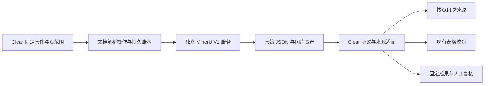

# MinerU 深度调研与 Clear 集成评估

调研日期：2026-10-21。范围：Clear 审计平台、ClearOCR 原生工作台，以及根仓独立 OCR 研发线。结论依据分为上游发布/源码事实、本地源码核对、工程建议和待实测假设；没有将公开榜单当成本项目验收。

## 1. 决策结论

**技术上可以集成，值得做定向对照；当前最有价值的是补齐文档结构和增加独立识别候选，不适合整体替换现有 OCR 工作台。建议分开评估三个组件：MinerU 完整解析器、MinerU Pro 模型、DocVortex 文档基础库。**

优先顺序取决于实际问题：

| 实际目标 | 优先路线 | 原因 |
|---|---|---|
| Agent 阅读报告、合同、制度、Office/OFD 等资料 | 先评估 DocVortex；扫描页接既有 OCR | 本项目原文工具仍以指定 PDF 页文字和纯文本为主，结构化文档阅读增量较大 |
| 复杂扫描表格、密集文字，希望提升识别效果 | MinerU2.5-Pro-2605-1.2B + 独立 mineru-vl-utils worker | 复用当前页图、队列、校对与导出，只增加一个识别来源；能公平比较模型增益 |
| 快速获得整份 PDF 的版面、阅读顺序、图表和公式结果 | 独立部署 MinerU 4.0.12 V1 服务 | 上游流程完整，但要处理许可、状态恢复、产物归档和坐标适配 |
| 改善屏拍、透视、摩尔纹、眩光 | 继续现有图像预处理专项 | MinerU 文档解析不能直接替代屏拍图像修复；效果需要同图对照 |
| 精确核对金额、账户、日期或完成正式审计判断 | 保留 Clear 的校对、来源和数据核对流程 | 解析候选不能自动成为已核实事实 |

对大型机构部署，完整 MinerU 的商业门槛可能比技术适配更先成为决策条件。只接当前标注 Apache-2.0 的 Pro 模型及独立工具，是应当认真验证的另一条路线；其完整依赖闭包仍需逐件核对。

## 2. 调研对象与版本边界

官方发布页当前最新为 **MinerU 4.0.12**，显示 10 月 11 日发布，对应标签 `mineru-4.0.12-released`、提交短 SHA `b7f3dd0`。本次关键源码按该发布标签阅读；滚动文档、模型卡和两个独立库的 main 页面单独标明来源。见[发布记录](https://github.com/opendatalab/MinerU/releases/tag/mineru-4.0.12-released)、[提交](https://github.com/opendatalab/MinerU/commit/b7f3dd0)。

必须区分三个版本号：4.0.12 是应用包；2.5-Pro-2605 是 VLM 模型；`docvortex.middle` / `docvortex.model` 的 `2.0` 是文档协议。它们没有相同的升级节奏。[源码类型入口](https://github.com/opendatalab/MinerU/blob/mineru-4.0.12-released/mineru/types.py)

旧教程里的 `mineru -p ... -o ... -b pipeline`、`mineru.json`、`pdf_info`，不能直接用作本轮方案。4.x 使用 `mineru-kit` 批量解析、V1 服务、YAML 配置和共享文档协议。文档库式 `mineru parse` 默认只处理前 10 页并支持续读，不能误当成完整批量转换。[迁移说明](https://opendatalab.github.io/MinerU/reference/migration_4/)

## 3. 本项目实际基础与缺口

正式入口登记仍为 `release/Clear/current.json` 的 0.14.0 candidate-006；0.15.0 GUI 候选、开发工作区和源码快照不能混成同一运行版本。本次未切换正式入口。

| 已核对位置 | 现有能力 | 对 MinerU 的含义 |
|---|---|---|
| `products/Clear/ocr/config/engines.json`、`src/ocr_workbench/engine_host.py` | PP-OCRv6、PaddleOCR-VL-1.6、GLM-OCR、HunyuanOCR-1.5；独立引擎进程 | 并非缺一个基础 OCR；新增模型必须证明相对收益 |
| `products/Clear/platform/.../application_services/pdf_text.py` | 固定输入、指定页、原生/自动/OCR、任务回执、等待恢复、固定文字成果 | 新文档解析操作可复用生命周期，但不能硬塞入现有文字提取语义 |
| `products/Clear/platform/.../agent/tools/documents.py` | PDF 指定页 pypdf 取字、文本分页、OCR 结果/单元格读取、显式表拼接 | 缺的是通用文档块、标题层次和多格式阅读，不是完全没有分页读取 |
| `products/Clear/platform/packages/contracts/direct.py`、`.../operations/pdf.py` | `engine` 为四值 Literal；页范围和 attempt 固定 | 第五引擎不能只改一处配置；还有请求模型、目录、适配、UI 和回执 |
| `products/Clear/platform/packages/contracts/models.py:200` | SourceLocator 含原件哈希/版本、来源精度、坐标变换身份 | 上游 bbox/页码必须转译；缺来源时如实降级 |
| `products/Clear/ocr/src/ocr_workbench/tables.py`、`complex_table_contract.py` | HTML/Markdown 表解析、合并格、文字原值、几何约束 | 表 HTML 可复用解析；格坐标与文字来源仍需另外建立 |
| `products/Clear/platform/.../resources/gpu.py` | 持久 GPU 单一所有者、进程身份和释放见证 | 新服务不能绕过现有显存调度独占常驻 |
| `products/Clear/platform/.../artifacts/`、`audit/` | 成果固定、原件引用、版本和证据归档 | MinerU 临时文件/URL 不是正式档案 |

这里的 `...` 均指 `src/workbench_platform` 下对应目录。完整相对路径和 SHA256 见[本地清单](../research/mineru-20261021/local-source-manifest.json)。平台 `pdf_text.py` 与登记开发源哈希一致；OCR `engine_host.py` 与登记开发源哈希一致。只抽查了这两个来源对应关系，未声称全部快照或正式候选逐文件一致。

根仓 `src/ocr_workbench` 为独立研发线，源码登记 schema 18；Clear 的 OCR 快照登记 schema 17。后续若做双线接入，应分别迁移与验收，不能将根仓效果自动算为正式 Clear 效果。

## 4. MinerU 为什么有价值

### 4.1 算法与工程流程

MinerU2.5 的关键设计是先在低分辨率整页上判断布局，再对原分辨率区域做文字、表格、公式识别。对密集材料，这比把整页统一压缩后一次生成更值得借鉴；但布局漏检仍会造成后续内容缺失。[原始技术报告](https://arxiv.org/abs/2509.22186)

4.x 又将原生文档能力、模型推理和输出协议分开。`MinerUParser` 负责输入和页映射，`backend/analyze.py` 分派格式，PDF pipeline 组织模型资源，后处理生成 MiddleJson，最后再导出。具体依据：[解析器](https://github.com/opendatalab/MinerU/blob/mineru-4.0.12-released/mineru/parser/mineru_parser.py)、[分析门面](https://github.com/opendatalab/MinerU/blob/mineru-4.0.12-released/mineru/backend/analyze.py)、[PDF 生命周期](https://github.com/opendatalab/MinerU/blob/mineru-4.0.12-released/mineru/backend/analysis/pdf/pipeline.py)。

### 4.2 档位与模型边界

| 档位 | 主要用途 | 本项目评估方式 |
|---|---|---|
| Flash | 原生文本/原生文档快速解析；扫描路径另有 OCR | 原生 PDF/Office 结构阅读；明确 `txt` 时不会替扫描页补字 |
| Basic | 小模型 OCR、公式和表格，可用 CPU | 比较结构解析价值；已有 PP-OCRv6，不能假定换壳即增益 |
| Standard | 小模型结合 VLM | 复杂版面和表格主要对照对象 |
| Advanced | 同一标准部署资源，增加推理计算 | 只对标准档失败的难例做定向评测 |

档位不是四个独立模型。ONNX 小模型后端与 VLM 引擎分别选择；Windows 完整加速路线与 Linux 也不同。[档位和运行时](https://opendatalab.github.io/MinerU/usage/tiers/)

发布标签的模型注册表使用 `MinerU-4_models_onnx` / `MinerU-4_models_torch` 与 `MinerU2.5-Pro-2605-1.2B`；llama.cpp 对应 GGUF 主模型和 mmproj 两个资源。不能拿历史 PDF-Extract-Kit 或旧 2509 模型目录当作 4.x 已准备完成。[注册表](https://github.com/opendatalab/MinerU/blob/mineru-4.0.12-released/mineru/model/registry.py)

### 4.3 公开分数的适用限度

Pro-2605 模型卡报告 OmniDocBench v1.6_full Overall 95.72、Table TEDS 93.62。这是发布方对特定模型、样本与运行方式的报告，不能换算成“财务金额识别正确率 95.72%”，也不能证明 Windows GGUF 路线等效，更不能直接比较我们当前 PaddleOCR-VL-1.6 或 GLM 的本机表现。[模型卡与评测口径](https://huggingface.co/opendatalab/MinerU2.5-Pro-2605-1.2B)

## 5. 三种接入方式

### A. 完整 MinerU 独立服务：适合文档结构解析

建议形成一个新的平台文档解析能力，先供 Agent 和资料预览使用。独立运行时部署 MinerU，平台只用普通 HTTP 客户端调用，避免为调用 SDK 将整个 `mineru` 包装入平台 Python 环境。

建议流程：探测 `/v1/health` 和 `/v1/tiers` → 上传固定原件 → 提交 `/v1/parse/jobs` 或 `/v1/tasks` → 持久保存远端任务 ID → 轮询逐文件状态 → 下载 JSON/ZIP → 校验页覆盖和资产 → 归档成功后才完成 Clear 操作。网络超时进入待核实，不直接重发。[V1 API](https://opendatalab.github.io/MinerU/usage/http_api/)

4.0.12 提供 `/v1/file_parse` 同步包装，超时可返回 202 且后台继续；长任务仍建议走异步。自部署 API 默认终态资源保留 24 小时，因此应主动导入本地成果中心。[4.0.12 发布说明](https://github.com/opendatalab/MinerU/releases/tag/mineru-4.0.12-released)

另一个源码级限制：该版本自部署解析 API 的 `JobStore` 用内存字典保存任务，不能据“有任务查询 API”推断进程重启后可持久恢复。Clear 必须保留自己的请求、原件、已归档结果和任务映射，并定义上游重启后 `job_not_found` 的核实/重建策略；设置无限保留也不等于任务持久化。[JobStore 源码](https://github.com/opendatalab/MinerU/blob/mineru-4.0.12-released/mineru/parser/api_server.py#L1192)

成本：一个额外运行时、独立模型和服务身份监管；复杂的是可靠接入，不是发出一次 POST。

### B. Pro 模型 + mineru-vl-utils：适合新增 OCR 候选

这条路线直接复用 Clear 当前页图/裁剪图，调用 `MinerUClient.two_step_extract` 等模型能力，保存块输出，再转为现有 OCR 候选。由 Clear 负责 PDF、任务、校对、导出和证据，避免重复引入一套文档库。

独立工具输出 ContentBlock 的类型、归一化 bbox、角度和内容；表格内容为 HTML，公式为 LaTeX。这恰好能够对接我们已有表解析器，但不是完整 MinerU 4.x 文档协议。[独立工具及输出说明](https://github.com/opendatalab/mineru-vl-utils)

依赖方面，本项目已有 Transformers 5.17.0 和 Torch 2.10.0 的 GLM 环境，与上游当前要求存在版本区间交集；这只能说明值得做兼容性验证，不代表可向现有环境直接追加安装。优先另建 worker，明确实际模型/引擎/设备/精度身份。llama.cpp 也不能仅因混元已使用就认定模型、投影器和客户端可共用。

不足：原生文字层优先、整文档后处理、标题树、跨页关联需要另补；直接模型结果与完整解析服务的分数不可视为等效。

### C. 仅接 DocVortex：适合通用文档阅读

DocVortex 目前是 MinerU 4.x 的共享协议、原生解析和导出基础，项目代码 MIT。对于 Agent 读 Office、OFD、原生 PDF 和网页归档，可以单独作为候选解析库，继续复用 Clear 的任务和资料范围。[DocVortex 项目](https://github.com/myhloli/DocVortex)、[许可证](https://github.com/myhloli/DocVortex/blob/main/LICENSE.md)

边界非常明确：DocVortex 自身不执行 PDF OCR；其自动分类也不是每页自动切后端。混合 PDF 必须检查逐页覆盖，并由 Clear 显式调用既有 OCR 或指定扫描页解析。Office 的逻辑块也不应伪造为与 Word 打印分页一致的页码。

XLSX/CSV 的审计计算仍优先 ClearData：文档语义转换不应覆盖公式、精确类型、工作表位置和数值计算口径。

## 6. 关键适配不能省略

### 6.1 页码、坐标与来源身份

中间 JSON 的 `page_idx` 从 0 开始，CLI 页范围从 1 开始。选第 1、3、10 页时应保留原始页号，不能按返回数组顺序重新编号。[输出协议](https://opendatalab.github.io/MinerU/reference/output_files/)

至少要保留：原件 SHA256/asset_revision、原始页号、运行版本、模型/量化/后端、参数、原始结果哈希、适配器版本。若有区域，还需渲染尺寸、旋转/裁剪/缩放变换及图像版本。

独立模型工具的 bbox 是 0—1 归一化；完整文档协议则应按其页几何和实际块坐标读取。不要默认所有接口都用同一尺度，也不要把旧版 0—1000 坐标直接传给 Clear。PDF 点坐标到像素仅在相同页框、原点、方向且无裁剪旋转的条件下可简化为 `x_px = x_pt × width_px / width_pt`；其它情况必须使用显式变换矩阵。无法证明时降为 page_only/approximate。

**块框只能支持块来源；HTML 的逻辑格只能支持逻辑结构。不能据表格外框自动分配每个格的精确像素框。** 另外，SourceLocator 验证器只校验字段约束，不验证模型内容真实或证据充分；精度升级还需适配器核实。

### 6.2 JSON 与资产

4.x MiddleJson 是带 `schema` 身份的共享协议；`structured_content` 是面向消费者的内容表示；`mineru parse --json` 又是命令响应。三者不能互换。本项目建议同时留存原始中间结果、可读文本/Markdown 和所有引用图片，再建立自身的稳定块 ID。[ParseResult 实现](https://github.com/opendatalab/MinerU/blob/mineru-4.0.12-released/mineru/parser/base.py)

模型块 index 是某次解析内定位，不能承诺跨重跑、跨模型版本稳定。Clear 块身份应绑定 `parse_run_id + 原始页号 + 原始块标识`，引用固定某次结果。

审计材料尤其要保留页眉中的金额单位、表注、脚注和附注对应关系。面向 RAG 的正文清理策略不能直接套用到审计证据；只留“干净 Markdown”可能丢掉解释金额和口径所必需的信息，应以原始结构和原件为完整依据。

### 6.3 表格和后处理

已有 HTML 表解析可保留 rowspan/colspan，未知坐标和置信度维持空值。金融内容须保留原值：前导零、长账号、括号负数、千位分隔、币种、小数位、百分比、空白与缺失；金额归一化作为另一个可追溯派生步骤。

跨页拼表、标题重建和图表解释应先输出候选关系。初期关闭可选 LLM 辅助跨页合并和标题增强，避免改变证据内容；即使以后启用，也保存增强前后两份结果。上游将该层与确定性后处理明确分离，可直接借鉴这个边界。[后处理边界](https://github.com/opendatalab/MinerU/blob/mineru-4.0.12-released/mineru/backend/postprocess/document.py)

### 6.4 GPU、取消与正式归档

平台应控制 worker 生命周期；取消请求和 GPU 真正释放是两个事件。常驻服务如果模型仍占显存，不能仅将任务标取消就释放平台所有权。先从单 worker、单作业开始，记录子进程退出/卸载和释放证据。MinerU Router 的任务调度可参考，不能替代跨 OCR/分类的 Clear GPU 协调。

对外 HTML/Markdown 渲染应使用现有安全展示边界，ZIP 成果解包须限制到任务目录；原件字节上传优先于任意服务器路径/远端 URL 输入。服务访问与上传复用还要保持项目权限，内容哈希不能代替访问授权。这些是具体接入点的处理要求。

## 7. 许可证评估

| 组件 | 本轮核查结果 | 对项目的具体影响 |
|---|---|---|
| MinerU 4.0.12 项目代码 | MinerU Open Source License，Apache-2.0 基础加附加条件 | 不能登记为无附加条件的 Apache-2.0 |
| Pro-2605 原始模型 | 官方模型卡标注 Apache-2.0 | 直接模型路线值得评估；分发前仍需固定 revision 并收齐许可文件 |
| 旧 MinerU2.5-2509 模型 | 模型卡标注 AGPL-3.0 | 不能将新 Pro 卡的许可套到旧权重 |
| mineru-vl-utils | 独立仓 LICENSE 为 Apache-2.0 | 可以单独评估，不代表完整 MinerU 也采用同样条款 |
| DocVortex | 独立仓 LICENSE 为 MIT | 适合独立评估原生解析与共享协议；依赖另列 |
| ONNX 小模型集合、GGUF/mmproj | ONNX 卡要求保留各原模型许可；GGUF 卡信息不完整 | 不能把容器/集合名当作整体授权，须追溯来源、revision、哈希和通知 |

MinerU 发布标签[附加条款](https://github.com/opendatalab/MinerU/blob/mineru-4.0.12-released/LICENSE.md)规定：使用方及关联方合并 MAU 超过 1 亿，或者月总收入超过 2000 万美元，继续相关使用前须取得单独商业许可；基于 MinerU 向第三方提供在线服务还需显著标识。这里的月总收入没有写成“本 OCR 产品收入”。因此大型审计机构的内部部署也不能简单按“内网/免费工具”推断门槛不适用；应由实际使用主体确认适用和授权。HTTP 隔离不会自动免除这些条款。

独立组件证据：[Pro 模型卡](https://huggingface.co/opendatalab/MinerU2.5-Pro-2605-1.2B)、[旧模型卡](https://huggingface.co/opendatalab/MinerU2.5-2509-1.2B)、[vl-utils LICENSE](https://github.com/opendatalab/mineru-vl-utils/blob/main/LICENSE.md)、[ONNX 模型说明](https://huggingface.co/opendatalab/MinerU-4_models_onnx)。本轮没有取得商用报价，也没有完成整套软件、模型和分发依赖的许可审计。直接模型路线不应复制完整 MinerU 中受另一许可证约束的流程代码。

## 8. 当前机器与离线部署成本

本机只读 `nvidia-smi` 返回 RTX 4070 Ti SUPER、16376 MiB 显存、驱动 595.97。F 盘调研时可用 10,681,024,512 字节，约 9.95 GiB。系统内存查询被环境拒绝，未作估计；当前空闲显存与其它任务占用也未测量。

16 GB 显存使单 worker 的 1.2B Pro 模型实验具有可行性，但不是已经跑通的证明。Windows llama.cpp/GGUF 是优先验证路线之一；若目标是吞吐，另评估 Linux/vLLM 或 Windows/LMDeploy。官方资源页的约 8 GB 显存和 16 GB 系统内存仅是规划起点。[运行时资源边界](https://opendatalab.github.io/MinerU/usage/tiers/)

完整 `mineru` 基础包已含 WebUI、ONNX、模型下载客户端和 llama.cpp 组件，不是单一轻量 HTTP SDK；`full` 还引入 Torch/Transformers 和平台相关推理引擎。[4.0.12 依赖](https://github.com/opendatalab/MinerU/blob/mineru-4.0.12-released/pyproject.toml)

本轮不新增模型、wheelhouse 或容器，避免在剩余约 10 GiB 时重复铺设重型环境。后续先生成实际下载清单和体积，再核算运行时+模型+缓存+输入渲染+归档+回退副本峰值；没有可靠依据给出“总共只需几 GB”的承诺。GGUF 页面显示的单文件体积也不包含所有小模型和 mmproj。

所有后续资产应落到 `F:\OCR\output\mineru-poc-<实施日期>` 对应子目录。除 TEMP/TMP/APPDATA/LOCALAPPDATA 外，还要指定 MINERU_HOME、MINERU_CONFIG、model.base_dir、HF_HOME/HF_HUB_CACHE、MODELSCOPE_CACHE、TORCH_HOME、pip/uv/XDG/Gradio 缓存及上传输出目录，并核对所选引擎自己的缓存。不得改 HOME/CODEX_HOME。Docker/WSL2 只有在 VHDX、镜像层、临时和卷也全部在 F 盘且边界可核实时才使用。

离线运行设置 `model.source=local`，预先下载校验并实测断网；不能只设置一个模型路径就声称离线。远程 VLM、文档解析 API 与 LLM 辅助后处理是三条不同连接，应分别配置。[模型与离线说明](https://opendatalab.github.io/MinerU/usage/model_source/)

## 9. 不集成也值得借鉴的内容

| 优先级 | 可借鉴做法 | 本项目已有基础 | 应补的增量 |
|---|---|---|---|
| P0 | 统一文档中间表示，分离原始分析和语义后处理 | 统一结果、表结构和 SourceLocator | 增加文档/页/块/关系层，并保留原始分析结果 |
| P0 | 低分辨率布局 + 原分辨率区域识别 | GLM、PaddleVL 已有布局/裁剪路线 | 用同图评测定位漏块与密集小字；避免重复实现已有功能 |
| P0 | 原生文字优先，困难内容才运行模型 | PDF native/auto/ocr 已有 | 加逐页覆盖检查和升级原因，特别是原生/扫描混合 PDF |
| P0 | 按页/块检索和预算续读 | documents_read 已分页 | 加标题路径、块选择、稳定 run 引用和明确缺页提示 |
| P1 | 模型完整性、后端和实际能力探测 | 现有 EnginePackages、manifest、运行身份 | 增加 schema/tier/模型能力探测，拒绝“已安装=可用” |
| P1 | 窗口化处理和生命周期管理 | 已有队列与分进程 | 控制长 PDF 渲染内存，分阶段记录时间；内部窗口不等于可恢复检查点 |
| P1 | 一次解析，多种成果导出 | 已有 TXT/JSON/XLSX 等 | 文档级 Markdown/图文/HTML 可从同一固定结果生成 |
| P1 | 分元素、分难度评测 | 已有复杂表格与屏拍评测目录 | 加阅读顺序/漏块/公式/来源映射，而非只看整页文字 |
| P2 | 跨页段落/表格关系建议 | 已有显式拼表 | 保留物理页片段和逻辑表关系，人工采用后再派生 |

P0/P1 是本次建议优先级，不是已批准的开发排期。MinerU PDF 内部默认 64 页处理窗口是内存组织机制；是否改小应测峰值与吞吐，不能直接照抄到单机。[窗口源码](https://github.com/opendatalab/MinerU/blob/mineru-4.0.12-released/mineru/backend/analysis/pdf/window.py)

## 10. 建议的最小验证与退出条件

先做研究样本的双路线验证：A 为完整 Standard 解析；B 为同一 Pro 原始/量化模型的独立 worker。DocVortex 单独作为原生文档阅读对照。完整 MinerU 的试运行先确认使用方许可条件，避免到发布阶段才发现商业门槛。

### 10.1 样本与公平对照

建议第一轮 60—100 份文档、300—500 页，至少覆盖：原生 PDF、扫描 PDF、混合页、合并格/无框表/跨页表、屏拍、合同/报告多栏、Office/OFD、旋转空白坏页和加密/超限反例。按文档划分调参与保留集，不能让同一文档近重复页面分到两侧。

模型候选先使用同一固定页图比较；完整流水线另计原件输入到成果归档的端到端表现。固定原件、页集、预处理、模型 revision/哈希、引擎/精度、并发和硬件。既比较当前实际默认路线，也比较被用户显式选择的四引擎结果，不能把“现有四个全跑”与“MinerU 只跑一个”混作无说明的速度比较。

### 10.2 应测指标

| 类别 | 指标 |
|---|---|
| 审计原值 | 金额、账号、税号、日期 exact match；负号/括号、前导零、空白/缺失分别计错 |
| 文字和版面 | CER、阅读顺序、漏块/重复块、页覆盖率、页眉脚注保留情况 |
| 表格 | TEDS/TEDS-S、单元格文字 exact match、合并格、跨页误拼与漏拼 |
| 来源 | 原件和页号身份正确率、区域映射误差、不能定位时是否如实降级 |
| 资源与体验 | 冷/热启动、端到端及推理 p50/p95、进程树 RSS/显存/磁盘峰值、每百页人工修改时间 |
| 生命周期 | 取消、进程崩溃、服务重启、网络超时、24h 过期、部分成功、重复提交与恢复 |
| 离线交付 | 断网冷启动、缺模型可读报错、中文空格路径、F 盘写入边界、成果离线重读 |

建议门槛：来源身份和已完成范围必须全部可核对；不支持/失败/缺页必须显式出现；关键字段不得以结构漂亮为由容忍明显退步。目标场景若能使人工校对时间降低约 20%，可作为产品价值信号，但这是建议业务门槛，样本不足时需扩评。仅公开榜单提高或输出更美观，不足以切换默认引擎。

### 10.3 实施分层及估算

| 阶段 | 交付物 | 粗估投入 |
|---|---|---|
| 来源/许可/下载清单 | 固定版本、依赖模型清单、空间预算、样本设计 | 1—2 工程日，外部授权等待另计 |
| 隔离模型/解析对照 | 可重跑评测、真实输出、资源统计 | 3—5 工程日，取决于 Windows wheel 和样本标注 |
| 平台文档能力 | 固定输入、异步任务、块读取、成果归档 | 5—8 工程日 |
| 原生第五引擎与编辑贯通 | 四值枚举扩展、结果规范化、校对/融合/导出回归 | 另 3—5 工程日 |

以上是工程估计，不是实测工期或必须全部实施的项目；两条接入路线共享基础，不能简单相加。若仅缺 Office 原文阅读，先做 C 即可，无需先完成第五引擎。

## 11. 本轮验证、证据和限制

已完成官方发布、固定标签核心源码、协议、模型注册、许可证和本地集成点核查；只读确认 GPU 与 F 盘空间。未安装/运行 MinerU、未下载模型、未上传业务文档、未改程序/正式 DATA/发行指针。

运行了 **9/9 个合成契约探针**：原始非连续页号映射、page_only、非法零页号、带变换的归一化区域、缺变换拒绝、旧千分制坐标拒绝、HTML 合并格、长账号/类公式文字原样保存、未知格几何与置信度保持空值。调用的是 Clear 现有验证器与表解析器，**没有使用真实 MinerU 输出，不代表识别准确率或集成已通过**。[脚本](../research/mineru-20261021/contract_probe.py)、[结果](../research/mineru-20261021/contract-probe.json)

上游源码通过联网阅读工具按发布标签读取。终端直接 HTTPS 抓取遇到 TLS/公共 API 限流，因此没有保存完整上游 Git 快照、完整 SHA 或逐文件上游哈希清单；这不影响本轮静态判断，但实施前必须补齐固定源码和模型归档。模型卡许可标识不替代分发时的许可材料。系统内存、真实模型峰值、Windows 推理性能、内网目标机和业务数据精度均待验证。

## 12. 推荐决策

近期将它列为“文档结构阅读 + Pro 识别候选”的专项，而不是发起 OCR 全面重构。

1. 先评估 DocVortex 对 Agent 原生文档阅读的增量；保留扫描页覆盖检查和既有 OCR。
2. 对复杂表格/密集扫描页验证 Pro-2605 + 独立工具，沿用 Clear 人工校对与证据链。
3. 需要成熟整文档流程且许可条件明确时，再将完整 MinerU 作为可选独立解析服务。
4. 无论采用哪条路线，文档块中间层、分辨率分工、结果续读与原始/增强分层都值得纳入后续设计。

在现有基础下，最值得购买的能力是更好的结构和更少的人工校对工作；是否接入，以本机和目标材料对照为准。
