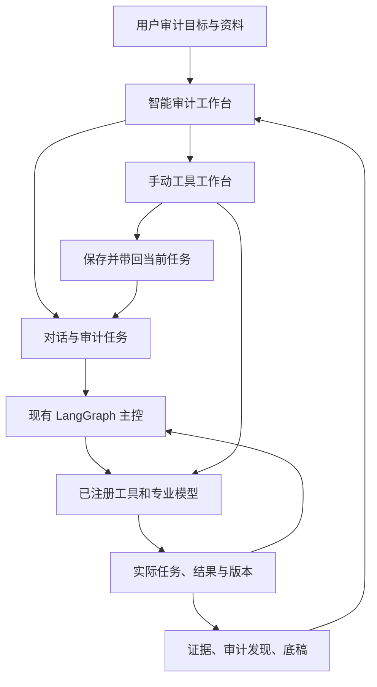

# AI 驱动的智能自动化审计平台：下一阶段规划

日期：2026-10-04。版本：2。状态：AI01–AI12 首版产品改造已实施并完成受影响功能检查；真实主控尚未配置。

**产品方向：用户围绕审计目标开展对话，Agent 理解项目与资料、安排工作、调用平台工具和专业模型、整理审计发现与证据、生成可编辑成果；用户始终可以打开现有工具手动处理，并把结果交回 Agent 继续。**

本规划落实用户最新要求：“AI大模型驱动的智能自动化审计平台，并保留用户目前手动操作的能力”。它是下一阶段的主计划，替代旧文件中“选择工具为首页主线、审计降为高级功能、Agent 独立附加入口”的产品定位。既有 LangGraph、39 个工具注册项、原生服务、资料和成果体系作为基础继续使用。

本阶段按用户可以直接使用的产品变化组织开发。旧 PA08/PA16 的闭环评测及分数要求不作为本阶段开工、开发顺序或功能交付的前置。旧记录保留历史含义，必要的功能检查随改动完成。

配套：[开发任务清单](ai-audit-product-tasks-20261004.json)。本阶段已沿用原执行架构完成产品改造。交付记录见 `F:/OCR/output/clear-automation-dev-20261002/worktrees/platform/docs/agent/product-delivery-20261004.md`；运行记录见 `F:/OCR/output/ai-audit-product-dev-20261004/state.json`。未使用历史业务数据测试，真实模型调用为 0。

## 1. 制定本规划时的产品问题

| 当前事实 | 用户受到的影响 | 本阶段调整 |
|---|---|---|
| `App.tsx` 的首页仍返回 `QuickStart`，内容是“选项目、选工具、开始处理” | 用户需要自行判断使用哪些工具、按什么顺序操作 | 默认首页改为智能审计工作台，首屏直接显示对话输入与资料入口 |
| `/agent` 是一级导航中的第五项；“审计底稿”处于高级功能 | Agent 与审计业务没有形成平台中心 | 智能审计成为首页；项目、资料、发现、底稿和手动工具围绕同一任务组织 |
| 当前候选入口为 `http://127.0.0.1:8866/`，对话在 `/agent`；旧本地启动脚本默认 8879，本次检查该端口未提供服务 | 开发候选、旧入口与用户实际启动方式容易脱节 | 明确一个主启动入口，首页、菜单、帮助和启动说明同步；首个产品切片即给出该入口 |
| 对话框只能接目标；最终没有 `delivery_publish` 就统一显示“未形成交付” | 普通问答、审计思路讨论和解释结果无法成为自然对话 | 增加问答、澄清、执行任务的输出语义；执行成果与对话回复分别表达 |
| 资料通过其他页面或 URL 带入，会话建立后范围主要固定在初始引用 | 用户难以在同一任务中补材料、换工作表或修改范围 | 对话内上传/选资料、可见范围和版本化补充资料 |
| 已有 Agent 主要产出工具文件，业务任务、审计发现与底稿联系较弱 | 能处理文件，但工作成果没有自动组织成审计事项 | 建立审计任务与证据、发现、底稿的关系，并注册相应业务工具 |
| 旧审计证据主要依赖 `batch_id/item_id`；正式底稿发布依赖编制和复核记录 | Agent 直接生成的 OCR/数据结果不易接入，自动草拟容易被旧流程阻塞 | 兼容原证据并支持直接工具结果；自动草拟和日常下载可连续进行，正式署名另用已有功能 |

源码依据：平台 `apps/portal/src/App.tsx`、`features/start/QuickStart.tsx`、`features/agent/AgentWorkbench.tsx`、`src/workbench_platform/agent/graph.py`、`audit/service.py`、`packages/contracts/audit.py`。源码根为 `F:/OCR/output/clear-automation-dev-20261002/worktrees/platform`。

## 2. 用户应该怎样工作

平台定位为 **Clear 智能审计**。保留 ClearOCR、ClearData、ClearClassify、ClearForensics 的名称和专业操作界面。

默认工作路径：

> 打开平台 → 描述审计目标并添加资料 → Agent 读取资料、解释工作安排并开始执行 → 查看发现及来源 → 按需手动调整或补充要求 → 继续分析并取得底稿、报告和数据文件。

以“检查本季度付款台账与凭证表是否一致，列出差异并形成底稿草稿”为例：

1. 用户在首页上传台账和凭证表；若已有项目，直接引用该项目资料。
2. Agent 查询工作表、字段和资料覆盖，明确期间、比对键与金额口径。只有会改变结果的缺失信息才提问。
3. 工作台显示简短工作安排，如“识别资料、核对记录、整理差异、生成底稿”。确定的步骤直接执行。
4. 结果区域显示异常记录、涉及金额、资料缺口和来源定位。每条发现可以回到原文件的页、表、行或区域。
5. 用户可以说“排除已作废记录”，也可以打开 ClearData 修改映射；保存后返回当前任务继续。
6. Agent 按最新条件更新受影响结果，生成差异表与带来源的底稿草稿。用户仍可编辑、下载或继续追问。

这些场景是目标表达示例。Agent 应根据实际资料和工具返回选择步骤，场景入口只帮助填写目标与业务条件。

## 3. 平台页面与交互结构

### 3.1 默认首页就是智能审计工作台

| 区域 | 默认内容 | 用户操作 |
|---|---|---|
| 顶部 | 当前项目、审计对象/期间、主控连接状态 | 切换项目、编辑项目背景、配置模型 |
| 左侧 | 新建任务、最近审计任务、项目导航 | 继续历史工作，切换项目与任务 |
| 中间主区 | 对话、问题答复、关键进度与结果摘要 | 描述目标、追加指令、问原因、要求生成成果 |
| 固定输入区 | 多行输入、添加文件、选择项目资料、当前范围 | 不离开对话即可补资料或调整任务要求 |
| 右侧任务区 | 当前安排、执行状态、发现数量、证据与成果 | 查看详细结果、打开工具、手动接管、返回 Agent |

大屏采用左侧导航、中间对话、右侧可折叠任务区；窄屏将右侧改为抽屉或页签，保留输入区及主要操作。避免出现平台导航与 Agent 自带第二套项目侧栏同时占据首屏。

空白首页直接显示目标输入和资料按钮，下方提供少量审计目标示例及最近任务。“手动打开工具”始终可见。主控未配置时，输入内容、资料选择和草稿可保留，通过就地引导完成配置；模型不可用时仍能进入手动工具。

### 3.2 一级导航

| 导航 | 职责 |
|---|---|
| 智能审计 | 默认首页、新任务、当前对话与执行工作台 |
| 审计项目 | 项目背景、期间、任务、已有资料与项目总结 |
| 资料与证据 | 原件、结构化结果、证据引用和来源定位 |
| 发现与底稿 | 异常事项、调查说明、底稿草稿、报告和数据成果 |
| 工具工作台 | 用户手动使用四个 Clear 工具及已有高级操作 |
| 设置 | 主控模型、专业模型状态、数据与应用设置 |

现有 `/apps/*`、`/assets`、`/artifacts` 等深链接继续可用。`/agent` 兼容跳转到新的智能审计入口，完整保留 project/workspace、session、assets、result 等上下文。旧“开始处理”页面归入手动工具入口。运行任务详情、模板批次和正式编制/复核功能在相关项目、工具或底稿页面提供。

### 3.3 对话必须同时支持讨论与执行

- 用户询问“这些资料可以做什么检查”“这条差异为什么出现”时，Agent 可以读取必要信息后正常回答，引用实际资料。此类回复不要求先生成文件。
- 用户要求核对、识别、筛选、生成底稿时，创建或继续审计任务。执行状态来自真实任务和成果，模型文字不能自行把执行标成完成。
- 澄清问题出现在同一对话，回答后继续当前任务；已知参数、可自动查询的信息和普通操作不逐步向用户要确认。
- 展示公开的工作安排、正在使用的能力和实际进度。底层工具名、请求 ID 与调试 JSON 收进详情；不展示模型内部推理过程。
- 支持消息的逐步呈现与 SSE 恢复。模型适配器支持流式协议时显示增量文本，完整校验参数后才执行工具；暂未支持的协议先显示明确的请求状态，再展示完整回复。
- 会话可以重命名、查找和继续。项目切换及刷新后恢复当前任务，不重复发出已提交操作。

## 4. 核心业务对象与架构

继续使用现有 FastAPI、LangGraph、SQLite checkpoint、操作账本和工具注册体系。新增的是审计产品对象与服务，业务计算继续由专业模块承担。

### 4.1 一个项目、一项审计任务、多次执行

| 对象 | 用途 | 与现有对象的关系 |
|---|---|---|
| 项目上下文 | 名称、审计对象、期间、业务口径、资料目录 | 继续以 workspace 为数据隔离边界，增量补充审计背景；不要求用户重复建立两套项目 |
| AuditTask | 用户目标、范围、当前安排、状态、发现及成果索引 | 新增轻量业务对象；关联现有 session、多个 run 和原生 job，不再建立执行调度器 |
| Conversation / AgentRun | 交流与单次模型执行 | 复用现有 sessions/runs/events/checkpoints |
| EvidenceRef | 指向确定版本的原件、结果、行列或页区 | 复用 AgentRef、SourceLocator、内容哈希并补审计引用适配 |
| Finding | 事实、检查口径、异常解释、来源、待补事项 | 扩展现有审计发现模型，允许 Agent 草拟、用户编辑和版本跟踪 |
| WorkpaperDraft | 检查目的、范围、执行过程、发现与证据、限制 | 复用底稿渲染与成果中心；新增直接工具结果来源与草稿导出能力 |

首版一个 AuditTask 默认关联一个连续会话；同一任务的补充目标产生新 run 或 inbox 消息。跨任务汇总引用成果，不自动创建复杂的子 Agent 层次。

现有 `audit project` 是 workspace 下的正式业务对象。新项目可先保存轻量背景，所需字段齐备后关联既有对象；已有多个审计项目的 workspace 明确选择，不自动合并。没有日期或对象信息时保留缺项，不编造值通过旧模型校验。

### 4.2 状态与持久化

AuditTask 记录 goal、scope_revision、selected_refs、project_context_revision、session_id、run_ids、plan_revision、result_refs、finding_refs、artifact_refs。状态采用用户可理解的“草稿、执行中、等待补充、已暂停、人工处理中、已完成、部分完成、执行失败”。状态更新由运行时/业务服务产生，工具执行记录可以追溯。

计划项只记录标题、目的、依赖、状态和相关操作/成果引用，由 Agent 随观察结果更新。计划展示不会变成另一套按固定顺序执行的工作流。已执行步骤与后续安排分别保留，不覆盖过去的事实。

项目背景、用户确定的规则和资料版本以业务对象保存；聊天记录按需引用。会话压缩后仍能读取当前任务、原结果与用户更正，避免只靠长聊天文本维持业务记忆。

### 4.3 资料与证据接入

复用现有可恢复上传 `/workspaces/{workspace_id}/assets/uploads/{request_id}`，接到对话附件区。用户首次添加资料或发送目标时建立必要的轻量 workspace，后续可重命名和补项目背景。

上传/选择完成后显示文件名、类型、状态和用途；内部 ID、路径和哈希在详情中。资料没有选齐时可以继续编辑目标，不要求先离开对话整理资料库。

运行中补资料通过版本化范围变更提交，在下一操作边界生效。旧任务已使用的资料版本不被悄悄替换，新范围及受影响步骤可见。

扩展审计证据契约，兼容旧批次引用，同时支持 Agent 或手动工具直接产生的数据行、比对结果、OCR 页/表/区域、分类子集和取证报告。来源与版本校验交给共用服务；不为接入审计模块伪造一个批次 ID。

## 5. 自动执行与手动操作如何协同

两种入口操作同一项目、同一资料和结果对象。工具自身的编辑、参数调整和专业视图继续可用。

| 用户动作 | 平台行为 |
|---|---|
| 从对话打开 ClearData/OCR 等工具 | 自动带入当前项目、相关输入、结果及返回任务的位置 |
| 点击“手动接管” | Agent 在操作边界暂停提交新动作；显示已在运行的任务，按真实能力等待或取消 |
| 手动修改映射、OCR 表格或其他结果 | 保存新版本，记录改动来源；人工修改保持明确，不被 Agent 静默覆盖 |
| 点击“带回任务并继续” | 带回类型化结果引用和改动摘要，Agent 读取最新状态，重新安排受影响步骤 |
| 不使用 AI | 从“工具工作台”进入现有操作，正常查看及下载成果，无需主控连接 |
| 手动成果需要 AI 进一步处理 | 从资料/结果页“交给智能审计”，在所选范围继续分析 |

复用现有请求去重、版本条件和原生返回上下文。人工接管与运行中后台任务竞争时保留旧结果；新步骤基于新版本运行，依赖旧版的发现标为待更新。接管不会复制出另一套项目，也不会让用户重新上传已经存在的文件。

## 6. 从文件处理走向审计业务

### 6.1 首批业务范围

首批以当前项目最有基础的台账核对、结构化凭证资料、重复/异常检查和图像取证为起点。具体审计口径由项目和用户提供，行业知识可后续积累为规则资料。

| 场景 | 已有能力可复用 | 本阶段需要补充 | 用户取得的成果 |
|---|---|---|---|
| 两份台账/清单一致性检查 | 工作表探查、清洗、精确比对、金额容差和导出 | 将差异按检查口径组织为发现并绑定来源 | 差异明细、影响说明、底稿草稿 |
| 付款或记录重复检查 | 现有重复检测与结构化表格 | 可注册的条件筛选、分组计数/金额汇总，记录日期/金额/主体口径 | 重复候选组、原始记录、金额汇总；候选不自动等同于违规 |
| 凭证/PDF 表格与台账核对 | 指定页 OCR、现有结构化表桥、分类选子集 | 资料对照、缺失材料识别与证据关联 | 对照表、缺失资料清单、来源页与底稿 |
| 可疑图像资料检查 | 六项现有取证工具、报告及热图 | 将工具观察和限制附到对应事项 | 原图/热图/报告引用及调查说明草稿 |

当前注册表没有通用的分组汇总、日期范围筛选和任意票据字段抽取能力。分组计数/金额汇总、比较/区间筛选作为本阶段明确新增的数据算子，使用固定参数契约和精确计算。任意扫描票据字段抽取、复杂跨页拼表另列后续能力；遇到缺少结构化结果时允许选择已有提取能力或转手动处理。

### 6.2 新增审计业务工具

在同一个注册表内按需增加以下工具组，名称可在实现时统一，职责固定：

- **项目与任务：** 读取审计背景、读取任务、更新后续工作安排、申请应用用户明确提出的范围变化。
- **资料检索与规则：** 在本项目已导入文本/OCR 结果中检索，返回文件、页/段落与版本；读取用户选定的规则和检查口径。优先索引现有文字，按需 OCR，首期不引入独立向量数据库。
- **数据审计：** 条件筛选、分组计数、金额汇总，与现有比对和重复检测组合。金额计算由数据服务完成，币种、单位和期间明确保存。
- **证据与发现：** 读取/固定证据、定位原文、创建或修订发现草稿、关联缺失资料。
- **底稿与报告：** 从真实结果和发现生成底稿草稿、报告摘要及数据附件，保存到成果中心；按用户改动更新对应版本。

规则引用绑定已选资料的版本、段落及适用范围。没有制度文件或规则未明确时，可以分析客观差异并标注口径待补，不凭模型记忆编造法规条款。

### 6.3 审计发现和成果的呈现

每项发现展示：标题、相关对象、观察到的事实、适用口径、涉及金额/范围、原始证据、解释与待补材料。将工具计算的事实、AI 提出的可能解释和人工补充分别标清来源。

用户点击发现即可定位表格行、PDF 页或图像区域，支持“说明原因”“补充材料”“重新检查”“编辑描述”。没有识别成功的资料应进入缺失/待处理范围，不能作为业务异常混入差异金额。

底稿草稿包含目的、资料范围、使用的口径、实际执行情况、发现、来源及未完成部分；提供可编辑页面和直接下载。首期沿用既有 Markdown/HTML 底稿渲染与 Excel/CSV 数据附件；Word/PDF 如需新增导出适配，单独安排，不阻塞基础成果。

Agent 产生的草稿记录 `origin=agent`、session/run、模型配置版本和证据版本；人工编辑记录 `origin=human`。现有 `LocalActor` 的本机署名不能直接冒充 Agent 作者，需扩展兼容作者模型或添加独立草拟来源字段。正式编制/复核仍可由用户明确操作，普通分析、草稿生成与下载无须先完成署名流程。

## 7. 开发顺序与每次可见的交付

采用四个递进切片。每个切片结束直接在统一入口展示新增能力；一个切片内优先纵向打通页面与现有服务，不先堆出一批后台抽象。

### 第一切片：打开平台就能开始审计对话

**范围：AI01–AI05。** 首页与导航调整；自然问答和执行语义；对话附件；轻量审计任务与历史；全局模型设置和就地配置。任务区先展示当前目标、资料与实际执行状态。

用户可看到：打开首页就是对话工作台，在这里选项目或新建轻量项目、添加资料、讨论和发起目标，能查看步骤及成果；手动工具入口同时存在。无主控时保留输入和附件并就地配置。首个切片不要求先完成整个审计领域改造。

### 第二切片：任务有安排，人与 Agent 可以接着做

**范围：AI06–AI08。** 动态工作安排、项目背景、任务上下文；手动接管与结果带回；统一证据引用和来源查看。

用户可看到：当前在做什么、为何需要补资料、哪些已完成；可以打开真实工具修改后回到同一任务继续；来源在对话和结果区域可点击。

### 第三切片：产出审计发现、底稿与项目成果

**范围：AI09–AI11。** 有限新增数据算子和资料/规则检索；审计发现与底稿草拟；项目视图和跨任务成果汇总。

用户可看到：同样的工具结果被组织成可用的审计事项与文档；项目中能持续追踪资料、任务、发现和底稿，后续追问以实际结果为依据。

### 第四切片：统一入口与日常使用收口

**范围：AI12。** 将已完成页面、Agent 层、设置、深链接、帮助及启动方式统一到交付入口。运行中提示、刷新继续、附件恢复和手动工具保持可用。

复用共享 F 盘运行时和模型，不重复拷贝未变的大模型；当前用户业务目录的切换与迁移以显式路径映射、备份和版本兼容处理。界面和服务集成不以擅自终止用户正在进行的工作来完成。

## 8. 实施任务与代码落点

以下路径相对于平台源码根，都是计划中的修改范围。

| ID | 优先级 | 开发内容 | 主要落点 | 完成后用户获得什么 |
|---|---|---|---|---|
| AI01 | P0 | 默认对话首页、导航、页面布局与旧入口兼容 | `App.tsx`、`router.tsx`、`features/agent/`、`features/start/`、启动入口 | 平台第一屏就能输入审计目标，并直接找到手动工具 |
| AI02 | P0 | 正常问答、执行任务与澄清的消息语义；即时响应与消息呈现 | `agent/graph.py`、`runtime.py`、`providers.py`、契约、会话 UI | 能先聊需求、解释发现，也能要求执行，回复不会统一变成“未形成交付” |
| AI03 | P0 | 对话上传/资料选择、输入范围和中途补资料 | `assets/routes.py`、上传组件、`agent/routes.py`、任务范围契约 | 从对话添加文件、调整范围，资料不用反复搬运 |
| AI04 | P0 | 轻量 AuditTask、会话/运行关联、历史与任务状态 | `audit/`、`agent/store.py`、业务服务与契约、任务区域 | 当前目标、资料、执行和成果属于同一项可继续的审计任务 |
| AI05 | P0 | 平台级主控设置、就地连接引导、专业模型状态 | `ControllerSettings.tsx`、`features/settings/`、连接 API | 在入口就能找到模型设置，连接失败时保留工作草稿 |
| AI06 | P1 | 动态工作安排、项目背景和持续任务上下文 | `agent/tools/audit.py`、`agent/context.py`、`audit/`、任务区域 | 能理解 Agent 的安排并随时补充，后续步骤按新信息更新 |
| AI07 | P1 | 手动接管、原生工具定位、保存结果并回到任务 | 四个工具入口、native navigation、引用服务、Agent inbox | 现有手动能力完整保留，并能与自动执行衔接 |
| AI08 | P1 | 非批次结果的审计证据接入和统一来源查看 | `contracts/audit.py`、`audit/evidence.py`、`application_services/references.py`、证据 UI | 直接工具结果可以进入审计事项，点结果能找到原资料 |
| AI09 | P1 | 首批审计算子、资料与规则检索、自然语言目标示例 | `modules/data_workbench/`、数据服务、检索服务、注册工具 | 支持台账核对、重复候选/汇总和有来源的规则分析 |
| AI10 | P1 | 审计发现草稿、Agent 作者来源、底稿生成和编辑 | `audit/service.py`、作者/发现契约、渲染器、成果中心、UI | 自动整理审计发现和可编辑底稿，普通导出可直接使用 |
| AI11 | P2 | 审计项目主页、任务/资料/发现/成果关联与汇总 | `features/projects/`、`features/audit/`、聚合查询服务 | 项目成为持续审计工作的容器，可看全貌并继续已有任务 |
| AI12 | P2 | 主入口、配置、路由、帮助和交付包集成 | 启动脚本、包清单、门户构建、使用说明 | 用户按同一入口启动就能看到已交付能力 |

任务依赖以配套 JSON 为准。先完成第一切片，再扩展业务深度。无需为本轮另建开发调度系统、并行子 Agent 体系或新的资格评测流水线。

## 9. 开发边界与必要检查

本阶段保留既有业务资产、版本和专业模型，把 UI/Agent 调用收敛到同一业务服务。能力缺口以注册工具补齐，不以临时生成脚本作为普通审计任务的默认实现。

检查围绕具体改动：导航和入口可达、消息/附件不丢失、真实执行状态正确、手动保存能带回、来源可定位、金额口径准确、成果可下载。协议和状态变更补必要反例，低风险文案和布局调整直接做构建及交互检查。已有通过且未受影响的检查不重复运行。

本阶段不安排固定“12 次真实任务、11 次成功”等计分工程，不将缺少主控配置扩大成界面、业务模型和手动协作开发的阻塞。已配置模型用于正常功能联调；未配置时如实提示，通过设置完成接入，不把模拟回复当产品实际运行。

所有新增源码、文档、依赖、临时文件、数据库、缓存、浏览器目录和交付物仅位于本机 F 盘。沿用已登记的源码根和共享 program；不修改 HOME/CODEX_HOME，不覆盖现有未提交代码。预计实施记录目录为 `F:/OCR/output/ai-audit-product-dev-20261004`，实际创建时核对路径和运行服务。

AI01–AI12 的实际状态与完成证据以配套任务清单为准。当前实施接续以[主开发索引](README.md)登记为准；旧 PA 系列说明已完成的基础和历史缺口，不再支配当前产品优先级。
