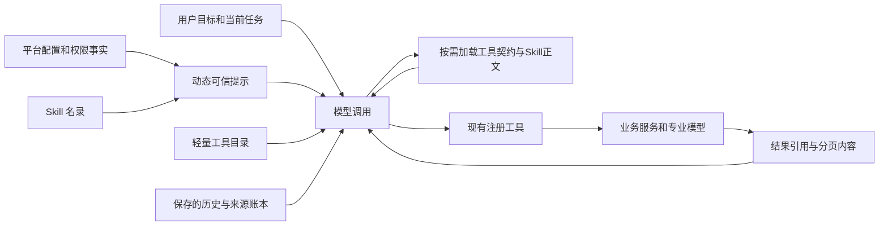

# Agent 上下文与 Skills 统一调研

日期：2026-10-05。审查对象：`F:\OCR\output\clear-automation-dev-20261002\worktrees\platform` 及运行中的 `http://127.0.0.1:8879/`。调研产物：`F:\OCR\output\agent-context-skills-research-20261005`。

**开发完成更新（2026-10-05）：本文规划的三个阶段已实现，18 项要求核对通过，本地预览已更新。当前支持可信环境注入、按需工具加载与原生 Skills。第 1—6 节保留修复前的诊断事实；当前实现、验证边界和交付见第 7 节。**

**结论：截图中的失败由平台本地预检触发，请求没有发给模型。项目/会话事实有部分注入，主控身份和运行环境缺少明确的启动说明。当前平台没有 Skill 发现/加载机制，使用 LangGraph 不会自动获得 Skill 支持；现有架构能够增加该能力。**

本轮完成只读诊断、离线复现和官方框架资料调研，没有修改业务源码、连接配置或用户会话，没有触发主控模型请求。当前运行实例的上下文缺陷仍需按本文方案修复。上一轮新增工具时漏检了生产首轮请求的容量，已有工程替身回归不能证明生产请求可发送。

## 1. “一句话拉满”到底发生了什么

用户会话：`s3005fbdef0f34c5db058a5d835a0d8ce`。失败运行：`r2d41ad7b0a684cedb7a92ab2001e967c`。连接为 OpenAI 兼容 Chat Completions，配置模型 ID 是 `gpt-6.1-sol`，平台本地 `context_cap=16384`，预留输出 `2048`。

| 实际测量项 | 值 |
|---|---:|
| 用户消息 | 17 个字符，51 个 UTF-8 字节 |
| 系统提示 | 1,486 字节 |
| 全部首轮历史消息，含范围和会话事实 | 820 字节 |
| 已注册工具 | 101 个 |
| 首轮自动加载的工具契约 | 66 个，58,513 字节 |
| 本地算法扣契约前的消息预算 | `(16384 - 2048) × 2 = 28,672` 字节 |
| 扣契约和系统提示后的消息预算 | `max(0, 28672 - 58513 - 1486) = 0` |
| 该运行的模型请求记录 | **0 条** |
| 离线重放结果 | 与截图完全相同的 `context_limit` |

[context.py](F:/OCR/output/clear-automation-dev-20261002/worktrees/platform/src/workbench_platform/agent/context.py:8) 按固定“2 字节约等于 1 token”换算预算。[runtime.py](F:/OCR/output/clear-automation-dev-20261002/worktrees/platform/src/workbench_platform/agent/runtime.py:350) 的首轮工具筛选只是排除 OCR/分类/取证/结果桥前缀；新增的 native、batch、formal audit 等工具因此大批直接进入首轮。工具契约已超过该字节预算，短消息也必然失败。

错误发生在 `begin_model` 之前，因此没有主控发送记录、供应商 usage 或工具执行。这个 16K 是平台配置值，不是服务实际宣称的模型窗口。字节除以二是本地粗估，不能当成真实 token 消耗。服务使用该模型 ID，也不证明它等同于某个官方 API 型号及其上下文窗口；本轮没有证据确认其实际容量。

现有连接探针只发送一个微型 `probe_echo` 工具，能证明两轮原生工具调用及结果消费，无法证明带 66 个契约的生产首轮能进入模型。注入的工程 `model_provider` 还会直接跳过正常请求构造与容量检查，所以原先图回归没有覆盖这个失败点。

离线把首轮收敛为 10 个核心工具后，契约降至 **7,722 字节**，在同样的 16K 配置下本地预检通过。这只是修复方向的验证，没有声称已经修复运行服务或获得真实模型回答。

## 2. 仅缩小首轮仍不够

[tools/context.py](F:/OCR/output/clear-automation-dev-20261002/worktrees/platform/src/workbench_platform/agent/tools/context.py:71) 中 `tools_list` 默认返回全部目录，并将所有名称写进 `discovered_tools`。[graph.py](F:/OCR/output/clear-automation-dev-20261002/worktrees/platform/src/workbench_platform/agent/graph.py:148) 会把这些名称全部并入 `visible`，之后只增不减。

实际全目录有 101 个工具：目录 data 约 **37,081 字节**，全部输入契约约 **94,303 字节**。因此，一次“列出全部工具”后，后续请求仍会触发相同问题。`tools_describe` 的完整输入/输出 schema 同时留在历史中并再次作为原生工具契约发送，还会重复占用上下文。

当前压缩只裁剪 tool data 的 `rows/items/sample`，不裁剪 `tools`；只在已有至少两组 assistant 对话后尝试固定摘要。它不处理首轮契约超大、不收回无关契约，也没有完整按角色/组件计量。不能把解决方案缩为“把上下文数字调大”。

## 3. 工具环境能否正常注入

需要区分执行器掌握的信息与大模型实际看到的信息。后端 `ToolContext` 包括工作空间、会话、运行、代际、操作身份、资料范围和权限，handler 使用它验证并执行；它不会自动出现在模型消息中。

| 信息 | 当前实际行为 | 结论 |
|---|---|---|
| 平台身份、审计行为原则 | 固定 SYSTEM 说明 Clear 智能审计、原生工具、证据与人工接管原则 | 已有基础说明 |
| 当前项目 ID、选中资料、初始引用 | 首轮以服务器范围 user 消息注入 | 已有，属于模型可读范围事实；执行权限仍由后端校验 |
| 项目对象、期间、目标、规则 | `session_facts.audit_context` 注入；可通过工具查询完整背景 | 已有，但首轮文本有截断 |
| 当前任务、历史讨论、操作/模型/成果身份 | 部分有界事实自动注入，更多通过工具读取 | 已有，历史事实不代表当前状态 |
| 已激活工具的参数与描述 | 原生 `tools` schema 发送 | 已有，但过量加载导致本次请求无法发送 |
| 业务执行结果 | assistant/tool 配对后进入下一次请求 | 机制已有，本次未进入模型和执行阶段 |
| 当前主控模型 ID/协议/配置版本 | 模型 ID 只在 API 请求参数，SYSTEM 未动态注入；模型可调用 `models_list` 查询 | **没有完整自动说明**。模型不能可靠地从消息得知自己的配置 ID |
| Windows、本机平台、实际数据位置、专业服务运行方式 | 未形成可信环境启动块；部分信息需 `workspace_get_context` 和模型目录查询 | **缺少统一注入** |
| 各业务工具族、模型角色和能力边界 | 固定提示提到部分业务；未提供完整轻量目录；只看当前加载的工具 | **部分支持**，容易误解自身能力 |
| Skill 名录、已启用 Skill、版本和资源 | 无对应状态、加载器或提示生成器 | **不支持** |

API 请求里的 `model` 参数不等于给模型的环境说明。主控模型也不是在用户机器中直接运行脚本：目前它通过 HTTP 选择已注册业务工具，本地服务/数据 worker 执行，OCR/分类专业模型由独立服务负责。平台没有向主控开放通用 cmd/PowerShell。应把这套事实明确注入，避免让模型凭训练知识猜测“我运行在什么环境”。

## 4. 官方框架与 Skill 调研

已实际获取并阅读以下原始文档，下载副本和状态在调研目录 `sources/`、`sources.json`：

1. [LangChain Context engineering](https://docs.langchain.com/oss/python/langchain/context-engineering)：分别管理 model context、tool context 和 life-cycle context；支持按状态、Store 和 runtime context 动态生成提示、选择工具。文档明确指出过多工具会占满上下文并增加错误。
2. [LangGraph Memory](https://docs.langchain.com/oss/python/langgraph/add-memory)：checkpoint 负责状态持久化，消息裁剪、删除、摘要与长期 Store 需明确配置。保存了消息不等于每轮必须把全部消息再发送。
3. [LangChain Deep Agents Skills](https://docs.langchain.com/oss/python/deepagents/skills)：`SkillsMiddleware` 初始只载入名称和描述；需要某项技能时读取完整 SKILL.md；资源按需读取。Deep Agents 为具体实现，不是 LangGraph 核心自动附带的行为。
4. [Agent Skills Specification](https://agentskills.io/specification)：目录至少含 SKILL.md，YAML frontmatter 包括 name、description；可附 scripts、references、assets。推荐分层披露，主文件控制长度。`allowed-tools` 是实验字段，支持情况取决于宿主实现。

OpenAI Docs 对应的官方工具调用、Codex Skills 页面与替代地址本次均返回 HTTP 403，未用无法读取的页面作为事实证据，也未据此断言 `gpt-6.1-sol` 的真实模型窗口。

平台依赖层登记了 `langgraph 1.2.11`、`langchain-core 1.6.3` 和 SQLite checkpointer；没有 Deep Agents，也没有平台自己的 Skill registry、SKILL.md 扫描、激活/资源读取或版本记录。已有 StructuredTool 转换仍使用当前 dispatcher，它不负责加载 Skills。

**可以支持 Skill，但不是把本机 Codex skills 文件夹放进项目就自动生效。** 需要平台的 Skill 宿主协议。Skill 可以包装“付款核对”“票据识别与台账比对”“分类训练准备”“证据与底稿”等可复用业务流程，正文指导 Agent 调用已有工具；能力仍由工具实现提供。

## 5. 建议的实现结构

保留现有 LangGraph、业务注册表、操作回执、异步观察器和人工入口。参考 LangChain 的上下文分层及 Deep Agents 的 Skill 渐进加载，不必为了支持 Skills 换掉当前执行引擎。



### 第一步：修首轮与工具发现

- 首轮保留少量核心工具，至少包含对话、环境/任务查询、目录发现、契约加载、必要提问和交付。10 个核心工具的离线尺寸已验证能通过当前默认配置；最终仍需按实际完整请求预算选择。
- 目录发现返回名称、简短说明、工具族、效果及可用状态，支持分类/关键词分页；发现不自动激活全部契约。
- 明确加载工具才改变当前可调用集。保留当前工具批次与核心工具，按相关性和预算回收无关契约；已完成操作与来源回执仍保存在后端。
- JSON Schema 去掉仅用于 UI 的冗余 title 等字段，保留 required、enum、边界和禁止额外参数等执行契约；不要把整份契约再次塞进历史。
- 请求前对最终 wire payload 计量：系统提示、环境、Skills、工具契约、用户消息、事实、tool result 和输出预留分别显示。已知 tokenizer 可用则按对应编码估计，未知模型明确标记估计方法；实际 usage 单独展示。
- 超限错误说明是哪个组件过大，避免误导用户收窄一句普通聊天。连接探针增加生产首轮构造的本地检查，不能只测微型工具。

主要落点：`agent/runtime.py`、`agent/context.py`、`agent/registry.py`、`agent/tools/context.py`、`agent/graph.py`、连接设置与消息展示。需要覆盖首句对话、列全目录后接续、加载大工具契约、连续跨板块切换，以及长历史中保持完整调用/结果配对。

### 第二步：注入可信环境与可恢复工作事实

- 动态 system 块说明平台角色、配置模型 ID/协议/连接版本、本机 Windows 业务执行环境、各专业模型角色和可调用方式、当前 workspace/session、手动接管与资料授权边界。
- 只注入完成任务需要的环境事实；不发送 API Key、原生 token、完整进程环境或无关本地路径。实际 returned model 若有记录，和 configured model 分开表达。
- 项目目标/规则、当前安排和有界操作事实单独组织；引用正文仍是资料内容，不变成执行授权。大表、大报告和长正文保留固定引用，分页读取。
- 摘要可在每轮请求前重建，保留用户约束、已确认参数、实际引用和未完成任务。压缩提示发送副本，不破坏原始操作、历史或证据。
- 记录每次请求纳入了哪些环境字段、工具和事实版本，使“环境是否注入”能通过实际请求结构核实。

### 第三步：增加原生 Skill 宿主

建议采用 Agent Skills 目录格式，在 F 盘登记的平台/工作区技能根加载，优先复用当前 PyYAML 与 LangGraph 状态。新增机制必须明确实现，不宣称当前已具备。

```text
F:\OCR\...\skills\
  payment-reconciliation\
    SKILL.md
    references\columns-and-rules.md
    assets\workpaper-template.md
```

- `SkillRegistry` 校验 name、description、兼容条件、文件范围和资源摘要，记录版本或内容 hash；名录可分页检索。
- 提供技能发现、激活、按需读取资源的工具；默认只加载精简名录，不把全部 SKILL.md 和附件塞入首轮。
- 激活 Skill 后将正文作为用户选择/平台登记的指导纳入动态提示，保存所用版本和引用。支持用户明确指定及 Agent 根据目标选择；项目资料不能悄悄注册成指令。
- Skill 正文优先编排平台已有业务工具，允许将付款核对的列选择、条件、数据导入、对账、证据和底稿步骤封装为可复用指导，不每次生成替代脚本。
- scripts 支持要单独定义宿主执行方式与依赖。第一版可以只支持正文、references、templates 与既有工具；需要脚本时注册为明确参数/输出的受控工具，不能因为存在 SKILL.md 就自动获得 Bash/cmd/PowerShell。
- `allowed-tools` 可用于缩小某项 Skill 的工具集合，执行授权仍来自平台资料范围、角色和 dispatcher；不能让技能提升权限。
- 冷恢复固定已经激活的 Skill 版本，资源改变时标明变化，保持原模型请求和操作身份。发布/打包时包含 F 盘技能副本及登记清单，避免依赖 Codex 的 C 盘个人目录。
- 门户能查看可用/已激活技能和来源，不强制用户每次手动选 Skill。人工接管和独立工具路径继续可用。

第一批建议制作“付款台账核对”“票据 OCR 与台账比对”“分类标注与模型训练准备”“证据整理与底稿”四项 Skill，使用现有工具并验证其真实调用接续。LangChain Deep Agents 可以作为实现参考，整体替换需考虑其默认文件工具、子 Agent 和脚本执行与本平台权限/来源协议的适配；本次没有理由立即引入整套栈。

## 6. 完成范围和证据

本轮是统一调研，以上三个阶段是待实现任务。未更改现有 101 个业务工具，未改用户的 16K 配置，未重启运行服务，未读取/输出 API Key，也未发送真实模型请求。

- [本地故障测量与复现](F:/OCR/output/agent-context-skills-research-20261005/diagnosis.json)：首轮/全目录尺寸、预算、请求记录与最小核心工具离线对照。
- [实际请求结构核对](F:/OCR/output/agent-context-skills-research-20261005/failure-payload-structure.json)：系统提示、消息角色、注入内容摘要和工具名称，不含凭据。
- [只读复现脚本](F:/OCR/output/agent-context-skills-research-20261005/diagnose.py)：只读 SQLite、现有 GET 接口和请求构造，无主控网络发送。
- [官方资料读取记录](F:/OCR/output/agent-context-skills-research-20261005/sources.json)与[OpenAI 替代地址状态](F:/OCR/output/agent-context-skills-research-20261005/openai-alternative-sources.json)。

截图只作为用户现象来源，本机 C 盘附件按只读来源使用；所有调研脚本、官方资料副本和文档落在 F 盘。

## 7. 开发完成与当前运行状态

本文三个阶段已在现有 LangGraph、业务工具注册表、操作回执和人工入口上完成。没有替换成验收建议或复核 Agent，仍以“用户目标 → 选择已注册工具/模型 → 执行并读取结果 → 决定下一步 → 交付成果”运行。

| 阶段 | 当前实现 |
|---|---|
| 首轮与工具发现 | 共 106 个注册工具，首轮只加载 14 个核心工具。目录分页发现不激活；明确描述/加载才加入契约；按预算回收较早无关工具，保护核心、当前批次及新加载工具。Schema 保留执行约束，完整契约不重复放进历史。 |
| 上下文与可信环境 | 每轮按最终 HTTP JSON 计量系统、环境、技能、工具、用户、工作事实、工具结果及协议开销，另列输出预留；超限显示主要组件。动态注入主控配置、Windows 本机执行、专业模型角色、会话与范围、手动接管边界，记录字段及版本，不含密钥/完整进程环境。 |
| 可恢复事实 | 当前目标、项目规则和计划完整保留；压缩发送副本不改原始记录。大回执保留完整外层类型引用、状态、覆盖、计数、风险提示及分页身份；`session_read_history` 可按序号、偏移读原文及 hash，拒绝跨会话读取。 |
| 原生 Skill 宿主 | Agent Skills 格式、明确登记的 F 盘平台/工作区根、兼容与资源路径校验。轻量名录先行，正文激活，资源按需分页；用户及 Agent 均可选择。固定全部资源字节/hash/版本，冷恢复保留，源变更提示，升级需明确选择新版本。 |
| 权限与恢复 | `allowed-tools` 仅缩权，每次实际调度再校验，同批次激活也生效。项目资料不自动成为技能。已收到的模型回复仅在原输入状态匹配时复用原身份与工具集合；新目标、范围、规则、配置、固定技能或宿主契约变更会冲突，未知回包不重发。 |
| 门户与发布 | 首页可查看上下文组件/注入来源、可用及激活技能、固定版本与资源；原有手动操作继续可用。包内含登记配置、技能目录及清单，独立冷启动保留现有会话/连接。脚本资源显示宿主不支持原因，不执行，也不再触发页面崩溃。 |

首批四项技能是付款台账核对、票据 OCR 与台账比对、分类标注与训练准备、证据整理与底稿。它们编排已有业务工具；当前 Skill 宿主支持正文、references 和 assets，**不执行附带 scripts，也不提供通用 cmd/PowerShell**。需要新增可执行能力时，应注册有明确参数和输出的工具。

最终版本保留原配置模型别名 `gpt-6.1-sol` 和 16K 设置。生产首轮本地预检为 **6,158 输入估算 + 2,048 输出预留，低于 16,384**；真实数据批次接续的三轮输入估算为 **7,217 → 13,658 → 11,431**，均低于可用输入 **14,336**。前者使用无业务资料的首轮占位环境，实际会话仍每次重新构造和计量。该别名无已验证本地 tokenizer，界面明确标记字节估算，不将其当作真实供应商 token 消耗或模型窗口。

验证结果如下，复跑项目与前面的兼容检查有重叠，不累加为独立测试数量：

| 检查 | 结果与范围 |
|---|---|
| 上下文回归 | 11 项通过，覆盖两种协议、真实 SYSTEM/4 项技能名录/14 核心工具、跨板块回收、完整调用配对、首个超大生成回执压缩。 |
| HTTP 请求与恢复 | 7 项通过，生产序列化经 `httpx.MockTransport` 验证，覆盖短对话、发现/加载/真实导入读取/交付、同批次 Skill 限制、完整规则、历史分页、源变更后固定回复恢复及未知回包不重发。 |
| 技能宿主与业务接续 | 7 项宿主 + 3 项业务检查通过；付款核对、票据数据接续、分类准备及证据/五文件底稿调用真实服务，资料为合成输入。 |
| 兼容与基础 | 图、恢复、人工能力、产品、调用修复及备份 42 项通过；基础 5 项通过；最终 runtime/store 的图/恢复复跑 10 项通过。 |
| 其余业务模块 | 20 项中原先唯一的批次上下文失败已由真实 focused 复跑修复。五项原生检查全部通过，实际执行本地分类训练/推理、OCR、PDF、取证算法，使用隔离合成资料。 |
| 门户与契约 | 16 项门户测试、TypeScript/Vite 构建、共享契约生成检查通过。 |
| 最终包与预览 | 2,046 文件，约 31.3 MB，不复制模型；包内源码与本次源码 hash 一致。预览 HTTP 200、Agent 启用、4 项兼容技能可见、原会话和连接保留。 |

**本轮没有发送真实远程主控请求，也没有自动重发原失败聊天。** 原预览仍保留一条历史失败运行、零条模型请求记录。主控协议与调度检查使用本地模拟响应；真实服务的模型容量和审计资料上的模型质量没有被这些工程检查证明。本地专业模型确已在合成资料回归中执行，不能把“远程主控请求为零”写成“全部模型调用为零”。

有一个保守恢复边界：若在请求身份落盘后、请求事件的输入状态 hash 落盘前崩溃，该记录沿用旧完整请求指纹校验，可能要求读取当前状态后继续，但不会自动重复发送。已有回包未知记录也继续禁止自动重发。

交付和证据：

- [新版本地预览](http://127.0.0.1:8879/)；服务使用 `F:\OCR\output\agent-context-skills-development-20261005\candidate-final`，数据仍为 `F:\OCR\output\ai-audit-product-dev-20261004\workspace`。
- [实现与使用说明](F:/OCR/output/clear-automation-dev-20261002/worktrees/platform/docs/agent/context-skills-20261005.md)。
- [18 项开发要求核对](F:/OCR/output/agent-context-skills-development-20261005/evidence/completion-audit.json)、[开发前基线差异](F:/OCR/output/agent-context-skills-development-20261005/evidence/changes-from-session-baseline.json)。CSS 未进入开发前快照，差异记录明确标注，不伪造旧 hash。
- [最终预览核查](F:/OCR/output/agent-context-skills-development-20261005/evidence/live-check-final.json)、[打包与源码一致性](F:/OCR/output/agent-context-skills-development-20261005/evidence/package-source-check-final.json)、[批次接续预算](F:/OCR/output/agent-context-skills-development-20261005/evidence/batch-context-budget.json)。

所有新增源码、依赖、数据库、合成测试资料、缓存、日志和候选包均在 F 盘。未提交 Git；既有未提交工作保留。
