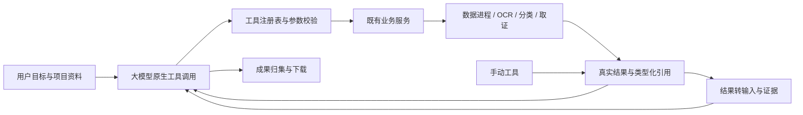

# Agent 各板块调用总审

后续状态：本报告确认的 R01–R07 已完成修复与回归，见[修复与审查记录](F:/OCR/output/clear-automation-dev-20261002/worktrees/platform/docs/agent/invocation-fixes-20261005.md)。下文保留修复前的审查事实和复现证据。

覆盖补接状态：分类标注/训练/模型管理、OCR 编辑/视觉/预处理/融合、原生独立成果接回、文档读取/结构表桥、批次/正式审计/待办等已完成接入。当前实际注册 **101 个工具，新增 51 个**，手动能力保留；具体实现、限制与验证见[未覆盖能力补接记录](F:/OCR/output/clear-automation-dev-20261002/worktrees/platform/docs/agent/coverage-completion-20261005.md)。下文的“50 个工具”“训练尚未注册”“原生独立成果不能接回”均为总审时的历史状态，不代表当前源码。

审查日期：2026-10-05。审查源码：`F:\OCR\output\clear-automation-dev-20261002\worktrees\platform` 的当前工作区，包括已有未提交修改。证据目录：`F:\OCR\output\agent-invocation-review-20261005`。

**结论：Agent 已有实际业务调度能力，当前注册 50 个可执行工具；主要板块接通了服务，但跨板块衔接尚不完整。本轮确认 7 类问题，其中有版本冲突后停止执行却仍显示运行中的问题。不能把“注册了工具”或上一轮功能清单完成，等同于所有调用路径都可用。**

主路径符合“用户目标 → 主控选择工具／专业模型 → 执行 → 读取结果 → 再决定 → 交付”。数据处理、证据、发现和底稿可以连续执行，没有要求先走旧批次、编制／复核手续。当前首页源码也确实挂载了 Agent 对话工作台。

本轮是调用审查与故障复现，未修改业务源码。新增报告、隔离检查脚本、合成资料和证据均在 F 盘。没有调用真实主控模型，没有使用真实业务资料，没有启动 OCR／分类 GPU 服务或停止其他服务。原预览地址 `127.0.0.1:8879` 本轮连接被拒绝，因此未宣称在线门户或当前模型配置已验证。

## 1. 实际调度架构

- [runtime.py](F:/OCR/output/clear-automation-dev-20261002/worktrees/platform/src/workbench_platform/agent/runtime.py:27) 注册实际 handler；[graph.py](F:/OCR/output/clear-automation-dev-20261002/worktrees/platform/src/workbench_platform/agent/graph.py:9) 用 LangGraph 管理输入、模型、调度、原生任务等待、结果回送和结束。
- [registry.py](F:/OCR/output/clear-automation-dev-20261002/worktrees/platform/src/workbench_platform/agent/registry.py:106) 调用真实 handler，校验输入、记录操作身份并保存回执；不是只有工具描述。[providers.py](F:/OCR/output/clear-automation-dev-20261002/worktrees/platform/src/workbench_platform/agent/providers.py:15) 将原生工具结果供主控继续决策。
- 异步任务由运行时观察结果后恢复图。OCR／分类服务可通过 prepare 启动并关联当前项目，模型目录来自原生服务；分类推理选择已存在的模型，不会临时生成替代分类脚本。
- LangChain StructuredTool 转换入口存在，但生产路径直接由该注册表 dispatch。核心调度已经使用 LangGraph；无需为解决本次问题再换一套调度器。
- [App.tsx](F:/OCR/output/clear-automation-dev-20261002/worktrees/platform/apps/portal/src/App.tsx:123) 的 Home 返回 AgentWorkbench；手动入口另有 ManualStart。这个结论是当前源码事实，不是对未运行实例的页面确认。

## 2. 逐板块调用情况与全部 50 个工具

“接入”表示有实际服务调用和明确结果契约；是否已在本轮运行、是否仅核对历史原生证据，另行标明。

| 板块 | 工具数与名称 | 实际执行／回读 | 总审判断 |
|---|---|---|---|
| 对话、任务、项目背景与安排 | 6：`workspace_get_context`、`ask_user`、`conversation_answer`、`audit_get_task`、`audit_get_project`、`audit_update_plan` | WorkspaceStore、AuditTasks、项目口径、任务记录；问答和执行成果分别结束 | 已接入。背景修改、项目创建、范围选择由门户手动入口完成，Agent 读取；本轮验证手动接管与返回，R01 影响异常恢复 |
| 工具与专业模型目录 | 3：`tools_list`、`tools_describe`、`models_list` | 查询实际注册契约、主控连接、原生 OCR 引擎和项目分类模型 | 已接入。本轮 3 项目录检查通过；目录登记不等于模型文件已加载，也没有证明真实主控会正确选工具 |
| 资料与固定输入集 | 3：`assets_search`、`assets_describe`、`assets_create_set` | AssetRegistry、不可变 AssetSet、版本和内容哈希 | 已接入。派生输入能追溯原资料。文件上传由门户完成；标签管理／删除等并未全部暴露给 Agent |
| 数据分析 | 8：`data_create_session`、`data_inspect_input`、`data_import`、`data_read_table`、`data_apply_step`、`data_compare`、`data_read_result`、`data_export` | DataWorkbenchService → 既有数据进程／算子 → 固定表／差异分页 → CSV/XLSX/Parquet 成果 | 正常路径接通，本轮真实进程检查通过。包含清洗、重复候选、类型筛选、分组汇总、精确金额和比对。手动直接上传回传有 R02；数据成果链接有 R04 |
| 图片 OCR | 4：`ocr_prepare`、`ocr_run`、`ocr_read_results`、`ocr_export` | 原生 OCR 服务、固定输入 handoff、识别队列、结果版本、结构表和托管成果 | 接入真实服务；本轮核对调用代码与历史原生运行日志，未重新运行 OCR。结果可以转输入继续数据处理；直接在原生应用导入且未经过平台 handoff 的资料，不能由现有候选枚举自动接回 |
| PDF | 3：`ocr_inspect_document`、`ocr_process_pages`、`ocr_read_page` | 实际页数、显式页集、native/ocr/auto 队列、页结果和来源 | 已有按页执行与表格桥，历史原生 PDF 检查通过。手动返回只枚举前 50 页，R03；其他页集需新 attempt。不能据此宣称有通用跨页拼表能力 |
| 分类与资料子集 | 5：`classification_prepare`、`classification_infer`、`classification_read_results`、`classification_export`、`assets_select_from_results` | 原生项目标签／模型目录 → 推理 → 预测、分数、人工标签分别读取 → 不可变子集 | 可以选择实际模型并将预测子集交给 OCR；有历史原生恢复证据，本轮重查了模型目录和递归失败重试逻辑。训练尚未注册；人工标注变化后旧证据回读存在 R05 |
| 图像取证 | 3：`forensics_inspect`、`forensics_read_report`、`forensics_collect` | 本地六算法、真实报告与热图、成果归集 | 已接入，历史原生算法检查通过；本轮核对 handler。算法包含 metadata/noise/frequency/jpeg/jpeg_grid/copy_move。没有硬取消，不输出机器真伪裁定。取证成果绑定有 R04 |
| 跨板块结果转输入 | 2：`results_describe`、`results_to_input` | 版本／哈希核实；OCR 原生结构表 → CSV；数据成果 Parquet → 受控资料；记录单元格与原始输入来源 | 已有实际桥接，避免主控重录金额、编号。合并单元格会明确返回 unsupported。描述 OCR 成果文件时有 R04；并非任意结果或文件都能自动转输入 |
| 原生任务管理 | 3：`jobs_get`、`jobs_cancel_owned`、`jobs_retry_failed` | 原生任务状态、会话拥有权、能力对应取消、失败子集新 attempt | 已接入。本轮验证原生等待后继续决策、递归失败重试选择；只管理本会话创建的任务。取证无硬取消，训练没有通用恢复保证；R01 是共用运行时缺口 |
| 证据、发现和底稿 | 5：`audit_bind_evidence`、`audit_read_evidence`、`audit_write_finding`、`audit_read_finding`、`audit_generate_workpaper` | 直接固定结果证据、草稿保存与修订、Markdown/HTML 底稿和 JSON/CSV 附件 | 正常数据路径本轮经真实注册表通过。无需旧批次。R01、R04、R05 会打断跨板块使用；尚未新增 Word/PDF 底稿导出 |
| 原文／规则检索与项目汇总 | 2：`audit_search_documents`、`audit_project_overview` | 资料原文、部分既有 OCR 引用、用户项目规则、任务／发现／成果目录 | 接入有限的文字匹配，非完整文档知识库。R06 会漏掉明确选中的文件；现有 OCR 检索只扫描 task.result_refs，不覆盖所有 initial_refs／手动返回引用 |
| 成果目录、核实与交付 | 3：`artifacts_list`、`artifacts_get`、`delivery_publish` | 托管文件、下载字节校验、实际结果引用；未完成任务不报完整交付 | 正常数据／底稿路径本轮通过。下载按钮可工作，不意味着每种成果都能绑定证据或从来源链接打开，R04 |

合计：**50**。完整契约、handler 模块与 effect 见 [工具清单](F:/OCR/output/agent-invocation-review-20261005/evidence/tool-inventory.json)。

## 3. 确认的问题，按优先级排列

### R01 · P1 · 业务版本冲突使 Agent 停止执行却仍显示“处理中”

触发：`audit_write_finding` 使用已经过期或错误的 expected_revision。例如人工保存之后，Agent 尚未读取最新版本就修订发现。

[drafts.py:99](F:/OCR/output/clear-automation-dev-20261002/worktrees/platform/src/workbench_platform/audit/drafts.py:99) 抛出与运行代际失效相同的 Conflict；[registry.py:140](F:/OCR/output/clear-automation-dev-20261002/worktrees/platform/src/workbench_platform/agent/registry.py:140) 继续上抛；[runtime.py:202](F:/OCR/output/clear-automation-dev-20261002/worktrees/platform/src/workbench_platform/agent/runtime.py:202) 直接忽略该异常。

真实 LangGraph 和真实草稿工具已复现：运行状态仍是 `running`，active_driver 为 false，操作留在 `intent` 且没有结果。后续消息进入同一运行的 inbox，无法正常继续。这个失败发生在向模型返回工具错误之前，模型没有机会自行重新读取版本。

修复方向：将用户接管／代际取消与业务乐观版本冲突分开处理。业务冲突应返回可供主控读取最新版本、再决定的工具结果，并完成操作回执；同时保证退出执行时不会留下无执行器的 running 状态。

### R04 · P1 · 原生结果与成果文件混用分支，影响绑定证据与打开来源

触发：OCR、分类、取证工具导出后，返回 `kind=artifact` 且 application 为其来源模块的引用，再交给通用描述／证据工具。

- [results.py:27](F:/OCR/output/clear-automation-dev-20261002/worktrees/platform/src/workbench_platform/agent/tools/results.py:27) 先按 application=ocr 读取 `table_snapshot`，OCR 成果包没有该字段；`results_describe` 失败。
- [direct.py:75](F:/OCR/output/clear-automation-dev-20261002/worktrees/platform/src/workbench_platform/audit/direct.py:75) 的 OCR／分类／取证分支先于 artifact，分别使用原生结果字段。成果包会缺少 `source_asset`、`items` 或 `asset_id`；`audit_bind_evidence` 无法正常绑定。
- [TaskPanel.tsx:11](F:/OCR/output/clear-automation-dev-20261002/worktrees/platform/apps/portal/src/features/agent/TaskPanel.tsx:11) 和 [direct.py:29](F:/OCR/output/clear-automation-dev-20261002/worktrees/platform/src/workbench_platform/audit/direct.py:29) 先处理 data 来源，数据成果引用被导向 `/apps/data`，而不是带 bundle 参数的成果中心。底稿的最终直接下载入口可以正常工作，不能据此否定来源链接问题。

已用真实分支函数与成果结构替身复现，并核对原生导出工具确实生成这种 application/kind 组合。手动候选通常把成果标为 platform，所以存在“人工选择同一成果可用、Agent 导出的引用继续处理失败”的不一致。

修复方向：先明确引用 kind，再按 application 解析该种对象，复用统一引用解析和定位函数；覆盖各模块 artifact 与 asset_set 等类型，而非只修一个页面链接。

### R02 · P1 · 手动直接上传即使是同一选中资料，也不能正常返回 Agent

触发：任务已经选定资料，用户手动接管，在数据工作台用本地文件上传入口导入／替换表格，再带回结果。

[DataWorkbench.tsx:399](F:/OCR/output/clear-automation-dev-20261002/worktrees/platform/apps/portal/src/features/data/DataWorkbench.tsx:399) 走独立 uploads 接口，未建立平台 asset 的来源映射。[references.py:61](F:/OCR/output/clear-automation-dev-20261002/worktrees/platform/src/workbench_platform/application_services/references.py:61) 因任务限定 selected_assets 而拒绝该表。候选服务随后把它列为不可用。

真实数据工作进程复现了导入成功、Agent 读表 `invalid_input`、手动返回候选为 0。追加复现使用与原选中资料**完全相同的文件字节与文件名**，仍然失败，因此问题不只是用户额外导入了范围外的新资料。

修复方向：让手动上传接入同一资料登记与来源映射；相同资料保留身份，新资料明确加入用户认可的任务范围。保留范围校验，不能通过取消 selected_assets 检查来掩盖衔接问题。

### R05 · P2 · 分类人工标注变化后，Agent 读不到已保存的旧证据

触发：先绑定分类结果为证据，人工修改类别／处置状态，再让 Agent 读取原证据或据此继续生成底稿。

[references.py:149](F:/OCR/output/clear-automation-dev-20261002/worktrees/platform/src/workbench_platform/application_services/references.py:149) 将当前分类 items 的整体哈希作为版本；人工标签变化也改变哈希。[drafts.py:58](F:/OCR/output/clear-automation-dev-20261002/worktrees/platform/src/workbench_platform/audit/drafts.py:58) 读取已保存证据时仍要求其原引用通过当前版本校验。旧快照虽已保存，Agent 的 `audit_read_evidence` 却返回 `invalid_input`。门户使用 evidence_status 可以显示旧快照并提示过期，双方语义不一致。

已用真实证据保存／回读和分类协议替身复现：原 observation 保留，stale 为 true，Agent 读取失败。修复方向是分别表达“保存时事实”和“当前最新事实”，校验所属项目和资料范围后允许读取固定快照；是否更新发现由显式选择决定，不将新标注悄悄覆盖旧证据。

### R03 · P2 · 手动返回只发现 PDF 前 50 页结果，且没有继续分页入口

[manual.py:49](F:/OCR/output/clear-automation-dev-20261002/worktrees/platform/src/workbench_platform/application_services/manual.py:49) 固定调用 offset=0、limit=50。已复现 100 页文档中只有第 60 页保存结果：候选为空，unavailable 也为空。第 60 页可经显式 `ocr_read_page` 获取，遗漏发生在手动返回的候选发现。

图片 OCR 候选也只调用默认一页，数据作业、原生 handoff、取证及成果分别有 50／30 项枚举边界。它们是同类未分页的规模限制；本轮独立复现了 PDF 分支，不宣称其余各分支都逐一跑过。

修复方向：按任务已知引用和原生完整页集定位结果，并为候选 API／页面提供分页或搜索；达到枚举上限时要说明仍有未展示结果。

### R06 · P2 · 原文检索先截取项目 200 文件，再过滤选中范围

[search.py:11](F:/OCR/output/clear-automation-dev-20261002/worktrees/platform/src/workbench_platform/application_services/search.py:11) 先 list(limit=200)，然后过滤 selected_assets。项目超过 200 文件时，明确选中的较早资料可能不在这页里，完全不会读取。已复现目录有 201 项、任务只选第 201 项时 candidate_files 为 0。

这是范围选择错误，与“本次最多检索 200 文件”的合理限制不同。修复方向：明确选中范围优先按 ID 读取并在该范围内限额；未限定范围时采用有界分页。另外应纳入 initial_refs 和最新手动返回的 OCR 引用，并明确项目既有 OCR 检索覆盖。

### R07 · P2 · 聊天中的结果链接丢失原任务标识

[AgentWorkbench.tsx:26](F:/OCR/output/clear-automation-dev-20261002/worktrees/platform/apps/portal/src/features/agent/AgentWorkbench.tsx:26) 的聊天消息 ReferenceLinks 没传 taskId；[TaskPanel.tsx:10](F:/OCR/output/clear-automation-dev-20261002/worktrees/platform/apps/portal/src/features/agent/TaskPanel.tsx:10) 只有收到 taskId 才生成 task_return。用户从聊天引用进入工具时缺少关联任务上下文，ManualReturn 无法显示该任务的接管／带回入口；侧栏链接则保留上下文。

本轮通过 TSX 调用链确认，未启动浏览器。修复方向：会话 ID 从消息组件传入统一链接组件，并检查所有聊天、安排、结果和成果入口采用同一任务上下文。

## 4. 已有手动能力中，Agent 尚未覆盖的内容

这些是能力边界，不与上面的确认缺陷混在一起：

1. **分类模型训练尚未注册。** 原生适配器 [native_classification.py:305](F:/OCR/output/clear-automation-dev-20261002/worktrees/platform/src/workbench_platform/jobs/native_classification.py:305) 已有 train，Agent 只注册 prepare／infer／read／export／select。新建分类项目没有训练模型时，Agent 无法仅靠已注册工具完成“建项目→训练→推理”。模型选择仅覆盖当前原生项目目录，并非通用任意模型插件市场。
2. **外部视觉审校未注册。** models_list 明确返回 visual_review 未就绪；现有 OCR 模块的此类能力不能被视为 Agent 已接入。若审计目标需要其他视觉理解，应另列专业工具接入工作，而不是让主控写脚本模拟。
3. **OCR 编辑和人工采用、分类人工标注没有自动写入工具。** 首版保留人工操作，不自动改人工标签；执行预测与人工采用是不同语义。这本身不是缺陷，但需要把人工保存的新结果可靠接回任务。
4. **直接在原生工具导入的资料没有通用映射回传。** 当前 OCR／分类候选依赖平台 handoff；数据独立上传存在 R02。保留原工具并不等于原工具里的所有结果都已纳入 Agent。
5. **检索是文字匹配。** 单文件有大小限制，部分格式需结构化导入或先 OCR；无向量检索或完整法规知识库。当前已有 OCR 检索也并非全项目结果索引。
6. **跨板块桥接是明确类型的转换。** 分类预测子集可继续 OCR，OCR 实际结构表可进入数据工具，数据 Parquet 成果可再输入；通用扫描票据字段抽取、合并表展开、跨页拼表尚未提供。
7. **旧批次、正式编制／复核记录、待办管理不在这 50 工具的自动执行范围。** 它们保留手动能力，直接审计草稿主路径不依赖这些手续。当前任务应聚焦智能执行与人工接续，不需要为接通业务工具重新建立“闭环评测”主线。

## 5. 建议下一步顺序

1. **先恢复执行可靠性和统一引用处理：R01、R04。** 用户遇到版本冲突应能重新读取并继续；各板块导出的成果应能描述、固定证据、打开与下载。
2. **补齐人工处理到同一任务的接续：R02、R03、R07。** 同一资料身份、明确新增范围、完整结果发现和原任务链接必须一致，同时补上原生直接导入资料的映射入口。
3. **统一历史证据与当前结果语义：R05，并修正检索范围：R06。** 保留保存时内容，明确新版本和过期状态，让 Agent 根据用户目标选择继续使用或重新绑定。
4. 再按真实审计需求接入缺失的专业能力，例如分类训练、适用的视觉工具、完整原文读取／检索、票据字段与跨页表。沿用现有注册表和业务服务，不新增手写脚本执行器作为默认路径。

## 6. 验证记录与限制

本轮正常调用的 **8 项检查全部通过**：真实数据清洗／核对／导出及独立文件回读，LangGraph 等待结果后继续，3 项模型目录契约，实际注册表贯通安排／证据／发现／底稿／交付，手动接管阻断迟到动作并返回，以及递归失败重试选择。

**7 类问题完成确认**：R01、R02 使用真实业务服务／运行时；R03、R04、R05、R06 使用真实相关函数与明确标记的原生协议替身；R07 为静态前端调用链确认。7 个复现断言通过的含义是“缺陷成功复现”，不是产品通过验收。R02 另以原选中资料相同字节补查，1 项通过。

- [正常调用检查记录](F:/OCR/output/agent-invocation-review-20261005/evidence/positive-checks.json)、[最终日志](F:/OCR/output/agent-invocation-review-20261005/evidence/positive-checks-final.log)。
- [问题复现记录](F:/OCR/output/agent-invocation-review-20261005/evidence/reproductions.json)、[最终日志](F:/OCR/output/agent-invocation-review-20261005/evidence/reproductions-final.log)。
- [同一资料手动上传补查](F:/OCR/output/agent-invocation-review-20261005/evidence/reproductions-focused.json)。
- [隔离复现脚本](F:/OCR/output/agent-invocation-review-20261005/review_checks.py)、[正常检查脚本](F:/OCR/output/agent-invocation-review-20261005/positive_checks.py)、[F 盘环境配置](F:/OCR/output/agent-invocation-review-20261005/environment.ps1)。

本轮只读核对了历史的图片 OCR／六取证算法、PDF 原生页集和表格桥、失败子集重试以及分类→OCR 原生恢复记录。历史目录中也有早期失败日志，不能把单个旧失败或单个修复成功日志概括为当前全量验证。正常路径结论以当前源码和本轮上述检查为主，原生专业模型实际推理未在本轮重新运行。

真实主控调用次数为 **0**。本轮可以确认工具执行链与这些断点，不能确认某个已配置大模型会在真实用户目标下正确选择每一步。没有因这个限制开展新的闭环计分或全量效果评测。
