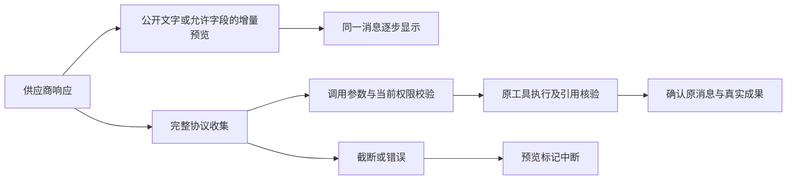

# Agent 流式交互与聊天工作台开发计划

日期：2026-10-05。状态：**开发已完成，实际检查范围见完成报告**。任务清单见 [agent-streaming-ux-tasks-20261005.json](agent-streaming-ux-tasks-20261005.json)。

本轮目标：把当前 Agent 工作台做成连续可读、状态清楚、可中断和可恢复的智能审计对话入口。用户发送目标后立即获得运行反馈；正文真实渐进显示；工具调用与专业模型任务的状态持续更新；回答、资料来源及交付成果保持清楚的关系。继续使用现有 LangGraph、注册工具、Skills、工作区权限和人工操作能力。

## 1. 当前基线与问题

源码根：`F:\OCR\output\clear-automation-dev-20261002\worktrees\platform`。

规划时运行包（基线）：`F:\OCR\output\agent-context-skills-development-20261005\candidate-final`。预览：`http://127.0.0.1:8879/`。预览数据：`F:\OCR\output\ai-audit-product-dev-20261004\workspace`。

上一轮已完成上下文与 Skills：106 个注册工具，首轮 14 个核心工具，按需加载与预算计量、可信环境、4 项业务技能、固定版本与已收到回复恢复。详见 [统一调研及完成记录](Agent上下文与Skills统一调研-20261005.md)。本轮在这份基线上接续，已有未提交修改必须保留。

2026-10-05 只读核对当前用户会话的公开事件和响应结构，未读取输出凭据、未重发消息：连接 `streaming=true`，两轮回复的普通正文均为空；第一轮读取任务、项目和模型目录，第二轮通过 `conversation_answer.content` 返回 421 字正文；可见 `model_delta` 为 0。仅凭流式开关不能证明供应商实际返回 SSE，但现有收集器即使收到工具参数流，也不会公开预览其中的回答。

| 问题 | 已确认的实现原因 | 本轮处理 |
|---|---|---|
| 等待后整段答案出现 | 收集器只发布普通文本，工具参数只缓存；聊天答案最后由工具结果一次性发布 | 增加受控正文预览，完整验证后确认同一条回答 |
| 模型等待期间缺少动画 | 按钮 loading 仅覆盖提交；会话只有条件性的静态等待文字 | 增加贯穿请求、工具、作业和终态的运行状态 |
| 工具开始信息出现较晚 | `tool_step` 在 dispatcher 返回后写入 | 权限和身份检查后、handler 开始前发出真正的开始事件 |
| 长任务没有连续反馈 | 主要呈现提交和完成回执 | 按原生服务实际能力推送阶段、队列和数量变化 |
| 聊天被技术信息打断 | 请求、预算、usage 和工具回执按原事件平铺 | 正文、工具活动与诊断使用各自的显示区域 |
| 消息替换不稳定 | 依赖后向扫描隐藏旧 delta；最终回答、交付、错误缺少统一关联身份 | 使用明确消息身份和确认/中断关系 |
| 断线与回看体验不足 | 已有 SSE 游标，但前端无连接状态；无滚动跟随策略 | 补读去重、重连反馈、历史回看与新消息提示 |

主要依据：源码根下 `agent/streaming.py`、`providers.py`、`runtime.py`、`graph.py`、`routes.py`，门户 `AgentWorkbench.tsx`、`ContextBudget.tsx`、`agent.css`。当前 `model_delta.content` 是**累计全文快照**，不能作为追加字符拼接。

## 2. 应交付的用户体验

### 2.1 普通对话

发送后立即显示“正在提交”；服务器接收后切换“模型处理中”及耗时。模型输出公开正文时，同一条消息逐步更新；如果回答位于 `conversation_answer` 参数中，也能真实预览。预览期间标记“正在生成”，成功确认后成为正式回答，资料引用随确认结果显示。

回答支持 Markdown 标题、列表、表格、代码块和链接。流式阶段的未闭合代码块、中文和转义符能稳定显示。参考资料、工具结果及下载仍使用既有可信引用组件。

### 2.2 自动执行审计目标

用户发送“核对两份付款台账并整理差异底稿”后，对话中展示真实工作安排和工具活动，例如读取资料、核对数据、整理成果。每个调用只有一个活动项，状态从开始更新为等待、完成或失败。专业模型任务显示实际阶段及已处理数量；缺少总量时显示阶段与耗时。

执行完成后，显示正式回答和真实成果入口。工作安排来自已公开的计划或实际工具事件，运行状态来自服务器。模型普通文字不能自行宣布工具成功，也不能把预览文字当作已交付成果。

### 2.3 等待、控制与恢复

模型暂未给出正文时，保持动态状态和耗时。供应商返回整包 JSON 时显示“此响应以完整结果返回”，等待期间仍有真实活动反馈，不用人为打字效果伪装网络流式。

停止、失败、回包未知、等待用户和人工接管都有明确状态。原生任务的取消能力按真实回执展示；停止 Agent 后，仍在执行的原生任务不能被标成已终止。刷新和浏览器断线只恢复读取，不自动重发模型请求或业务命令。

### 2.4 界面组织

延续现有 Clear 界面风格。会话正文作为主要阅读内容，工具过程按当前轮聚合并可展开；项目背景、资料范围、Skills 和手动工具入口保持易于访问。上下文组成、注入版本、模型身份、usage、原始参数和调试 JSON 收入“诊断”详情，错误及资料缺口仍直接可见。

靠近底部时跟随新内容；用户向上回看时停止自动跟随，显示“回到最新消息”。切换任务恢复各自草稿和阅读位置。窄屏下正文与输入框优先，任务侧栏可收起。动画采用轻量点动/脉冲，尊重 `prefers-reduced-motion`，状态文字始终完整。

## 3. 实现方案与关键约定

### 3.1 先补事件契约

事件继续保留现有 `seq/run_id/kind/payload/created`，增量加入公开投影版本、执行代际、模型请求身份、稳定 `display_id`、调用身份及文字版本号。当前事件名称保持可读，新字段用明确版本适配。

| 事件职责 | 必须表达的内容 |
|---|---|
| 运行活动 | 准备请求、等待模型、接收回复、验证调用、执行工具、等待原生任务、等待用户、整理交付及终态 |
| 回答预览 | 来源为普通正文或允许预览的工具正文；稳定显示身份；明确 snapshot/append/replace 语义及 revision；未确认标记 |
| 回答确认/中断 | 与预览使用同一身份；正式内容及引用，或失败/停止/未知结果原因；终态优先于迟到帧 |
| 工具活动 | 原调用身份、操作身份、开始、等待、完成、失败及真实结果引用 |
| 原生任务进度 | 原 job 引用、原生阶段、可用的数量/总量、服务采样时间及最后变化时间 |

稳定显示键使用服务器的模型请求身份及响应块/调用索引。工具名、call ID 尚未完整接收时也能关联预览；不得用正文相似度猜测重复消息。一个请求可包含公开过程说明、多个工具活动和最终回答，不能把这些内容无条件合并。

持久化状态区分“模型生成完成”“工具验证/执行完成”和“正式回答/成果已确认”。模型 EOF 不等于回答已确认，更不等于业务成果已交付。空的 assistant 协议消息不关闭公开预览。

事件写入事务核验运行代际和请求状态，堵住“先检查 current、取消随后提交、再写迟到 delta”的竞态。终态事件应幂等，明确关联请求/显示身份；丢失确认事件的恢复从原回执补齐，不能重新发送模型或重新提交操作。

### 3.2 让工具参数中的答案进入公开文字流

第一版预览白名单为 `conversation_answer.content`；交付摘要 `delivery_publish.summary` 可在后续同轮补入，但只能作为候选文字，最终以验证过的交付回执及实际完整性为准。

实现有界的增量 JSON 字符串读取器，正确处理字段名分片、中文、反斜杠、换行、引号、Unicode 转义、多个并行调用及中途截断。不对半个 JSON 使用 `eval`、正则猜测或提前业务执行。其他工具参数不进入公开正文。

预览与执行路径明确分开：

继续沿用跨分片脱敏和供应商私有协议块处理。公开状态动画使用服务器活动事实；不读取或生成模型内部推理供界面展示。无需增加一轮模型调用来生成“思考旁白”。

所有预览、动画和公开活动仅用于会话投影，不能再次塞入模型历史、服务器工作事实或 `input_state_version`。原模型消息、工具配对、固定 Skills、请求身份及操作账本继续按已有协议保存。

### 3.3 真正开始工具时再显示“正在执行”

工具开始事件放在 dispatcher 的参数、可见集合、Skill 限制、资料范围、运行代际及操作身份检查之后。只完成参数生成或整批验证时显示“已选择/正在验证”，被拒绝的调用不能显示为已经执行。恢复已有操作时显示“恢复原操作状态”，不能制造第二次开始执行。

对于同步 handler，在开始前记录活动；对于异步作业，关联原 job 身份。原生任务观察器使用已有只读服务读取进度，不让主控反复调用查询工具。按状态/阶段/数量变化及有限心跳更新，避免每次轮询都写相同事件；已有 observer 尽量复用。

### 3.4 前端按身份投影，保持一条消息稳定更新

从 `AgentWorkbench.tsx` 拆出事件订阅、会话投影、正文、运行状态、工具活动和滚动控制组件。投影按事件 `seq` 去重，累计快照替换正文；新版本增量帧按 revision 应用。确认/中断优先，重复或迟到事件不重新启动动画。

最终正文在原消息位置确认，工具提交及完成更新原活动项。旧事件通过适配层继续显示，新订阅器不能把旧 `model_delta` 当作新增字符串。旧最终消息没有身份时保留原记录，不用正文匹配删除历史。

Markdown 采用成熟 React 渲染库及 GFM 支持，固定版本并登记 F 盘依赖；不引入整套聊天框架。原始 HTML、可执行链接和代码不执行。正文更新按帧合并，避免每个网络碎片触发完整列表重算；宽表和代码块在消息内部横向滚动。

### 3.5 SSE 能力、重连与日志容量

区分配置“请求流式”、实际响应“SSE/完整 JSON”、已观察的公开文字流及未知能力。连接设置和诊断显示实际能力来源与检测时间。连接探针扩展使用无项目资料的短正文及答案工具参数；探针结果为未知或非 SSE 时仍保留正常工具调用能力。

订阅 hook 使用已有事件 ID、`Last-Event-ID` 和补读接口，显示连接中/已连接/正在重连/连接失败。重连后补读游标缺口并去重；切换会话关闭旧订阅，忽略旧请求/旧代际的晚到帧。终态后仍补读最后的回答确认与 usage，不能见到完成状态就立即丢弃最后事件。

新预览采用节流的增量帧及定期累计快照，确认/中断保存最终快照；避免当前“每个事件再存整份累计正文”的平方增长。快照和增量的恢复顺序可验证，不因容量优化删除原始业务记录。刷新需要重建同一预览；第一版不用引入新的消息队列或更换 LangGraph 执行方式。

## 4. 开发任务与顺序

| ID | 优先级 | 交付 | 主要落点 | 依赖 |
|---|---|---|---|---|
| AS01 | P0 | 公开事件契约、显示身份、活动状态和终态规则；前后端类型一致 | `packages/contracts/agent.py`，Agent `state.py/store.py/runtime.py`，门户 `api.ts` | 无 |
| AS02 | P0 | 两协议正文与答案参数的真实增量预览、确认和中断 | Agent `streaming.py/providers.py/runtime.py/graph.py`，流式回归 | AS01 |
| AS03 | P0 | 真正的工具开始/恢复/完成事件；真实原生作业进度 | Agent `registry.py/graph.py/runtime.py/tools/jobs.py` 与现有服务读状态桥 | AS01 |
| AS04 | P0 | 稳定会话投影、同消息确认、工具活动聚合、诊断收纳 | 门户 `AgentWorkbench.tsx` 及新投影/消息/活动组件 | AS01；集成依赖 AS02、AS03 |
| AS05 | P1 | Markdown、状态动画、耗时、滚动跟随/回看、窄屏及控制入口 | 门户正文/滚动/状态组件、`TaskPanel.tsx/agent.css`、依赖锁 | AS04 |
| AS06 | P0 | 实际流式能力识别、重连补读、代际隔离、日志有界及冷恢复 | Agent `connection.py/providers.py/routes.py/store.py/runtime.py`，订阅 hook | AS01；集成依赖 AS02、AS03、AS04 |
| AS07 | P1 | 普通对话减少无必要的背景/模型目录往返 | Agent `providers.py/environment.py/runtime.py` 及对应请求检查 | AS02、AS04 |
| AS08 | P0 | 生产路径的流式/工具/恢复集成检查与界面核对 | 后端与门户定向测试，F 盘隔离数据及证据 | AS02—AS07 |
| AS09 | P0 | 新候选包、原会话兼容、预览刷新、使用与完成记录 | 打包脚本、F 盘新候选、项目文档 | AS08 |

AS07 将固定提示中的“所有问题先读任务/项目背景”改为按问题需要查询。普通问候、平台能力介绍、已明确注入的配置身份问题可以直接回答；实际项目状态、审计资料和专业模型可用性仍通过工具读取。不得用当前配置别名冒充供应商实际模型，也不能凭过期事实省略必要查询。

实施里程碑：

1. **M1：回答真的在流动。** 完成 AS01、AS02 和 AS04 的最小完整切片，接入 AS06 的终态、重连基础；可演示只有答案工具参数、没有普通正文的聊天渐进显示与可靠确认。
2. **M2：执行过程能看懂。** 集成 AS03、完善 AS04、完成 AS05；可演示真实台账工具接续及一个异步专业任务，过程更新与回答连续可读。
3. **M3：日常使用与交付。** 完成 AS06、AS07、AS08、AS09；断线、刷新、停止、接管和旧会话均可用，发布新候选并刷新本地预览。

M1 通过后即可预览切片；整个计划完成以 M3 为准。先实现协议与真实过程，再打磨动画，避免先做静态演示。

## 5. 并行分工与落点

建议主代理统筹三个子代理，遵守共享文件单一编辑者：

| 负责人 | 负责内容 | 编辑边界 |
|---|---|---|
| 主代理 | AS01 契约冻结、共享 runtime/store/routes 集成、AS06 恢复协调、AS08/AS09 | 共享契约、运行/存储/路由、打包与文档 |
| 流式后端代理 | AS02、能力检测适配及对应测试 | `streaming.py/providers.py/connection.py`；runtime/graph 修改先交主代理集成 |
| 工具状态代理 | AS03、原生进度映射及对应测试 | `registry.py/graph.py/tools/jobs.py`；runtime/store 修改先交主代理集成 |
| 门户代理 | AS04、AS05、订阅 UI 与对应测试 | Agent 门户、门户测试、Markdown 依赖和锁 |

AS01 定稿后，AS02、AS03、AS04 可并行；共享文件不由多个代理同时编辑。AS07 的提示调整在流式后端主要修改稳定后进行。原生训练/GPU长测和浏览器批次串行，先针对受影响路径检查。

规划登记的下一轮产物根：`F:\OCR\output\agent-streaming-ux-dev-20261005`，用于基线、临时、缓存、依赖、隔离测试工作区、日志、截图和新候选。本轮运行目录已初始化并保存基线、开发产物及检查证据。实施时先确认真实路径均在 F 盘，再配置环境及子进程写入边界；盘外额外 workspace root 不构成写入授权。

源码优先复用上述 F 盘工作树，保存新增开发前基线；不得覆盖上一轮 `before`、候选或历史失败证据。包装使用新的目录，不能覆盖 `candidate-final`。功能测试使用合成资料和隔离工作区；真实远程验证使用无业务资料的短目标，不自动重发用户旧消息。

## 6. 完成条件与有限检查

这些检查用于证明本轮具体功能，不建立新的审计质量计分体系。颜色、间距等低风险视觉调整用界面核对；新增自动检查集中在协议、状态、身份、恢复及关键阅读行为。

| 场景 | 必须满足 |
|---|---|
| C01 两协议纯答案工具 | 普通正文为空时，仍在完整回包前出现答案预览；最后同一条消息确认，无重复正文 |
| C02 普通正文与多工具混合 | 公开过程说明与回答各自稳定；多个调用分片不串内容，引用随实际结果确认 |
| C03 解析边界 | 中文/转义/分片字段名正常；重复键、无效JSON、截断、超大响应不提前执行工具；草稿正确中断 |
| C04 生命周期 | 请求立即反馈；工具在真实handler开始前出现开始状态；失败/停止/未知回包关闭当前生成动画 |
| C05 权限与代际 | 同批次 Skill 限制仍生效；被拒绝的调用不显示已执行；取消与写增量竞态不产生有效晚到帧 |
| C06 原生任务 | 至少真实数据任务和一个异步专业任务有开始/等待/完成接续；进度来自原服务，未知总量不显示虚构百分比 |
| C07 整包响应 | 上游忽略流式或返回JSON时明确降级，答案一次确认；动画不伪造文字流 |
| C08 重连与刷新 | 断线、重复事件、缺口补读、终态后补读均不漏不重；只恢复订阅，不增加模型或业务提交 |
| C09 冷恢复 | `sent` 未知不重发；`received` 原输入恢复保持原身份；源技能变化、真实用户/权限变化遵守上一轮规则 |
| C10 跨会话 | 快速切换、浏览器返回时旧流不写入新会话；草稿及阅读位置隔离 |
| C11 停止与接管 | 待确认控制状态清楚；停止后原生任务继续/取消按真实能力显示；新一轮保留结果身份 |
| C12 正文阅读 | 中文长文、表格、代码块正常；用户回看不被新消息拉走；自动跟随时保持最新内容可见 |
| C13 诊断与容量 | 估计与实际usage仍分开；注入/Skill版本可查；预览帧不增加LLM上下文，事件存储不随累计快照平方增长 |
| C14 简单对话 | 已有可信事实足够时，不强制背景/目录工具调用；需要实际数据的问题仍查询工具 |
| C15 打包与历史 | 共享契约/门户构建通过；新包冷启动，旧会话可读，原模型配置保留，未自动重发历史请求 |

体验指标只测平台可控部分：

- 用户点击后在下一渲染周期进入发送状态，不等待服务响应才展示反馈。
- 服务器收到可公开的有效片段后，默认约 100—200ms 合并更新；最终确认、中断和控制事件及时发出。现有 SSE 空闲轮询最多约500ms，会计入测量，必要时用进程内唤醒缩短，SQLite 仍是持久事实来源。
- 本机受控流式检查目标为“有效公开片段到界面可见”P95 不超过750ms；同步工具开始到状态可见同样记录延迟。供应商思考/首字延迟单独记录，不算成平台流式开销。
- 用10,000字级回答记录帧数、事件总字节和最后恢复内容一致性，确认容量随文本总量有界增长；不跑无关长时压力测试。
- 在1280×800与窄屏核对正文、输入、停止/接管、宽表和回看；使用减少动画偏好再核对状态。

发布前只补受影响回归：上下文/Skills、图/恢复、会话权限、流式协议、手动接管与门户构建。无需因改了动画重复训练本地分类模型；专业进度桥改动涉及原生服务时再跑对应合成任务。

## 7. 本轮完成的判定

只有确认以下结果，才将任务清单的 AS01—AS09 更新为完成：

1. 在生产 provider→runtime→SSE→门户路径上，纯答案工具也能真正渐进显示并确认。
2. 等模型、同步工具执行、原生任务等待及所有终态都有准确的活动状态；工具与结果身份可追溯。
3. 回答连续可读、过程可展开、诊断可查，滚动和控制不会干扰阅读。
4. 断线、刷新、停止、人工接管、冷恢复和旧会话满足 C01—C15；没有把模拟响应当作真实上游能力证据。
5. 形成新 F 盘候选、检查记录和使用说明，安全刷新本地预览；历史包、用户数据和既有未提交修改保留。

规划阶段仅交付计划与任务清单；当前AS01—AS09已实施，候选、实际检查范围和预览切换结果见第8节及完成报告。

## 8. 开发落地记录

2026-10-05：AS01—AS09已完成，候选0.7.0已切换到8879，原会话和模型配置保留。完整证据、时延与验证范围见 [完成报告](F:/OCR/output/agent-streaming-ux-dev-20261005/完成报告.md)。任务清单同步更新为completed。C10已补齐独立浏览器检查，任务选择及浏览器后退/前进恢复各自未发送草稿、历史和阅读位置，非GET请求为0，隔离数据库计数前后一致；旧流迟到帧隔离另有组件证据。
