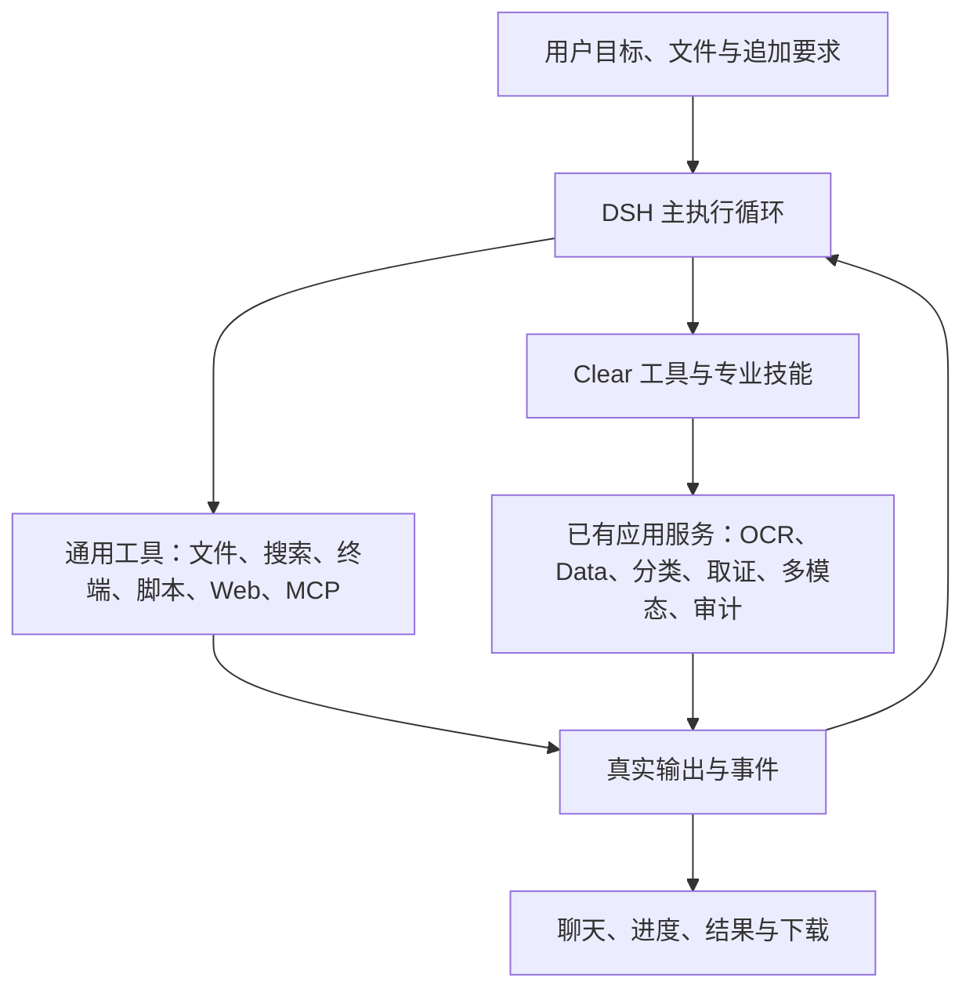

# Agent 通用能力恢复与审计增强：调研结论及升级计划

> 适用范围补充（2026-10-23）：本文的缺失能力判断针对当时0.13.0 candidate-018；通用工具、自然收尾及组合业务已在0.14.0实施，不能当作当前仍未修复。20+12场景、每类5次和1.2倍等是当次基础升级目标，后续修改先验证受影响的真实用户路径；只有需要证明性能差异或排查回归时扩大重复对照，轮数目标不变成运行时硬停。当前以[易用性优先实施计划](Clear易用性优先与Agent简化实施-20261023.md)安排工作，历史验收和失败事实保持。

日期：2026-10-19（香港时间）。本文件保留初次调研结论与计划；后续自主实施和真实验收见[实施与验收记录](Agent通用能力恢复实施与验收-20261019.md)。

产品目标按本次澄清确定：**先让 Clear Agent 能顺畅完成原版 DSH 的常规任务，再叠加审计平台工具的自主调用、参数选择和效果优化。** 通用能力、任务成功率与交互流畅度优先；工具数量和审计流程覆盖不能替代这三项。

## 一、结论

**已经换成 DSH，但当前产品是“DSH 核心组件＋封闭业务工具宿主”，并非原版 DSH 的完整能力加审计增强。用户感觉能力受限有明确代码依据。**

1. **通用执行能力被裁掉。** 当前宿主加载模型循环、会话、工具运行时及上下文整理，没有装配通用文件操作、搜索、PowerShell 执行、Web、MCP 和子 Agent 等完整能力。提示词还明确要求“不要猜测或创建代码”“不自行实现算法或脚本”。因此遇到已注册业务算子以外的需求，Agent 缺少写脚本、调用现有库、处理文件和自助补齐任务的通道。
2. **Clear 外层继续规定如何回答、如何结束。** 普通文字能通过模型协议解析，但当前收尾只认可 `conversation_answer` 或通过核验的 `delivery_publish`。DSH 自然结束后，Python 外层可能再次注入“任务尚未通过交付检查”。这会增加模型服从专用协议的负担。
3. **工具发现和调用粒度增加了往返。** 当前实装 121 个工具，首轮暴露 14 个核心工具；业务工具通常还要经过列目录、加载定义，再实际调用。Data 的一次 trim 只作用于一列，七列就要七个业务步骤。把原生服务内部的准备、版本、读取、导出都交给模型逐步编排，会放大长任务成本。
4. **近期修复确有成果，但成功恢复与高效首跑是不同指标。** 最新 018 的全新 PDF 任务已有 1 次模型请求、6 次工具、1 次原生请求的成功证据；同时，三文件清洗任务是在 014→015→016 跨版本续作后，累计 116 次模型请求、81 次工具、29 个原生作业才完成。这是包含故障验收、QA 传输问题、上下文整理和跨版本修复的轨迹，反映该任务恢复过程的成本；不能全部称作规划轮数，不能推算正常三文件必需 116 次请求，也不能当成 018 全新首跑的耗时。见[最近验收记录](/F:/OCR/docs/platform-automation/Clear用户流程修复与验收-20261018.md)。
5. **推荐继续使用 DSH，并收薄 Clear 宿主。** 恢复 DSH 的通用工作能力，保留 Clear 已有原生服务、作业回执、输入版本与成果溯源，将审计业务实现为可按需调用的工具和技能。ZCode 作为工具发现、输入接续和状态展示的设计参考。

初次调研阶段尚未做同模型、同输入的全新DSH/Clear对跑，因此当时不能给出整体速度百分比。后续固定006候选已完成110次真实对照，实测结果及原版DSH本机沙盒限制见[实施记录](Agent通用能力恢复实施与验收-20261019.md)。

## 二、核查对象与证据

初次核查时正式入口 `release/Clear/current.json`：Clear **0.13.0 user-flow candidate-018**，8879；实际健康接口返回 `engine=deepseek-harness`、`engine_version=0.2.1-alpha.4`。被检查的 10 个关键文件与审阅源码快照逐字节一致，结论没有套用早期候选代替当前程序。

| 已确认事实 | 依据及影响 |
|---|---|
| DSH 是实际执行内核 | 正式依赖锁定 `0.2.1-alpha.4`；[宿主装配](/F:/OCR/output/user-flow-fixes-20261018/delivery/Clear-0.13.0-user-flow-candidate-018/platform/agent_harness/host.mjs:373)实际加载官方插件 |
| 通用工作能力未装配 | [依赖](/F:/OCR/output/user-flow-fixes-20261018/delivery/Clear-0.13.0-user-flow-candidate-018/platform/agent_harness/package.json:9)、宿主插件列表和实际注册表均没有通用文件/终端/Web/MCP/子 Agent 工具；[主提示词](/F:/OCR/output/user-flow-fixes-20261018/delivery/Clear-0.13.0-user-flow-candidate-018/platform/src/workbench_platform/agent/providers.py:43)还限制自行写脚本 |
| Skills 只能指导既有工具 | [技能实现](/F:/OCR/output/user-flow-fixes-20261018/delivery/Clear-0.13.0-user-flow-candidate-018/platform/src/workbench_platform/agent/skills.py:243)明确 `scripts_supported=False`，技能资源存在不代表可以执行脚本 |
| 普通文本不能独立收尾 | 本轮纯函数探针：协议解析接受普通 assistant 文本；同一文本进入[收尾逻辑](/F:/OCR/output/user-flow-fixes-20261018/delivery/Clear-0.13.0-user-flow-candidate-018/platform/src/workbench_platform/agent/harness_service.py:535)返回 False；[外层循环](/F:/OCR/output/user-flow-fixes-20261018/delivery/Clear-0.13.0-user-flow-candidate-018/platform/src/workbench_platform/agent/harness.py:290)随后会要求继续 |
| 元数据写入可能触发统一业务交付要求 | [状态规则](/F:/OCR/output/user-flow-fixes-20261018/delivery/Clear-0.13.0-user-flow-candidate-018/platform/src/workbench_platform/agent/harness_service.py:451)按非核心工具的成功写入设置 `business_started`；`audit_update_plan` 本身是 derive 工具，也会进入这一类 |
| 工具发现需要额外加载 | [注册表](/F:/OCR/output/user-flow-fixes-20261018/delivery/Clear-0.13.0-user-flow-candidate-018/platform/src/workbench_platform/agent/registry.py:127)查询只返回元数据；本轮探针列出 8 个 Data 工具后，直接调用未加载工具仍被拒绝 |
| 执行被统一串行化 | [宿主](/F:/OCR/output/user-flow-fixes-20261018/delivery/Clear-0.13.0-user-flow-candidate-018/platform/agent_harness/host.mjs:193)所有工具 `parallelSafe=false`、并发数为 1；[模型请求](/F:/OCR/output/user-flow-fixes-20261018/delivery/Clear-0.13.0-user-flow-candidate-018/platform/src/workbench_platform/agent/providers.py:271)也关闭并行工具调用 |
| Data 清洗粒度偏细 | [Trim 契约](/F:/OCR/output/user-flow-fixes-20261018/delivery/Clear-0.13.0-user-flow-candidate-018/platform/packages/contracts/data_operations.py:35)只接受一列；[apply_step](/F:/OCR/output/user-flow-fixes-20261018/delivery/Clear-0.13.0-user-flow-candidate-018/platform/src/workbench_platform/application_services/operations/data.py:90)逐步骤提交实际作业 |
| 很多错误缺少可操作的修正信息 | [注册表](/F:/OCR/output/user-flow-fixes-20261018/delivery/Clear-0.13.0-user-flow-candidate-018/platform/src/workbench_platform/agent/registry.py:248)仍将多种 ValueError/KeyError 合并为通用 `invalid_input`，模型难以区分错参数、错版本和错引用 |

本轮注册表实际是 **121** 个工具，说明书仍写 120；这是文档漂移，主要问题仍是能力组成及调用方式。当前全量 schema 序列化约 108,817 字节，14 个核心工具约 9,335 字节；这是 JSON 字节统计，不能当作实际 token 或延迟。

历史长任务的具体障碍也有记录：导出 CSV 多出的 `source_row` 被误解成业务列异常，随后读取不适用的文件引用得到通用错误，模型反复查目录和历史，未继续第三份文件。该说明已在后续版本补齐。这个案例说明工具语义与错误反馈会直接消耗模型轮次，不能把问题统一归因于模型或上下文整理。[原始现场](/F:/OCR/output/user-flow-fixes-20261018/evidence/j06-real-first-run-blocker.md)与[最终续作审计](/F:/OCR/output/user-flow-fixes-20261018/evidence/j06-real-compaction-audit/continuation016-final.json)保留。

当前已有的正向能力应继续使用：明确本地动作的零模型执行、原生作业后台等待、故障后同任务继续、追加要求、成果先可用、原件和结果固定版本、前导零及 Decimal 精度、人工接管与审计证据。这些近期修复不能重新列为“完全未实现”。

## 三、DSH 与 ZCode 各取什么

上游资料按提交固定：

- DSH：[`687f282e`，0.2.1-rc.2](https://github.com/deepseek-ai/deepseek-harness/tree/687f282e8625c6b8d11ff58211a90524be2e4317)。本机仍是 alpha.4；上游新版本的能力和机制用于调研，不能自动视作本机已具备。
- ZCode：[`0a1fc56d`](https://github.com/zai-org/ZCode/tree/0a1fc56d279fd1001f78387bd81aec1c26767411)，README 登记版本 v3.16.1。本报告的 ZCode 指 `zai-org/ZCode`。

| 方面 | DSH 的可用设计 | ZCode 的可借鉴设计 | Clear 的选择 |
|---|---|---|---|
| 通用执行 | 插件化文件、文件搜索、Windows PowerShell、后台作业、Skills、Web、子 Agent 等；具体可用性由 profile 和连接决定 | 文件读写编辑、终端、Web、MCP 等工具契约完整 | 以 DSH 官方能力装配恢复通用基座；业务工具作为扩展 |
| 回答与接续 | 一个 turn 内执行模型及工具；无后续工作时正常结束，输入进入 inbox | 运行时接收新输入，统一命令接纳和会话投影 | 普通文字正常结束；运行中可补充；已有成果与未完事项分开表达 |
| 工具发现 | 工具注册和执行前后扩展点，业务插件可以直接接入 | ToolSearch 返回工具引用并由适配器提供定义；Local 模式复用普通执行器 | 采用一次搜索即可获得可调用定义的产品语义；常用工具直接提供 |
| 前端状态 | 持久会话事件与实时流分工 | command ACK 与状态 projection 区分，UI 订阅 snapshot/delta | 服务端确定状态，前端显示；命令接纳不等于已完成 |
| 提示词与上下文 | 提示词、运行时上下文、工具定义可组合 | 稳定提示词与动态环境、技能、工具定义分离 | 通用身份保持简洁；审计背景按需提供，减少每轮重复事实 |
| 并发与失败 | 现成执行管线和扩展点 | 用 concurrentSafe 等实际属性调度；普通工具失败不必跳过后续无关工作 | 先开放已验证的独立读取；写入、版本冲突、GPU 排队继续按实际资源处理 |

ZCode 的 ToolSearch **缺省为 off**，支持 native/local/off 等模式；其复杂的 provider 兼容协议不需要整体复制。Clear 首先实现兼容当前模型接口的一次搜索加载，并验证冷恢复。ZCode 的远程主机、移动端、工作流和多套部署结构也不属于本次升级范围。

DSH 上游的插件装配可见[标准预设](https://github.com/deepseek-ai/deepseek-harness/blob/687f282e8625c6b8d11ff58211a90524be2e4317/packages/bundle/web-app/presets/standard.patch.yml)及[基础配置](https://github.com/deepseek-ai/deepseek-harness/blob/687f282e8625c6b8d11ff58211a90524be2e4317/packages/bundle/base/cordis.patch.yml)；ZCode 的实现参考[工具搜索](https://github.com/zai-org/ZCode/blob/0a1fc56d279fd1001f78387bd81aec1c26767411/apps/zcode-cli/packages/core/src/tool/handlers/tool-search.ts)、[搜索兼容语义](https://github.com/zai-org/ZCode/blob/0a1fc56d279fd1001f78387bd81aec1c26767411/apps/zcode-cli/docs/design/v2/tool/19-tool-search.md)和[消息流](https://github.com/zai-org/ZCode/blob/0a1fc56d279fd1001f78387bd81aec1c26767411/docs/architecture/message-flow.md)。

## 四、升级后的产品行为

用户仍在同一个聊天入口提出要求。普通任务自动获得轻量工作目录；正式审计档案、计划和证据流程按任务需要启用。

| 用户要求 | 升级后应有行为 |
|---|---|
| “解释一下这个概念”“这段结果是什么意思” | 直接正常文字回答；需要来源时读取来源，不要求调用回答工具 |
| “检查这个目录、改一下脚本并运行验证” | 在授权的 F 盘工作目录读取、修改、执行和验证，报告实际结果 |
| “按这个特殊规则清洗表格、补计算列并画图” | 优先用已有适合的 Data 能力；缺少算子时可以使用受控 Python/已有库完成，结果可读取和下载 |
| “提取图片文字” | 通过一次面向目标的工具调用完成常规准备、识别、读取和输出；服务等待作业，模型不搬运内部 ID |
| “把三份表指定列去空格，保留编号和金额” | 一次提交多列处理要求；服务执行已有算子，逐文件给结果，只修复失败项 |
| “这批屏拍识别不好，自动调优后导出” | 检查代表样本，尝试适用引擎与参数，比较结果后处理整批；保留来源、选参理由及失败项 |
| “再核对付款台账并形成底稿” | 按需载入审计技能，调用核对、证据和底稿服务；已有通用能力继续可用 |

自主调用与调优的含义是：**能选择适用工具、合理组合参数、观察结果、修正失败并完成交付。** 调优默认作用于当前任务和参数方案；训练模型、改变全局默认配置等另有明确目标时才做。

## 五、历史实施计划（已交付，不自动重新开工）

预计总投入 **14—22 人日**，按单名工程师连续实施估算；首个可试用的通用基座约 6—9 人日。每阶段交付可运行候选及对应用户任务结果，以下时长是估算。

| 阶段 | 实施内容 | 完成标准 | 投入 |
|---|---|---|---|
| 0：固定对照基线 | 固定当前 018；建立原版 DSH 同模型通用任务基线，区分模型、原生计算和宿主开销 | 20 个通用任务、12 个平台任务有输入、期望结果与实际轨迹；缺失能力明确记失败 | 1—2 人日 |
| 1：恢复通用基座 | 装配文件读写编辑/搜索、PowerShell 与 Python 执行、后台进程及适用 Skills；接入 Web/MCP/按需子 Agent；普通文本自然收尾 | 文件、脚本、自定义数据处理及多轮接续可以完成；普通问答一轮结束；通用任务达到原版基线 | 5—7 人日 |
| 2：收薄工具与控制链 | 常用工具直接可用，一次搜索加载其余工具；复用现有服务完成准备/等待/读取/导出；Data 增加多列/多步骤组合入口；改进错误反馈 | 三文件七列清洗无需模型逐列调度；普通任务无额外审计计划或交付工具前置；历史任务仍能恢复 | 3—5 人日 |
| 3：加入任务内调优 | 在既有 OCR 等工具之上建立样本比较、选参、失败项修复和批量执行；用 Skills 指导业务判断 | 在真实样本上证明选参依据、效果与成本；不因调优重复整批成功项；审计任务可端到端完成 | 3—5 人日 |
| 4：统一体验与发布验收 | 收敛服务端状态投影、简化默认展示，验证流式、追加、刷新、故障继续、结果下载及旧会话 | 达到下节基线和升级目标；固定候选通过冷恢复与兼容检查后再发布 | 2—3 人日 |

### 阶段 1 的具体取舍

- **保留一个 DSH 决策循环。** 清除“模型已经自然结束，外层再反复提示继续”的通用控制方式。普通回复直接呈现；业务执行是否成功由已有回执判断，业务失败时可以自然解释阻碍并给出已完成结果。
- **通用工具与专业工具共存。** 优先使用平台擅长的能力，补充脚本处理未覆盖的任务。平台业务库、作业提交和正式证据写入继续经过应用服务，脚本在任务工作目录处理授权输入与派生文件。
- **保持 F 盘执行边界。** 文件、Git 元数据、解释器输出、临时目录、依赖/浏览器/模型缓存及子进程落点全部在 F 盘，核查真实路径。执行权限不能只靠提示词约定；复用适用的进程/文件边界实现并验证。
- **先在当前 alpha.4 对照恢复能力。** rc.2 在独立兼容分支验证，会话格式、恢复、适配器和上下文整理通过后再合并；版本升级单独记录收益，避免与外层简化混淆。
- **MCP、Web、子 Agent 按实际配置提供。** 无连接、无网络或模型不支持的能力明确显示不可用；基础单任务不依赖多 Agent 编排。

### 阶段 2 的具体取舍

- `tools_list`/`tools_describe` 保留旧会话兼容；新请求使用一次搜索并加载定义，且只有搜索本身不执行业务操作。常用文件工具和少量场景工具直接暴露，不把 121 份 schema 每轮全部塞入上下文。
- 面向目标的组合工具直接复用已有 `application_services` 与直接驱动能力。例如文字提取返回可读全文和成果引用；Data 清洗接受多列/步骤，内部继续使用当前算子、版本与回执。普通服务准备不再成为模型独立决策步骤。
- 新自然语言任务由主 DSH 理解后调用这些工具；明确按钮和类型化 API 保留零模型路径。停止继续扩充口令白名单和独立前置目标解释层，已接受的旧驱动任务按原身份完成与恢复。
- 普通文件创建后自动登记输出；用户要求的业务条件由服务端校验并提供结果。`delivery_publish` 暂作历史兼容与显式业务发布接口，逐步退出所有任务的统一终止条件。
- 将“计划/元数据更新”与“实际业务产物”分别表达，前者不会把一次讨论强制升级为完整业务交付。
- 错误提供稳定原因、可修正字段、当前版本或可读取引用，保留敏感数据边界；普通失败只阻断实际依赖它的后续动作。
- 独立只读操作验证后可并行；共享可变对象、原生 GPU 作业和有依赖的处理保持实际顺序。并发不是第一阶段解决能力缺口的替代方案。

### 阶段 3 的“调优”闭环

以 OCR 为首个场景：代表样本 → 查询适用引擎/旋转/对比度等选项 → 在任务预算内比较少量候选 → 核对覆盖、结构、关键字段和冲突 → 选取方案 → 整批执行 → 仅重试失败或低质量项 → 导出。

有人工真值时比较实际识别误差；没有真值时只能报告结构完整度、规则通过率及模型间分歧等可观测指标，不能把高置信度或多个引擎一致冒称准确率提升。缺少可用识别结果时说明缺失，不能用猜测填补财务事实。已有模型和算法优先复用；一次性脚本可用于合法的整理、计算和输出，正式审计结论继续有证据支持。

## 六、验收方式：用真实任务判定升级

**通用任务先达到原版 DSH 基线。** 固定同一模型接口、模型 ID、输出预算、上下文容量和可比权限；通用对照使用同一资料。平台任务另以现有原生服务结果核对，并可加一组 DSH＋同平台插件作为对照，避免要求原版 DSH 凭空拥有本地专业模型。

20 个通用任务覆盖：直接问答、解释已有内容、多轮指代和修正、目录检索、文件阅读编辑、创建及运行脚本、自定义 CSV/XLSX 计算、图表/文件生成、代码修改验证、后台作业、流式输出、运行中追加、暂停继续、刷新/重启恢复，以及已配置的 Web/MCP/Skills/子 Agent。正式分组和样本在阶段 0 固定，复杂任务可以覆盖多项能力。

12 个平台任务覆盖：图片识字、指定 PDF 页、PDF 复合比较、多列/多文件 Data、失败项续作、分类预测、取证、多模态处理、OCR 选参、跨工具核对、底稿草稿和人工接管带回。普通处理无需正式档案，正式署名仍须真实人工操作。

| 验收项 | 升级目标 |
|---|---|
| 通用能力 | 20 项选定任务均能完成，且同条件成功率不低于原版 DSH；未配置能力单列，不能计作通过 |
| 问答 | 简单问答一次模型请求完成，不调用专用回答工具，不额外提示继续交付 |
| 常规文件任务 | 自主读取、处理、执行验证并返回实际文件；不因缺少预注册业务算子直接放弃 |
| 简单提取 | 明确按钮/API 为 0 次主控；自然语言固定提取通常不超过 2 次主控请求，原生等待不调用模型 |
| 三文件七列清洗 | 全新首跑正确完成，编号、金额精度及来源保留；正常主控请求目标不超过 8 次，模型不逐列往返；原生内部步骤单独统计 |
| 通用性能 | 当次升级的对照目标为成功场景各跑 5 次、中位数初期不超过原版的 1.2 倍；后续改动按影响范围验证，只在性能声明需要时扩大对照，模型与计算耗时分别报告 |
| 反馈与成果 | 接纳后 1 秒内给真实执行反馈；原生结果确认后目标 2 秒内可读、5 秒内可下载，冷启动和资源等待单列 |
| 接续与恢复 | 追加目标不中断原要求；可恢复故障保持原任务；不重复已接受的业务写入；成果先可用且失败项可继续 |
| 流程负担 | 普通任务额外审计计划/正式档案/交付确认前置为 0；只在影响实际结果的歧义上提问 |
| 正确性 | 下载实际文件核对内容、覆盖及必要哈希；不降低用户条件来达到轮数或时延指标 |

轮数和时延属于验收目标，不是达到数字就强行结束任务的运行时上限。分别记录正常模型请求、整理请求、重试、工具调用和真正原生作业；同时记录首次有用结果、总完成时间及用户被迫干预次数。通用能力或普通任务未达标时，后续审计特化不计作基础升级完成。

## 七、落实顺序与兼容

实施从当前正式 018 固定源码和已有 F 盘开发源开始，先建立对照，再完成通用能力与正常收尾，然后简化工具调用，最后加入业务选参和精修。复用已存在的会话身份、原生服务、操作回执、输出登记及成果下载，不为这次升级再引入新的工作流引擎或服务集群。

已有 `conversation_answer`、`delivery_publish`、直接驱动及工具加载记录需要兼容读取和续作；新语义通过版本明确区分。模型对话以 DSH 会话为准，业务执行事实以原生回执为准，前端读取统一投影；同一状态不再由多个层各自推断。

初次调研阶段仅增加调研、探针和计划文档，没有修改执行程序、迁移业务数据、调用用户模型或切换发行入口。本文代码证据链接固定到当时的018封存版本，后续开发源码更新不改变历史判断。F 盘证据目录为 `F:\OCR\output\agent-baseline-research-20261019`，含正式代码身份、纯函数探针、上游固定提交快照和来源哈希。完整资料索引见[本轮记录](/F:/OCR/output/agent-baseline-research-20261019/README.md)。
