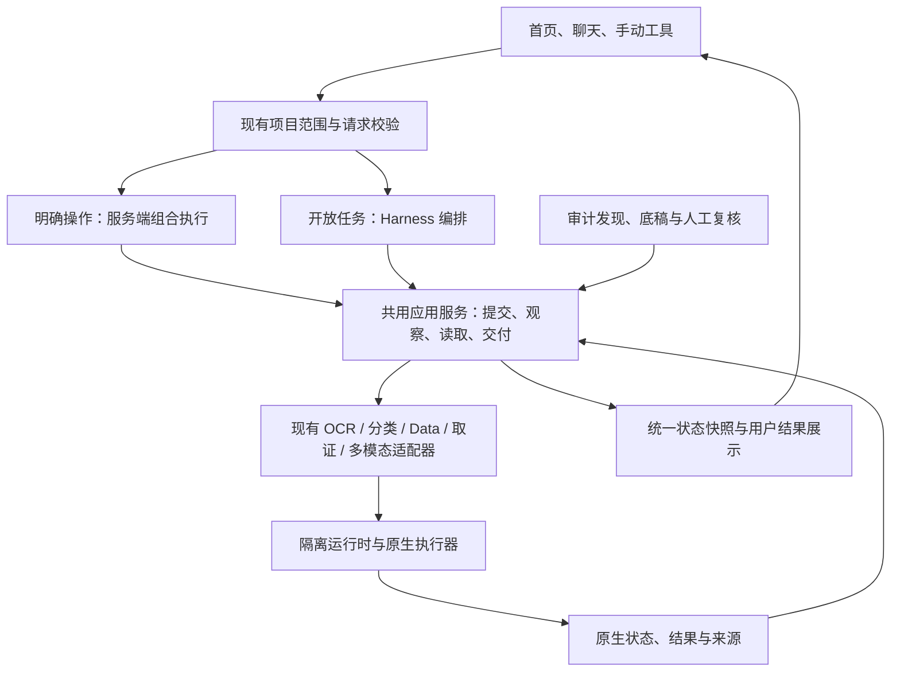

# Clear 全平台架构修订计划

计划日期：2026-10-16；实施更新：2026-10-17。状态：**本机核心实现、隔离真实验收及交叉审查完成；22项完成、8项验收仍未关闭**。最终封存 Clear 0.13.0 architecture candidate-006；正式入口仍为 Clear 0.12.1 visual candidate-003，未切换正式DATA或共享模型。

本轮完成中立服务与四类持久明确操作、终态/覆盖/全文修复、严格阶段错误和恢复围栏。真实验收发现并修复冷备误判、历史辅助拒绝污染交付、原生停机后等待无法恢复等问题。006真实原句零模型、同native停机恢复、PDF复合分析复核、分类预测/失败子集/无模型及完整TXT通过；5冷/10热与恢复证据绑定006。扫描PDF真实执行身份005另有明确闭包说明。性能目标、人工质量/正式人审、完整跨领域/批次/分类资格及PG仍未全部满足，不标为全平台验收完成。

详见[实施与审查报告](Clear全平台架构修订实施与审查-20261017.md)，每项状态、证据和剩余条件已写回配套任务JSON。全部证据、候选及新目录恢复副本位于`F:\OCR\output\architecture-revision-20261017`，源码同步不是正式发行。

本计划以单图文字提取故障为锚点，目标是让任务复杂度决定执行成本，让各入口复用可靠的业务服务，让完成状态对应用户实际拿到的结果。实现中优先删除不必要的决策步骤和重复职责，复用已有存储、适配器、身份与恢复机制。

配套工作清单：[clear-architecture-revision-tasks-20261016.json](clear-architecture-revision-tasks-20261016.json)。它用于分解范围与验收，不启动新的自动化调度器、审批系统或研发框架。

## 1. 结论及证据边界

**需要做全平台修订，修订主轴是职责和契约。** 一张图片触发 20 次模型请求、一次上下文整理，识别成功后仍标部分完成，两个已结束作业还显示运行中，这些现象经过共用 Agent、交付和前端投影代码，影响范围超出 OCR。

第二轮静态核查覆盖 31 个关键文件，全部与正式发行逐字节一致。进一步确认了四项架构事实：

| 事实 | 证据 | 推论与边界 |
|---|---|---|
| 全工具共用执行、等待、交付策略 | `agent/runtime.py` 注册各工具族；`harness_service.py` 等待和推进；`tools/context.py` 统一交付 | OCR 暴露的问题必须在共用机制修正，并验证每个生命周期族；不宣称所有工具已经发生相同故障 |
| 下层服务反向依赖 Agent 工具 | `application_services/job_lifecycle.py:51/56/84`，`manual.py:85/89/109`，`references.py:257` | 共 7 处 import 将应用服务连接到 Agent 工具实现；仅增加一个 OCR 快捷按钮无法解除这项耦合 |
| 多入口和多种任务语义并存 | 手动 API、Agent 工具、BatchRunner、原生任务、作业投影、审计任务、正式审计记录 | 要统一底层行为与对外解释，保留不同对象的独立责任；不强行合并数据库和历史身份 |
| Agent 运行按整个 workspace 独占 | `agent/store.py:87` 的唯一索引包括运行、等待、暂停及待核实状态 | 一个暂停会话也可阻挡同项目的新运行；需审视准入粒度，不能直接删除索引后无保护并行 |

本轮没有为其他工具重新执行全部业务样本。跨工具失败恢复、性能、输出易用性的具体表现属于待验证项，列入验收矩阵。

当前正式启动绑定 `workbench_platform.app`，本地模式声明 `multiuser=false`；源码另有 PostgreSQL 中央任务服务 `tasks/server.py` 和 `tasks/worker.py`。中央服务是需要兼容的独立部署路径，不能把它当成本次 OCR 的已证实瓶颈，也不把启用它作为修订前提。已有架构文档以 0.10.0 为主的历史描述需在交付时更新。

详细事故证据：`F:\OCR\output\agent-workflow-audit-20261016\核查报告.md`。本轮架构证据：`F:\OCR\output\architecture-revision-plan-20261016\evidence\architecture-scan.json`。

## 2. 修订后的产品行为

用户仍通过现有首页、聊天和手动工具完成工作，不增加必须理解的“轻量/重型模式”设置。入口根据已经明确的目标和资料选择合适执行路径。

| 用户目标 | 默认路径 | 用户应拿到什么 |
|---|---|---|
| 提取图片文字、读取明确 PDF 页文字、明确清洗操作、已有模型分类预测 | 服务端组合执行 | 直接可用的文字/表格/预测结果，清楚的状态和来源，适合使用的下载格式 |
| 多资料查找、跨工具分析、需要根据结果选择下一步 | Agent 编排应用服务 | 适量的公开安排、真实进度、可核对的分析与成果 |
| 形成审计发现、底稿、正式档案或人工复核 | Agent 或人工调用审计业务 | 固定证据、事实与解释、草稿/正式版本、明确的人工责任 |

这三类是内部处理策略。执行期间可以升级到需要推理的路径；升级前保存已完成步骤和回执，解释新增工作原因。相同任务恢复时沿用已保存路径，不重新猜测意图，不重新提交已接受操作。

例：“提取图片文字”直接产出全文；“检查这张票据是否存在异常，结合台账形成发现”进入分析。不能仅凭出现“文字”“图片”等关键词就截断复合要求。没有模型连接时，明确的手动/确定性操作继续可用，需要自由理解和分析的请求清楚说明所需连接。

## 3. 目标架构与职责

这张图表示依赖方向，继续保持本机组合式应用和现有计算进程隔离，不拆成额外网络服务。

| 层 | 应负责 | 应移出的职责 |
|---|---|---|
| 门户与聊天 | 收集目标、范围和必要选择，展示服务端状态与结果 | 根据旧消息自行判定作业仍运行；把所有诊断默认铺给用户 |
| 入口处理 | 已授权目标的类型化转换、选择执行路径 | 执行算法；伪造或猜测原生身份 |
| 应用服务 | 输入固定、业务操作、观察、结果读取、覆盖与交付 | 导入 `agent.tools`；依赖模型决定如何搬运内部 ID |
| Agent | 理解、分析、选择必要业务动作 | 重复实现服务准备、范围固定、轮询和成果封装；无条件维护审计计划 |
| 工具适配器与计算 | 原生任务、分阶段执行、真实错误与结果 | 决定整个用户目标已交付或人工复核已完成 |
| 资源与持久化 | 进程身份、GPU 所有权、幂等、固定版本、恢复 | 把租约到期当作进程停止；把回执未知当作可重新提交 |
| 审计领域 | 证据固定、发现、底稿、正式记录和人工署名 | 成为任何普通工具调用的前置步骤 |

依赖调整以搬移现有实现和薄适配为主：先抽出 OCR/PDF、分类、作业读取和结果验证，再让 Agent 工具、手动带回和批次调用同一服务。`digest/canonical` 等通用函数移到中立模块时必须保持原字节语义，原导入位置保留兼容导出，避免历史哈希和回执身份变化。

新路径不另造第三套任务系统。手动执行复用原生/平台作业和成果记录；聊天中的明确操作继续保留现有会话、运行和操作身份，由直接执行驱动应用服务，不创建 Harness 子进程。必要的驱动类型和待恢复阶段使用最小、显式版本化的持久字段；只保存恢复所需数据。旧记录读取和不识别新字段的旧发行拒绝写入边界必须一起验证。

中立任务记录和应用服务的初始化应独立于模型凭据、连接探针和 Harness 安装；这些条件只约束需要 Agent 的执行路径。现有局部服务不可用的隔离机制继续使用，不能让新组合入口重新把所有工具、模型或正式审计服务变成启动依赖。

## 4. 状态与完成度：先统一语义

### 4.1 每个事实只有一个权威来源

| 事实 | 权威来源 | 对外处理 |
|---|---|---|
| 原生尝试在排队、加载、推理、成功或失败 | 原生任务与执行器 | 平台作业保留原始状态和有版本的归一化观察 |
| 该请求允许操作哪些输入、当前代次是否有效 | 项目范围和运行/操作记录 | 所有入口在相同写边界校验；迟到模型和迟到工具结果不扩权 |
| 哪些原件已满足本次要求 | 按原件/页/行范围计算的完成度 | 服务端核算；模型不能靠概述声明覆盖完成 |
| 成果版本、文件是否可读取 | 现有结果版本与 ArtifactStore | 验证实际内容和固定引用，结果存在与可下载分别表达 |
| 人工采用、复核、正式签署 | 对应审计/原生人工记录 | 独立显示；不阻挡未要求人工复核的原文提取 |
| 页面当前显示 | 服务端快照及增量事件 | 页面是投影，不成为新的状态权威 |

### 4.2 用户目标与技术尝试分别核算

完成度的基本单位为“原始输入身份 + 固定版本/哈希 + 用户要求的操作及范围”。一张图片的后备引擎成功可以覆盖同一文字提取要求；若要求指定引擎、两引擎比较、指定 PDF 页或指定算法，这些要求各自计入应完成集合。

保留尝试历史、失败原因、重试父关系和实际采用结果。成功修复映射到同一要求后，解除该要求的缺失；新尝试不得掩盖其它失败输入、旧范围、指定算法要求或回执未知。大量文件只保存可验证的范围映射和必要摘要，不让模型重新抄录百万行身份清单。

面向用户至少分别表达：执行是否仍进行、要求完成多少、结果是否可用、是否存在质量提示/人工待办。这些字段是现有事实的投影，不再新建四套独立状态机。质量提示不得冒充已验证精度；人工待办也不得一律导致普通处理“部分失败”。

### 4.3 事件和快照

终态观察与持久结果提交后，必须发出同一作业身份的终态事件。保留现有 sequence、generation 和版本检查。SSE 中断后按游标补齐，再读取权威作业快照；快照无法读取时显示“状态暂不可核实”，不能继续显示确定的“识别中”，也不能从聊天结束推断原生成功。

恢复只触发状态读取和重附着。写入已接受而响应丢失时先按原身份查回执；存在不确定写入就明确待核实。当前 `job_lifecycle` 的各族读取/结算/控制可以继续复用，修正其依赖方向和终态发布位置。

### 4.4 准入、等待和并发

当前 workspace 独占约束在修订期间保留到新的冲突边界通过验证。目标是会话内控制有序、同一可变业务对象按版本和操作身份隔离、GPU/原生队列按真实资源排队；纯读取和互不影响的任务可以继续，不被一个无关暂停会话长期挡住。已有 `resource_keys` 声明不代表并发隔离已经实现，必须验证实际生效路径。

对范围/原生项目修改、结果编辑和模型切换，继续使用期望版本与明确资源冲突保护。既有原生队列和 GPU 所有权承担计算资源准入，不再为任务历史增加第二个调度器。观察连续不可达时退避并显示等待核实原因，避免高频循环维持一个看似“处理中”的任务；长任务健康等待继续不消耗模型请求。

## 5. 执行和 Agent 的修订

### 5.1 先提供组合业务动作

第一项组合动作覆盖已选图片的文字提取：校验范围 → 固定输入 → 准备服务 → 根据要求选引擎 → 提交或恢复原作业 → 等待 → 读取完整文字 → 发布可读结果与 TXT。内部阶段自动记录，模型只在确有必要的理解或分析环节介入。

这项动作在应用服务中实现，HTTP、Agent 工具、手动入口和批次都能调用。不能通过一条长提示词要求模型“以后少调用工具”代替这个入口，也不能让快捷入口绕开已有身份、范围和幂等保护。

后续按实际价值推广到 PDF 原文、Data 明确算子、已有模型分类及取证报告。每次只抽取已验收的业务路径，不建设任意 DAG/任意脚本执行平台。

### 5.2 工具和上下文按任务装配

- 明确操作由服务端预绑定所需的小组工具/服务。开放任务继续按需发现工具；不把全部工具 schema 塞进每次请求。
- 审计背景和计划只在目标确实依赖它们时加载。简单任务的固定阶段由实际执行自动展示，模型无需单独写计划。
- 当前事实按下一步需要提供范围、有效回执和未解决事项；完整历史、原始请求、JSON 和来源证据继续可分页回查，减少当前事实与历史工具结果的重复。
- 简单提取产出完整文字时允许直接结束业务驱动，不等待模型再写一段“已经完成”的话。若需整理表达，最多增加一次模型请求，原文始终保留。
- 保留无进展检测、明确用户预算和长任务恢复。性能告警、任务级执行预算、模型连接超时和原生超时分别配置，排队/用户等待不冒充主动执行。不能用恢复固定 20 轮上限来掩盖长任务设计问题。
- 意图、工具参数或上下文有实质歧义时保留明确提问；常规内部 ID、准备步骤和可确定的技术降级由服务器处理。

### 5.3 错误需要可处理

错误记录包含失败阶段、稳定错误码、原尝试引用、是否已接受写入、可重试条件及可供用户采取的动作。加载超时不能再提示缩小图片；权限拒绝不能提示盲目重试；回执未知不能返回普通失败后自动重新提交。公开内容继续隐藏凭据和内部敏感参数，内部保留足够诊断信息。

## 6. 各领域的修订边界

| 领域 | 必改内容 | 必须保留的能力与限制 |
|---|---|---|
| OCR / PDF | 完整原文展示、TXT、明确页范围、冷热/加载阶段、失败子集后备、成功覆盖解除旧失败 | 原图与版本、显式采用、表格存在性；不能把无结构文字猜造成表格；长文分页不能静默截断 |
| Data | 明确清洗/核对组合入口、结果预览与下载、操作回执和覆盖统一 | Decimal 金额、前导零、原值和来源行；计算继续由现有算子执行，模型不转录数据 |
| 分类 | 已有模型预测短路径、失败输入重试、模型/标签/预测版本清楚表达 | 无模型时说明缺失或根据用户明确目标训练；不隐式训练、不把预测等同人工标签 |
| 经典取证 | 用户选择算法后的直接提交、报告和热图交付、适用性及失败原因分开 | 线索与人工结论分开；PNG 上不适用的 JPEG 算法不伪装成功，也不自动算作基础执行故障 |
| 人脸/音频/印章/CAT-Net | 共用任务状态与成果展示；阶段/取消能力准确；手动入口复用业务服务 | 当前已开放设备和输入限制；未注册为 Agent 工具的能力不在界面假称可由 Agent 自动执行 |
| 批次 | 多输入复用业务操作，按要求和输入统计完成度；执行、复核、索引状态分别显示 | 显式失败子集、原结果不覆盖、已成功项不重复执行 |
| 审计发现与底稿 | 使用共用结果和证据服务；普通任务不强制创建正式档案；解除普通 workspace 查询对 BatchService 的不必要依赖 | 事实/解释/建议、固定证据、草稿与正式快照、人工编制复核署名 |
| 多人任务中心 | 使用同一业务操作与状态归一化契约；检查命令回执/outbox 映射 | PostgreSQL 作为独立部署；本机路径不新增 PostgreSQL 依赖；不复制第二套推理业务 |
| 发行与源码 | 固定受测候选、明确开发源/审阅快照/共享运行时关系、统一文档口径 | 共享模型和封存发行只读；独立 OCR 主仓与 Clear 内置 OCR 分开升级 |

## 7. 性能与资源专项

本次 41.1% 时间发生在两次 OCR 操作之外，另外 58.9% 在 OCR 操作内。需要同时治理编排和原生性能。

测量分解为：入口与范围校验、模型理解、服务准备、队列等待、进程启动、依赖导入、权重加载、推理、结果写回、导出及页面可见。事件包含已有请求/作业/尝试身份和时间，不另建重型可观测平台。使用本地结构化日志和报告即可。

以固定样本记录冷启动、热启动、资源竞争和恢复；比较直接原生、现有手动、旧 Agent 和新组合入口。质量用同一真值/人工核对口径，不能通过缩图、减少页数、换低质量模型或删复核要求制造提速。

原生优化先解释 PPOCR 约 78 秒加载、105 秒处理，以及 PaddleVL 加载超时。根据测量再决定模型复用、依赖导入、设备路由、批量策略和缓存。已有 resident model、GPU 所有权和进程隔离先复用；不默认预热所有模型、不默认并行占 GPU、不悄悄转 CPU。队列公平性、资源等待和工作量单位分别报告，不伪造百分比。

完整性校验评估缓存失效边界后再优化，不能为了性能跳过受信发行和模型身份校验。应用和模型健康要分清“安装可用、服务可达、可提交、权重已热、近期执行成功”，目录查询不触发无关模型加载。

## 8. 分阶段实施与退出条件

各阶段先完成可核对切片，再扩大范围。角色表示责任领域，不要求多人或子 Agent；实施可由同一维护者顺序完成。

| 阶段 | 工作清单 | 主要交付 | 退出条件 | 建议投入预算 |
|---|---|---|---|---|
| A 基线与契约 | AR-001—004 | 当前路径/状态/输出地图、固定样本、职责与字段决定、变更边界 | 已证事实与待验风险分开；原失败证据可重放；目标接口和兼容办法写清 | 1—2 人日 |
| B 正确性先修 | AR-005—010 | 共用终态发布、覆盖修复、可读交付、阶段错误、前端快照恢复 | 原事故复放中两作业终态正确，同原件后备成功可完整交付；用户可读全文 | 2—4 人日 |
| C 服务收敛与首条短路径 | AR-011—017 | 反向依赖抽取、最小直接驱动、OCR 组合服务、按需工具/事实和前端展示 | Agent 关闭时确定性路径可用；聊天范围/恢复有效；同需求各入口结果一致 | 4—6 人日 |
| D 性能与跨工具推广 | AR-018—024 | 冷热测量、瓶颈修正、PDF/Data/分类/取证/多模态验证与组合入口 | 每族完成契约场景；保持质量，性能改善有证据；未开放能力如实显示 | 4—8 人日 |
| E 审计/中央兼容与交付 | AR-025—030 | 审计解耦、中央路径兼容、迁移演练、真实模型用户验收、固定候选与文档 | 现有数据可继续使用；核心用户目标通过；备份/回退和受测候选身份明确 | 3—5 人日 |

合计是 **14—25 人日的初始投入预算**，用于安排工作与检查范围，不是完成时长承诺；模型/设备性能诊断可能改变预算。A 阶段后按实际依赖和首轮测量更新。B 的正确性修复不必等待全平台重构完成。D 中独立领域可在 C 的共用契约稳定后分别验收；E 以实际受影响路径为范围，不重跑所有历史压力测试。

关键依赖顺序：完成度与输出契约 → 正确性修复 → 应用服务抽取 → 直接执行 → 工具按任务装配 → 跨领域推广 → 迁移与受测候选发布。原生性能诊断可从 A 开始收集，性能代码变更在正确性基线之后比较。

如果首条 OCR 短路径完成后仍需要多个模型回合去传递内部 ID、仍依赖审计计划才能交付，C 阶段不能退出，应回到职责分配修正，而非继续添加兜底提示词。

## 9. 验收指标

### 9.1 必须达成的行为指标

| 指标 | 合格条件 |
|---|---|
| 用户交付 | 本例完整原文直接呈现、可复制且有 UTF-8 TXT；长文可完整读取，不静默截断 |
| 状态一致 | 权威作业终态、刷新后展示和同一事件快照一致；正常本机环境下终态在 2 秒内可见，超过时显示观察延迟 |
| 成功修复 | 未指定引擎的同原件后备成功为完整覆盖；历史失败保留；尚未修复输入和指定引擎缺失继续准确显示 |
| 重复执行 | 重连、恢复和已接受回执重放不创建额外原生作业；需要新尝试时身份和原因明确 |
| 业务模型调用 | 明确按钮/参数的直接路径为 0；本例自然语言路径目标总共 1—2 次，不在准备/等待/导出阶段消耗模型调用 |
| 简单任务上下文 | 固定单图场景没有工具目录发现、模型计划维护和上下文整理；不牺牲选中范围核验 |
| 入口一致 | 相同输入/参数/版本经手动、组合入口、Agent、批次得到相同业务结果与来源语义 |
| 审计隔离 | 普通原文提取无需创建正式审计档案/签署记录；需要正式业务时原证据、草稿和人工责任仍完整 |
| 故障隔离 | 非相关工具不可用不阻断图片提取；无模型连接不阻断明确的本地操作 |
| 存储与兼容 | 新产物及所有子进程写入 F 盘；旧下载、版本、哈希和回执身份不失效 |

### 9.2 性能目标与测量方法

在声明硬件、同一固定样本与同一冷热条件下，至少记录 5 次冷启动、10 次热任务；这是性能小样本，不声称具有大规模分位统计精度。记录中位数、范围和每次原始数据，不以单次最快值验收。

首条 OCR 新路径目标：从请求到原生已接受提交的服务端控制开销，在服务已热且资源可用时不超过 2 秒；自然语言路径额外模型耗时单独记录。原生完成到文字可读目标不超过 2 秒，TXT 可下载不超过 5 秒。原生整图总时延在测量后给出单独目标，不把当前 13 分钟直接改写成无证据的“5 秒识别”。

模型输入累计量和工具步数与事故基线比较。对本例输入累计量目标下降至少 80%，且全文、范围、用户要求没有缩减；质量和输出校验失败时，速度与 token 节约不能算通过。大任务继续保留长会话与安全整理能力。

### 9.3 必跑场景矩阵

| 编号 | 场景 | 关键验收 |
|---|---|---|
| V01 | 原事故单图，冷/热 | 完整文字、正确作业状态、TXT、模型次数与阶段耗时 |
| V02 | 首选引擎加载失败，允许后备 | 错误阶段正确、同原件完成度恢复、原失败保留 |
| V03 | 明确要求指定引擎或多引擎比较 | 不以其它引擎成功假称原要求已完成 |
| V04 | 三输入中一项失败，随后只重试失败项 | 成功项不重复、每个输入的来源与覆盖正确 |
| V05 | 超过 8000 字符、跨页长文 | 显示/分页与 TXT 均完整，不把预览当全文 |
| V06 | PDF 可直接提取文本；扫描 PDF 只选第 2、5 页 | 前者不强制 OCR；后者不处理未选页，页定位保留 |
| V07 | CSV 去空格、金额和前导零；双表核对 | 原值精度、来源行、实际下载内容完整 |
| V08 | 已有分类模型预测、失败子集重试 | 预测/人工标签分开；失败修复与模型版本正确 |
| V09 | 分类无模型、用户未要求训练 | 不自动训练；缺失说明明确 |
| V10 | 取证适用/不适用/真实失败的混合算法 | 三者准确区分；报告和热图可读，不作自动真伪裁定 |
| V11 | 当前已开放的音频、人脸、印章、深度取证各一例 | 输入限制、阶段、结果展示、取消能力如实；不假称 Agent 已支持 |
| V12 | 正式发现、草稿修订、转正式档案与人工复核 | 固定版本、证据和署名不被普通完成度覆盖 |
| V13 | 范围变更、暂停/继续、停止后的迟到返回 | 下一写边界有效；旧代次不能再创建操作 |
| V14 | 接受写入后断连、服务重启、重复恢复 | 原身份查回执，无不确定重放和重复原生提交 |
| V15 | SSE 断连、事件重复/逆序、页面刷新、快照不可读 | 终态不回退；不可读显示未知；无模型或工具重发 |
| V16 | GPU 竞争、加载超时、进程崩溃 | 资源等待与故障分开，不强释放未证实退出的所有者 |
| V17 | 模型未连接、Agent 停用、无关工具损坏 | 允许的明确本地操作可用，分析能力限制准确 |
| V18 | 复合/歧义要求与用户后续修订 | 不错误降为单一操作，不降低交付条件 |
| V19 | 旧会话、原下载、人工修改结果、旧失败历史 | 身份/内容不变，可继续、可定位；新投影注明规则版本 |
| V20 | 中央任务部署的命令/outbox 与原生状态同步 | 共用语义，身份与控制权限不退化；本地部署无新增依赖 |
| V21 | 同项目一个会话暂停，另一个读取/独立操作；两个操作竞争同一可变对象 | 无关工作可继续；真正冲突有明确等待/版本拒绝；不能以放开独占换来并发写错 |

V01、V02、V06、V07、V08、V12、V18 至少各做一次真实模型/真实用户入口验收；不具备必要数据或模型的场景如实保留未验收并阻止该能力扩大开放。确定性故障注入覆盖恢复和并发边界，不能把固定控制器代替自然语言路径验收。

V20 是中央部署的独立资格；环境未具备时保持未验收并限制该部署声明，不强制给当前本地发行引入 PostgreSQL，也不阻挡只发布已验收的本地修订。

## 10. 迁移、兼容与回退

1. 先冻结受测源码与旧结果，不在正式 DATA 上故障注入。所有新阶段实验使用 F 盘隔离 DATA；原件哈希不变。
2. 新完成度作为带规则版本的投影；旧记录不被悄悄改写成成功。展示“当前规则核对结果”和历史尝试时明确来源。回填只读派生信息可以独立重建，不改变人工记录。
3. 新组合服务和直接驱动先在候选启用。驱动类型在提交时固定；运行中切换程序也不能把直接任务改由 Harness 重跑。未知写入维持待核实。
4. 优先使用向后兼容的附加字段/表；确需新 reader feature 时，备份、兼容声明和旧 reader 拒写同时交付。避免未完成的长期双写；确需短期双投影时，写权威、版本和撤除日期明确。
5. 先完成原事故与基础跨工具验收，再逐族启用；每次记录固定候选清单、驱动/契约版本与实际数据路径。旧私有 ID、URL、下载、结果版本和原生项目链接保留。
6. 回退优先关闭新入口用于**新请求**，已接受任务继续由能识别其驱动的候选恢复。涉及不兼容数据时，用切换前一致性备份恢复到新的 F 盘目录配合旧发行，原 DATA 和切换后记录保留；不能覆盖正式库或丢弃已接受任务。

## 11. 范围控制与开发落点

首批实施切片为 AR-001—010：确认契约并修正终态、覆盖、可读输出、错误阶段及页面恢复。之后进入 AR-011—017，以一条完整 OCR 组合路径证明服务收敛有效，再推广其它领域。

本轮不更换 Harness 框架，不合并 Paddle/PyTorch 运行时，不新建消息队列或微服务，不迁移所有库到 PostgreSQL，不重写整个前端，不扩展未经验证的模型/算法，也不删除历史数据。上述边界用于控制投入；已证实的阻碍若确需突破，先提供具体证据和范围变更，避免把日常修复滚动扩成平台再造。

| 用途 | F 盘落点与处理 |
|---|---|
| 当前权威开发源 | `F:\OCR\output\frontend-workbench-20261015\worktrees\platform`；实施前核对并保存当前未提交内容，不覆盖其它工作 |
| Clear OCR / 分类来源 | 按 `products/Clear/source-manifest.json` 登记找到对应 F 盘开发源；独立 OCR 根仓不混用 |
| 本轮计划、工作清单 | `F:\OCR\docs\platform-automation` |
| 架构扫描、临时与验证 | `F:\OCR\output\architecture-revision-plan-20261016` |
| 后续隔离实现与业务验证 | 在 F 盘任务根登记，Git 元数据、依赖、模型缓存、浏览器和所有子进程临时目录均为真实 F 盘路径 |
| 审阅源码快照 | 实施分项通过后同步 `products/Clear`，附来源版本和哈希；不把源码同步等同发布 |
| 正式发行与 DATA | 维持既有固定入口；发布阶段按已验收候选和一致性备份实施切换 |

计划最初的文件修改只完成规划；2026-10-17 用户已明确授权实施及审查。本轮不新增自动化。工作清单每项按真实产物、验收结果和限制关闭，未验及未达标不以文档更新代替行为修复。
