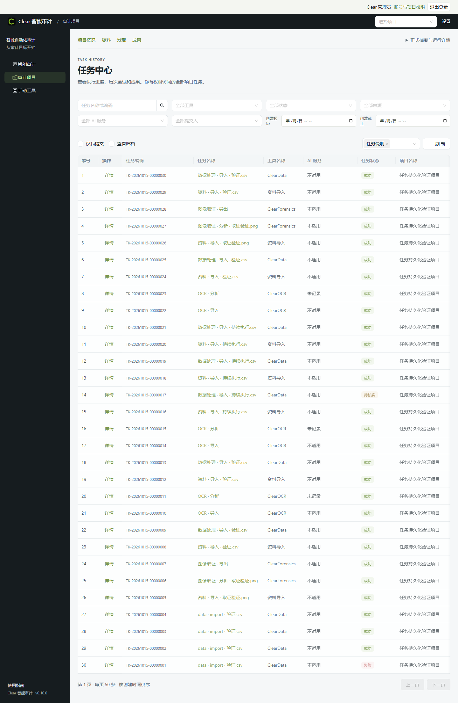
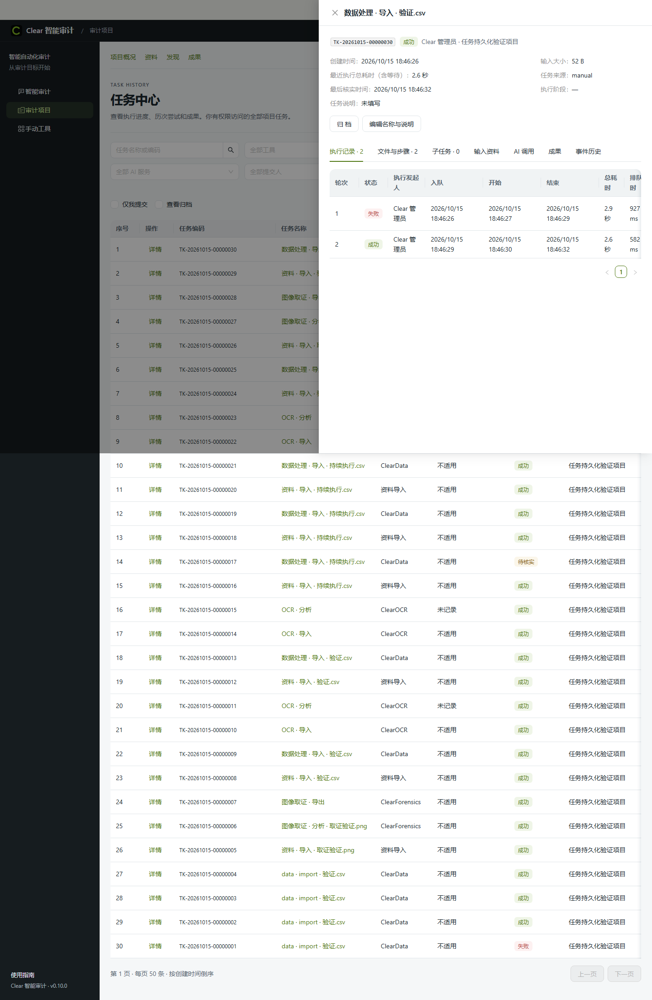

# Clear 多人任务中心实施与验收

日期：2026-10-15。交付状态：**已实现并封存本机工程候选，生产迁移和正式入口切换尚未执行。**

## 交付内容

已增加 PostgreSQL 17 中央任务库、SQLAlchemy/Alembic 迁移、内置账号和项目角色、独立执行器、持久队列与原生事务 outbox。主任务、每次执行轮次、文件/工具步骤、事件、AI 调用、成果和审计分别保存。人工及内部重试保留旧记录，原生服务断连不会覆盖已确认终态，结果不明的外部调用不会自动重发。

前端任务中心改为 50 条游标分页表格，提供项目、工具、AI、状态、提交人、来源、时间和关键词筛选。详情可查看输入、历次执行、步骤、子任务、事件、用量和成果，并按权限编辑说明、控制和归档。账号及成员维护界面已接入。原生工具经过同源鉴权网关，列表查询只读中央库。

接入范围包括资料上传、OCR/视觉审校、分类、Data、取证、人脸、音频、印章、CAT-Net、批次和 Agent 的已登记执行入口及导入导出；管理修改进入审计日志。具体白名单、状态和实际验证边界见[实现记录](../../products/Clear/platform/docs/task-center-implementation.md)。

## 封存版本与入口

| 项目 | 记录 |
|---|---|
| 开发分支 | `codex/task-history-multiuser` |
| 基线 | `0009ddcc440a7863c696e13712df76da6d025bc3`，包含上一轮取证稳定性改动 |
| 最终平台提交 | `4fcb0e870e2d8451e740496398077db788e2811c` |
| 数据库迁移 | `0004_search_and_ai_filters` |
| 候选目录 | `F:\OCR\output\task-history-multiuser-20261015\delivery-v2` |
| 候选清单 | `candidate-manifest.json`，2,928 个文件，逐文件哈希复核通过 |
| 清单 SHA256 | `f0606cd8fdd84f053d5a6dcd8c947fe8dcfafd87dff4cb11dcaaeee86c19dccc` |
| 恢复后的候选 DATA | `F:\OCR\output\task-history-multiuser-20261015\runs\candidate-workspace-v2` |
| 本机预览 | `https://localhost:8901/jobs`，测试自签证书 |
| 原始证据 | `F:\OCR\output\task-history-multiuser-20261015\evidence` |

候选从自己的三仓源码和三个前端 dist 运行，包含 Python 离线 wheels、锁文件及许可。共享的 F 盘基础运行时、模型、Agent 依赖层和 PostgreSQL 路径及哈希声明见候选 `dependencies.json`；它不是全量独立模型离线介质。运行账号、测试登录和 TLS 私钥保留在受 ACL 保护的本机运行目录，不进入源码或候选清单。测试管理员的本机登录文件为任务根 `runs/demo-login-private.json`，不要上传或纳入 Git。

正式 `release/Clear/current.json` 仍指向 0.10.0，8879 及真实业务 DATA 未切换。早期 `delivery`、`delivery-v1` 和恢复目录保留为失败/修复证据，交付使用 `delivery-v2` 与 `candidate-workspace-v2`。

## 验证结果

| 验证 | 结果与证据 |
|---|---|
| 后端核心回归 | 202 项通过；任务、契约、项目、投影范围，`backend-sealed.log` |
| 后续监测/原生回归 | 13 项通过；`backend-final-monitor.log`，与核心回归存在重叠，不相加计数 |
| 最后恢复修复 | 3 项通过；加密请求路径、热日志恢复、Windows PG 路径边界，`backup-recovery-tests.log` |
| 前端 | 23 个文件、160 项通过；TypeScript 和生产构建通过，`frontend-current-final.log` 等 |
| 百万任务查询 | 1,000,000 任务＋1,000,000 轮次，20 个独立认证用户，3 类查询各 100 次请求，`million-task-benchmark.json` |
| 门户独立重启 | 100,000 行、8 列、3,611,931 bytes CSV 在同 worker 上成功，仅一轮；`portal-restart.json` |
| 真实 CSV | 首轮故意失败，恢复同一原件后第二轮成功，两个步骤，52 bytes；`live-data-final.json` |
| 真实取证 | CPU metadata/frequency、5 个成果、哈希下载、真实 ZIP 5,460 bytes；`live-forensics.json` |
| 真实 PDF | 上传 606 bytes PDF，失败阶段保留，新阶段重试成功、两轮两步骤、PNG 成果；`live-pdf-stages.json` |
| 原生分类 | 封存候选上传 99 bytes PNG，原生接收日志与中央成功任务核实；`live-classification-import.json` |
| 一致性备份 | 169 文件及 PG dump 的 SHA256/SQLite 完整性通过；`backup-final.json` |
| 新目录恢复 | 新 DB `clear_restore_223ed317c4394619`、受限运行账号、登录、报告及 PNG 同哈希下载通过；`restore-final.json`、`restore-artifact-check.json` |
| 恢复后真实执行 | CSV 两轮两步骤成功；`restore-live-final.json` |
| 浏览器 | HTTPS 页面、详情两轮记录可见，无 pageerror；`browser-check.json`，外部 Chrome 已关闭 |
| 最终候选 | 2,928 文件重新核验；`candidate-final.json`。恢复后另行演练完成时有 31 任务、42 轮次、15 成果，事件同步积压为 0 |
| 根仓源码快照 | 三仓 1,814 个自有文件逐项校验通过，`products/Clear/source-manifest.json` |

压测 latest/filtered/search P95 分别为 **137.87 / 81.67 / 76.32 ms**，数据库约 1.386 GB，达到本机 1 秒目标。测试库完成后已删除。测试调用实际鉴权 API，但仍是本机 ASGI 压测，不替代目标服务器和真实网络验收；压测后的变更只涉及监测与恢复，列表查询代码未变。

前端测试的 jsdom 伪元素提示和 Vite 大 chunk 提示保留。曾尝试完整历史后端套件，但基础平台运行时缺 numpy，且另一轮全量测试中止；本报告不宣称全部后端测试通过。外部 AI、全模型训练和 GPU 资格未实测。

## 恢复演练修复的问题

1. 终端 Ctrl+C 会终止工具管理的子进程树。仅门户进程退出已另行验证，执行器保持相同身份并完成工作；整个执行器崩溃则保留中断记录并要求核实。
2. SQLite 热日志不能由只读连接回滚。备份在排空及全局写屏障内允许 SQLite 恢复日志，备份后检查完整性；回归确认未提交行不进入副本。
3. PostgreSQL `LIKE` 对 Windows 反斜杠转义造成成果路径未搬移。已改为完整目录边界匹配，并用新目录重新恢复和下载验收。
4. 三个早期合成 Data 重试的来源 generation 与原生新 ID 不一致。只修正已核实的来源映射，保留原状态与原事件，追加审计，见 `synthetic-generation-repair.json`。

这些失败副本和第一轮缺索引压测证据继续保留，没有通过修改状态伪造成功。

## 部署与生产前待办

部署、新库迁移、受限账号、每日备份、保留策略、恢复及回退命令见[运维说明](../../products/Clear/platform/docs/task-center-operations.md)。正式切换前须准备内网域名和受信 TLS 证书，在目标机核验 GPU/模型资源、真实 AI 连接及真实旧库迁移。每日 02:00 备份依赖门户运行，停机不会伪造补跑记录；可由生产运维另行配置 Windows 计划任务。

历史未归属任务仅管理员可查询，尚无完整批量归属整理 UI。当前支持单服务器 canonical 原生数据根，不支持多主机注册。跨机器/Windows 账号的 DPAPI 凭据需重新配置。对于没有实际用量回执的 AI，成本和 token 保持“未记录”；没有明确固定资料范围的 Agent 任务不虚构输入大小。所有项目文件与运行产物均继续落在 F 盘。
