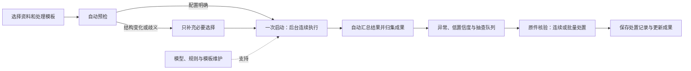

# Clear 系列产品结构、自动化与审计 UX 审查

日期：2026-10-02。审查对象：已交付的 Clear 工程预览及其冻结源码。

**判断：当前产品已经统一了外观，但信息结构仍主要服务于工具操作和模型开发，用户需要手工串起导入、准备、执行、复核和成果归集。下一轮应以自动化优先：一次选定资料与处理模板，系统连续完成可确定的步骤，人工集中处理异常和需要判断的结果。复核状态、结果优先级与证据留痕是这条自动化主线的基础。**

本报告没有修改产品源码、程序包、数据库或演示业务结果。上一轮 U00–U08 的功能验收记录保持原状；本次新增的是产品与交互审查结论。

根据用户补充的“操作繁琐、应强调自动化”，本报告同步调整建议和优先级。具体后续任务见 [Clear系列自动化优先与操作简化开发计划-20261002.md](/F:/OCR/docs/platform-automation/Clear系列自动化优先与操作简化开发计划-20261002.md)。计划中的能力尚未实现，不作为当前候选功能宣传。

## 1. 审查方法与范围

- 人工查看交付内的五张截图：三应用桌面、分类低高度、数据窄屏。
- 检查平台导航、交接、数据输入/比对/结果、成果中心，以及分类概览、标注、训练、模型和复核源码。
- 针对分类复核状态追踪前端请求、后端查询和标注写入逻辑，并对当前运行实例进行只读 GET 核对。
- 阅读四个成熟产品的官方页面及 MindBridge 的任务管理帮助文档，区分官方功能描述与本项目的实际观察。

浏览器控制接口返回 `Codex auth token is unavailable`，本次未取得新的交互截图。视觉证据使用上一轮交付截图，源码为交付绑定的冻结版本；状态问题同时有当前实例只读响应支持。本审查属于专家走查，没有招募真实审计人员进行任务计时或可用性实验，不能据此给出用户效率百分比。

本项目目前是本地作业与审计辅助工具，未实现完整审计管理系统。缺少审计计划、签署和整改管理属于产品定位下的业务缺口，不能全部记成界面缺陷。

## 2. 值得参考的成熟案例

| 案例 | 官方资料可确认的重点 | 本项目适合借鉴的部分 |
|---|---|---|
| [Caseware IDEA](https://www.caseware.com/us/products/idea/) | 全量数据测试、异常/缺口/重复分析；保持原件；可重复测试与运行历史；面向调查的结果输出。 | 最接近 ClearData。将已确认的分析规则保存为模板，用于下一批资料，自动产生结果与来源，把异常结果放到工作中心。 |
| [Diligent ACL Analytics](https://www.diligent.com/products/acl-analytics) | 数据分析与测试自动化、持续监测、测试和结果留痕、异常调查。 | 可复用测试流程、自动执行、异常调查和可解释运行记录。其最新官网也宣传 AI 能力，本报告不据此推断实际准确率。 |
| [MindBridge](https://www.mindbridge.ai/) | 全量财务交易分析、风险优先级、可解释发现；帮助文档提供独立调查任务及其状态、负责人、评论与历史。 | 最值得借鉴复核闭环：从结果创建调查任务，处理后明确关闭，也能重开。图像分类分数不能直接当作其财务风险分数。 |
| [AuditBoard / Optro OpsAudit](https://optro.ai/product/operational-audit) | 风险导向计划、现场测试、资料请求、证据、发现和整改；角色工作流与审计日志。 | 项目上下文和证据/工作程序的关系。完整企业内审模块较重，不宜一次照搬。 |

2026-10-02 访问 `auditboard.com` 实际跳转到 `optro.ai`，官网明确写有 “formerly AuditBoard”；因此这里同时标注两个名称。

这些案例的共同方法是：围绕待完成的工作、待解释的问题和证据组织界面。其公开资料不足以证明某个产品在所有场景中“最好”，本报告也没有登录其实际客户租户进行横向性能比较。

MindBridge 的具体参考比营销首页更有价值：

- [Audit plan management](https://support.mindbridge.ai/hc/en-us/articles/360056330814-Audit-plan-management)：任务表、搜索、筛选、列配置、指派、评论、关闭与重开。
- [Audit plan: Task details](https://support.mindbridge.ai/hc/en-us/articles/360058198653-Audit-plan-Task-details)：交易/分录、分析来源、审计领域、认定、创建人、负责人、状态与历史。
- [Change a task’s status](https://support.mindbridge.ai/hc/en-us/articles/360058198573-Change-a-task-s-status)：区分 Open、Mark as Normal、Resolve 和 Reopen。

## 3. 具体发现

### A01 / P1：分类“待复核”并不表示人还没有处理

**事实。** [前端确认逻辑](/F:/OCR/output/clear-ui-dev-20261002/worktrees/classification/apps/web/src/views/jobs.tsx:74) 向项目 `annotations` 接口保存标签；[后端标注接口](/F:/OCR/output/clear-ui-dev-20261002/worktrees/classification/src/image_platform/api.py:334) 新增标注修订并更新资产标签。[结果筛选](/F:/OCR/output/clear-ui-dev-20261002/worktrees/classification/src/image_platform/api.py:482) 的 `needs_review` 条件读取原始预测 JSON，而 `confirmed_label` 从当前资产标签读取。这两个字段没有本次结果的独立复核完成状态。

当前运行实例只读核对中，四个已完成的分类任务各返回一条同时具有当前标签（接口字段 `confirmed_label`）和 `prediction.status=needs_review` 的记录。不能把这些条目当成四个独立文件，也不能仅凭已有标签断定每个任务都已复核；标签可能来自先前标注。这正是当前模型无法清楚回答“这一次结果是否已经由人复核”的原因。

**影响。** 人工确认成功后，条目仍符合“待复核”筛选。用户无法用此数量判断工作是否处理完，容易重复检查；导出中的原始 `status` 也不是独立的复核完成状态。

**建议。** 保留原始预测历史，同时明确区分执行状态、模型建议和处置/复核状态。处置记录应能区分按哪版规则自动通过、由人确认、暂缓和重开。短期可以把当前筛选准确命名为“模型建议复核”；真正的待办队列需要关联结果/任务的持久记录，不能用 `confirmed_label != null` 伪造完成，也不能通过改写旧预测来清队列。

只读证据：[classification-readonly-review-state.json](/F:/OCR/output/clear-ui-audit-20261002/classification-readonly-review-state.json)。

### A02 / P1：ClearData 完成工作后，首屏仍然以输入和配置为中心

**事实。** [桌面截图](/F:/OCR/output/clear-workbench-preview-20261002/checks/U07/screenshots/01-clear-data-desktop.png) 显示“导出已完成”，但 1440×900 首屏主要呈现左右原表、清洗和比对设置，差异数量与结果在下方。[渲染顺序](/F:/OCR/output/clear-ui-dev-20261002/worktrees/platform/apps/portal/src/features/data/DataWorkbench.tsx:380) 固定为两个输入面板 → 比对设置 → 结果，无论作业阶段如何。

**影响。** 返回一个已完成作业时，用户首先看到的仍是准备工具，必须滚动或点击锚点才能判断发现了什么、下一步要查什么。窄屏中第一张输入表就占据大量高度。[窄屏截图](/F:/OCR/output/clear-workbench-preview-20261002/checks/U07/screenshots/05-clear-data-narrow.png) 证明无横向溢出，但不证明核心结果容易找到。

**建议。** 未完成作业以资料和处理模板为主；执行中以自动阶段进度为主；已有结果以摘要、异常队列、来源和已归集成果为主。输入与规则保留在可展开的上下文中。固定可见当前两份输入、匹配键、容差、输入版本/结果版本关系；不要为了简洁隐藏影响解释的政策。

这是工作区优先级调整，优先复用已有结果和版本数据，不需要重写比对算法。

### A03 / P1：复核被嵌在任务监控中，连续处理成本高

**事实。** 分类“分类与复核”首先是导入、训练、推理混合任务表；选择推理任务后才出现结果。每页结果是 12 张卡片，逐项打开弹窗确认，保存后关闭弹窗；[Results 组件](/F:/OCR/output/clear-ui-dev-20261002/worktrees/classification/apps/web/src/views/jobs.tsx:67) 没有连续“保存并下一项”。复核原图在[样式](/F:/OCR/output/clear-ui-dev-20261002/worktrees/classification/apps/web/src/style.css:175) 中最高约248px，主要看清文字需要另外打开原图。

**影响。** 任务运行状态与人的判断混在一起。图片卡片适合浏览样本，批量核验文字型票据时则缺少稳定队列和足够大的证据视图。

**建议。** 自动处理后优先呈现需要人处理的条目：失败、低置信度、规则冲突及抽查样本。复核区采用“可筛选列表 + 大图证据 + 当前判断”，保存后进入下一项，保持筛选和位置；支持有明确范围的批量处置。模型原判、人工标签及二者差异同时显示。运行日志留在任务详情。全量按低分排序或跨任务聚合需要接口支持，不能只排序当前12条却宣称已完成全局排序。

已有图像标注支持多选和批量标签，属于应保留的能力；本项针对结果复核流程，并非声称整个平台没有批量操作。

### A04 / P1（定位）：导航反映工具模块，缺少审计辅助工作主线

**事实。** [门户导航](/F:/OCR/output/clear-ui-dev-20261002/worktrees/platform/apps/portal/src/App.tsx:46) 为首页、工作空间、应用、资料、任务、成果、设置；原生分类另有项目、图像、训练、模型、分类任务和运行环境。跨工具时还需理解工作空间、原生项目、资料集、交接和成果归集。[交接页](/F:/OCR/output/clear-ui-dev-20261002/worktrees/platform/apps/portal/src/features/classification/ClassificationWorkflow.tsx:145) 直接呈现项目关联与原生入口。

**影响。** 对开发者和熟悉工具的人，这种组织方式可以理解。审计辅助用户则必须自行判断“资料准备后该做什么、结果在哪里、哪些需要人工处理、怎样形成可说明的输出”。同一颜色无法降低这部分认知负担。

**建议。** 用当前工作空间作为稳定上下文，提供统一的“新建处理批次”入口，围绕批次的自动执行、异常处理和成果组织主线。OCR/分类/比对由处理模板调用，专用编辑器在需要核验时进入。保留原生项目身份和深链接，不把项目切换仅当作一个视觉下拉框。

若最终目标只是独立工具集，本项的重要性可降低；若目标是审计辅助工作台，它应先于下一轮视觉精修。

### A05 / P2：训练与运行技术细节抢占普通用户的操作路径

**事实。** 分类导航把训练与模型列为主要分区，训练页首屏同时提供编码器、分类头、输入分辨率、设备、轮数、批大小、种子和精确率目标。[训练页截图](/F:/OCR/output/clear-workbench-preview-20261002/checks/U07/screenshots/04-classify-low-height.png) 顶部为 CPU 模式，创建表单仍初始选择 NVIDIA GPU；[表单默认值](/F:/OCR/output/clear-ui-dev-20261002/worktrees/classification/apps/web/src/views/models.tsx:29) 固定 `device: 'cuda'`。顶部还有 API 文档。

**影响。** 当前环境、当前可执行动作与实验参数之间的关系需要用户自行理解。模型维护能力应保留，但不是每位审计使用者的日常任务。

**建议。** 日常批次复用模板中绑定的已有模型、类别和设备策略，条件未变时不让每次执行都重新选择。训练与运行环境进入明确的模型维护区；折叠高级参数但允许查看。设备默认值和提示应依据真实能力。不要简单把0.95目标翻译成“95%准确率”，也不要把类别匹配分数当成审计风险等级。

### A06 / P2：OCR 深色资料栏内的浅色复核卡片难以阅读

**事实。** [OCR截图](/F:/OCR/output/clear-workbench-preview-20261002/checks/U07/screenshots/02-clear-ocr-desktop.png) 中，“PDF表格提取失败”等复核条目的主要文字在浅背景上非常淡。[资料栏按钮颜色](/F:/OCR/output/clear-ui-dev-20261002/worktrees/ocr/frontend/src/editor.css:99) 使用深色区域浅文字，而[复核条目样式](/F:/OCR/output/clear-ui-dev-20261002/worktrees/ocr/frontend/src/structure.css:21) 使用浅背景。共享区域颜色与局部组件表面组合未完整核对。

**影响。** 需要优先阅读的失败原因反而难以辨认。禁用按钮也有较低对比；本报告不把禁用控件直接判为 WCAG 不合格，优先问题是仍需阅读的说明和复核条目。

**建议。** 独立处理深色资料栏里的输入、禁用态和复核卡片，避免宽泛的按钮前景覆盖局部浅色组件。保留原图/校对双栏，这是现有界面最适合证据核验、值得继续利用的结构。

### A07 / P2：分类概览的工作流完成提示并非真实完成状态

**事实。** [Overview](/F:/OCR/output/clear-ui-dev-20261002/worktrees/classification/apps/web/src/workbench.tsx:164) 使用“至少一个已标注样本”及“存在任意模型”判定前两步完成，第三步“批量分类与人工复核”的 `done` 恒为 `false`。

**影响。** 此处实际是入门提示，却表现为工作流完成指示；既无法表达准备质量，也不能表达最终复核完成。其对勾容易被过度解释。

**建议。** 短期明确为“入门步骤/已有资源”，避免完成语义。正式进度应绑定具体批次和定义清楚的完成条件，并依赖 A01 的独立复核状态，不能再用资源是否存在替代业务完成。

### A08 / P2：结果表达偏向下载文件和宽表，缺少解释重点

**事实。** ClearData [结果表](/F:/OCR/output/clear-ui-dev-20261002/worktrees/platform/apps/portal/src/features/data/DataWorkbench.tsx:251) 展示左右全部列，首选为“全部结果”，差异主要以行分类表达。[成果中心](/F:/OCR/output/clear-ui-dev-20261002/worktrees/platform/apps/portal/src/features/artifacts/ArtifactCenter.tsx:46) 已有输入版本、来源和文件版本，但核心内容仍是成果文件目录。

**影响。** 列多时用户需要在宽表里找变化；“文件已导出”不能回答为什么有差异、采用什么规则、哪些事项还需解释。金额差异不自动等于审计发现，图像分类也不自动形成审计结论。

**建议。** 结果摘要先呈现差异、仅左/仅右、重复键等待解释项，允许逐项查看原件、规则和版本。具体变化字段应采用后端既有比较语义；若契约没有提供，需要补充结果字段，不能在前端自行实现另一套容差/空值比较规则。长期的解释、结论、复核人和签署需要新增业务记录，不能只加几个看似可用的按钮。

### A09 / P1：可复用能力没有连成自动完成的工作流程

**事实。** ClearData 已有[清洗配方重放](/F:/OCR/output/clear-ui-dev-20261002/worktrees/platform/apps/portal/src/features/data/DataWorkbench.tsx:55)，但它只覆盖清洗步骤。用户仍分别触发左右导入、清洗、比对、生成下载文件和[成果归集](/F:/OCR/output/clear-ui-dev-20261002/worktrees/platform/apps/portal/src/features/data/DataWorkbench.tsx:245)。默认映射还会[按列位置回退并把第一列设为匹配键](/F:/OCR/output/clear-ui-dev-20261002/worktrees/platform/apps/portal/src/features/data/DataWorkbench.tsx:172)，这属于待确认的建议，不能直接作为无人值守规则。OCR/分类交接页也分别提供交接、提交和归集按钮，没有形成统一的用户处理批次。

**影响。** 已有后端能力没有充分减少用户操作。相同来源的新一批资料仍需重走很多准备动作；后台运行与前台逐步点击之间存在断点。只把按钮放得更紧凑，难以解决繁琐问题。

**建议。** 将已确认的输入角色、导入配置、列映射、左右清洗配方、比对政策、模型/引擎及输出要求保存为版本化处理模板。再次使用时选择资料和模板，确认一次后连续执行，自动产生可核对的成果并归集。遇到新表结构、歧义映射、能力缺失或规则冲突才暂停请求具体输入；已成功阶段保留，恢复时继续未完成项。

执行状态由后端持久化管理，刷新或关闭浏览器不应使流程丢失。不同场景选用不同模板：表格比对可以直接运行，不要求先经过分类和OCR；票据资料可按实际能力组合分类和识别。首版采用少量明确模板，不建设通用拖拽编排器。

自动执行与自动认可结果分开：确定性步骤可以连续完成；模型自动通过需绑定经验证的业务政策并保留抽查。当前分类 `auto_accept` 默认关闭，不能为了减少点击全局改为开启，也不能自动生成“审计无异常”的结论。

## 4. 根因与合理的改进顺序

上一轮计划以 OCR 视觉为基准，冻结色彩、尺寸和静态 token，并明确保留各工具结构、避免扩展业务。因此它有效解决了品牌和外壳一致性，却没有重新定义审计辅助用户的主任务。原先的训练平台、OCR编辑器和数据处理台，仍有各自的对象和状态体系。

上一轮测试验证了入口、身份、保存读回、启动缓存和有限视口。它没有验证“复用同一业务配置是否仍要重复点击多步”“关闭页面后自动流程能否继续”“处理一个结果后，待复核是否减少”“重新打开已完成作业能否首先找到异常结果”等问题。下一轮以自动化闭环与人工介入质量为主验收目标。

| 顺序 | 要解决的问题 | 变更边界 |
|---|---|---|
| 1 | 定义批次、版本化处理模板、自动执行与人工处置状态；修正复核语义及OCR可读性。 | 复用已有任务/成果契约；真正处置完成需要结果关联的持久记录。 |
| 2 | 先做ClearData自动闭环：导入→配方→比对→生成成果→归集。 | 复用现有算法，明确后台持久编排与恢复；列映射有歧义时暂停。 |
| 3 | 接入OCR/分类批量处理和异常队列，支持连续及有明确范围的批量复核。 | 按实际能力运行；模型自动通过政策与流程自动执行独立管理。 |
| 4 | 首页与导航围绕批次、异常和成果；复用模板后只保留一次启动确认。 | 结果优先，技术参数进入模板/维护区；保留现有身份和深链接。 |
| 5 | 根据业务需求增加调查说明、责任人、结论、签署或整改。 | 作为后续领域功能，不阻塞首个自动化闭环。 |

建议按审计辅助工作台定位，先参考 IDEA/ACL 的可复用自动分析和 MindBridge 的调查任务。Optro 的完整计划、多人审批和整改管理可作为远期参考。

## 5. 目标工作结构与可用性验收

以下是建议的目标结构，不是当前已经实现的页面或数据能力：

以后用自动化闭环和真实审计辅助任务检验设计：

- 已确认模板在同结构新资料上复用：完成资料选择后只需一次“开始处理”，普通成功阶段不再要求逐步点执行、导出和归集。
- 表头变化或映射歧义时只暂停需要重新确认的部分；不得凭列位置悄悄改变匹配键或金额政策。
- 刷新/关闭浏览器、请求响应丢失和服务恢复后，批次能读回真实进度；不重复导入、创建任务或归集成果。
- 自动处理完后，界面分别显示执行成功、异常待处理、人工/自动处置和成果状态；执行成功不冒充复核完成。
- 返回已完成比对后，用户能直接找到差异数量、当前规则及一个差异的来源。
- 保存一项人工复核后，系统能证明这一次结果的复核状态；若跳过或暂缓，也不能误记完成。
- 连续复核一批结果时，不需要逐条返回任务总表；筛选、当前项和原件位置稳定。
- 在三个工具之间移动时，用户始终知道当前工作空间、原生项目、输入批次及结果版本。
- 用相同资料任务比较首次配置与模板复用，记录人工动作数、人工介入次数、重复输入、恢复失败和异常漏分流。让真实使用者完成差异核验与分类复核后再报告效率变化，不预先虚报提升比例。

## 6. 证据位置

- [本次只读状态记录](/F:/OCR/output/clear-ui-audit-20261002/classification-readonly-review-state.json)
- [官方案例页面文本与链接](/F:/OCR/output/clear-ui-audit-20261002/official-reference-pages.json)
- [官方产品补充资料](/F:/OCR/output/clear-ui-audit-20261002/official-reference-details.json)
- [MindBridge分析/调查资料索引](/F:/OCR/output/clear-ui-audit-20261002/mindbridge-workflow-index.json)
- [MindBridge任务与状态文档](/F:/OCR/output/clear-ui-audit-20261002/mindbridge-task-reference.json)
- [原交付报告](/F:/OCR/output/clear-workbench-preview-20261002/交付报告.md)

该审查不改变工程预览资格，也不将正式 revision605 的 T052–T057 改为完成。
