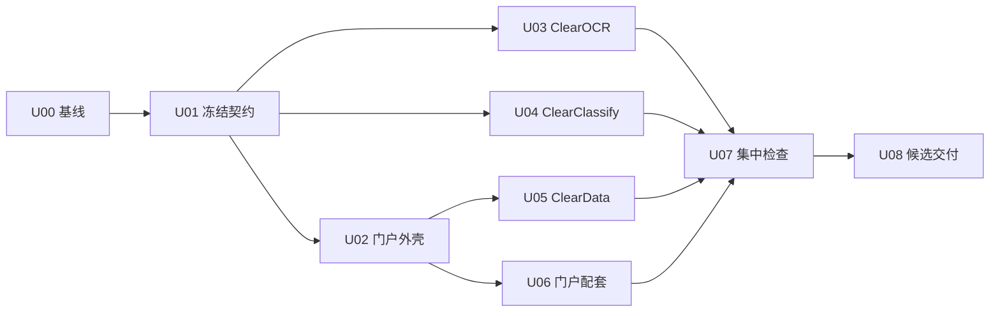

# Clear 系列界面统一务实开发计划

日期：2026-10-02。状态：**原界面统一范围U00–U08已实施完成，以下保留原始任务规格**。实施结果见 [交付报告](/F:/OCR/output/clear-workbench-preview-20261002/交付报告.md)。

**后续实施的存储约束：所有项目文件均只能在本机 F 盘落盘。** 原规格中的 E 盘源码根和任务草案路径仅作历史只读参考；新增工作树、Git 元数据、构建、依赖、缓存、临时文件、运行数据、截图和交付物都必须在 F 盘。续作前记录 F 盘实际路径映射，按 [项目文件存储规范](../项目文件存储规范.md)配置工具及子进程；本次文档更新不代表旧仓库已迁移。

后续方向已按用户补充调整为自动化优先与操作简化，见 [Clear系列自动化优先与操作简化开发计划-20261002.md](/F:/OCR/docs/platform-automation/Clear系列自动化优先与操作简化开发计划-20261002.md)及 [产品结构、自动化与审计UX审查](/F:/OCR/docs/platform-automation/Clear系列产品结构与审计UX审查-20261002.md)。原机器任务草案属于历史规格，实际U00–U08状态以交付报告和开发记录为准，不是新的待执行任务。

目标：以现有 DeloitteOCR 的专业工作台界面为唯一视觉基准，把 OCR、图像分类、数据清洗比对及其平台入口统一为 Clear 系列。保留已经可用的业务能力，解决跨应用切换时的品牌、布局、密度、控件和反馈割裂。

原规划按当时要求新立界面改造范围，替代旧计划中“不重做页面风格”这一项限制；旧计划的工程结果、数据保护、首次校验策略和资格边界继续有效。以下为当时的计划与任务草案，原规划阶段没有修改应用；其后已按用户实施指令完成开发与交付。

配套机器可读任务草案：[clear-ui-tasks-20261002.json](clear-ui-tasks-20261002.json)。它不接入或覆盖原 `tasks.json`、`checks.json`、正式运行账本，不为本轮另造计划器。

## 1. 品牌与范围一次确定

以下作为实施默认命名，不以反复选名字阻塞开发：

| 产品 | 用户可见名称 | 中文说明 | 内部身份 |
|---|---|---|---|
| 统一平台 | Clear Workbench | 本地作业平台 | 沿用现有平台身份 |
| 文档识别 | ClearOCR | 文档识别与校对 | `ocr` |
| 图像分类 | ClearClassify | 图像分类与复核 | `classification` |
| 数据处理 | ClearData | 数据清洗与比对 | 沿用现有数据作业身份 |

ClearOCR 为用户明确提出的名称；其余三个是本计划的默认建议。进入实施后统一采用，除非用户提出新命名，不再内部发散备选。

**改造范围：**平台首页与应用入口；OCR/分类的门户交接页和原生工作台；数据作业页；工作空间、资料、任务、成果页面；这些页面共用的导航、对话框、空状态、错误、加载和启动校验反馈。设置占位页只统一外壳，不开发新设置功能。

**品牌替换范围：**页面标题、页头字标、菜单、入口卡片、页脚、浏览器标签与图标，以及新版本使用说明中的当前产品名称。默认采用简洁 Clear 字标和轻量 SVG 图标，不开启 logo 设计竞赛或图片生成流程。OCR 原有 Deloitte 字标和分类原有 Prism 名称不再出现在当前产品界面。

**不迁移内部身份：**路由、API、`app_id`、Python 包名、数据库结构、数据目录、请求键、实例/项目/任务 ID、模型锁、许可来源保持兼容；分类的 `prism-project` 等浏览器存储键保留，以免用户偏好丢失。禁止全仓替换 Deloitte/Prism，历史报告、第三方许可、来源记录不改名。

## 2. 现状诊断与真实设计基准

本次已经只读核对代码与三个源码仓库 HEAD；以下是代码层面的诊断，尚未声称完成当前运行页面的浏览器验收。

| 区域 | 当前实现与割裂来源 | 本轮处理 |
|---|---|---|
| OCR 基准 | `professional.css`、`theme.ts`、`BrandHeader.tsx`、`WorkspaceLayout.tsx` 已形成 44px 深色页头、深色资料栏、浅色编辑区、紧凑工具栏与双栏校对；标题约 23px、常用按钮约 34px。 | 保留布局与精致程度；提取公共视觉参数，换 ClearOCR 品牌，统一平台返回入口与状态样式。 |
| 门户 | `style.css` 的顶栏最小 76px，内容留白 32–66px，标题 30–46px；深绿色导航和较宽展示区偏向门户介绍，进入任务页仍沿用这一尺度。 | 改为专业工作台外壳，压缩页头和操作区，让实际工作内容进入首屏。 |
| 原生分类 | `style.css`、`main.tsx`、`workbench.tsx` 使用浅色导航、69px 顶栏、96px 品牌区、27px 标题和 36px 控件，仍显示 Prism。 | 统一深色导航和 ClearClassify 页头；保留概览、图像标注、训练、模型、分类复核与运行环境等功能分区。 |
| 数据工作台 | `DataWorkbench.tsx`、`data.css` 继承门户的大标题与留白，输入、清洗、比对、版本和结果区域分散。 | 调整为紧凑作业头、清晰工具栏、两侧输入面板和结果区；收拢低频设置，保留版本、配方及数据语义。 |
| 跨应用衔接 | 两个门户交接页与原生应用的品牌、页头、反馈不一致，容易产生“换了一个产品”的感受。 | 对齐品牌、项目/工作空间上下文、主操作与返回入口；不嵌套双层导航，不引入 iframe 整合。 |

历史实施时的源码对应关系（原路径与 HEAD 保留，不是后续写入位置）：

| 仓库角色 | 本轮源码根 | 已核对 HEAD |
|---|---|---|
| 平台/门户/ClearData | `E:/project/professional-workbench-platform` | `66971e7230538addcafe4f108931415395cec407` |
| 集成 OCR | `E:/project/platform-dev-runs/dev-20260925-001/workspaces/ocr` | `465620cadff2235da4fd875ca4555fcb5eb7b3e5` |
| 集成分类 | `E:/project/platform-dev-runs/dev-20260925-001/workspaces/classification` | `90fc0c1ec50223b6b3fbe2446cca86116be46ed4` |

`F:/OCR/frontend/src/` 是视觉参考与独立 OCR 源码，**不是本轮平台集成分支的覆盖来源**。后续实施保持表中的源码身份关系，但须使用经核对并登记的 F 盘仓库，在 F 盘建立适当的 `codex/clear-ui-*` 分支/隔离工作树；不能在表中的旧 E 盘根继续写入，也不能把独立 OCR 较新的业务代码整目录覆盖到集成仓库。

### 2.1 冻结的 Clear 视觉基准

| 项目 | 首版固定规则 |
|---|---|
| 页头/导航 | 全部采用深色品牌页头与深色导航；页头基准 44px，导航保留产品名称、上下文和必要返回入口。允许功能资料栏宽度不同，不强行统一专用编辑器尺寸。 |
| 颜色 | 页头 `#070908`、导航 `#171b18`、工作区 `#f4f6f4`、白面板、正文 `#202823`、次要字 `#66706a`、边界 `#e2e7df`；品牌强调 `#86bc25`，链接/焦点 `#386a12`。 |
| 字体/标题 | 沿用 OCR 的系统字体及已有离线字体回退；正文 14px，辅助文字 12px，工作页标题约 23px，面板标题 16px。不新增字体下载或更换字体体系。 |
| 密度/控件 | 默认舒适密度，普通按钮和输入基准 34px，主要提交按钮可 38px；间距采用 4/8/12/16/24px，主区边距以 20px 为基准，面板约 10px、控件约 6px 圆角。沿用 OCR 已有紧凑显示能力，不为其他应用新开发整套密度偏好。 |
| 面板/工具栏 | 标题与上下文 → 工具栏 → 主内容 → 任务/结果反馈；白色面板与细边框，弱阴影。每个操作区一个清楚的主操作，次要动作弱化；避免大段介绍和重复容器占首屏。 |
| 反馈 | 加载、空、错误、处理中、成功、取消/恢复、待人工复核有一致表达；原始业务状态不改。颜色同时配文字/图标，错误有原因和现有可恢复动作。 |
| 可访问性 | 品牌按钮使用浅绿背景与深色文字，验证可读性；不把这一文字颜色全局套到错误/警告控件。保留键盘焦点、标签、禁用语义和现有 `aria-live` 反馈。 |
| 响应布局 | 以 1440×900 与 1280×720 桌面为主要检查尺寸；另检一个 390px 窄屏。页面不整体横向溢出，表格允许自身滚动；低高度优先缩减非必要页头并提供单面板切换。 |
| 图标/动效 | 沿用 Fluent/Lucide 与 Ant Design 已有图标，统一视觉大小和用途，不引入第三套库。只保留短 hover/状态变化；不新增展示动画、滚动叙事或装饰插画。 |

这组数值来自 OCR 基准，作为一次冻结的实施目标；不得在每个泳道里重新选配色、字体或圆角。明显不可读、控件不可用等问题可以修正，其余差异集中一次处理。

### 2.2 三个应用保留各自的工作结构

- **ClearOCR：**资料列表 → 识别工具栏 → 原图/校对双栏 → 任务队列；保留缩放、分栏拖动、校对编辑、人工修订、文档页与 OCR 引擎选择。
- **ClearClassify：**项目与功能导航 → 当前页标题/动作 → 图像或模型/任务面板 → 复核反馈；训练参数、类别、模型指标和复核状态按原语义显示。
- **ClearData：**作业选择/状态 → 两份输入与清洗工具 → 比对配置/执行 → 结果与导出；低频参数可折叠，当前比对键、版本、金额容差和告警保持可见或明确可展开。

统一的是产品外壳、视觉语言与交互层级。专业编辑器、数据表格和训练页面各用适合其工作的布局，不能为了“看起来一样”删功能或隐藏关键业务信息。

## 3. 四阶段、九个有边界的任务

预计投入为 **5–7 人日**；具备三个开发泳道时目标 **3–4 个工作日**，只是排期估算，不是自动停止开发的时限。每任务最长半天有效开发时间后必须留下可运行切片或明确阻断诊断，防止长时间无交付。

| 阶段/任务 | 依赖 | 负责人 | 实际交付与结束条件 |
|---|---|---|---|
| 一 / U00 基线与写入边界 | 无 | 统筹 | 核对当时 HEAD、已有改动、运行实例和源码根；登记页面清单与工作树。复用上述诊断，不再做新一轮全项目审计。 |
| 一 / U01 冻结设计契约 | U00 | 统筹/公共样式负责人 | 一份 Clear token/品牌映射、CSS 变量、轻量字标/图标及三个应用的适配接口；固定页头、标题、工具栏、面板、状态、返回入口规则。一次冻结后可开并行开发。 |
| 二 / U02 门户公共外壳 | U01 | 泳道 A | 平台品牌、深色页头/导航、主题适配与工作页密度可运行；工作空间选择和现有路由正确。为后续门户子页提供稳定外壳。 |
| 二 / U03 ClearOCR | U01 | 泳道 B | 原生 OCR 更名并接入统一品牌/反馈；核心编辑器和平台返回链不退化。交付源码预览和受影响检查。 |
| 二 / U04 ClearClassify | U01 | 泳道 C | 原生分类外壳及所有现有功能分区统一；重点完成图像标注、训练、模型、分类复核的实际操作区。保持现有存储和导航身份。 |
| 二 / U05 ClearData | U02 | 泳道 A | 数据作业布局统一，导入→清洗→比对→导出可操作；支持旧作业读回，关键政策/告警不丢。 |
| 二 / U06 门户交接与配套页 | U02 | 统筹 | OCR/分类交接、资料、任务、成果等统一；应用卡片品牌与首次校验进度正常。只编辑本任务的子页，不改共享外壳。 |
| 三 / U07 集成与集中检查 | U03、U04、U05、U06 | 统筹 | 三应用同一轮源码预览；检查下文有限场景，修复阻断问题，最多一次非阻断视觉归并。冻结可交付源码。 |
| 四 / U08 候选与交付 | U07 | 统筹 | 通过现有发布流程形成 Clear 候选、统一入口、差量清单、有限截图、检查报告、回退说明；实际包内页面与源码一致，首次/缓存启动符合原策略。 |

每个任务交付真实页面与检查结果。设计文档、仅有品牌卡片或静态 mockup 不替代 U02–U06 的实现完成。

## 4. 并行开发的文件边界与合并规则

最多三个开发泳道加一位统筹。无多代理环境时按同一依赖顺序串行，不新增协调系统。并行的是有独立文件范围的开发；共享文件修改、同一源码构建、浏览器检查、候选更新和真实 GPU 作业顺序执行。

| 任务/负责人 | 允许编辑的主要范围 | 禁止直接编辑 |
|---|---|---|
| U01 公共负责人 | 平台 `apps/portal/src/clear-ui/` 为规范源；三个前端 `src/clear-ui/` 中的静态副本及 `public/brand/clear-*` 资产由此负责人一次分发。 | 业务逻辑、依赖锁、数据库；其他泳道自行改 token 或品牌副本。 |
| U02 泳道 A | 平台 `apps/portal/src/App.tsx`、`router.tsx`、`main.tsx`、`style.css`、`index.html` 和 `tests/navigation.test.tsx`。 | 原生源码、U01 的规范源；其他泳道此时不得改这些共享文件。 |
| U03 泳道 B | OCR `frontend/src/BrandHeader.tsx`、`WorkspaceLayout.tsx`、`theme.ts`、`professional.css`、必要的 `style.css`/`App.tsx`/`main.tsx` 与 `frontend/index.html`；确实受影响的前端测试。 | OCR 识别/存储后端、模型/运行时、U01 的静态副本；不从 F 盘批量搬业务源码。 |
| U04 泳道 C | 分类 `apps/web/src/main.tsx`、`workbench.tsx`、`style.css`、`views/` 与 `apps/web/index.html`；确实受影响的现有前端 e2e。 | 分类后端/训练算法、存储键迁移、U01 的静态副本。 |
| U05 泳道 A | 平台 `apps/portal/src/features/data/DataWorkbench.tsx`、`data.css`；本功能局部检查记录。 | 门户全局 CSS/主题/路由、其他 feature。 |
| U06 统筹 | 平台 `features/catalog/`、`features/ocr/`、`features/classification/`、`features/assets/`、`features/jobs/`、`features/artifacts/` 及相应局部样式；`tests/catalog.test.tsx`、`tests/jobs.test.tsx`。 | U05 数据文件、U02 公共文件、三个仓库的后端接口；公共问题交给其负责人。 |

全路径和机器可读边界见任务草案。新增局部组件放本 feature 目录；共享组件放 U01 的规范源，只由公共负责人修改。不得靠不断往全局 CSS 末尾追加覆盖来解决局部问题。

实现策略：保留 OCR 的 Fluent UI、门户的 Ant Design 6、分类的 Ant Design 5 和各自锁定依赖。共享的是静态 token、品牌资产及布局规范；各项目各写一层主题适配，不迁移到同一组件库，不创建跨仓库运行时依赖包。静态副本只分发一次，变更由负责人记录版本并同步。

合并顺序固定为 U01 → U02 → U03/U04 → U05/U06 → U07。U05 与 U06 可并行编辑不相交文件，但同一门户构建由统筹排队；功能切片可先在各工作树预览，不等待全部分支完成。

共享调整采用“提出具体问题 → 公共负责人单次修改 → 受影响泳道更新”的规则。发现写入范围交叉先交回负责人，禁止多人同时抢改 `style.css`、`router.tsx` 或公共 token。不得擅自重置、stash、清理用户已有改动，提交只包含本任务文件。

## 5. 自动执行与可续作规范

任务草案记录 `depends_on`、`owner`、`write_paths`、`checks`、`acceptance` 和独占资源，可供执行者/代理按依赖领取任务。**本次不安装调度器、不创建定时任务、不自动开启新聊天。**实施授权到达后，统筹按以下循环推进，无需每阶段例行再问确认：

1. 从依赖已完成的任务中选择工作；登记目标、源码 HEAD、负责人、写入范围和检查范围。U00 时读当时的仓库规则与已有运行状态。
2. 实现一个完整切片；遇到共享问题发给负责人，其他独立开发继续。
3. 运行本前端的类型/生产构建和受影响的已有检查，提交预览与结果。纯品牌/可逆样式修改不新增照抄实现的测试。
4. 记录完成项、证据路径、源码提交与具体未解决问题，满足完成标准即进入下一依赖任务。
5. 统筹在 U07 集中检查并在 U08 统一交付，不让每个泳道独立打大包或重复全站截图。

续作只需一个简短记录，建议存放 `F:/OCR/output/clear-ui-dev-20261002/NEXT.md`；列出各 U 任务的 planned/running/done/blocked、源码提交、实际产物与下一动作即可。机器任务草案是规格，状态记录不反向伪改正式 T 任务，不为本轮增建另一套证据账本。

本轮已发现可直接使用的前端命令：

| 前端 | 工作目录（相对本仓库根） | 命令与范围 |
|---|---|---|
| 门户/数据 | `apps/portal` | `pnpm build`；按改动选择 `pnpm test -- tests/navigation.test.tsx tests/catalog.test.tsx tests/jobs.test.tsx` 的相关文件。 |
| OCR | `frontend` | `pnpm build`；按现有用例名选择 `pnpm test -- <受影响的测试文件>`，实施时先定位，不机械跑全部引擎。 |
| 分类 | `apps/web` | `pnpm build`；按用例筛选 `pnpm test:e2e -- e2e/workspace.spec.ts --grep <受影响的用例>`，不把完整训练基准作为样式前置。 |

命令在现有隔离工具链运行；这两条带占位选择器的检查说明不是可直接复制的成品脚本，执行者必须先选出真实文件/用例再运行。各前端完成后构建一次，最终集成若源码不同再构建；同样源码与环境已通过，不因换执行者重复运行。

## 6. 一轮集中检查与明确完成门槛

### 6.1 U07 源码阶段的有限检查

| 检查 | 通过要求 | 证据与边界 |
|---|---|---|
| 三应用外观 | 三个主页面和平台外壳使用同一品牌、导航颜色、标题尺度、工具栏、面板与状态样式；当前页面不出现 Deloitte/Prism 产品品牌。 | 自动扫当前展示源码/构建产物的命中位置，排除内部存储键、历史/许可；集中人工对照。简单字符串检查不能替代界面确认。 |
| 页面覆盖 | 交接、资料、任务、成果、分类各功能分区及相关对话框套用已冻结样式；不留第二套大标题/旧品牌外壳。 | 同一轮浏览器巡检，可复用共享样式检查；不要求每页独立截图。 |
| 主要视口 | 1440×900、1280×720 三应用关键操作可见且不被遮挡；390px 可导航和使用主要表单。 | 三应用主页面各一张桌面证据，另选一张低高度及一张窄屏证据；最多五张必需截图，非截图场景用结果记录。 |
| 平台与原生导航 | 选择/关联项目、打开正确原生项目、返回平台、刷新后继续正确上下文。 | 使用已有演示目录的隔离副本；核对项目/资料身份，不换成固定假 ID。 |
| OCR 编辑 | 读已有结果，缩放/分栏/切换页、人工修订保存并刷新读回、导出能完成。 | 默认不重新跑未受影响的模型；识别提交控件若改到事件绑定，补一次已有引擎的真实任务。 |
| 分类操作 | 选项目、图像/标签筛选、打开现有模型与任务、人工复核并刷新读回；训练参数/启动/取消控件可访问。 | 默认复用未变算法的训练/推理证据；若更改请求绑定或状态处理，针对受影响动作执行一次小样本真实任务。 |
| 数据闭环 | 两份现有小表导入、一次清洗、比对、结果查看、导出及刷新读回完成；标识符/原件/金额/版本语义保持正确。 | 实际下载并读回成果，沿用既有夹具预期；不重跑十万行压测。 |
| 反馈/错误/焦点 | 启动校验、加载、禁用、错误、取消/恢复及待复核可识别；键盘可到主要控件，焦点可见。 | 既有状态响应/失败夹具可验证展示，模拟标明为模拟；异常不能静默或永久停在 loading。 |

需要截图时默认使用现有外部 Playwright/Chromium，添加 `--disable-gpu --disable-gpu-compositing`，浏览器检查仅一位负责人执行。若使用 Codex 内置浏览器，先停止其他线程的 Browser Use 活动，保留单一本地预览地址；截图后停止浏览器活动、等待界面稳定，再做最终 Git/测试收口，不把重启 Codex 当流程。

### 6.2 U08 候选阶段的有限检查

沿用现有 `scripts/build_base_candidate.py` 与候选/应用清单、校验及回退流程。优先在独立 Clear 候选中更新三个前端及必要显示元数据，复用已锁定的运行时/模型输入；先确认现有工具支持安全差量生成，再执行。若不支持可靠差量候选，只在源码冻结后全量构建一次，不为此另开发通用发布系统。

发布必须更新实际受影响的应用清单、平台程序清单、哈希与字节数，清理构建产物中被替换的旧前端文件；不能直接改最终包中的 HTML/CSS 而保留旧完整性身份。原 `F:/OCR/output/platform-engineering-final-20261001/` 及其证据保留，Clear 候选建议使用独立 `F:/OCR/output/clear-workbench-preview-20261002/`，不覆盖运行中的旧程序或用户数据。

新候选程序身份变化后，按现有规则在**第一次启动**完成一次必要的后台完整校验，期间门户/数据可用且有阶段、百分比、文件数、当前文件和用时；失败禁用且不写成功缓存。成功后做一次同包重启，确认 `cached`、不重复全扫描，再打开两个原生入口验证实例身份与页面版本。沿用现有策略测试；禁止为新清单手工伪造或平移旧成功缓存。

这次新候选的首次校验是升级后的正常行为，不承诺沿用旧包 5.73 秒的实测数字。禁止为了 UI 更新修改首次校验策略、降低完整性要求或每个开发切片重新启动完整包扫描。

最终核对：包内三个新前端可打开，Clear 页面与源码一致，主要导航/数据成果读回正常；未改后端/数据格式时直接引用现有 GPU 协调、备份、恢复、取消等工程证据并注明来源，不声称本轮重测。只有明确影响才补受影响检查。

## 7. 严格禁止反复纠结细枝末节

1. **唯一视觉基准。** 不再制作多套方案、挑字体、挑绿色、比较设计技能或重新选择组件库；U01 最长半天冻结规范。
2. **非阻断视觉修改最多一次。** U07 集中整理一次同类问题、集中修一轮；通过后不为 1–2px 间距、图标形状、文字润色或阴影继续开轮次。
3. **相同失败最多重复一次。** 第二次仍失败必须先得到新的原因、代码修正或不同验证路线；不能通过反复构建/刷新碰运气。核心缺陷必须解决，时间盒不能用来把失败标完成。
4. **已通过即前进。** 没有新代码、新失败或新发现的核心风险，不重复相同测试、截图或旧任务验收；不以“再确认一次”为理由重开阶段。
5. **不借统一风格扩业务。** 不新增模型、训练策略、数据库迁移、移动原生应用、主题商城、全新设置、图标库或跨仓库 UI 包。
6. **不反复制作大包。** 源码阶段用前端预览；一次冻结后统一生成候选。非阻断视觉问题不得触发十万文件复制、全模型验收或全包重发布。
7. **不把形式当交付。** 不重绑全部历史回执、不追求旧台账全绿、不整理无关目录；任务完成以可运行页面和上述门槛为准。
8. **不制造例行确认。** 获得实施授权后按依赖自主推进，阶段结果供审阅但不逐个等待批准。只有确有缺失、会阻断实现的用户选择才提出具体问题。

**本轮阻断问题：**主要页面仍使用旧产品外壳/品牌而未覆盖本轮范围；入口或主要控件不可用/不可读/被遮挡；项目/资料/任务身份错误；人工修订或成果丢失；请求重复或状态永久卡住；首次校验缓存/反馈退化；包内页面与清单身份不一致。必须修复。

**后移问题：**个别图标细节、轻微间距差异、无影响的文字/换行、装饰动画、额外截图、未受影响功能的历史测试补齐。统一写一次后移清单，不重新排进当前关键路径。

## 8. 固定交付与停止条件

U08 只交付一个明确版本，包含：

- 三个源码仓库的改动提交与版本对应表，Clear token/品牌规范及其静态副本版本。
- 一个可操作 Clear 预览候选、统一启动入口与演示数据位置；现有旧交付保留以便回退。
- 三应用代表页面与有限视口证据、受影响检查结果、首次/缓存启动记录；报告区分本次新证据、模拟展示、复用旧工程证据。
- 一份当前使用说明、已知限制和非阻断后移清单；前端/元数据差量和清单更新记录。
- 回退步骤：结束本候选任务并停服，以旧程序和匹配的已验证数据备份恢复/启动；不声称回退会合并新写入，沿用现有备份与版本回退约束。

全部本轮完成门槛通过、无阻断问题、候选可审阅后即停止本轮开发，递交结果。不自行开启“第二轮精修”、额外模型验收或业务资格征集。独立设备与真实业务效果继续保留未验证状态，正式 revision 605 的 T052–T057 不因界面改造伪改为完成。

相关既有事实：[上一轮务实计划](后续务实开发计划-20260927.md)、[工程交付报告](最终工程交付报告-20261001.md)、[首次校验缓存与进度反馈](启动校验更新说明-20261001.md)。
