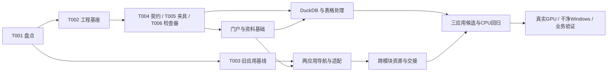

# 多功能平台自动化开发执行手册

版本：1；日期：2026-09-25。适用产品：统一门户、OCR、图像分类、数据清洗比对三个平级应用。

归档说明（2026-10-04）：本文件保存 2026-09-25 的规划状态，后续实际实施与审计平台修复记录见 `F:/OCR/docs/platform-automation`。所有新写入只能在本机 F 盘，规则见 `F:/OCR/AGENTS.md` 与 `F:/OCR/docs/项目文件存储规范.md`。下文 C/E 盘路径是历史记录，不能直接作为当前命令的写入落点；续作时须显式指定已登记的 F 盘仓库、运行目录、缓存和临时目录。

本包把[开发方案](../多功能作业平台开发方案-20260925.md)转换为可续作的开发规范。当前只制定方法和准备校验工具，47 项业务开发任务尚未启动。未来用户要求开始实施时，执行者按本手册持续推进，不在每个阶段重复索取已获授权的许可。

## 1. 文件职责与事实来源

| 文件 | 用途 |
|---|---|
| [tasks.json](tasks.json) | 47 个任务的依赖、资源、写入范围、产物、步骤、检查、完成条件 |
| [checks.json](checks.json) | 46 个检查定义，记录入口生产任务、命令参数、超时及证据类型 |
| [contracts.md](contracts.md) | 接口、数据、状态、幂等与错误语义；T004 将其转成可执行 schema |
| [platform_plan.py](../../scripts/platform_plan.py) | 已实现：校验计划、初始化运行状态、选择下一任务、验证完成证据、计算检查绑定摘要 |
| [test_platform_plan.py](../../tests/test_platform_plan.py) | 校验器和任务选择逻辑的反例测试 |

优先顺序：当前用户指令 → 当前会话适用规则 → 本执行规范与冻结任务包 → 设计参考。历史 OCR/分类专项计划不自动成为本项目的新任务；已取消的长测不恢复排期。

任务清单是规格，不存动态完成状态。每次实施运行拥有一个独立 `state.json`，旧日志、失败回执和旧候选保留。状态应由执行结果推动，不根据写了多少代码估算完成百分比。

## 2. 启动与跨仓库工作方式

默认一个执行者、一个活动开发任务。机器工具可以并发进行独立读取；GPU 验收、浏览器批次、数据迁移及同目录编辑顺序执行。本包不要求启动子代理。

涉及三个仓库：现有 OCR、现有分类、计划新建的平台。实施时为现有仓库创建 `codex/platform-integration-*` 分支或独立工作树，新平台使用自己的仓库。T001 记录实际根路径；默认路径只是发现线索，不允许覆盖非空目录。

必须先记录 HEAD、工作区已有改动、当前运行进程和现有包清单。对已有用户改动进行内容保全，不自动 reset、stash、覆盖或批量格式化。不要把两个项目的数据库、Python 环境或全局包合并到一起。

建议一次运行目录使用 `E:/project/platform-dev-runs/dev-20260925-001`，里面保存：

```text
state.json                  动态状态、实际仓库映射和资源可用性
baseline/                   原始代码、应用和环境身份
attempts/T001/001/           该任务本次日志与检查回执
attempts/T001/002/           修复后的独立重试证据
workspaces/                 隔离的 OCR、分类和平台测试数据
fixtures/                   固定输入和预期值
release/                    候选清单、交付结论与回退回执
qualification/              GPU、干净 Windows、业务验证
NEXT.md                     人类可读的接续摘要
```

以下命令现在可以验证本任务包，不启动任何业务服务：

```powershell
python -X utf8 C:/Users/A/Desktop/OCR/scripts/platform_plan.py validate
python -X utf8 C:/Users/A/Desktop/OCR/scripts/platform_plan.py next --limit 3
python -X utf8 -m unittest discover -s C:/Users/A/Desktop/OCR/tests -p test_platform_plan.py -v
```

收到实施指令后再初始化新的运行记录：

```powershell
python -X utf8 C:/Users/A/Desktop/OCR/scripts/platform_plan.py init-state --run-dir E:/project/platform-dev-runs/dev-20260925-001 --run-id dev-20260925-001
python -X utf8 C:/Users/A/Desktop/OCR/scripts/platform_plan.py next --state E:/project/platform-dev-runs/dev-20260925-001/state.json --limit 3
```

初始化只创建状态文件，不执行清单里的命令，不安装依赖，不改变两个工作台。已有运行目录会被拒绝覆盖。把实际工作树绝对路径写入 `state.repositories`，在 `authorization_reference` 中简短记录实施授权来源，不保存凭据或完整私密对话。

## 3. 单任务执行循环

1. **选择**：先运行 `next`。优先恢复 `resume` 中的任务；检查 `reverify` 的证据失效原因；从 `ready` 选择优先级最高的一个。没有可执行任务时查看 `--details`，区分依赖、设备、业务材料与代码缺陷。
2. **确认输入**：读取该任务、涉及的契约、被修改文件和直接依赖产物。校验当前工作树与基线，不重新加载全部历史日志。所需资源不具备时标记具体缺口，选择其他独立任务。
3. **领取任务**：把状态改为 `running`，增加 attempt，记录目标、预期改动文件与本次检查。使用状态 revision 防止并发覆盖。
4. **实现最小完整切片**：一个切片包含实际服务行为、必要界面、失败路径和持久化。不把只显示卡片、假进度或固定模拟返回视为完成。
5. **验证**：先运行风险相称的局部检查，再运行该任务的 `required_checks`。对恢复、身份、金融数值和来源追踪用独立反例；文字样式微调不机械增加测试。
6. **记录证据**：状态改 `verifying`；运行前固定源输入和已有产物哈希，运行后复核输入未变化，再把本次生成的报告/成果加入产物清单，生成最终绑定摘要并写独立回执和原始日志哈希。
7. **完成与续作**：校验完成记录，逐条核对 acceptance，标 `done`。更新 NEXT 后立即选择下一可执行任务，阶段完成无需例行等待用户确认。

执行者需要解释测试命令实际做了什么，不能只复制命令后因退出码为零而宣称所有范围通过。手工评审也必须有可审阅记录；机器无法替代业务人员的确认。

## 4. 依赖图的关键路径



P0/P1/P2 是产品阶段，不是必须整阶段封锁的瀑布门槛。只遵守具体任务依赖。T040–T047 的数据工作台可在缺少 GPU、分类训练能力或第二台设备时推进；共享任务/成果基础以统一契约实现，不等待两个模型系统先通过真实推理。

T053、T054、T055 分别需要真实 GPU、干净 Windows 和业务样本/评审，它们不会阻塞 T057 形成带明确缺口的工程交付报告；对应资格仍为未通过。

## 5. 状态、缺口和失败处理

| 状态 | 含义 | 允许的后续行为 |
|---|---|---|
| pending | 未领取或已安排一次有变化的重试 | 依赖与资源满足后进入 running |
| running | 正在实现、诊断或执行检查 | 记录检查点；不能并行再领取另一开发任务 |
| verifying | 实现结束，检查/读回/评审仍在进行 | 检查失败回到诊断，满足条件后 done |
| done | 产物、所需检查、依赖和证据均通过 | 输入变化时只补受影响验证，不重复开发 |
| blocked | 缺少具体外部条件，当前动作不能继续 | 保存解除条件，推进独立任务 |
| failed | 已尝试但实现/检查失败 | 修改假设或输入后，开新 attempt 重试 |

不使用 `done_with_gaps` 来容纳未通过的任务。可以完整交付工程范围，同时在资格层面保留缺口；这两者由不同 gate 表示。

重复相同失败最多两次，第三次前必须有可解释变化：定位到新原因、修复代码、改变受控输入或改用另一可验证路线。单任务默认最多三次 attempt；若已有实质诊断进展，可记录原因并修订任务预算，不能通过不断重置计数掩盖停滞。

常见情况的处理规则：

- 运行时缺失：优先定位已有独立环境/便携包；需要安装时使用新隔离环境。已有环境不可擅自升级。
- 下载失败：校验来源后尝试官方替代位置或已验证缓存；无可用文件时继续无关工程，不下载同一失败地址直到超时。
- 真实 API 未配置：首版核心不依赖付费 API。协议模拟可验证适配边界，不能宣称真实供应商效果。
- 无 GPU：运行资源协议和 CPU 测试，真实 GPU 资格保持未测。不要偷偷切换执行设备后仍写 GPU 通过。
- 无业务样本：使用公开/合成夹具完成工程；T055 保持 blocked，不推断实际节省工时或准确率。
- 无干净设备：完成安装包审计与同机隔离测试，T054 保持 blocked。另一目录不等于另一台机器。
- 单模块失败：停止该支路并隔离故障，门户和可独立的数据工具继续开发/测试。

只有会话尚未授权且确需付费外发、修改生产数据、改变部署范围、停止用户进程、系统级禁网/重启或发布外部服务时，才提出具体授权问题。普通修复、局部测试、创建隔离目录和记录证据不追加审批流程。

## 6. 证据格式与过期判定

`state.tasks[Txxx]` 至少包括：status、attempt、source_inputs、outputs、check_results、blockers。文件条目统一为 `repo`、相对 `path`、64 位小写 `sha256`。repo 可以是 ocr、classification、platform 或 run。

完成记录必须覆盖任务清单中全部 outputs。source_inputs 应覆盖实际影响行为的代码、契约、配置、依赖锁和夹具清单，由执行者审查是否完整；校验工具只能验证已列出的文件，不能证明遗漏文件不相关。

每份检查回执包含以下字段：

| 字段 | 规则 |
|---|---|
| task_id / check_id | 与任务及检查定义完全一致 |
| status / exit_code | 完成证据只接受 passed 和整数 0 |
| evidence_kind | 必须匹配 checks.json；模拟证据不能冒充 real_gpu/real_device |
| binding_digest | 绑定当前任务包、任务 ID、source_inputs 和 outputs |
| log | run 下的原始非空日志路径与 SHA256 |
| test_counts | pytest、unittest、run test 和 tests/ 下的入口强制填 passed/failed/skipped；自定义入口可用 requires_test_counts=true 声明；至少一个通过断言且 failed=0 |
| started_at / finished_at | 实際开始结束时间，由执行器填充 |
| argv / cwd / runtime | 实际参数、隔离目录及解释器身份；输出时去除凭据 |
| source_revision / environment | 三仓版本与已登记的机器/资源信息 |
| limitations | 本检查没有覆盖的产品范围 |

检查回执不能伪造为测试日志。执行器在启动前保存源输入及已有产物的哈希快照；结束后重新校验这些文件，变化即拒绝把本次检查绑定到新版本。性能结果、验收报告等由检查生成的产物在结束后取哈希；全部产物齐备后计算最终 binding_digest，最后写回执。产物清单不能包含自身回执的哈希，避免循环依赖。这个前后快照机制由 T006 执行器实现；当前校验器只核查收到的最终记录，无法事后证明执行期间文件没有变化。

一项任务的多条检查必须针对同一固定实现。后一次检查若修改了前一次已校验的业务产物，前一次证据需要重跑；只追加独立日志不影响已有业务产物。检查器更新日志目录，不自动修改业务源文件、依赖锁或预期答案。

```powershell
python -X utf8 C:/Users/A/Desktop/OCR/scripts/platform_plan.py binding --state E:/project/platform-dev-runs/dev-20260925-001/state.json --task T001
python -X utf8 C:/Users/A/Desktop/OCR/scripts/platform_plan.py verify-state --state E:/project/platform-dev-runs/dev-20260925-001/state.json
```

标记 done 前核查 acceptance 和完成证据；校验器会拒绝缺产物、缺日志、错误证据类型、输入变化和依赖未完成的记录。已完成任务被后续改动影响时，保留旧回执，补跑相应检查并重新绑定。没有输入或验证范围变化，不反复运行全量长测。

任务包变更会改变 plan_digest，旧状态不会被自动接受。执行者须记录规格差异、建立新计划版本、迁移无关任务记录并重新绑定受影响检查；不得只改 digest 绕过过期判断。

## 7. 检查命令的落地规则

checks.json 的未来入口由 producer_task 负责实现。已有命令与未来命令都先确认文件存在和运行时身份，不能把“文件不存在”处理为跳过后通过。任务可以创建自己的检查入口，不能依赖尚未完成的后继任务生产测试文件。

命令用可执行文件加参数数组描述，不拼接 shell 字符串。`{run_root}` 是执行器受控替换的唯一目录参数；cwd 前缀 ocr、classification、platform 解析为本次状态登记的实际工作树。

运行时名 ocr_python/classification_python/platform_python/node/npm/pnpm 必须在 T001/T002 解析为实际可执行入口和版本。OCR 测试设置该工作树 `src` 为 PYTHONPATH；分类测试使用隔离 `ICP_DATA_DIR`。测试中不要复用现有用户工作区，也不要继承真实外部 API 凭据。

对于 `.cmd` 包管理器入口，由执行器采用 Windows 已验证的调用方式；参数来自冻结清单，上传文件名不能进入解释执行字符串。只对本次记录的进程 PID/创建时间和后代进行超时清理。

检查分层：协议/纯 CPU → 模块真实 HTTP → 外部浏览器 → 实际 GPU → 目标设备。每层只声明它实际覆盖的范围。构建成功不能替代导航与下载，模拟 HTTP 不能替代真实后端，截图不能替代文件读回。

## 8. 浏览器、截图与资源纪律

优先使用外部 Playwright/Chromium 或 Edge，参数包含 `--disable-gpu` 和 `--disable-gpu-compositing`，每批测试一个隔离实例。端口由本次启动回执取得，不连接不明的 8765 服务。

使用内置浏览器时遵守用户 AGENTS.md：截图前停止其他线程的 Browser Use 活动；截图后不立刻切线程、清 goal、interrupt 或连续收口；关闭浏览器活动并等界面稳定后再运行发布/测试收口。不把重启 Codex 当作正常测试步骤。

模型/训练/GPU 验收同一时刻只占一个资源名额。运行已有长任务时先选择独立 CPU 工作；不能为了当前任务自动杀掉不归自己管理的进程。新项目没有默认四小时稳定轨，性能任务采用预先定义的有界规模。

## 9. 检查点与恢复协议

每个任务完成、失败、外部条件变化或连续工作约 30 分钟时，更新 state 和 NEXT。保持日常进展消息简短，说明新发现、当前阻碍与接下来验证的内容。

NEXT 至少记录：run ID、计划摘要、三仓实际路径和 HEAD、活动任务、最后一次检查、保留的失败、待核实外部提交、拥有的进程/端口、资源缺口、下一条可执行命令。

状态更新采用临时文件、校验、原子替换并递增 revision；只有一个写者。旧 state 保存为带 revision 的快照，不手工覆盖原始日志。T006 的执行器负责这一机制；本次交付的选择器只读状态，不提供后台调度。

恢复时先运行 verify-state/next，再核对进程归属、原生任务账本和未知提交。running 不等于需要重做，verifying 不等于可以直接 done。旧回执仍有效时继续下一项，只有受影响的部分重新验证。

如果所有 ready 都因外部条件阻塞，输出：已完成范围、各 gate 状态、具体解除条件和 NEXT 路径。不要伪造通过，也不要安排未经用户要求的周期提醒。

## 10. 五个可机器判定的交付门槛

| gate | 声明范围 |
|---|---|
| portal_ready | 两个旧工作台实际打开、返回和基线通过 |
| engineering_ready | 本机工程、数据工作台、跨模块协议、候选包与恢复完成；外部资格单列 |
| device_qualified | 在工程通过基础上，真实 GPU、独立 Windows 离线/搬迁通过 |
| business_qualified | 在工程通过基础上，明确业务范围经样本和评审通过 |
| v1_qualified | 工程、设备、业务三项全部满足 |

T057 可以产出准确报告而不满足最后三个 gate；报告写完不等于生产合格。开发者应在交付中列出每个 gate 的实际状态，而不是一个含糊的“全部完成”。

## 11. 从空工程到自动检查的引导顺序

T001–T005 尚不能依赖 T006 的执行器。执行者先按 checks.json 的参数直接运行已经存在或由当前任务新建的入口，保留实际命令、环境、退出码和原始日志，再按本手册格式登记回执。T006 验收通过后统一改用执行器；旧回执只在事实字段齐全且哈希有效时导入，不把后补记录伪装成当时已经运行过自动执行器。

T002 同时建立最小健康 API 测试、前端生产构建、平台 Python 锁文件和门户包管理锁文件。T013 再建立前端行为测试；每个检查的 producer_task 必须交付它自己的入口及运行所需配置。T006 只实现通用执行机制，不提前生成所有未来业务功能。

write_scopes 表示预计主要修改位置，outputs 是最低交付清单。确需修改路由挂载、服务组合入口、依赖清单、锁文件或测试配置时，先记录具体文件及原因，再修订该任务范围与计划版本；正常实现配套修改不产生新的用户审批。校验器会检查声明产物落在写入范围内，但不会拦截操作系统写文件，实际 diff 仍须核对。

接口或任务拆分需要调整时，在运行目录保存规格变更记录，列出旧/新计划摘要、受影响任务、契约兼容性和需重跑的检查。更新冻结包和状态必须作为一次受控迁移：保留旧状态，不单改 plan_digest。未改变检查内容与输入的历史日志可以经明确复核后引用，迁移回执标明原运行身份；当前工具不自动迁移。

如果某个任务预计持续超过半天且包含多个独立行为，在领取前按可验收切片细分、分配新 ID 并更新依赖；不要通过一个不断扩张的 running 任务隐藏进度。清单中的路径是当前落点约定，实施时有证据的合理重构可以通过上述版本变更记录完成。

## 12. 本地自动化与持续集成方式

优先建立本地可重复的同一套命令。首版不要求云端 CI 服务；后续接入已有 GitHub Actions 或单位流水线时复用检查入口，不另写只在流水线生效的逻辑，也不默认上传用户资料或模型。

| 触发 | 自动检查范围 | 成功产物 |
|---|---|---|
| 任务包修改 | validate、规划工具反例测试、依赖/产物路径检查 | 新计划摘要与影响说明 |
| 平台 Python 代码修改 | 受影响单测；涉及契约/状态/持久化时增加相应反例 | 测试计数、日志与绑定回执 |
| 门户代码修改 | 类型检查/构建、相关行为测试；导航或文件交互再跑真实浏览器 | 构建产物、测试回执和必要截图 |
| OCR/分类接入修改 | 对应旧应用 CPU 回归、适配器测试；页面修改再跑构建/导航 | 原能力无回退的比较记录 |
| 契约或依赖锁修改 | 契约正反例、受影响提供者/消费者、冻结依赖安装及构建 | 兼容矩阵与依赖身份 |
| 候选包生成 | 清单/许可核对、固定候选真实 HTTP 与浏览器、备份/回退 | 同一候选哈希对应的一组证据 |
| 具备合格设备或业务条件 | T053–T055 各自独立运行 | GPU、Windows、业务资格回执 |

运行器必须具备这些约束：

- 每次命令使用登记的解释器绝对路径和固定工作目录；不依赖开发者 shell 的偶然 PATH。
- Python 按目标 Windows/Python 版本锁依赖；pnpm 使用冻结锁安装。首次锁定允许联网取得公开依赖，离线交付从已校验的包准备，不能依赖隐形全局缓存。
- 测试进程继承最小必需环境，移除真实模型 API 密钥和用户工作区路径；测试库、临时文件、浏览器下载均在本次 run 下。
- 前端 test 脚本使用单次执行模式，不启动 watch。测试零收集、全跳过、超时、有失败断言均失败；跳过与限制仍进入报告。
- 日志与回执采用独立 attempt 目录；超时后确认子进程停止，再允许下一检查占用同一资源。后台残留不作为成功退出。
- 只缓存依赖和可验证公开模型文件；缓存键包含系统架构、解释器版本和锁文件哈希。不能缓存活动数据库、用户样本或工作台凭据。
- 本地开发分支采用 codex/ 前缀，按可验收切片形成提交；提交消息注明任务 ID。创建远程仓库、推送、PR、合并和正式发布按后续会话实际授权执行，不由任务包自行触发。

候选冻结后新增修复必须产生新候选身份，并补跑受影响检查。既有 GPU/设备/业务资格不能自动沿用到不同可执行文件、模型、数据 schema 或规则版本；是否可复用需明确兼容性和影响证据。

## 13. 启动实施时给执行者的指令

> 按 docs/platform-automation/README.md、contracts.md、tasks.json 和 checks.json 开始多功能平台实施。先验证任务包，建立独立运行记录并从 T001 开始。保持 OCR、分类和平台仓库/运行时/数据边界；使用真实产物和检查回执推进任务。阶段完成后继续下一可执行任务。缺 GPU、业务样本或干净设备时记录对应缺口并推进独立工作，不把未测项写成通过。不改生产数据，不启动未经授权的付费外发、外部部署或旧项目长测。每次收口给出 gate 状态和 NEXT 路径。

这段指令供后续启动实施使用。本次交付不自动执行它。
