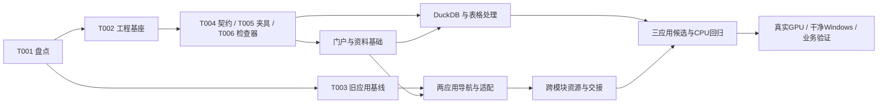

# Clear 智能审计开发索引

## 唯一开发主线（2026-10-24）

开发统一到 `F:\OCR` 的 `codex/workspace-organized-20261023`，三个应用在 [`products/Clear`](../../products/Clear/README.md) 维护。屏拍专项、平台接入、GLM 辅助工具与 0.18/0.19/0.20 源码的整合范围和检查见[统一分支记录](分支整合记录-20261024.md)。原工作树保留历史来源，后续不再作为独立修改和快照覆盖入口。下方正式登记与历史阶段记录分别保留其版本身份。

## 当前正式交付入口（2026-10-24）

正式登记为 **Clear 0.20.0 易用性版 / candidate-006 / 8879**，沿用原工作区，实际身份以 [current.json](../../release/Clear/current.json) 为准。八个实用案例覆盖六组目标，正式启动、旧会话与下载抽查及单请求问答已通过。本轮从已验收 **0.17.1 / e5ca875** 实施，保留文档/MinerU Pro 和已有修复，不混入 0.18.0、0.19.0 实验；最终身份、前后对照、失败修复、备份与回退只记在[本轮实施记录](Clear易用性优先与Agent简化实施-20261023.md)。

现行取舍见 [AGENTS.md](../../AGENTS.md)：优先完成用户目标、尽早给可用结果，普通任务无审计建档前置，复用现有服务，内部细节按需展开。只维护[一份简短实施计划](Clear易用性优先与Agent简化实施-20261023.md)；相关使用说明与架构说明同步解释实际已交付行为，规划不冒称完成。

验证先覆盖受影响的真实用户路径与必要反例。日常改动无需旧任务包初始化、完整回执字段、五类 gate 或全量多轮对照；发布、迁移、身份与未知写入仍保留所需检查。历史检查仅证明当时版本，未受影响的证据可注明范围后引用。

下列日期条目均为对应阶段的记录。10月18日八项用户流程修复、10月19日通用工具及自然收尾已有实施证据，不重复列为新缺陷。旧 JSON 的 pending/planned/validation_in_progress 不自动进入新待办：10月18清单的 implementation 已记 completed_local_delivery，实际交付见该次验收报告；10月16仍开放的专项资格只约束其声明范围。冻结任务 JSON 与原始证据不改写。

## 历史阶段索引

> 历史记录（2026-10-19）：[全平台 GUI 升级实施与验收](Clear全平台GUI升级实施与验收-20261019.md)已完成 0.15.0 candidate-002 候选交付，试用入口 http://127.0.0.1:8970/，正式入口仍为 0.14.0。

**2026-10-19 通用能力优先升级已本机交付：** 正式入口为 **0.14.0 agent-foundation candidate-006**，原DATA/8879。DSH通用工具、自然收尾、组合业务及任务内OCR选参已落实；110次固定对照、20通用/12平台证据、正式旧会话/下载、备份恢复与旧版回退均已核对。完整结论、对照限制和后续专项见[实施与验收](Agent通用能力恢复实施与验收-20261019.md)、[最终矩阵](Agent通用能力恢复最终验收矩阵-20261019.md)与[初次调研计划](Agent通用能力恢复与审计增强调研升级计划-20261019.md)。

**2026-10-19 上一阶段用户流程修复（历史交付）：** 当时正式入口切换到 **0.13.0 user-flow candidate-018**，沿用原工作区/8879并启用Agent。目标分流、原任务故障恢复与追加、跨工具进展、独立成果和实际对象范围保护已实现；最终候选、真实用户旅程、工程回放边界、旧会话/下载及冷备回退证据见[修复与验收记录](Clear用户流程修复与验收-20261018.md)。以下严审段落按修复前历史阅读。

**2026-10-18 用户流程与任务连续性严审（按用户纠偏重写）：** 当前主线是排查普通目标被过度编排、短暂故障后无法继续、执行中追加被拒绝、交替工具空转、暂停任务阻挡无关项目，以及结果交付不完整等严重使用问题。见[用户流程审查与8项改进计划](Clear当前基准严审与后续改进计划-20261018.md)及[当前任务清单](clear-improvement-tasks-20261018.json)。原14项工程细目保留为辅助资料，已不作为本轮执行主线；新增确定性复现不冒称真实模型/浏览器首跑。该审查制定时正式入口为0.12.1、尚未实施；用户随后授权的修复与正式切换见上方记录。以下旧“当前运行基线”等表述按历史阅读，实际配置以`release/Clear/current.json`为准。

**2026-10-17 全平台架构修订实施：** 已实现中立业务服务、图片/PDF/Data/既有模型分类直接驱动、终态和要求覆盖修复、全文/TXT、错误阶段与快照恢复，并完成独立审查修复。固定候选、真实入口、性能和恢复证据见 `F:\OCR\output\architecture-revision-20261017`。见[全平台修订计划](Clear全平台架构修订计划-20261016.md)和[30 项工作清单](clear-architecture-revision-tasks-20261016.json)；未验人工/中央部署及未达性能分别登记。正式入口未切换，不新增自动化；历史开发任务包保留为对应阶段记录。

**2026-10-14 使用与架构文档：** [平台完整使用说明书](../Clear审计平台使用说明书.md) · [手动工具分册](../Clear手动工具使用说明.md) · [OCR 分册](../ClearOCR详细使用说明.md) · [架构设计与实现思路](../Clear架构设计与实现思路.md) · [统一源码快照](../../products/Clear/README.md)。以 v0.10.0 固定入口及实际启动覆盖路径为基线，区分根仓独立 OCR 研发功能和历史候选；源码、文档统一纳入 GitHub，离线运行资产与业务数据留在本机。

**2026-10-13 多模态手动工具工程版已正式切换：** v0.10.0 保留原四工具，新增人脸、音频工作台并扩展印章及 CAT-Net；四方向 CPU 真实处理、人工复核、成果与完整离线介质已通过工程验证。原工作区、固定入口、旧版及冷备份保留。业务样本、A4000/A6000 现场资格、新增 GPU 调度与长录音仍有待办，整体升级未登记完成。见[交付记录](多模态手动工具升级交付记录-20261013.md)、[唯一升级任务清单](多模态手动工具升级任务-20261013.json)及[内网部署说明](多模态手动审计验收与内网部署说明.md)。

**2026-10-12 手动工具扩展选型调研：** 已整理图像篡改、人脸识别、音频分析和印章识别的开源/权威实现、代码与权重许可、竞品、现有工具接入方式及 Windows 离线封包影响，见[完整调研报告](/F:/OCR/research/manual-tools-extension-20261012/四类扩展选型与竞品分析.md)。当前为选型阶段，未安装新依赖/模型或修改正式运行版本。

**2026-10-12 手动工具美化版已正式切换：** 按用户明确要求，将完成 40 项验收的美化候选发布为 v0.9.4，正式登记指向 `F:\OCR\release\Clear\versions\0.9.4`。[正式手动工具](http://127.0.0.1:8879/apps)及原启动快捷方式继续使用原工作区；完整备份 98 个文件、22 个数据库检查通过。正式门户及 OCR/分类原生页面已打开核验，17 次静态响应均匹配发布清单。见[正式发布报告](/F:/OCR/output/manual-tools-polish-release-20261012-001/正式发布报告.md)。此 v0.9.4 为手动工具美化发布，不是下方历史屏拍基准的同号未发布候选。

**2026-10-07 下一阶段专用 Agent 计划：** 围绕平台已有工具完善常用任务匹配、结构化偏好、具体异常处理、当前版本交付与首产出；以屏拍 OCR 为首个业务，随后验证已有分类及数据核对的跨工具流程。详见[最终实施计划](平台专用Agent提升计划-20261007.md)及[8 项任务清单](specialized-agent-tasks-20261007.json)。当前状态为规划完成、待实施，保留既有 OCR 模拟验收及正式 v0.9.3；没有将计划登记为已实现。

**2026-10-07 批量屏拍 OCR 与 Agent 改进：** 已接通固定批次、后台识别、检查点恢复、精度子批次、每图 XLSX 与整批 ZIP，原生入口和 Agent 共用批次服务。新增模型实测支持首版 Hunyuan 首轮、仅技术失败 GLM 兜底；候选须人工确认。240 张实际模拟批次使用 4 轮主控/3 工具，交付 238 本 XLSX/2 无可交付表候选；表格核验全通过 54.58%、关键字段 74.09%。24 张挑战、8 输入恢复重复复用与全量 Excel 读回已完成，业务说明/UI 整理、错格定位、首产出等待和导出新鲜度仍有缺口，详见[最终方案与模拟评估](../批量屏拍OCR完善方案-20261007.md)。最终工程候选为 [v0.9.4-final-003](F:/OCR/output/ocr-screen-benchmark-20261007/candidate-v0.9.4-final-003)，**正式 current 仍是 v0.9.3**；调度提效已经实测，免校对自动化尚未达到。

**2026-10-06 ClearOCR 界面简化已完成：** 默认突出导入、识别、文字/表格校对和导出；引擎、预处理及对比识别集中到“识别设置”，结构复核、模型对比和视觉审校集中到“专业工具”。定位与坐标调整默认收起，合并重复队列入口；非默认识别参数、保存失败和恢复提示仍可见。交付 v0.9.3，37 项相关单元测试、16 项浏览器导航检查、三种宽度的原生界面检查及正式资源身份核验通过，原 OCR 内容与 Agent 配置保持，见[完成报告](F:/OCR/output/ocr-simplification-dev-20261006/完成报告.md)。

**2026-10-06 首次工具入口修正已完成：** 无项目进入图像取证、OCR/分类项目工作台时，可在原工具页选择或新建项目，完成后直接续开原工具；不再只给空提示或创建后跳首页。保留查询参数和锚点，防止晚到创建回复劫持导航。交付 v0.9.2，相关导航/取证回归、桌面/手机真实浏览器和正式资源核验通过，见[修复报告](F:/OCR/output/tool-project-entry-fix-20261006/完成报告.md)。

**2026-10-06 服务启动状态修正已完成：** OCR/分类已安装、可启动且尚无受控实例时，主状态显示“待启动 · 按需启动，打开时检查运行状态”；真实服务故障优先展示原因。交付 v0.9.1，18 项相关测试、桌面/手机浏览器检查及正式入口资源核验通过，原工作区记录与模型配置保持，见[完成报告与回退依据](F:/OCR/output/service-status-display-fix-20261006/完成报告.md)。

**本轮精修已完成：** [前端精修开发计划](前端精修开发计划-20261006.md)的 [10 项任务](frontend-polish-tasks-20261006.json)全部完成，交付 v0.9.0。统一视觉规范、Agent 首页与流式反馈、手动目录、配套页和四类专业工具；原手动能力、来源版本和任务带回保持。状态和检查证据仍只在同一任务清单登记，详见 [完成报告](F:/OCR/output/frontend-polish-dev-20261006/完成报告.md)和[交付与回退](F:/OCR/output/frontend-polish-dev-20261006/交付与回退.md)。

**上一轮已完成：** [平台收束开发计划](平台收束开发计划-20261005.md)的 [8 项任务](platform-convergence-tasks-20261005.json)，当前状态及证据仍只在这份任务清单登记。交付 v0.8.0，见[完成报告](F:/OCR/output/platform-convergence-dev-20261005/完成报告.md)。旧计划的 pending/planned 不自动进入新待办。

**2026-10-19 运行基线（历史）：** v0.14.0 agent-foundation candidate-006，Agent保持启用，明确本地操作无需模型连接，手动工具继续保留；Python/专业模型只读复用0.10.0共享program。固定入口是[启动智能审计.cmd](F:/OCR/release/Clear/启动智能审计.cmd)，真实运行选择以[当前登记](F:/OCR/release/Clear/current.json)为准。下方带日期的旧版本与未切换表述均为对应阶段的历史记录。实施前 v0.8.1 的[资源、能力与状态修正报告](F:/OCR/output/application-declarations-fix-20261006/完成报告.md)及原 SC01—SC08 完成报告保留为历史交付记录。

**产品主线：** 普通对话和通用文件执行，按需调用专业服务，交付可读可下载的成果；用户需要正式审计时再进入相应分析、复核与确认。普通工作不以正式审计流程为前置。手动工具与正式人工档案流程继续保留；多模态业务精度、目标设备与中央部署按各自资格单列，不把流程修复等同于这些专项已通过。

**2026-10-06 补充修正已应用：** OCR/分类的资源、格式及操作声明已补齐；Data/Forensics 卡片提供一致的声明说明，Agent 原生工具的可用状态据实返回。本次 31 项前端、21 项后端检查与浏览器检查通过。旧单独 OCR 修补包未应用，已由本次 v0.8.1 完整候选替代。

| 2026-10-19 接续登记（历史） | 登记位置 |
|---|---|
| 源码 | `F:\OCR\output\frontend-workbench-20261015\worktrees\platform`；OCR/分类沿用登记来源 |
| 当时候选 | `F:\OCR\output\agent-foundation-upgrade-20261019\delivery\Clear-0.14.0-agent-foundation-candidate-006` |
| 用户工作区 | `F:\OCR\output\ai-audit-product-dev-20261004\workspace` |
| 当时正式入口 | <http://127.0.0.1:8879/> |
| 本轮精修规格与结果 | [前端精修计划](前端精修开发计划-20261006.md)；[唯一任务清单](frontend-polish-tasks-20261006.json) |
| 当前启动/停止 | [固定启动](F:/OCR/release/Clear/启动智能审计.cmd)；状态/停止见 [使用说明](F:/OCR/release/Clear/使用说明.md) |
| 最新手动工具美化 | [40 项唯一任务清单](手动工具美化提升TODO计划-20261011.md)；[正式发布与回退报告](/F:/OCR/output/manual-tools-polish-release-20261012-001/正式发布报告.md) |
| 上一轮收束完成证据 | [收束任务清单](platform-convergence-tasks-20261005.json)；[最终检查](F:/OCR/output/platform-convergence-dev-20261005/evidence/checks-summary.json)，原工作区连续性已核对 |

已完成产品改造依据：[AI 驱动智能审计规划](AI驱动智能审计平台下一阶段规划-20261004.md)与[12 项产品任务结果](ai-audit-product-tasks-20261004.json)。历史 Agent 规格见[平台 Agent 计划](平台Agent开发计划-20261004.md)、[18 项冻结任务规格](platform-agent-development-tasks-20261004.json)及[框架调研](../../research/platform-agent-20261004/README.md)。这些文件保留历史方向、过程和验证范围，当前实现与接续状态以本索引上方登记为准。

## 全局落盘约束

**2026-10-02 起的本机落盘约束：所有项目文件只能保存到本机 F 盘。** OCR 主目录为 `F:/OCR`，关联仓库只可使用 F 盘内登记的路径；工作树及实际 Git 元数据、运行状态、依赖、模型、数据、缓存、临时文件、浏览器 profile/下载、日志、截图、备份和交付包全部遵守。详见 [项目文件存储规范](../项目文件存储规范.md)。下述示例已改用 F 盘；历史任务 JSON、脚本默认值与旧证据中的 C/D/E 盘路径不构成写入授权，续作前须统一实际路径和子进程环境。本次未迁移旧仓库、修改冻结任务包或创建运行记录。

## 历史计划与执行手册

以下为历史执行手册，不适用于当前日常开发，也不要求重新初始化任务包。各阶段当时的范围和状态表述不作为当前收束任务状态；旧冻结任务包的状态、目录及初始化方式仅适用于对应历史执行。旧评分评测不恢复为本轮开发前置。

2026-10-02 新增规划：[Clear 系列界面统一务实开发计划](Clear系列界面统一务实开发计划-20261002.md)以现有 DeloitteOCR 为视觉基准，统一三个应用与平台配套页，默认采用 ClearOCR、ClearClassify、ClearData 品牌；[机器可读任务草案](clear-ui-tasks-20261002.json)明确依赖、负责人、写入范围和有限检查。本次仅规划，尚未实施；不覆盖以下历史任务包及工程完成记录。

本包把[开发方案](../多功能作业平台开发方案-20260925.md)转换为可续作的开发规范。以下保留 2026-09-25 的执行方法与历史任务包；当前实施结果以[后续务实开发计划](后续务实开发计划-20260927.md)和[最终工程报告](最终工程交付报告-20261001.md)为准。2026-10-01 首版工程收尾四步已完成，[交付使用说明](F:/OCR/output/platform-engineering-final-20261001/README.md)提供统一入口、样例及备份恢复工具。正式 T052–T057 仍为 pending；不以工程交付替代独立设备和业务资格，不按下面的历史初始化指令重新开工。

## 1. 文件职责与事实来源

最新运行策略见[首次校验缓存与进度反馈](启动校验更新说明-20261001.md)：用户已明确要求仅首次完整校验并给出反馈，此新增要求已完成；基础交付报告保留更新前的历史证据与正式资格边界。

| 文件 | 用途 |
|---|---|
| [tasks.json](tasks.json) | 47 个任务的依赖、资源、写入范围、产物、步骤、检查、完成条件 |
| [checks.json](checks.json) | 46 个检查定义，记录入口生产任务、命令参数、超时及证据类型 |
| [contracts.md](contracts.md) | 接口、数据、状态、幂等与错误语义；T004 将其转成可执行 schema |
| [platform_plan.py](../../scripts/platform_plan.py) | 已实现：校验计划、初始化运行状态、选择下一任务、验证完成证据、计算检查绑定摘要 |
| [test_platform_plan.py](../../tests/test_platform_plan.py) | 校验器和任务选择逻辑的反例测试 |

优先顺序：当前用户指令 → 当前会话适用规则 → 本执行规范与冻结任务包 → 设计参考。历史 OCR/分类专项计划不自动成为本项目的新任务；已取消的长测不恢复排期。

任务清单是规格，不存动态完成状态。每次实施运行拥有一个独立 `state.json`，旧日志、失败回执和旧候选保留。状态应由执行结果推动，不根据写了多少代码估算完成百分比。

## 2. 启动与跨仓库工作方式

默认一个执行者、一个活动开发任务。机器工具可以并发进行独立读取；GPU 验收、浏览器批次、数据迁移及同目录编辑顺序执行。本包不要求启动子代理。

涉及三个仓库：现有 OCR、现有分类、计划新建的平台。实施时为现有仓库创建 `codex/platform-integration-*` 分支或独立工作树，新平台使用自己的仓库。T001 记录实际根路径；默认路径只是发现线索，不允许覆盖非空目录。

必须先记录 HEAD、工作区已有改动、当前运行进程和现有包清单。对已有用户改动进行内容保全，不自动 reset、stash、覆盖或批量格式化。不要把两个项目的数据库、Python 环境或全局包合并到一起。

新的运行目录统一使用 F 盘，例如 `F:/OCR/output/platform-dev-runs/dev-20261002-001`，里面保存：

```text
state.json                  动态状态、实际仓库映射和资源可用性
baseline/                   原始代码、应用和环境身份
attempts/T001/001/           该任务本次日志与检查回执
attempts/T001/002/           修复后的独立重试证据
workspaces/                 隔离的 OCR、分类和平台测试数据
fixtures/                   固定输入和预期值
release/                    候选清单、交付结论与回退回执
qualification/              GPU、干净 Windows、业务验证
NEXT.md                     人类可读的接续摘要
```

以下命令现在可以验证本任务包，不启动任何业务服务：

```powershell
python -X utf8 F:/OCR/scripts/platform_plan.py validate
python -X utf8 F:/OCR/scripts/platform_plan.py next --limit 3
python -X utf8 -m unittest discover -s F:/OCR/tests -p test_platform_plan.py -v
```

收到实施指令后再初始化新的运行记录：

```powershell
python -X utf8 F:/OCR/scripts/platform_plan.py init-state --run-dir F:/OCR/output/platform-dev-runs/dev-20261002-001 --run-id dev-20261002-001
python -X utf8 F:/OCR/scripts/platform_plan.py next --state F:/OCR/output/platform-dev-runs/dev-20261002-001/state.json --limit 3
```

初始化只创建状态文件，不执行清单里的命令，不安装依赖，不改变两个工作台。已有运行目录会被拒绝覆盖。把实际工作树绝对路径写入 `state.repositories`，在 `authorization_reference` 中简短记录实施授权来源，不保存凭据或完整私密对话。

## 3. 单任务执行循环

1. **选择**：先运行 `next`。优先恢复 `resume` 中的任务；检查 `reverify` 的证据失效原因；从 `ready` 选择优先级最高的一个。没有可执行任务时查看 `--details`，区分依赖、设备、业务材料与代码缺陷。
2. **确认输入**：读取该任务、涉及的契约、被修改文件和直接依赖产物。校验当前工作树与基线，不重新加载全部历史日志。所需资源不具备时标记具体缺口，选择其他独立任务。
3. **领取任务**：把状态改为 `running`，增加 attempt，记录目标、预期改动文件与本次检查。使用状态 revision 防止并发覆盖。
4. **实现最小完整切片**：一个切片包含实际服务行为、必要界面、失败路径和持久化。不把只显示卡片、假进度或固定模拟返回视为完成。
5. **验证**：先运行风险相称的局部检查，再运行该任务的 `required_checks`。对恢复、身份、金融数值和来源追踪用独立反例；文字样式微调不机械增加测试。
6. **记录证据**：状态改 `verifying`；运行前固定源输入和已有产物哈希，运行后复核输入未变化，再把本次生成的报告/成果加入产物清单，生成最终绑定摘要并写独立回执和原始日志哈希。
7. **完成与续作**：校验完成记录，逐条核对 acceptance，标 `done`。更新 NEXT 后立即选择下一可执行任务，阶段完成无需例行等待用户确认。

执行者需要解释测试命令实际做了什么，不能只复制命令后因退出码为零而宣称所有范围通过。手工评审也必须有可审阅记录；机器无法替代业务人员的确认。

## 4. 依赖图的关键路径



P0/P1/P2 是产品阶段，不是必须整阶段封锁的瀑布门槛。只遵守具体任务依赖。T040–T047 的数据工作台可在缺少 GPU、分类训练能力或第二台设备时推进；共享任务/成果基础以统一契约实现，不等待两个模型系统先通过真实推理。

T053、T054、T055 分别需要真实 GPU、干净 Windows 和业务样本/评审，它们不会阻塞 T057 形成带明确缺口的工程交付报告；对应资格仍为未通过。

## 5. 状态、缺口和失败处理

| 状态 | 含义 | 允许的后续行为 |
|---|---|---|
| pending | 未领取或已安排一次有变化的重试 | 依赖与资源满足后进入 running |
| running | 正在实现、诊断或执行检查 | 记录检查点；不能并行再领取另一开发任务 |
| verifying | 实现结束，检查/读回/评审仍在进行 | 检查失败回到诊断，满足条件后 done |
| done | 产物、所需检查、依赖和证据均通过 | 输入变化时只补受影响验证，不重复开发 |
| blocked | 缺少具体外部条件，当前动作不能继续 | 保存解除条件，推进独立任务 |
| failed | 已尝试但实现/检查失败 | 修改假设或输入后，开新 attempt 重试 |

不使用 `done_with_gaps` 来容纳未通过的任务。可以完整交付工程范围，同时在资格层面保留缺口；这两者由不同 gate 表示。

重复相同失败最多两次，第三次前必须有可解释变化：定位到新原因、修复代码、改变受控输入或改用另一可验证路线。单任务默认最多三次 attempt；若已有实质诊断进展，可记录原因并修订任务预算，不能通过不断重置计数掩盖停滞。

常见情况的处理规则：

- 运行时缺失：优先定位已有独立环境/便携包；需要安装时使用新隔离环境。已有环境不可擅自升级。
- 下载失败：校验来源后尝试官方替代位置或已验证缓存；无可用文件时继续无关工程，不下载同一失败地址直到超时。
- 真实 API 未配置：首版核心不依赖付费 API。协议模拟可验证适配边界，不能宣称真实供应商效果。
- 无 GPU：运行资源协议和 CPU 测试，真实 GPU 资格保持未测。不要偷偷切换执行设备后仍写 GPU 通过。
- 无业务样本：使用公开/合成夹具完成工程；T055 保持 blocked，不推断实际节省工时或准确率。
- 无干净设备：完成安装包审计与同机隔离测试，T054 保持 blocked。另一目录不等于另一台机器。
- 单模块失败：停止该支路并隔离故障，门户和可独立的数据工具继续开发/测试。

只有会话尚未授权且确需付费外发、修改生产数据、改变部署范围、停止用户进程、系统级禁网/重启或发布外部服务时，才提出具体授权问题。普通修复、局部测试、创建隔离目录和记录证据不追加审批流程。

## 6. 证据格式与过期判定

`state.tasks[Txxx]` 至少包括：status、attempt、source_inputs、outputs、check_results、blockers。文件条目统一为 `repo`、相对 `path`、64 位小写 `sha256`。repo 可以是 ocr、classification、platform 或 run。

完成记录必须覆盖任务清单中全部 outputs。source_inputs 应覆盖实际影响行为的代码、契约、配置、依赖锁和夹具清单，由执行者审查是否完整；校验工具只能验证已列出的文件，不能证明遗漏文件不相关。

每份检查回执包含以下字段：

| 字段 | 规则 |
|---|---|
| task_id / check_id | 与任务及检查定义完全一致 |
| status / exit_code | 完成证据只接受 passed 和整数 0 |
| evidence_kind | 必须匹配 checks.json；模拟证据不能冒充 real_gpu/real_device |
| binding_digest | 绑定当前任务包、任务 ID、source_inputs 和 outputs |
| log | run 下的原始非空日志路径与 SHA256 |
| test_counts | pytest、unittest、run test 和 tests/ 下的入口强制填 passed/failed/skipped；自定义入口可用 requires_test_counts=true 声明；至少一个通过断言且 failed=0 |
| started_at / finished_at | 实際开始结束时间，由执行器填充 |
| argv / cwd / runtime | 实际参数、隔离目录及解释器身份；输出时去除凭据 |
| source_revision / environment | 三仓版本与已登记的机器/资源信息 |
| limitations | 本检查没有覆盖的产品范围 |

检查回执不能伪造为测试日志。执行器在启动前保存源输入及已有产物的哈希快照；结束后重新校验这些文件，变化即拒绝把本次检查绑定到新版本。性能结果、验收报告等由检查生成的产物在结束后取哈希；全部产物齐备后计算最终 binding_digest，最后写回执。产物清单不能包含自身回执的哈希，避免循环依赖。这个前后快照机制由 T006 执行器实现；当前校验器只核查收到的最终记录，无法事后证明执行期间文件没有变化。

一项任务的多条检查必须针对同一固定实现。后一次检查若修改了前一次已校验的业务产物，前一次证据需要重跑；只追加独立日志不影响已有业务产物。检查器更新日志目录，不自动修改业务源文件、依赖锁或预期答案。

```powershell
python -X utf8 F:/OCR/scripts/platform_plan.py binding --state F:/OCR/output/platform-dev-runs/dev-20261002-001/state.json --task T001
python -X utf8 F:/OCR/scripts/platform_plan.py verify-state --state F:/OCR/output/platform-dev-runs/dev-20261002-001/state.json
```

标记 done 前核查 acceptance 和完成证据；校验器会拒绝缺产物、缺日志、错误证据类型、输入变化和依赖未完成的记录。已完成任务被后续改动影响时，保留旧回执，补跑相应检查并重新绑定。没有输入或验证范围变化，不反复运行全量长测。

任务包变更会改变 plan_digest，旧状态不会被自动接受。执行者须记录规格差异、建立新计划版本、迁移无关任务记录并重新绑定受影响检查；不得只改 digest 绕过过期判断。

## 7. 检查命令的落地规则

checks.json 的未来入口由 producer_task 负责实现。已有命令与未来命令都先确认文件存在和运行时身份，不能把“文件不存在”处理为跳过后通过。任务可以创建自己的检查入口，不能依赖尚未完成的后继任务生产测试文件。

命令用可执行文件加参数数组描述，不拼接 shell 字符串。`{run_root}` 是执行器受控替换的唯一目录参数；cwd 前缀 ocr、classification、platform 解析为本次状态登记的实际工作树。

运行时名 ocr_python/classification_python/platform_python/node/npm/pnpm 必须在 T001/T002 解析为实际可执行入口和版本。OCR 测试设置该工作树 `src` 为 PYTHONPATH；分类测试使用隔离 `ICP_DATA_DIR`。测试中不要复用现有用户工作区，也不要继承真实外部 API 凭据。

对于 `.cmd` 包管理器入口，由执行器采用 Windows 已验证的调用方式；参数来自冻结清单，上传文件名不能进入解释执行字符串。只对本次记录的进程 PID/创建时间和后代进行超时清理。

检查分层：协议/纯 CPU → 模块真实 HTTP → 外部浏览器 → 实际 GPU → 目标设备。每层只声明它实际覆盖的范围。构建成功不能替代导航与下载，模拟 HTTP 不能替代真实后端，截图不能替代文件读回。

## 8. 浏览器、截图与资源纪律

优先使用外部 Playwright/Chromium 或 Edge，参数包含 `--disable-gpu` 和 `--disable-gpu-compositing`，每批测试一个隔离实例。端口由本次启动回执取得，不连接不明的 8765 服务。

使用内置浏览器时遵守用户 AGENTS.md：截图前停止其他线程的 Browser Use 活动；截图后不立刻切线程、清 goal、interrupt 或连续收口；关闭浏览器活动并等界面稳定后再运行发布/测试收口。不把重启 Codex 当作正常测试步骤。

模型/训练/GPU 验收同一时刻只占一个资源名额。运行已有长任务时先选择独立 CPU 工作；不能为了当前任务自动杀掉不归自己管理的进程。新项目没有默认四小时稳定轨，性能任务采用预先定义的有界规模。

## 9. 检查点与恢复协议

每个任务完成、失败、外部条件变化或连续工作约 30 分钟时，更新 state 和 NEXT。保持日常进展消息简短，说明新发现、当前阻碍与接下来验证的内容。

NEXT 至少记录：run ID、计划摘要、三仓实际路径和 HEAD、活动任务、最后一次检查、保留的失败、待核实外部提交、拥有的进程/端口、资源缺口、下一条可执行命令。

状态更新采用临时文件、校验、原子替换并递增 revision；只有一个写者。旧 state 保存为带 revision 的快照，不手工覆盖原始日志。T006 的执行器负责这一机制；本次交付的选择器只读状态，不提供后台调度。

恢复时先运行 verify-state/next，再核对进程归属、原生任务账本和未知提交。running 不等于需要重做，verifying 不等于可以直接 done。旧回执仍有效时继续下一项，只有受影响的部分重新验证。

如果所有 ready 都因外部条件阻塞，输出：已完成范围、各 gate 状态、具体解除条件和 NEXT 路径。不要伪造通过，也不要安排未经用户要求的周期提醒。

## 10. 五个可机器判定的交付门槛

| gate | 声明范围 |
|---|---|
| portal_ready | 两个旧工作台实际打开、返回和基线通过 |
| engineering_ready | 本机工程、数据工作台、跨模块协议、候选包与恢复完成；外部资格单列 |
| device_qualified | 在工程通过基础上，真实 GPU、独立 Windows 离线/搬迁通过 |
| business_qualified | 在工程通过基础上，明确业务范围经样本和评审通过 |
| v1_qualified | 工程、设备、业务三项全部满足 |

T057 可以产出准确报告而不满足最后三个 gate；报告写完不等于生产合格。开发者应在交付中列出每个 gate 的实际状态，而不是一个含糊的“全部完成”。

## 11. 从空工程到自动检查的引导顺序

T001–T005 尚不能依赖 T006 的执行器。执行者先按 checks.json 的参数直接运行已经存在或由当前任务新建的入口，保留实际命令、环境、退出码和原始日志，再按本手册格式登记回执。T006 验收通过后统一改用执行器；旧回执只在事实字段齐全且哈希有效时导入，不把后补记录伪装成当时已经运行过自动执行器。

T002 同时建立最小健康 API 测试、前端生产构建、平台 Python 锁文件和门户包管理锁文件。T013 再建立前端行为测试；每个检查的 producer_task 必须交付它自己的入口及运行所需配置。T006 只实现通用执行机制，不提前生成所有未来业务功能。

write_scopes 表示预计主要修改位置，outputs 是最低交付清单。确需修改路由挂载、服务组合入口、依赖清单、锁文件或测试配置时，先记录具体文件及原因，再修订该任务范围与计划版本；正常实现配套修改不产生新的用户审批。校验器会检查声明产物落在写入范围内，但不会拦截操作系统写文件，实际 diff 仍须核对。

接口或任务拆分需要调整时，在运行目录保存规格变更记录，列出旧/新计划摘要、受影响任务、契约兼容性和需重跑的检查。更新冻结包和状态必须作为一次受控迁移：保留旧状态，不单改 plan_digest。未改变检查内容与输入的历史日志可以经明确复核后引用，迁移回执标明原运行身份；当前工具不自动迁移。

如果某个任务预计持续超过半天且包含多个独立行为，在领取前按可验收切片细分、分配新 ID 并更新依赖；不要通过一个不断扩张的 running 任务隐藏进度。清单中的路径是当前落点约定，实施时有证据的合理重构可以通过上述版本变更记录完成。

## 12. 本地自动化与持续集成方式

优先建立本地可重复的同一套命令。首版不要求云端 CI 服务；后续接入已有 GitHub Actions 或单位流水线时复用检查入口，不另写只在流水线生效的逻辑，也不默认上传用户资料或模型。

| 触发 | 自动检查范围 | 成功产物 |
|---|---|---|
| 任务包修改 | validate、规划工具反例测试、依赖/产物路径检查 | 新计划摘要与影响说明 |
| 平台 Python 代码修改 | 受影响单测；涉及契约/状态/持久化时增加相应反例 | 测试计数、日志与绑定回执 |
| 门户代码修改 | 类型检查/构建、相关行为测试；导航或文件交互再跑真实浏览器 | 构建产物、测试回执和必要截图 |
| OCR/分类接入修改 | 对应旧应用 CPU 回归、适配器测试；页面修改再跑构建/导航 | 原能力无回退的比较记录 |
| 契约或依赖锁修改 | 契约正反例、受影响提供者/消费者、冻结依赖安装及构建 | 兼容矩阵与依赖身份 |
| 候选包生成 | 清单/许可核对、固定候选真实 HTTP 与浏览器、备份/回退 | 同一候选哈希对应的一组证据 |
| 具备合格设备或业务条件 | T053–T055 各自独立运行 | GPU、Windows、业务资格回执 |

运行器必须具备这些约束：

- 每次命令使用登记的解释器绝对路径和固定工作目录；不依赖开发者 shell 的偶然 PATH。
- Python 按目标 Windows/Python 版本锁依赖；pnpm 使用冻结锁安装。首次锁定允许联网取得公开依赖，离线交付从已校验的包准备，不能依赖隐形全局缓存。
- 测试进程继承最小必需环境，移除真实模型 API 密钥和用户工作区路径；测试库、临时文件、浏览器下载均在本次 run 下。
- 前端 test 脚本使用单次执行模式，不启动 watch。测试零收集、全跳过、超时、有失败断言均失败；跳过与限制仍进入报告。
- 日志与回执采用独立 attempt 目录；超时后确认子进程停止，再允许下一检查占用同一资源。后台残留不作为成功退出。
- 只缓存依赖和可验证公开模型文件；缓存键包含系统架构、解释器版本和锁文件哈希。不能缓存活动数据库、用户样本或工作台凭据。
- 本地开发分支采用 codex/ 前缀，按可验收切片形成提交；提交消息注明任务 ID。创建远程仓库、推送、PR、合并和正式发布按后续会话实际授权执行，不由任务包自行触发。

候选冻结后新增修复必须产生新候选身份，并补跑受影响检查。既有 GPU/设备/业务资格不能自动沿用到不同可执行文件、模型、数据 schema 或规则版本；是否可复用需明确兼容性和影响证据。

## 13. 启动实施时给执行者的指令

> 按 docs/platform-automation/README.md、contracts.md、tasks.json 和 checks.json 开始多功能平台实施。先验证任务包，建立独立运行记录并从 T001 开始。保持 OCR、分类和平台仓库/运行时/数据边界；使用真实产物和检查回执推进任务。阶段完成后继续下一可执行任务。缺 GPU、业务样本或干净设备时记录对应缺口并推进独立工作，不把未测项写成通过。不改生产数据，不启动未经授权的付费外发、外部部署或旧项目长测。每次收口给出 gate 状态和 NEXT 路径。

这段指令供后续启动实施使用。本次交付不自动执行它。

架构修订20261017：[实施与审查报告](Clear全平台架构修订实施与审查-20261017.md)。006本机候选已封存；性能、真实人工及扩展域/中央资格仍按矩阵保留。正式入口未切换。
