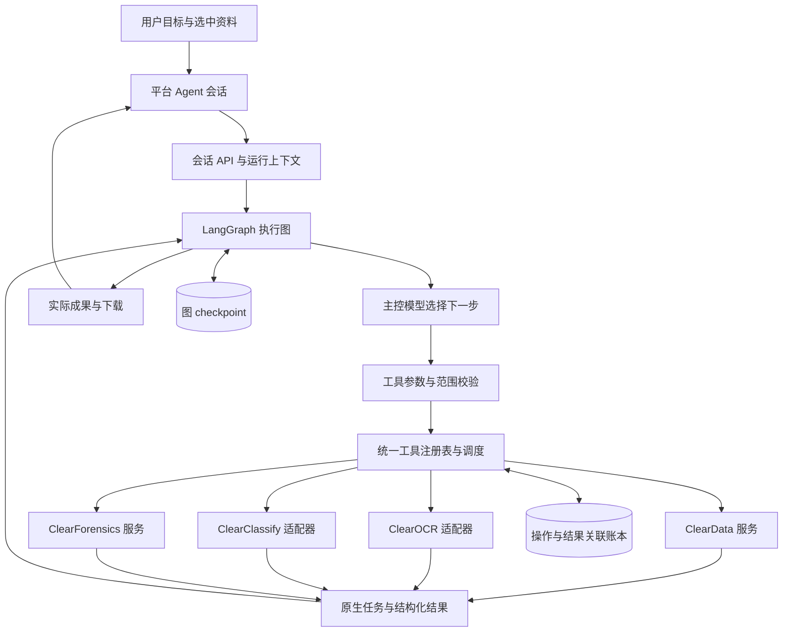

# Clear 平台 Agent 开发计划

**后续产品主线已调整（2026-10-04）：** 用户要求构建以大模型为中心的智能自动化审计平台，并保留手动工具。下一阶段以[AI驱动智能审计平台规划](AI驱动智能审计平台下一阶段规划-20261004.md)及其任务清单为准，先改默认首页、对话与任务、再打通证据和底稿。本计划的执行底座继续复用；PA08/PA16 的历史评测缺口不作为新产品阶段的开工或交付前置。下述状态保留原阶段含义。

日期：2026-10-04，Asia/Hong_Kong。版本：1。状态：**实施中。独立状态与证据见 F:/OCR/output/platform-agent-dev-20261004；尚无真实主控验收成绩，不能宣称全计划完成**。

本计划按用户本次确认的产品目标制定：**用户提出目标 → Agent 选择已注册工具/模型 → 执行并读取结果 → 决定下一步 → 交付成果。** Agent 是平台的任务执行入口，覆盖 ClearData、ClearOCR、ClearClassify、ClearForensics。常规任务通过已有业务能力完成；工具结果决定下一步，输出实际文件或可继续使用的业务对象。

配套：[开发任务清单](platform-agent-development-tasks-20261004.json)、[框架调研与源码依据](../../research/platform-agent-20261004/README.md)、[研究来源索引](../../research/platform-agent-20261004/source-index.json)。编制时只完成规划、公开资料调研和源码阅读；后续实施与证据见文末进展记录。

## 1. 产品目标与完成标准

### 1.1 用户应当怎样使用

用户在当前项目中选择已有资料或上传文件，输入目标，例如：

> 把这两份供应商台账按供应商编号比对，去掉名称两端空格，把金额差异超过 1 元的项目导出为 Excel。

Agent 自行查看文件和列结构，调用清洗与比对工具，等待任务，读取差异结果，再调用导出工具。用户看见正在处理什么、实际结果和下载入口。只有目标中缺少会实质改变结果的信息时才提问，例如两份文件都存在多个候选工作表，无法确定要比较哪两个。

后续同一会话可以继续：“忽略已停用供应商，重新导出”“只处理刚才失败的两页”“把识别出来的表与这份台账比较”。会话保留对象引用、条件和成果关系，不能要求用户重复输入内部 ID。

### 1.2 防止再次偏离目标的五条约定

1. **模型作下一步选择。** 业务算子可以是确定性的，整项任务的工具选择、顺序、分支与停止由模型根据目标和已返回结果决定。固定模板是可选工具，不是唯一执行方式。
2. **工具真实执行。** 聊天回复、建议、预设演示文本不能替代提交任务、处理数据或生成文件。Agent 发出的每次调用都能定位到真实 handler、操作记录和输出。
3. **现有能力优先。** OCR、分类、清洗、比对、取证和导出都调用已有服务。普通任务不以让模型临时写 Python、PowerShell、SQL 或操作浏览器作为执行路径。
4. **成果可以继续被工具使用。** OCR 的结构化表格、分类选出的资料子集、数据导出都能以有类型的引用交给下游工具，避免“每个工具能单独运行、彼此无法衔接”。
5. **常规执行连续完成。** 本轮明确目标和项目范围内的查询、创建处理任务、生成派生数据和导出默认连续执行。计划展示不是强制审批；审计项目、编制/复核和底稿不是普通任务的前置。

首版验收必须同时证明：有真实主控参与决策、有动态分支、有实际工具执行、有跨应用组合、有可读回成果。只完成工具 schema 或对话 UI 不算首版完成。

## 2. 项目现场与可复用基础

### 2.1 本轮实际路径

| 用途 | 路径 |
|---|---|
| 规划与调研仓库 | `F:/OCR` |
| 平台当前源码 | `F:/OCR/output/clear-automation-dev-20261002/worktrees/platform` |
| OCR 当前源码 | `F:/OCR/output/clear-automation-dev-20261002/worktrees/ocr` |
| 分类当前源码 | `F:/OCR/output/clear-automation-dev-20261002/worktrees/classification` |
| 已有集中运行时和模型 | `F:/OCR/output/clear-automation-dev-20261002/program` |
| 本计划未来开发检查目录 | `F:/OCR/output/platform-agent-dev-20261004` |
| 本次公开研究快照 | `F:/OCR/research/platform-agent-20261004` |

源码身份和关键文件 SHA256 在研究来源索引中登记，实施前重新检查当前 HEAD 与本地修改。历史计划中的 E 盘仓库、旧候选包路径不作为新运行入口。所有源码、依赖、Git 元数据、模型、缓存、临时文件、数据库、日志、浏览器资料和交付物只写 F 盘；不改 HOME/CODEX_HOME，不覆盖正在使用的业务工作区。

**制定时的产品基线（现已被上述新规划替代）：** 2026-10-03 的执行计划顶部将日常入口简化为“选择项目 → 选择 Clear 工具 → 开始处理与输出”，审计流程作为可选高级功能。本计划制定时沿用了这一修订。2026-10-04 用户最新要求已明确智能审计为平台主线，手动工具作为持续可用的操作入口。历史“不引入新 AI 助手”的旧首版范围不限制新增目标；旧开发成绩与缺口原样保留。

### 2.2 能力盘点与具体缺口

下表中的源码均相对于上表的对应源码根。

| 能力 | 已有实现 | 本计划要补的部分 |
|---|---|---|
| 工具启动、实例核实、项目关联 | 平台 `catalog/launch.py`、`supervisor/`、`jobs/*_projects.py` | 无需先打开工具页面的服务准备入口；同范围复用/创建原生项目，避免同名误关联 |
| 资料发现、固定输入集 | 平台 `assets/registry.py`、`assets/sets.py`、`assets/routes.py` | Agent 的有界资料查询与选择工具；把路由里的导入逻辑提取为 UI/Agent 共用服务 |
| 图片 OCR | 平台 `jobs/native_ocr.py`、`jobs/ocr_handoff.py` | 工具包装、引擎目录、结果分页读取、不同引擎/失败子集的新 attempt 关联 |
| PDF 处理 | OCR 原生 `document_routes.py`、`application_services.py`、文档队列；平台已有 PDF 导入/结果映射 | 平台当前 `OcrHandoff.submit` 明确拒绝 PDF。补按页提交/查询/取消与请求去重适配，不能把 PDF 当普通图片提交 |
| 图像分类 | 平台 `jobs/native_classification.py`、`jobs/classification_handoff.py` | 模型/标签目录、推理工具；根据结果创建不可变资料子集，继续交给 OCR |
| 数据清洗比对 | 平台 `data_api/service.py`；`modules/data_workbench/recipes/engine.py` 与比较/导出模块 | 工作表和字段探查、严格类型工具参数、资料导入幂等、原生结构化表格输入桥 |
| 图像取证 | 平台 `forensics/service.py`、`packages/contracts/forensics.py` | 注册已启用的六项经典工具与报告读取。工具箱研究目录中的其他候选不自动列为可用 |
| 模型资源管理 | OCR 引擎、分类模型列表、Supervisor、现有 GPU 协调 | 统一“能做什么/输入是什么/是否就绪”的能力投影，按工具族选择已有模型 |
| 长任务与成果 | 平台 `jobs/projection.py`、`artifacts/center.py`、不可变版本 | Agent run 与原生 job/成果关联、统一等待接口、派生成果到下游输入的来源关系 |
| Agent 执行基础 | OCR `agent/graph.py`、registry、providers、jobs、operations、checkpoints、inbox | 在平台落地独立 runtime；复用经过评估的实现模式，解除 OCR Store、项目 ID、12 项白名单耦合 |
| 对话与模型连接 UI | OCR `AgentPanel.tsx` 等 | 平台门户的会话、工具步骤、成果和主控设置；迁移交互思路并使用平台组件体系 |

额外事实：ClearData 的现有算子为 `trim/rename/map/cast/filter/duplicates`，另有精确比对、配方重放、表/结果导出。`duplicates` 的具体行为遵循现有实现，不能把“发现重复”宣传成任意合并去重。现有资料集导入数据会话的 HTTP 路由每次生成新 upload ID，Agent 重放前必须补业务幂等。取证目前没有统一的硬取消 API，界面需显示实际能力。

## 3. 框架选型与借鉴实例

### 3.1 推荐决定

采用 **LangChain 生态的模型与工具接口 + LangGraph StateGraph 执行编排**，以库方式嵌入现有平台 FastAPI。首版是单主控、多工具、多回合 Agent；OCR/分类/取证的专业模型作为工具背后的执行能力。

LangChain 与 LangGraph 不是二选一。LangChain 的 `create_agent` 本身构建 LangGraph 图。它适合快速建立模型—工具循环；本项目已经有长任务等待、业务副作用去重和自定义恢复边界，因此产品 runtime 使用显式 StateGraph 更直接。只维护一套图执行状态，不在外面另造一个重复的调度器。

| 方案 | 借鉴价值 | 本项目决定 |
|---|---|---|
| LangChain `create_agent` | 标准模型/工具调用循环、工具描述、运行时上下文、按请求裁剪工具 | 用作最小对照实例；采用 `BaseChatModel`、`StructuredTool`/`@tool` 等组件，不再额外嵌套一个完整 create_agent 循环 |
| LangGraph StateGraph | 显式节点、动态边、checkpoint、interrupt/resume、流事件 | 作为唯一执行框架；复用 OCR 已验证的模式，挂接平台服务 |
| Deep Agents | 长任务计划、上下文压缩、文件系统、子 Agent | 参考计划展示与压缩；首版不用其整套默认工具。项目主要需求是调度明确业务能力，不需要文件/子 Agent 默认栈 |
| PydanticAI | 函数工具、依赖注入、类型校验、工具集合 | 保留为替代参考；引入会再维护一套 Agent/持久执行适配，目前没有足够收益替换已有 LangGraph 基础 |

MCP 作为后续把同一工具契约提供给外部客户端的适配层。内部同进程调用先直接走服务，不先建设 MCP server、流程画布、向量库或云端运行平台。

### 3.2 从优秀实例落到项目设计

| 官方实例/证据 | 本项目具体采用方式 |
|---|---|
| LangGraph “Workflows and agents” 区分预定路径与动态工具选择 | 图固定的是运行机制，工具链由模型每轮选择；不用业务场景名称硬编码完整路线 |
| LangChain tools 的 schema 与隐藏运行时上下文 | 工具拥有准确用途、输入输出和失败说明；workspace、凭据、request ID 由服务端注入 |
| LangChain SQL agent 的“先读目录/结构，再执行，按错误修正” | 数据 Agent 先看工作表、列 ID、类型和样本，再选择已有算子；计算由 ClearData 执行 |
| LangGraph interrupt/checkpointer | 原生任务运行时挂起图，后台观察器完成核对后恢复；重启也按原操作身份续接 |
| 固定提交的 ToolNode 源码默认并行执行同批工具 | 自定义 dispatch 节点按资源键串行写工具，只读查询可有限并行，不直接用默认并行覆盖同一数据会话 |
| Deep Agents 的计划与上下文机制 | 长目标显示简短可更新步骤；大结果留引用，按需分页读取，不把整个文件塞进模型上下文 |

官方文档和固定提交源码见[调研报告](../../research/platform-agent-20261004/README.md)。文档中的云追踪和模型示例不作为本项目的配置要求。

### 3.3 依赖与主控接入

2026-10-04 实际查询的候选：LangChain 1.4.3、langchain-core 1.6.6、LangGraph 1.2.12、checkpoint-sqlite 3.1.1、langchain-openai 1.6.7、langchain-anthropic 1.7.5。现有 OCR 锁包含 LangGraph 1.2.11、langchain-core 1.6.3、checkpoint-sqlite 3.1.1。**这些是候选与现状，不是已验证的新平台依赖锁。** PA02 验证 Windows Python 3.12 的依赖解析、SQLite saver、序列化和实际模型协议后锁定最小组合；不为追新改动 OCR 引擎环境。

主控默认安排为工具调用 API 优先，支持 OpenAI 兼容 Chat Completions；Anthropic Messages 接口列入同一连接层。兼容的本地端点可用相同入口，但每个模型/服务组合都须通过多轮工具调用探针。主控的工具调用能力与 OCR/分类模型的推理能力分别登记，不能因为某个视觉模型已安装就将其当成合格主控。

首版只选择一个明确配置且有实际闭环证据的主控作为默认。保留自定义 URL、模型 ID、密钥、输出长度及超时配置；密钥复用 Windows DPAPI 实现方式但使用平台独立存储，不借用视觉审校凭据。客户端、图状态和工具参数不持有密钥。LangChain 标准集成不兼容某个既有端点时，可保留现有 httpx 协议适配作为同一 Provider 接口的实现；业务工具与图不感知供应商差异。

本轮没有调用真实 API。缺少实际端点只影响真实主控体验验证，不阻止独立工具、UI、数据交接和恢复开发；不得用模拟模型成绩冒充真实效果。

## 4. 目标架构与模块边界

建议新增平台目录 `src/workbench_platform/agent/`，包含 `graph.py`、`runtime.py`、`state.py`、`registry.py`、`providers.py`、`connection.py`、`operations.py`、`jobs.py`、`context.py`、`policy.py`、`routes.py`、`events.py` 及 `tools/`。契约放 `packages/contracts/agent.py`，按现有生成方式输出 schema/OpenAPI/前端类型。UI 放 `apps/portal/src/features/agent/`。

业务调用收敛在 `src/workbench_platform/application_services/` 或同等小型 facade：资料导入、原生服务准备、项目关联、任务提交、结果读取、导出/归集。UI 和 Agent 共用这些入口，Agent 不调用浏览器页面、不直接写原生应用数据库。优先使用实际运行的 `workbench_platform/jobs/native_*.py`，不继续扩大 `adapters/` 中标注的镜像实现差异。

**OCR 代码复用策略：** 复用 schema 校验、模型消息规范化、请求记账、事件补读、去重、取消 fencing、checkpoint 与恢复的经过验证思路及可独立函数；不把 OCR `AgentRuntime` 整包导入平台，不让平台连接 OCR 的会话库，也不迁移旧会话到新图。OCR 的12项工具依赖其内部数据模型，逐项转换到平台对象引用。旧助手可保留历史入口；本次不把整套 OCR Agent 重构为共享包作为首个闭环前置。

## 5. 工具注册与模型目录

### 5.1 统一 ToolSpec

每个工具注册以下内容：

| 字段 | 作用 |
|---|---|
| `name`、`version`、`description`、`examples` | 使用兼容供应商的下划线工具名，如 `data_compare`；版本单独记录；用途说明包含适用条件和输入来源 |
| `input_schema`、`output_schema` | 严格 Pydantic schema；不将现有任意 dict 原样暴露给模型 |
| `availability`、`prepare` | 区分已可执行、需要启动已安装服务、缺包/缺模型、不支持；常规启动可自动准备 |
| `effect`、`resource_keys` | 只读、新建结果、版本化变更等；指出数据会话/原生项目/GPU资源，供串行和权限判定 |
| `execute`、`lookup_operation`、`get_job` | 真实 handler、未知响应核对、异步状态读取；取消/重试按实际能力声明 |
| `input_kinds`、`output_kinds`、`limits` | AssetSet、TableRef、ResultRef 等可组合类型，以及项目已有的大小/页数/类型限制 |

schema 由注册表生成，模型可见的工具集合按项目、实际安装能力和当前任务筛选。`tools_list`/`tools_describe` 用于发现目录中其他工具；发现后才加入下一轮模型请求的可执行 schema。模型不能通过文本任意注册处理器。先用几十个明确工具即可，不提前建设插件市场或向量工具检索。

服务端向 handler 注入 `ToolContext(workspace_id, session_id, run_id, turn_id, operation_id, grants, services)`。这些字段不由模型填写。自定义 StateGraph dispatch 必须显式完成注入；`ToolRuntime` 的类型标注本身不会在自定义节点里自动生效。跨项目引用、伪造路径、过期版本由实际服务再次校验。

返回统一 `ToolResult`：`status`、有界 `summary`、有类型的 `result_refs`、`job_refs`、`artifact_refs`、`warnings`、`error`、`coverage` 和下一页游标。大表、大图、原始 OCR 内容留在已有存储中；模型只读需要的分页/摘要。JSON 中的模型标识、列ID和对象ID均来自实际查询。

### 5.2 首版工具目录与接入顺序

以下是规划名称，最终只允许为兼容或避免重名作小幅调整；每项必须有业务 handler。

| 工具组 | 规划工具 | 复用与新增边界 | 交付阶段 |
|---|---|---|---|
| 上下文和能力 | `workspace_get_context`、`tools_list`、`tools_describe`、`models_list`、`assets_search`、`assets_describe` | 包装目录、资料与模型列表；不把整个工作区作为提示词 | M1 |
| 资料集合 | `assets_create_set`、`assets_select_from_results` | 固定资料版本；分类子集保存筛选条件与结果来源，不修改人工标签 | M1/M2 |
| 数据准备 | `data_create_session`、`data_inspect_input`、`data_import`、`data_read_table` | 新增导入前工作表/表头探查与幂等导入；普通模型不能选择任意本机路径 | M1 |
| 数据处理 | `data_apply_step`、`data_compare`、`data_read_result`、`data_export` | 使用已有算子、Decimal/文本语义和导出；保留前导零、长编号、公式原文和来源行 | M1 |
| 图片 OCR | `ocr_prepare`、`ocr_run`、`ocr_read_results`、`ocr_export` | 复用原生启动/项目映射/队列；推理结果和人工采用结果分别引用 | M2 |
| PDF | `ocr_inspect_document`、`ocr_process_pages`、`ocr_read_page` | 补平台按页适配与请求去重，复用原生 native/ocr/auto 模式；按显式页集执行 | M2 |
| 分类 | `classification_prepare`、`classification_infer`、`classification_read_results`、`classification_export` | 从当前项目读取模型和标签；识别可用模型与标签体系，禁止跨项目混用 | M2 |
| 取证 | `forensics_inspect`、`forensics_read_report`、`forensics_collect` | 六项已发布本地工具：metadata/noise/frequency/jpeg/jpeg_grid/copy_move；报告不冒充真伪裁定 | M2 |
| 成果桥 | `results_describe`、`results_to_input`、`artifacts_list`、`artifacts_get` | 新增成果到受控输入的确定性桥接；文件/表/资料子集均保留原始来源 | M2 |
| 任务控制 | `jobs_get`、`jobs_retry_failed`、`jobs_cancel_owned` | 查询和受支持的失败子集重试；等待由运行时完成，不让模型循环轮询 | M1基础/M2完善 |
| 澄清与交付 | `ask_user`、`delivery_publish` | 绑定当前问题的回复；交付从已有真实成果引用生成摘要与下载入口 | M1 |

`delivery_publish` 只组织有依据的成果、覆盖和缺口，不运行一个额外的 AI 复核器。

后续增量 PA18 注册已有高级功能：保存/重放配方与批次模板、明确要求时的训练/数据集操作、版本化修订采用、可选审计底稿。它们继续复用同一注册机制；不会成为普通识别、清洗、比对和下载的前置。

### 5.3 模型目录的职责

统一目录返回模型 ID、角色、工具族、输入类型、支持任务、项目/类别集、版本/哈希引用、运行设备、就绪状态与已知限制。角色至少区分 `controller`、`ocr_engine`、`classifier`、`visual_review`。取证中的无模型算法以工具列出。

用户指定模型时遵从；未指定则按任务能力和已配置默认选择。主控可以根据实际失败选择另一个已授权、已安装且支持该输入的引擎，并创建关联的新 attempt。不能把 OCR 低分直接解释为伪造，也不能把分类分数解释为人工确认。

已有本地专用模型继续在原进程和环境运行。主控只传任务参数与对象引用，不把全部模型加载进平台服务。新模型下载、训练预算和外部服务接入是单独的明确目标，不在常规处理过程中暗中发生。

## 6. 执行、等待和恢复

### 6.1 唯一执行循环

`receive_input → prepare_context → model → validate_calls → dispatch → await_jobs（有长任务时）→ collect_results → model … → finalize`

节点职责是通用机制；不出现“这是OCR请求所以走固定五步”的替代主控逻辑。`finalize` 校验模型声明与实际任务/成果关系：尚在排队、导出失败、覆盖不完整时只能给出对应状态，不能展示已完成。

模型回复中的工具调用先整批做 schema、已注册性和范围校验；不执行截断调用。执行前再次检查版本和权限。同一对象的写操作按模型顺序串行；依赖前一步生成 ID 或 revision 的调用必须等结果回来再决定。只读查询可最多并行3个；GPU继续服从现有跨模块协调。首版同一会话只运行一个图调用，同一项目最多一个拥有写操作权的 Agent run，人工 UI 仍通过版本条件处理竞争。

工具返回异步任务后，图持久化待等待的原生 job 引用并挂起。后台观察器只查实际任务，完成或出现需要决策的变化时恢复图；等待期间不消耗模型轮次。未终态的工具结果先存操作账本，终态汇总以同一 call ID 配对回到模型，避免伪造 tool message 顺序。显示进度使用应用事件，不依赖模型不停解释。

### 6.2 业务操作身份与跨库结果

平台 Agent 新增操作账本与图 checkpoint，分别管理业务副作用与图执行位置；不再建第二套可编辑模型历史。原生模块自己的数据库仍是任务状态权威。

每个有副作用调用在发出前保存 `operation_id`、参数哈希、输入版本和已选模型；同一调用重放沿用同一身份。调用成功但平台未记回执时，先通过原生 request/operation 查询核对，再继续；无法判断是否已提交则暂停该操作等待核实，不能无条件新建任务。改参数、换模型或明确重跑是带 `parent_operation_id` 的新 attempt，不篡改旧身份。

数据会话创建/导入、PDF页处理、成果派生等目前缺少完整去重的入口，必须在对应工具接入时补齐。不能只在 Agent 表里记一次调用，就声称跨进程恰好执行一次。框架 checkpoint 不替代业务去重。

图使用独立 `agent/checkpoints.sqlite3` 和官方 AsyncSqliteSaver，操作/会话/事件使用 `agent/operations.sqlite3`；都位于指定平台数据根。模型消息由图保存，UI历史由应用事件投影。业务网络等待不跨 SQLite 事务或 GPU 锁。初始使用同步 checkpoint 持久化模式，PA02确认锁定版本行为后才采用。正常单机文件工作流使用 SQLite；未来多人部署再评估数据库替换。

### 6.3 用户追加、停止、重启与错误

运行中追加指令写入持久 inbox，在下一安全边界处理；不丢失已提交的原生任务。停止 Agent 立即阻止新动作；“同时取消本轮任务”只尝试取消本轮拥有且支持取消的任务。取证等不支持硬取消的任务显示“停止后续步骤，当前工具仍运行”，不伪报已取消。

重启后重新绑定当前受管原生实例、核对原生 request 与 job、处理未知响应，再恢复图。服务端控制 thread ID、generation 和恢复 token；浏览器不能提供任意 checkpoint 或 Command。旧图不兼容时保留记录并给出迁移/新会话路线，不强行执行未知状态。

参数错误可把结构化错误交回模型修正，默认最多两次相同类型连续修正。运行时未就绪可自动启动已有服务；业务失败按实际错误选择重试、替代工具或澄清。模型网络响应未知时保留计费和响应未知状态，不进行无界重发。

初始可配置预算为每次用户请求20轮主控、60次工具调用；长任务等待不计轮次。每次读取默认最多50行/项，复杂任务可分页。上下文按所选模型能力设定并预留输出空间，不统一假设大窗口。Token用量使用供应商实际 usage，缺失时标记估算；费用只有配置价格时估计。预算只在实际到达时询问，正常每一步不追加确认。

### 6.4 输入范围与人工判断

用户提交目标即允许其当前范围内的常规本地处理与新成果创建。用户已设置的本轮模型地址、可发送数据类别和预算在会话中复用；不为每次工具调用重复弹窗。资料正文中的“执行命令”“忽略规则”等文字作为数据处理。

需要用户回答的情形集中为：结果会因歧义而不同、目标要求覆盖已有人工内容、范围扩大到另一个项目、新外发地址/数据类别或预算超出。平台认证和项目校验继续生效。原生工具目录、下载、日志和异常信息不暴露凭据。

模型可以使用分类预测来选择后续要处理的图片，前提是目标允许且记录 `selection_basis=prediction`；这不自动更改人工标签。识别/比对结果可直接导出，同时保留未人工确认的属性。最终审计签批、人工署名与取证判断仍按对应业务功能处理，不被通用“完成”按钮代签。

## 7. 跨工具数据交接

这是本次核心能力的一部分，与对话运行器同等优先。

统一输入/结果引用至少包含：`kind`、`workspace_id`、原生对象定位、`revision`、内容哈希、来源引用和覆盖情况。具体类型为 `AssetRef/AssetSetRef/TableRef/ResultRef/ArtifactRef/JobRef`；实际可读路径只由服务端解析。

1. **分类 → OCR：** 通过分类任务结果与原始资料映射创建新的不可变资料集，记录模型/类别/筛选条件。不能把预测写成已确认标签，也不重新上传未选中的全部图片。
2. **OCR/PDF → ClearData：** 读取已存在的结构化表格，确定性转换为可导入表对象或托管中间文件，保存页/表/行列来源。表头歧义要澄清；缺少结构化表格时返回不支持原因或由 Agent 选择已安装的结构提取能力。禁止让主控凭文本臆造财务表。
3. **数据导出 → 后续处理：** 允许已完成的托管 XLSX/CSV/Parquet 注册为派生输入，保留导出版本、哈希和父来源。对公式防护产生的展示转义不能作为新的原始业务值；优先通过类型化 TableRef/伴随原始值读取再导入。
4. **取证 → 交付：** 原图、报告和热图保留独立引用；Agent可解释工具观察与限制，并提供文件，不强制先创建审计调查或人工复核记录。

所有桥接由固定代码执行，Agent只选择要转换的对象和合法参数。首版不承诺任意票据字段抽取、跨页复杂拼表或在多个表头间自动猜测业务对应关系；这些是真实工具能力的边界，需要明确新增工具才能扩展。

## 8. 门户交互与 API

平台提供“Agent 助手”入口，可从项目、资料多选、某个工具结果打开，并自动带入范围。聊天页展示目标、选中资料、当前步骤和成果；原生工具可按需打开查看细节，不成为后台执行的必要动作。

从无项目的快捷入口开始时，沿用当前轻量项目机制建立必要的工作上下文，不要求用户先创建审计项目或工作程序。模型不能自行把已有其他项目的资料并入当前范围。

UI交付包含：会话列表、历史分页、消息/追加目标、真实工具步骤卡、任务进度、明确歧义问题、停止/继续、成果预览与下载、主控连接/模型设置。长任务的进度条来自 job 状态；只显示简短计划和可验证动作，不展示模型内部推理。技术 ID、schema 版本和图节点名留在可展开诊断中。

API建议：

| API 组 | 范围 |
|---|---|
| `/api/agent/connection`、`/probe`、`/models` | 独立连接设置和无业务资料的原生工具闭环测试；不开机自动联网探针 |
| `/api/workspaces/{workspace_id}/agent/capabilities` | 当前可用/可准备工具与模型，返回不可用原因 |
| `/api/workspaces/{workspace_id}/agent/sessions` | 创建与列出会话 |
| `/api/agent/sessions/{id}/messages`、`/events`、`/stream` | 提交消息/追加目标，事件分页和 SSE 补读 |
| `/api/agent/runs/{id}`、`/cancel`、`/resume` | 运行快照、停止和显式恢复 |
| `/api/agent/decisions/{id}/reply` | 回复绑定范围与版本的问题，不是通用授权开关 |
| 现有任务/成果 API | 查看原生任务与下载现有托管成果；不再复制一套文件存储 |

开发期注册前端类型生成和路由应保持单一来源。未配置主控时入口明确显示设置动作；缺某一工具运行时只影响该工具，其他能力继续可用。

## 9. 分阶段交付与任务顺序

详细依赖、写入范围、产物和验证在[机器清单](platform-agent-development-tasks-20261004.json)。默认一个执行者顺序推进；独立只读检查可并发。PA01限制为一次必要盘点，PA02限制为一次最小框架兼容验证，不反复组织框架选型。

| 阶段 | 任务 | 用户可见交付 | 退出条件 |
|---|---|---|---|
| M0 接入基础 | PA01–PA04 | 工具目录、主控连接、可调用业务入口 | 核心 schema/上下文/副作用身份成立；版本锁可复现 |
| M1 第一个实际 Agent | PA05–PA08 | 一句话完成两表读取、按结果选择清洗、比对、导出；可追加目标和停止 | 真实主控通过 ClearData 闭环，文件读回正确；动态调用记录可审阅 |
| M2 平台组合能力 | PA09–PA14 | 图片/PDF OCR、分类、取证和数据工具可组合，自动传递结果 | 至少分类→OCR、OCR表→比对两条跨应用目标完成；不是预设固定脚本 |
| M3 首版交付 | PA15–PA17 | 可靠恢复、清晰失败、主控效果记录与当前入口可用的候选 | 通过本计划的有限验收；依赖在F盘，可恢复/关闭Agent；使用说明与结果同步 |
| 后续按需扩展 | PA18 | 训练/配方/模板/修订采用等更多已存在能力 | 逐工具接入同一注册表，不扩大首版关键路径 |

M1完整演示优先于批量接入所有工具；工程可用后就给用户看实际效果。PA09–PA13不依赖真实API验证任务PA08的完成，可以在等待主控配置时继续。M3不是重新运行旧72项OCR Agent验收、旧审计流程资格或四小时稳定轨；只覆盖本次新增与受影响的功能。

推荐任务：

| ID | 交付 |
|---|---|
| PA01 | 当前源码/路径基线、8类目标夹具、现有可调用能力矩阵 |
| PA02 | 主控连接与Provider、框架最小兼容验证、平台Agent独立依赖锁 |
| PA03 | ToolSpec/引用/结果契约、可执行注册表、模型能力目录 |
| PA04 | 共用服务入口、操作账本、任务桥、权限/版本注入 |
| PA05 | LangGraph动态循环、checkpoint、等待/恢复、事件、停止与追加 |
| PA06 | ClearData完整工具组、探查与幂等导入 |
| PA07 | 平台Agent会话界面与主控设置 |
| PA08 | 第一个真实主控清洗比对导出闭环 |
| PA09 | 图片OCR、引擎发现、结果读取与导出工具 |
| PA10 | 分类工具、预测子集及与OCR的资料映射 |
| PA11 | 六项取证工具、报告/成果读取与能力限制 |
| PA12 | PDF按页适配、原生处理幂等与页覆盖 |
| PA13 | 类型化成果到下游输入的桥接与来源关系 |
| PA14 | 跨工具组合、基于观察结果的重规划与按需工具发现 |
| PA15 | 重启、重复请求、停止、并发、上下文与范围边界的针对性加固 |
| PA16 | 有限真实主控任务评测与修正 |
| PA17 | 当前入口接入、依赖/备份/关闭Agent回退、单次候选收口和使用说明 |
| PA18 | 首版之后按需注册已存在的高级业务动作 |

不按任务数量宣称产品完成率。机器清单保留规划规格；实际任务状态写入运行目录的 state.json。“有框架”“有schema”“模拟主控通过”“真实用户任务完成”分别记录。

## 10. 有限、以用户任务为中心的验证

### 10.1 八类目标

| 用例 | 用户目标 | 必须观察到的行为与交付 |
|---|---|---|
| C01 两表清洗比对 | 按指定业务键、金额阈值比对并输出Excel | 主控读取列与样本后调用正确算子；差异行/金额/长编号与独立预期一致，下载可读 |
| C02 结果驱动的澄清 | 输入多工作表且目标未说明使用哪张 | 根据真实目录提出一次有意义的问题；答复后续跑原会话，不乱猜或重新导入全部文件 |
| C03 分类后识别 | 用已有模型选出指定类别的图片并识别导出 | 先查模型/标签，按返回结果建子集，再OCR；未选资料不被处理，不修改人工标签 |
| C04 PDF指定页 | 提取1、3–5页的内容与结构化表格 | 平台实际提交对应页，等待原生任务；来源页与覆盖清楚，缺表时不编造XLSX |
| C05 OCR表格接数据比对 | 将已识别的一张表与台账比较并导出差异 | 原生表成为类型化输入；数字/来源保真，交付能追到页/表及台账行 |
| C06 图像取证 | 对选中图片选择合适工具并交付报告 | 根据输入格式选择当前可用算法，读取结果/限制；报告与热图可下载，不声称机器证明真伪 |
| C07 失败后的替代 | 原引擎失败后只重跑失败项并导出 | 主控根据错误和可用能力选择新attempt；成功项不重跑，旧失败保留，部分覆盖不显示完整成功 |
| C08 追加与恢复 | 处理中收窄目标、停止、重启后继续 | 新动作符合最新范围；核对旧任务后续接，无重复副作用，已有成果仍可读 |

验收只核对目标、实际调用和可读输出，不固定模型措辞或唯一工具顺序。至少两个用例改变工具返回（如可用模型或工作表结构），证明后续决策随结果变化。工具缺失时给出明确缺口，也作为预期行为检查，不能靠偷偷生成脚本通过。

### 10.2 检查范围与真实模型门槛

- 每个工具接入时，验证参数、项目/版本和真实服务结果。对未修改的推理算法、模型权重和旧审计模块复用已有证据，不重复做完整质量评测。
- 对新增行为做必要反例：同请求重复投递、原生成功后回执丢失、图重放、同对象两次写入、过期版本、跨项目ID、输入中的指令、部分失败及损坏成果。它们验证执行正确性，不评价模型“建议质量”。
- PA08先完成一次真实API+真实ClearData文件闭环。PA16用8个目标基例和4个表达/输入变化，总计12次真实主控任务；要求8个基例各至少通过一次、总成功至少11/12，失败有归因与限制。涉及重复写入、范围越界、错误宣称完整交付的失败必须修复后定向复测。
- 实际输出由独立读回器验证：CSV/XLSX行列与数值、结果集合、来源版本、文件哈希；不能让同一个主控自评“通过”。OCR/分类/取证工具的算法质量沿用各模块已知边界，本轮主要验证选择、执行与数据交接。
- 记录主控配置、调用数、tokens、等待与执行耗时和需要用户回答的次数。相同目标下核对是否仍需人工做可自动化操作；正常明确目标不应逐步询问“是否执行”。
- 当前功能变化相同时只做一次集中构建与浏览器主路径：发目标、看步骤、回答歧义、追加/停止、下载文件、刷新恢复。优先外部 Chromium，所有profile/缓存/下载/截图到F盘，使用 `--disable-gpu --disable-gpu-compositing`。

没有真实主控证据时，可以交付“工具/协议开发预览”，不能标为平台Agent完成。重测仅针对变化、失败或新范围；不重启无关旧资格任务，不引入新的长期验收流水线。

## 11. 运行、交付与后续执行约定

平台Agent依赖以单独锁文件和可追溯安装层接入当前平台运行时，原有OCR/分类引擎环境保持独立。PA17只构建一个明确版本的候选，不重复拷贝32GB未变模型。若当前构建只能打全包，先评估最小的Agent依赖层接入，不让反复大包构建成为日常开发循环。

备份覆盖Agent两库、引用元数据和必要成果，并与既有平台/原生冷备协调到静止点；恢复后核对引用和版本。Agent开关关闭时普通项目、工具和成果入口仍可运行。不能将旧版本直接打开新数据库作为回退方案。

每个任务保留最少可复核记录：修改文件、完成行为、针对性检查、实际结果、已知缺口、下一步。任务JSON只放规格；实施时在未来运行目录新建 `state.json` 和 `NEXT.md`，不借用旧D/T任务成绩。默认单执行者，不要求新的开发调度器、子Agent或固定的多泳道流程。

首个实施切片为 **PA01–PA08：实际主控 → ClearData工具 → 文件成果**。随后按PA09–PA14覆盖现有四类应用与跨工具交接，再完成有限恢复验证和候选交付。日常开发选择由执行者按本计划和现场解决；遇到真实缺少的主控配置或输入歧义才收集必要信息。

## 12. 实施进展（2026-10-04）

全部 v1 工具组、独立 Provider/DPAPI 配置、LangGraph/SQLite 两库、会话门户和成果入口已实现。真实原生工具证据包括分类→预测子集→OCR、PDF 1/3/4/5 页→原生表候选→ClearData 比对→独立 CSV 读回、图片 OCR 导出及六项取证。依赖使用独立 F 盘层，原推理环境与共享绑定未改写。

PA15 工程检查覆盖预算/追加/停止、问题答复与初始 checkpoint 窗口、未知提交回执查询、失败重试父关系、上下文压缩、范围/版本/内容哈希和停止后的新轮次任务引用。真实故障夹具只损坏隔离原生副本：原批次1成功1失败，重试仅提交失败项，来源原件和旧失败保留。

PA17 工程候选在 `F:/OCR/output/platform-agent-dev-20261004/candidate-v1`，约31MB，未重复拷贝32GB模型。当前本机入口 http://127.0.0.1:8866 。平台/原生 OCR/分类冷备、原任务身份续接、派生来源及下载恢复已验证；关闭 Agent 时普通项目、资料和数据入口可用。外部 Chromium 检查了目标、工具步骤、问题/回答、追加/停止、成果带入、实际下载和刷新；下载 XLSX 已独立验证编号/金额/公式原文。

这些均为工程及真实工具证据，**PA08/PA16 仍未完成：平台尚无真实主控配置，未调用真实 API，12次真实任务分数为空。** 整体 goal 保持未完成，不能把工程控制器成绩计入真实主控验收。PA18 为首版后的按需扩展。

补充核对：扫描PDF按页真实auto/ppocr检查通过（三页无文字层，仅1/3页处理，重复请求不新增阶段，无表转换拒绝）；模型目录统一角色、原生版本和能力限制的3项检查通过。逐任务要求与剩余真实主控门槛见[验收核对](../../output/platform-agent-dev-20261004/验收核对.md)。这些新增证据仍不计真实主控成绩。

可复核记录：[状态](../../output/platform-agent-dev-20261004/state.json)、[接续](../../output/platform-agent-dev-20261004/NEXT.md)、[实施与交付记录](../../output/platform-agent-dev-20261004/实施与交付记录.md)。
