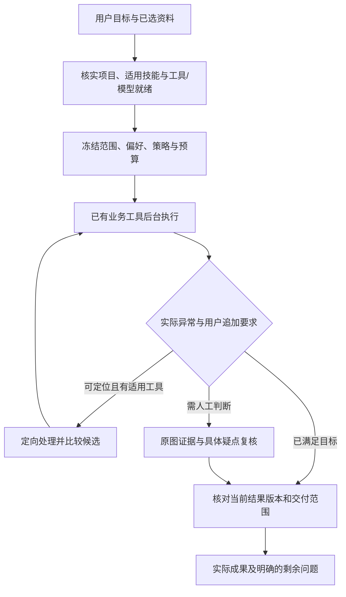

# 平台专用 Agent：下一阶段最终实施计划

首次制定：2026-10-07；本次更新：2026-10-08，Asia/Hong_Kong。状态：计划已确定，实施中；逐项状态和证据以任务清单为准。用户要求：Agent 聚焦审计平台已有工具，借鉴通用 harness 的任务闭环、恢复和上下文管理经验。

**目标是让用户描述审计目标并提供资料后，Agent 选择平台内合适的工具、处理具体异常、核实结果并交付。** OCR 是本轮首个重点业务，贯通后用已有分类和数据核对任务验证公共能力。采用“常用任务有默认步骤，特殊情况按实际结果调整”的方式，保留跨工具组合能力。

本计划新增专用业务技能、任务偏好和异常/交付契约，改善现有业务服务。专业计算仍由平台工具及已配置模型执行；Agent 负责理解目标、选择步骤、处理异常和解释结果。项目、资料、工具授权和人工确认继续由平台控制。

本文件说明实施范围及顺序，[任务清单](specialized-agent-tasks-20261007.json)登记依赖、完成条件和执行状态。实施完成必须绑定实际源码、检查及结果证据；本次不把规划登记为功能完成。

最终交付以你的实际业务为准：一次提交 200 张以上屏拍图片，每张图片一个 XLSX，同图多表分 sheet，整批 ZIP；保留标题、单位、表注，排除电脑界面干扰。Agent 使用平台注册工具完成任务，后台批次承担逐图计算，普通任务不需要逐图调用主控思考。通过完整验收后，这条业务流程无需外部 DeepSeek Harness；目前不能把局部测试通过当作已经稳定平替。

执行重点是并行补齐长任务稳定性和 OCR 内容质量，随后验证异常处理、当前版本交付及实际效率，最后冻结大批次验收。分类、数据核对和审计证据用于验证已有工具的组合能力，本轮 OCR 主线不等待另建通用 Agent 框架。

最终执行顺序及采用决策如下，具体实现仍对应下文 S01–S08，不缩减其范围：

| 顺序 | 要完成的工作 | 用户获得的结果／进入下一步的条件 |
|---|---|---|
| 1 | 先修长批次状态读取、暂停与恢复，再收口专用技能、偏好和长任务上下文；工具逐项核实权限、实际加载及下一轮窗口预算 | 后台准备时进度仍可读；失败续作不重提整批或重算未变的成功项；工具加载如实返回已加载、拒绝或暂缓。真实批次及跨工具 Agent 链完成，而非仅 CPU 重演通过 |
| 2 | 改善屏拍预处理、业务表定位、结构及标题／单位／表注整理；在开发 60 张、验证 40 张实跑已配置可加载模型 | 电脑界面干扰与业务说明分别计量；按中文业务、密集小字、宽表等错误类型选路线，同时比较质量、加载可靠性和耗时 |
| 3 | 在可靠原图格位上验证专用文字复识，接入平台注册的局部候选工具与有界处理分支 | 仅疑点生成可对照候选，保留原值与来源；验证净修复、新错、成本及残留漏报后决定采用范围。开发子集收益、多模型一致或疑点少不能代替独立正确性证明 |
| 4 | 收口疑点复核、部分下载、每图 XLSX／多表分 sheet／整批 ZIP、当前版本核验与恢复；对照整批和有限分组调度 | 用户能直接看原图局部与冲突值；无需整批重跑。分别实测首个候选、首个可下载 Excel 和整批耗时，有收益才采用分组默认 |
| 5 | 冻结路线，执行 240 张主保留、24 张挑战、200+ 真实 Agent／模型／导出链及恢复／重复／编辑竞态 | 以完整分母报告识别质量、需核范围、自动子集残留错误及真实时间；中文业务和公开复杂表分开报告，挑战压力测试单列 |
| 6 | 完成候选源码绑定、界面、兼容、冷备恢复验收；分类提交、清理相关 Git 工作区，交付成果与采用范围 | 获得可用候选、验证报告、Excel／ZIP、来源及回退依据。完整验收通过后，该 OCR 工作流在平台内闭环，不再依赖外部 DeepSeek Harness |

当前结论：批次编排与 Excel 交付已具备实际基础，稳定平替仍未通过。12 图 Hunyuan／GLM 整表核验均仅 4/12，全部待核；新 60 图实际链因状态读取超时未完成交付。优先补上述 1–3。更强模型的平均分提升不能替代校对减负，没有实测依据时，不承诺固定工期、真实业务准确率或对旧 harness 的提速倍数。

## 1. 当前基础与已知缺口

正式 current 仍为 v0.9.3。上一阶段 OCR 工程候选为 v0.9.4-final-003，已通过其工程资格，尚未切换正式运行版本；该资格不覆盖本轮新增功能。规划基线：主仓 `codex/ocr-agent@d3234a7`；平台任务树 `9c26bd4`、OCR `9709c2c`、分类 `d90707b`。本次更新前主仓 HEAD 为 `bce0082`，本轮生产及评测修改仍在登记的 F 盘工作树中实施。上一阶段实际推理来自 final-route-002，工程收口来自 final-route-003，二者原生推理文件及默认策略保持一致。本轮计划初次提交为 `cf7b161`。

| 已有基础，继续复用 | 本轮应补齐 |
|---|---|
| 注册工具、严格参数、按需发现/加载、固定版本技能及工具范围限制 | 常用任务自动匹配适用技能/工具；把“已注册、服务可启动、具体模型就绪”分开 |
| 项目规则、会话目标、计划、历史与固定资料集合 | 有来源、作用域和版本的结构化工作偏好；单次指令优先于默认 |
| OCR 整批后台、模型分组、预算、暂停恢复、失败重试、选图精度子批次 | 从整图短提示细化到图/表/格及原图证据；以异常原因驱动定向处理 |
| 原图核对、候选比较、逐图 XLSX/ZIP、来源索引 | 可靠格位、业务说明/UI 整理；同数量旧 ZIP 的当前版本核验 |
| 结果衔接、数据处理、比对和审计证据工具 | 为可支持的结构选择正确的跨工具流程；不完整或合并语义未确定的结构明确留待处理 |
| 等待主控空闲、持久身份、防重复提交及真实交付计数 | 首个结果更早可用、渐进交付、异常处理后的版本与状态同步 |

现有 OCR 技能面向票据与台账核对，其工具范围不包含屏拍批次工具；新增独立“批量屏拍转 Excel”业务技能，保留原技能。

上轮 240 张混合模拟为 4 轮主控/3 工具、约 53 分 35 秒；首个有表候选约 7 分 20 秒。实际 238 本 Excel、2 个有参考表却无可交付表的候选；整图表格核验全通过 54.58%，关键字段精确 74.09%，全部待复核。一个实际工作簿的业务说明 194 条中有 168 条重复业务格，并混入列标尺。调度已经满足低轮数目标，内容质量及降低校对负担仍未达标。

这些是公开/合成模拟结果，不能直接换算真实手机屏拍表现。原模型选择、失败和实测边界继续保留在[OCR 最终评估](../批量屏拍OCR完善方案-20261007.md)，不覆盖或重新解释历史成绩。

本轮已有 12 图开发探针对照：Hunyuan 与 GLM 各 4 图整表全核验通过，关键格精确分别为 88.93% 和 96.08%，实际 OCR 调用序列分别约 63 秒和 285 秒；中文子集没有体现 GLM 优势。两者的具体错格定位及平台自动交付尚未由该实验验证。PaddleOCR-VL 本次存在冷加载故障，12 图中 3 次失败、1 次中断后结果未知、8 次未尝试，不能用于完整识别质量排名。详见[开发探针报告](../../output/platform-specialized-agent-20261007/evaluation/dev-probe-001-final-review-001.md)。这些结果支持按错误类型探索路线，不支持把全批默认机械地切到某个模型。

本轮冻结源码已完成首次 12 图真实 Agent→原生队列/模型→Excel 全链：3 轮主控、3 次批次级工具，整条测试约 118.85 秒，生成 12 本 XLSX，无缺文件；等待期间主控请求数保持稳定。独立读回确认 ZIP 忠实包含当前选定结果和来源版本。此项核验只证明调度、导出与当前版本一致，不能证明 OCR 内容正确。

独立内容评分为 4/12 整表核验通过，关键格 522/587（88.93%）、全部可见格 723/856（84.46%）；标题/单位/表注命中 7/18，12 张全部待复核，没有免人工交付或可靠格级定位成绩。详见[12 图独立质量报告](../../output/platform-specialized-agent-20261007/evaluation/agent-native-dev-001-quality-001.json)及[实际 Excel 读回](../../output/platform-specialized-agent-20261007/evaluation/agent-native-dev-001-readback-001.json)。这些模拟成绩说明下一步优先提升元信息保留、识别质量和具体疑点定位，不能以低轮数或文件齐全宣称已稳定平替。

后续 GLM 12 图真实 Agent→模型→Excel 链亦已终态：3 轮／3 工具、约 279.51 秒，12 本 XLSX 均实际读回。整表仍为 4/12，关键格 564/587（96.08%），中文关键格 46/52，低于 Hunyuan 的 47/52；另有额外表。逐输入质量存在回退，总耗时相对首轮增加约 160.66 秒，尚未采用为全批默认。见[真实路线对照](../../output/platform-specialized-agent-20261007/evaluation/agent-native-h-glm-comparison-002.json)。

元信息整理改进已在新的实际 12 图链复现：标题／单位／表注由 7/18 提高至 14/18，仍有 4 个缺失和 5 个额外片段；不能称全部保留正确。相同输入和源码、仅调度参数不同的整批／分组实际对照质量相同；分组使首个原生候选提前约 6.31 秒，但总耗时由 124.82 秒增至 155.74 秒，约增加 30.93 秒。首个候选不等于首个正确 Excel，因此默认仍为整批，须大批次继续验证取舍。见[实际调度对照](../../output/platform-specialized-agent-20261007/evaluation/agent-native-schedule-comparison-001.json)。

格位 v2 以源像素边线、真实单元格分区和独立文字行列锚点证明映射，拒绝均分或按索引猜坐标。24 个开发候选 CPU 回放仅两张图的 81 个格有可靠映射；Hunyuan／GLM／辅助文字联合的 9 个疑点命中 5 个真错、误报 4 个，仅覆盖 Hunyuan 全量 133 个错格中的 5 个。模型共同一致仍会漏错，尚无人工减负或自动交付资格。见[定位计分](../../output/platform-specialized-agent-20261007/evidence/s04-grid-localization-score-001.json)。

上述 81 格已完成两种真实局部试验。GLM 整页识别模式用于单格裁剪时，61 次无解码、净修复为 0；新的显式 `local_text` 文字模式 81 格全部有解码，但全格替换修复 1 个关键错误、新增 1 个非关键错误，净修复仍为 0。只消费预先标出的 9 个诊断疑点，在完整 856 格分母下修复 1 个关键错误、新增 0；该策略是在观察开发结果后选择的，尚需验证 40 张，且 9 格成本与人工减负未实测。下一步仅探索有来源、可靠格位、预算及版本保护的局部候选工具，生产 `local_reread=false`，仍全部待核。见[真实局部文字试验](../../output/platform-specialized-agent-20261007/runs/local-text-probe-001/diagnostic-only-analysis-001.json)及[实际图像和坐标读回](../../output/platform-specialized-agent-20261007/runs/local-text-probe-001/coordinate-readback-001.json)。

PaddleOCR-VL 新单图实际探针已在原启动 240 秒／请求 180 秒预算内成功：加载约 23.00 秒、推理约 16.67 秒，输出 1 表并完成自有进程／资源清理，独立来源及 XLSX 忠实性核验通过。它证明该冻结源码和输入可以实际加载、推理，尚未独立内容评分，不能由一张图宣布完整模型路线可靠或精度领先。历史失败继续保留；后续进入开发／验证路线比较。见[单图实际回执](../../output/platform-specialized-agent-20261007/runs/paddlevl-development-load-probe-002/execution/result.json)及[独立审核](../../output/platform-specialized-agent-20261007/evaluation/paddlevl-development-load-probe-002-independent-001.json)。

新 60 图真实 Hunyuan 批次未完成：60 项上下文均成功，但准备、排队、运行项仍未全部终态；状态读取超时使 Agent 转为需要核实，测试清理随后停止自有服务。没有完整模型链、Excel／ZIP 或质量成绩。已定位后台准备持有长时间批次／文件锁，普通状态也等待同锁；状态快照修正已通过 11 个真实 SQLite／HTTP 状态及交付回归，尚未证明 60 图实际恢复。下一步在新目录核实恢复，不覆盖原现场或盲重提整批；暂停、取消与暂时不可读状态的恢复继续实际验证。见[CPU 状态／交付回归](../../output/platform-specialized-agent-20261007/evidence/screen-status-delivery-cpu-004.json)。

专用技能、偏好、异常／版本回执、界面及兼容方面已有实现和 CPU 检查。已有发布分类模型的 CPU 实际预测、文件→数据核对→审计证据及原生 OCR→数据工具衔接已局部实跑；完整跨工具 Agent 仍未通过，前三次实际任务在重复事实或加载完整工具契约后耗尽上下文。正在补齐逐项权限／实际加载／窗口预算回执和可继续入口，不扩大权限或直接增加窗口。12 图工程数据的生产冷备／新 F 目录恢复报告 005 已通过独立复核，但不覆盖后续上下文、工具加载与状态读取修改，最终候选须按最终源码重新冷恢复。见[冷恢复独立复核](../../output/platform-specialized-agent-20261007/evaluation/cold-backup-restore-native-005-independent-002.json)。

当前仍缺最终路线的内容／减负收益、240 图同条件性能、200+ 真实 Agent 批次、独立 240/24 质量验收、实际恢复／竞态，以及最终候选的界面和源码一致的工程资格。所有任务继续保持实施中，不把局部验证或旧候选资格等同于本轮交付完成。

## 2. 用户应获得的体验

用户说“这批图片转 Excel，每张一个文件”，Agent 根据已选资料和当前项目进入专用流程，采用已验证默认参数。后台执行，界面显示真实进度，已有结果可先下载；用户途中追加“暂停”“只重试失败”“提高这几张的精度”时，继续操作原任务及明确的子批次。

出现问题时，用户能看到具体图片/表格/单元格、原图局部、候选值及原因。Agent 在预算内调用适用的现有工具，对比新旧结果；无法可靠定位或原图看不清的内容明确保留待核。文件数、缺文件数、待复核数和成果版本均由实际服务回执决定。

用户追加“按项目规则核对金额”时，Agent 查询真实工作表、字段、单位和规则，在现有结果衔接能力支持的结构上调用数据核对工具。当前衔接器拒绝合并单元格和不完整格位；此类结构先解决业务含义或复核，不能由主控自行重录、展开或补猜数据。

## 3. 实施任务与顺序

| 编号 | 工作包 | 具体交付与完成条件 |
|---|---|---|
| S01 | 任务与能力匹配 | 冻结现有工具/技能及实际能力清单；增加屏拍专用技能与常用任务匹配。明确输入就直接进入对应工具组，实质歧义才补问。未就绪工具/模型按实际状态处理，明确的用户覆盖仍生效；未知任务沿用已注册工具的按需发现。验证技能切换不会扩展资料或工具授权 |
| S02 | 工作偏好与任务上下文 | 保存明确的输出方式、文本/数值口径、复核要求及已验证策略偏好，记录用户指令来源、项目/业务作用域和版本。单次要求优先，偏好可查看/修改/撤回；当前批次冻结快照，续作不受新默认悄悄影响。金额列、单位和核验规则缺失时只询问影响结果的内容 |
| S03 | OCR 异常定位与内容整理 | 将独立文字/结构证据映射到真实业务表，查合并跨度、漏行列、错位和 UI 假表；可靠时定位到格，不能可靠时标到表/图。按空间与归属整理标题、单位、表注，排除标尺/UI及重复表内文字，保留辅助 OCR 全量证据。用真实错例核对保留与误删、定位漏报和误报 |
| S04 | 有界异常处理闭环 | 工具回执提供具体位置、证据引用、原因、适用处理和状态；Agent 调用现有精度/预处理/结构/核验工具，比较候选、保留来源、更新复核状态。技术故障与业务歧义分开；防止同一异常无收益循环。自动采用范围必须由净修复、新错和成本证明，未证明的处理保留建议/复核模式 |
| S05 | 当前版本与交付核验 | 核对逐输入原图版本、当前选定结果 ID/revision、复核状态及导出选项。数量相同但已编辑/换候选/重新确认的旧 ZIP 明确标历史成果，按当前版本重新导出。覆盖导出期间变化、部分范围、2 个 no_book、无原因遗漏和待复核口径；交付摘要从真实清单生成 |
| S06 | 首产出与编排效率 | 分别记录准备、上下文、模型切换、排队、工具和导出的时间。对有限分组推进与整批先做上下文进行对照，在质量、预算和恢复不退化的条件下缩短首个可用结果等待。支持已完成部分交付，并随继续处理/编辑刷新版本与范围；用真实回执结束等待，避免重复主控查询 |
| S07 | 平台内跨工具实战 | 验证屏拍转 Excel、已发布模型的文件分类、可支持结构的 OCR→数据核对→审计证据三类任务。使用实际工具身份、字段与规则，保留完整来源；工具不支持时准确说明原因与可操作入口。新增资料范围、正式人工签署和训练目标遵循已有用户授权与业务语义 |
| S08 | 冻结验收与候选交付 | 开发/验证集选择策略，新保留集验收；真实主控、实际模型、Excel 读回、异常与恢复、包/兼容/冷恢复分别出具证据。报告自动覆盖及错误、需核图片/格、首产出/总时长和调用次数，保留所有失败。分功能提交，工作区干净；按结果决定候选采用范围 |

实施依赖：先 S01；S02、S03、S05 可在文件与资源互不冲突时并行；S04 接异常与偏好；随后 S06 和 S07；最后 S08。GPU 试验、数据迁移和同目录修改顺序执行。具体依赖以任务清单为准。

首轮保留上轮已验证的 Hunyuan 首轮、技术失败 GLM 有界兜底及选图 GLM 精度路线。检测有表却空表、宽表、多级表头、密集小字等问题，在开发/验证集分别比较 H/GLM/PaddleOCR-VL；局部文字、结构或视觉步骤只有产生净收益才加入默认。Agent 调度更专业不等于 OCR 字符识别自然变准。

该首轮路线是实验起点，最终默认由质量、需核范围、冷加载可靠性和实际成本共同决定；不固定“GLM 主表加轻量 OCR 补漏”。注册但不能实际加载的引擎不参与自动路由；连续冷加载故障单独记录并限制后续尝试，避免 200 张批次反复耗尽等待。平台尚未提供可用局部复识工具时，界面和 Agent 应明确不可用，是否补充该能力由可靠定位和实测净收益决定。

## 4. 异常闭环需要提供什么

异常记录至少包含输入与结果版本引用、问题范围（图/表/格）、可靠定位标记、原图/局部证据、当前值与独立候选、原因、适用处理、已尝试步骤和剩余预算。普通状态只传有限摘要；详细格值与原图保存在业务服务中，按需读取。

格位必须同时检查行列、合并跨度和原图坐标映射；缺乏可靠定位时不按索引替换。合计等规则使用准确的十进制核算辅助定位，不能为使合计相等而改值。原图不可见/无法读清、金额/编号仍有冲突时保留不确定性；Agent 不代签人工确认。

识别候选、程序检查、人工确认、交付状态分别保存。校对造成的新 revision、换候选及选择性升级均需使旧导出的新鲜度失效；历史文件保留固定身份，但不能冒作当前成果。

慢处理返回前，重新核对原图版本、结果 ID/revision、当前选定候选与人工确认版本（review epoch）；若用户已编辑、换候选、重新确认或更换原图，旧候选只能作为带原版本引用的历史建议，不能覆盖当前值或延续人工确认。验收必须覆盖结果回写和复核状态的竞态，不能只检查旧 ZIP 是否失效。

工作记忆限定为已核实的项目事实、任务进度、工具回执、用户明确偏好和经过验证的业务流程。借鉴 harness 的续作记忆、反馈修正及失败恢复，用现有状态与技能机制承载；流程与默认策略的更改要有版本和验证依据。

## 5. 验收与采用条件

| 验收情境 | 必须检查 |
|---|---|
| 任务选择与能力缺失 | 明确批量转换直接匹配，审计分析读取对应规则；多项目/资料歧义只补必要问题。已注册、可启动、引擎就绪分开；技能切换、混合目标及未知目标不越权、不猜 ID、不自行创建算法/脚本 |
| 具体异常与元信息 | 合并错位、漏行、小数点/负号/编号、UI 干扰、标题单位表注、空表与遮挡分别计分；定位召回/误报、净修复/新错、业务信息误删、需核图片/格分别报告。全图待复核不算定位成功 |
| 新鲜交付 | 数量相同的旧成果在编辑、换候选、重新确认后不会作为当前版本交付；导出中变化拒绝；同图多表、同名输入、部分范围、无表/失败和全部来源可读回；非空原值文本、空格、明确授权数值分别核对 |
| 中途指令与恢复 | 暂停/继续、部分下载、仅重试失败、选图精度、重复指令和受控重启；不重算已成功未变项、不重提整批、不串范围、预算不丢、资源释放。未知提交结果先查原回执，不能盲目重发 |
| 跨工具与证据 | 受控结果衔接保持原文/来源；不完整或合并含义未知时不伪造下游输入；核验规则和单位明确，结果能追到原图/原格和所用版本。已发布分类模型与训练目标分开 |
| 实际效率 | 普通无额外指令的 OCR 批次维持不超过 5 轮逻辑主控、8 次批次级工具；等待期间不调用主控轮询。API 重试独立计数。首产出、整批、切换/队列/导出分开测量，同硬件/输入/冷热态对照，重叠成本不相加冒作墙钟 |

采用规则：工程门禁全部通过；新增自动处理在所测范围净修复为正、无新增静默关键错误，并确实缩小需核范围或经独立人工计时证明减负。更快的处理需维持同等质量；更准确但更慢的处理可以保留“提高精度”模式。全送人工复核只支持辅助提取，不能认定自动化目标通过。

缩小复核范围时固定全量真值和错误分母，单独核验免人工放行子集的残留错误。原有金额/编号等关键错误如果未经纠正就被移出复核，也计为新增静默放行错误，禁止采用该分流规则；不能以减少疑点报告数冒充减负。未证明正确的子集继续保留辅助提取与复核状态。

普通 OCR 的轮数目标适用于没有追加指令的批次，不作为复杂审计的全局硬上限。中途要求、复杂核验与跨工具任务另设有界预算并独立报告，保留已完成的业务结果。

上轮 240/24 保留集可以转为已知错误回归集；一旦用于调参，就不再作为新策略的独立保留验收。新保留集从未用于选择策略的源文档及新合成模板建立，按文档/模板族分组；覆盖中文业务与公开复杂表，质量分开报告。冻结最终路线后做 240 张主批次、24 张挑战、实际恢复/重复用例及真实 Agent 全链路，明确基线与路线的真实计算/复用范围。

本轮数据已登记为开发 60 张、验证 40 张、主保留 240 张、挑战 24 张；数据资格检查通过只证明来源、分组和文件绑定，不证明 OCR 成绩。开发/验证/主保留之间文档或模板族分组无交集；挑战与主保留共享四个新中文模板族，挑战作为故障压力测试单列，不能声称模板族完全独立。相同模板的多张变体不视为独立业务样本。详见[数据资格回执](../../output/platform-specialized-agent-20261007/evaluation/dataset-qualification-001.json)。

用户已允许既有测试集模拟，本轮实施不等待真实照片。没有真实屏拍或人工时间证据时，仍限定模拟采用范围，不报告真实业务准确率、免复核保证或旧 harness 的提速倍数。

## 6. 交付与执行登记

交付包括：专用技能及任务匹配、结构化偏好、具体异常与候选比较、当前版本交付、进度与渐进产出、跨工具实际样例、冻结策略、质量/性能/恢复报告、Excel/ZIP 及来源清单、候选包与回退依据。研究图像、真值与模型缓存保留在评测目录，产品只携带运行所需代码与配置。

执行根为 `F:/OCR/output/platform-specialized-agent-20261007`。平台与 OCR 使用该目录下登记的独立 F 盘工作树；实施前已核对新旧 HEAD、已有修改、实际 Git 元数据及正式入口。各进程和子进程的临时、缓存、应用数据、测试库、模型产物与交付均显式落 F 盘，遵循[项目文件存储规范](../项目文件存储规范.md)。正式入口在候选通过验收前保持原版本。

源码复用重点：平台 `agent/context.py`、`scope.py`、`runtime.py`、`graph.py`、`skills.py`、`agent/tools`、`application_services`、`jobs/screen_batches.py`；OCR `screen_batches.py`、`screen_quality.py`、`screen_evidence.py`、`screen_imaging.py` 及既有导出/队列。优先扩充现有回执、参数和校验，避免建立第二套批次服务或重复状态系统。

实施检查在独立 F 盘测试项目进行，用户业务工作区与正式入口不作为试验对象。备份/迁移、模型与文件读取资格、内容准确、人工确认和正式采用分别登记，防止一个层面的通过掩盖另一个层面的缺口。
