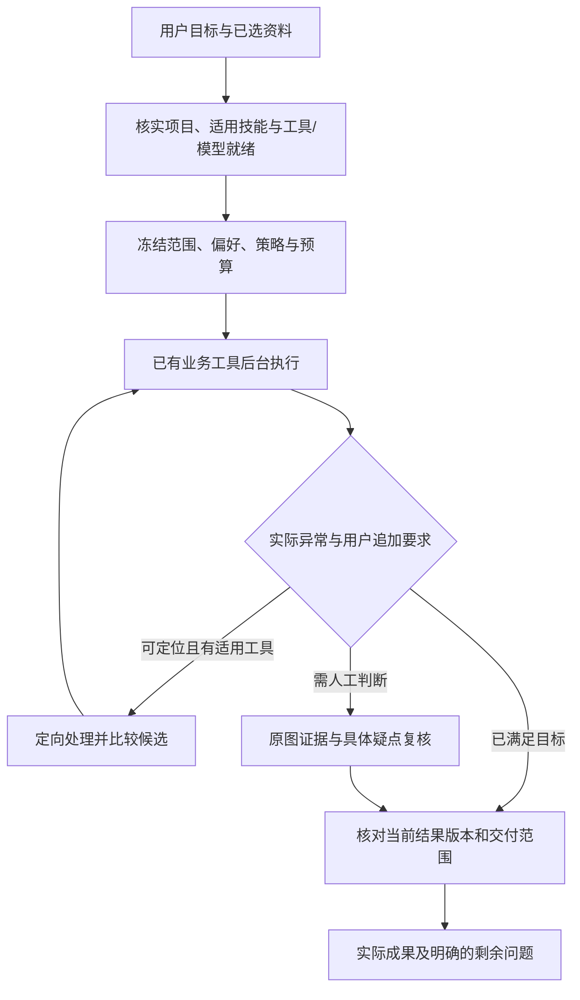

# 平台专用 Agent：下一阶段最终实施计划

首次制定：2026-10-07；本次更新：2026-10-11，Asia/Hong_Kong。状态：计划已确定，实施中；逐项状态和证据以任务清单为准。用户要求：Agent 聚焦审计平台已有工具，借鉴通用 harness 的任务闭环、恢复和上下文管理经验。

**目标是让用户描述审计目标并提供资料后，Agent 选择平台内合适的工具、处理具体异常、核实结果并交付。** OCR 是本轮首个重点业务，贯通后用已有分类和数据核对任务验证公共能力。采用“常用任务有默认步骤，特殊情况按实际结果调整”的方式，保留跨工具组合能力。

本计划新增专用业务技能、任务偏好和异常/交付契约，改善现有业务服务。专业计算仍由平台工具及已配置模型执行；Agent 负责理解目标、选择步骤、处理异常和解释结果。项目、资料、工具授权和人工确认继续由平台控制。

本文件说明实施范围及顺序，[任务清单](specialized-agent-tasks-20261007.json)登记依赖、完成条件和执行状态。实施完成必须绑定实际源码、检查及结果证据；本次不把规划登记为功能完成。

最终交付以你的实际业务为准：一次提交 200 张以上屏拍图片，每张图片一个 XLSX，同图多表分 sheet，整批 ZIP；保留标题、单位、表注，排除电脑界面干扰。Agent 使用平台注册工具完成任务，后台批次承担逐图计算，普通任务不需要逐图调用主控思考。通过完整验收后，这条业务流程无需外部 DeepSeek Harness；目前不能把局部测试通过当作已经稳定平替。

后续按四个可验收的里程碑推进。M1 与 M2 当前并行；已有分类和 OCR→数据→审计样例可以同时预跑，GPU 模型试验使用一个槽位顺序执行。M1、M2 完成后进入 M3 的最终冻结验收，M3 通过后完成 M4 交付。下文 S01–S08 作为实现和证据明细保留，完成要求全部映射到里程碑。

| 里程碑 | 集中完成的工作 | 明确交付与完成标准 | 对应任务 |
|---|---|---|---|
| M1：确定识别方案 | 收口正在进行的强模型对照及业务内容整理，在开发 60 张／验证 40 张比较质量、可交付率、需核范围、冷加载可靠性和真实耗时；处理加载期预算中断的停止策略 | 一份默认路线、提高精度路线和技术故障兜底决策；关键格、表结构、标题／单位／表注及 UI 残留／误删都有完整分母。不用未完成批次或成功图片子集排名；收益不足的处理不进入默认，仍保留问题并继续解决质量目标 | S03、S04、S08 |
| M2：完成日常 OCR 闭环 | 将专用技能、偏好、后台长任务、疑点候选和集中复核整合成完整用户流程；补业务说明两版／来源展示及人工选值／手改；贯通暂停、续作、定向处理、部分下载和当前版本导出 | 用户一次提交后可查看进度、纠正表格与业务说明、每图下载一个 XLSX、同图多表分 sheet、整批 ZIP。失败／空表／预算终止保持可见且有原因；未变的成功项不重算。真实操作证明版本、预算、权限、来源及复核状态一致；新处理有正净收益并实际缩小需核范围或证明校对减负，全图待核不算自动化完成 | S01–S06 |
| M3：证明大批次与平台 Agent 可用 | 冻结最终路线和源码，用新 240 张主保留／24 张挑战实跑；完成 200+ 张实际 Agent→模型→XLSX 全链、同条件整批／分组效率对照、恢复／重复／编辑竞态，以及现有分类和 OCR→数据核对→审计证据完整 Agent 样例 | 一份质量／效率／稳定性验收报告及可读回的 Excel／ZIP、来源和审计成果。分别给出首候选、首个可下载 Excel、整批耗时、主控／工具调用、自动覆盖与残留关键错；免人工子集无新增静默关键错。已有小样例不能代替大批次或完整分类资格 | S04、S06、S07、S08 |
| M4：交付可采用候选 | 对同一最终源码完成界面操作、兼容、包装门禁和真实冷备恢复；分类提交并清理相关 Git 工作区，整理采用范围和回退依据 | 一个通过全部最终资格的候选包、简明操作说明、验收证据和回退依据；相关工作区干净。候选资格、内容准确性和正式采用分别登记 | S05、S08 |

当前马上推进三件事：收模型对照的完整质量／读回报告，修正实际任务暴露的 Agent 业务匹配和工具调用路线；审查并整合业务内容整理、人工修改与当前导出；在这些结果上完成 M1 路线决策和 M2 整体操作验收。已有 OCR 成果核对采用明确的原生结果→结果衔接→数据→审计／交付阶段，避免错误票据技能匹配及反复发现工具耗尽上下文。M3/M4 的素材与包装检查可预先准备，正式资格使用最终冻结源码。

执行规则：

- 按用户流程和里程碑收口，每次试验明确要解决的问题、固定范围、预算及下一步决策；沿同一任务读取实际进度，不因观察超时另起重复任务，也不重置失败任务的额度。
- 已通过且相关源码、配置、输入和环境未变的检查复用证据；发生变更时验证受影响的要求及必要的整体链。不为增加测试数量重复检查，也不将组件通过升级为功能通过。
- 发现影响数据正确性、来源绑定、任务恢复、当前交付或关键操作的问题，在对应里程碑解决。其他改进登记后集中处理；交付所需的界面和浏览器验收仍在 M4 完成。
- 连续同原因加载故障受控停止、封存原成本和失败，修复后按明确的新试验身份验证；无净收益的识别分支退出默认路线。退回辅助模式会保留未达成的自动化目标，不能因此把目标标完成。
- 进度汇报聚焦可交付能力、里程碑结果和影响使用的关键阻碍。测试用例、日志和函数修改保存在明细证据中，普通批次维持不超过 5 轮逻辑主控／8 次批次级工具，等待期间不调用主控轮询。

当前结论：批次编排与 Excel 交付已具备实际基础，稳定平替仍未通过。原 60 图失败任务现已受控恢复，原 Agent 用 3 轮主控／3 个工具交付 60 本当前版本 Excel；整表核验 19/60、关键格精确 82.17%，全部仍待核。中文模拟子集 17/24 整表通过、关键格精确 95.83%，不能换算真实手机屏拍表现。当前重点是完成 M1/M2。更强模型的平均分提升不能替代校对减负，没有实测依据时，不承诺固定工期、真实业务准确率或对旧 harness 的提速倍数。

## 1. 当前基础与已知缺口

正式 current 仍为 v0.9.3。上一阶段 OCR 工程候选为 v0.9.4-final-003，已通过其工程资格，尚未切换正式运行版本；该资格不覆盖本轮新增功能。规划基线：主仓 `codex/ocr-agent@d3234a7`；平台任务树 `9c26bd4`、OCR `9709c2c`、分类 `d90707b`。本次更新依据主仓 `f8aec0f`、平台 `440492e`、OCR `36f7a6d`、分类 `d90707b`；已将评测、专用技能与偏好、上下文、候选及当前交付、包装兼容、界面控制分类提交，后续修正继续在登记的 F 盘工作树中实施。上一阶段实际推理来自 final-route-002，工程收口来自 final-route-003，二者原生推理文件及默认策略保持一致。本轮计划初次提交为 `cf7b161`。

| 已有基础，继续复用 | 本轮应补齐 |
|---|---|
| 注册工具、严格参数、按需发现/加载、固定版本技能及工具范围限制 | 常用任务自动匹配适用技能/工具；把“已注册、服务可启动、具体模型就绪”分开 |
| 项目规则、会话目标、计划、历史与固定资料集合 | 有来源、作用域和版本的结构化工作偏好；单次指令优先于默认 |
| OCR 整批后台、模型分组、预算、暂停恢复、失败重试、选图精度子批次 | 从整图短提示细化到图/表/格及原图证据；以异常原因驱动定向处理 |
| 原图核对、候选比较、逐图 XLSX/ZIP、来源索引 | 可靠格位、业务说明/UI 整理；同数量旧 ZIP 的当前版本核验 |
| 结果衔接、数据处理、比对和审计证据工具 | 为可支持的结构选择正确的跨工具流程；不完整或合并语义未确定的结构明确留待处理 |
| 等待主控空闲、持久身份、防重复提交及真实交付计数 | 首个结果更早可用、渐进交付、异常处理后的版本与状态同步 |

现有 OCR 技能面向票据与台账核对，其工具范围不包含屏拍批次工具；新增独立“批量屏拍转 Excel”业务技能，保留原技能。

上轮 240 张混合模拟为 4 轮主控/3 工具、约 53 分 35 秒；首个有表候选约 7 分 20 秒。实际 238 本 Excel、2 个有参考表却无可交付表的候选；整图表格核验全通过 54.58%，关键字段精确 74.09%，全部待复核。一个实际工作簿的业务说明 194 条中有 168 条重复业务格，并混入列标尺。调度已经满足低轮数目标，内容质量及降低校对负担仍未达标。

这些是公开/合成模拟结果，不能直接换算真实手机屏拍表现。原模型选择、失败和实测边界继续保留在[OCR 最终评估](../批量屏拍OCR完善方案-20261007.md)，不覆盖或重新解释历史成绩。

本轮已有 12 图开发探针对照：Hunyuan 与 GLM 各 4 图整表全核验通过，关键格精确分别为 88.93% 和 96.08%，实际 OCR 调用序列分别约 63 秒和 285 秒；中文子集没有体现 GLM 优势。两者的具体错格定位及平台自动交付尚未由该实验验证。PaddleOCR-VL 本次存在冷加载故障，12 图中 3 次失败、1 次中断后结果未知、8 次未尝试，不能用于完整识别质量排名。详见[开发探针报告](../../output/platform-specialized-agent-20261007/evaluation/dev-probe-001-final-review-001.md)。这些结果支持按错误类型探索路线，不支持把全批默认机械地切到某个模型。

本轮冻结源码已完成首次 12 图真实 Agent→原生队列/模型→Excel 全链：3 轮主控、3 次批次级工具，整条测试约 118.85 秒，生成 12 本 XLSX，无缺文件；等待期间主控请求数保持稳定。独立读回确认 ZIP 忠实包含当前选定结果和来源版本。此项核验只证明调度、导出与当前版本一致，不能证明 OCR 内容正确。

独立内容评分为 4/12 整表核验通过，关键格 522/587（88.93%）、全部可见格 723/856（84.46%）；标题/单位/表注命中 7/18，12 张全部待复核，没有免人工交付或可靠格级定位成绩。详见[12 图独立质量报告](../../output/platform-specialized-agent-20261007/evaluation/agent-native-dev-001-quality-001.json)及[实际 Excel 读回](../../output/platform-specialized-agent-20261007/evaluation/agent-native-dev-001-readback-001.json)。这些模拟成绩说明下一步优先提升元信息保留、识别质量和具体疑点定位，不能以低轮数或文件齐全宣称已稳定平替。

后续 GLM 12 图真实 Agent→模型→Excel 链亦已终态：3 轮／3 工具、约 279.51 秒，12 本 XLSX 均实际读回。整表仍为 4/12，关键格 564/587（96.08%），中文关键格 46/52，低于 Hunyuan 的 47/52；另有额外表。逐输入质量存在回退，总耗时相对首轮增加约 160.66 秒，尚未采用为全批默认。见[真实路线对照](../../output/platform-specialized-agent-20261007/evaluation/agent-native-h-glm-comparison-002.json)。

元信息整理改进已在新的实际 12 图链复现：标题／单位／表注由 7/18 提高至 14/18，仍有 4 个缺失和 5 个额外片段；不能称全部保留正确。相同输入和源码、仅调度参数不同的整批／分组实际对照质量相同；分组使首个原生候选提前约 6.31 秒，但总耗时由 124.82 秒增至 155.74 秒，约增加 30.93 秒。首个候选不等于首个正确 Excel，因此默认仍为整批，须大批次继续验证取舍。见[实际调度对照](../../output/platform-specialized-agent-20261007/evaluation/agent-native-schedule-comparison-001.json)。

格位 v2 以源像素边线、真实单元格分区和独立文字行列锚点证明映射，拒绝均分或按索引猜坐标。24 个开发候选 CPU 回放仅两张图的 81 个格有可靠映射；Hunyuan／GLM／辅助文字联合的 9 个疑点命中 5 个真错、误报 4 个，仅覆盖 Hunyuan 全量 133 个错格中的 5 个。模型共同一致仍会漏错，尚无人工减负或自动交付资格。见[定位计分](../../output/platform-specialized-agent-20261007/evidence/s04-grid-localization-score-001.json)。

上述 81 格已完成两种真实局部试验。GLM 整页识别模式用于单格裁剪时，61 次无解码、净修复为 0；新的显式 `local_text` 文字模式 81 格全部有解码，但全格替换修复 1 个关键错误、新增 1 个非关键错误，净修复仍为 0。只消费预先标出的 9 个诊断疑点，在完整 856 格分母下修复 1 个关键错误、新增 0；该策略是在观察开发结果后选择的，尚需验证 40 张，且 9 格成本与人工减负未实测。下一步仅探索有来源、可靠格位、预算及版本保护的局部候选工具，生产 `local_reread=false`，仍全部待核。见[真实局部文字试验](../../output/platform-specialized-agent-20261007/runs/local-text-probe-001/diagnostic-only-analysis-001.json)及[实际图像和坐标读回](../../output/platform-specialized-agent-20261007/runs/local-text-probe-001/coordinate-readback-001.json)。

PaddleOCR-VL 新单图实际探针已在原启动 240 秒／请求 180 秒预算内成功：加载约 23.00 秒、推理约 16.67 秒，输出 1 表并完成自有进程／资源清理，独立来源及 XLSX 忠实性核验通过。它证明该冻结源码和输入可以实际加载、推理，尚未独立内容评分，不能由一张图宣布完整模型路线可靠或精度领先。历史失败继续保留；后续进入开发／验证路线比较。见[单图实际回执](../../output/platform-specialized-agent-20261007/runs/paddlevl-development-load-probe-002/execution/result.json)及[独立审核](../../output/platform-specialized-agent-20261007/evaluation/paddlevl-development-load-probe-002-independent-001.json)。

新 60 图真实 Hunyuan 批次最初因状态读取超时失败；后台准备持有长时间批次／文件锁，普通状态也等待同锁。状态快照修正已通过 11 个真实 SQLite／HTTP 状态及交付回归，原失败现场保留。在新 F 盘目录的第二次受控恢复已真正终态：原 36 个模型任务身份保留、补齐原批次剩余 24 个，60 项上下文未重算，历史成本及原截止时间保留；原 Agent 以总计 3 轮主控／3 个工具发布整批 ZIP，独立读回 60 本 XLSX、无缺文件，内容忠实与当前版本均通过。恢复链约 740.42 秒，含故障续作及额外 resume 等待，不能作为正常性能基线。第一次恢复的空目录遗漏及第二次复用旧 resume 回执的停顿分别封存，后续复制与操作身份已修正。见[恢复闭环报告](../../output/platform-specialized-agent-20261007/evaluation/h60-controlled-recovery-002-closure-001.json)。

60 图开发评分在停机和原始输出封存后完成：整表 19/60，关键格 2194/2670（82.17%），全部可见格 3150/3933（80.09%）；中文模拟 24 图整表 17/24、关键格 207/216（95.83%），公开复杂表 36 图整表 2/36、关键格 1987/2454（80.97%）。标题／单位／表注命中 59/72，仍有 13 个缺失、47 个额外片段及 21 处 UI 标记泄漏。60 图全部待复核，自动覆盖为零；另已核实中文 5 图有 83 个可靠格位，但当前没有单格疑点定位成绩。下一步按中文小字、公开宽表／复杂表头及 UI 归属分别比较已有强模型与处理路线，再在验证 40 图确认收益。不能由当前三轮调度、文件齐全或中文子集较高的关键格成绩宣布稳定平替。

专用技能、偏好、异常／版本回执、界面及兼容方面已有实现和 CPU 检查。异步局部文字候选后端已有完整 CPU 契约与输入来源回归：短事务入队、原预算与幂等控制、裁剪／解码证据、版本过期保护，候选不覆盖当前值；局部控制 40 项、包装／兼容／当前导出 101 项 CPU 检查通过。原生 action／resolve 查询的明确 HTTP 200 JSON null 现可作为操作未收到的回执，错误或不确定响应仍拒绝，新增实证与既有异常桥 25 项通过；这些均为组件证据。已有发布分类模型的 CPU 实际预测、文件→数据核对→审计证据及原生 OCR→数据工具衔接已局部实跑；完整跨工具 Agent 仍未通过。S07 009 在 14619/14336 上下文预算处终止；后续冻结 013 的原七模块门禁共 132 项通过，真实 010 完成原生接入、读取和重新加载后仍失败：12 轮主控／15 次工具、约 177.20 秒，尚未进入结果衔接、数据、审计和交付。下一实现聚焦已有 OCR 成果核对的专用技能匹配和分阶段注册工具路线，继续保持原窗口、预算、权限及来源回读。见[实际 010 回执](../../output/platform-specialized-agent-20261007/runs/s07-agent-native-010/s07-agent-native-result.json)。12 图工程数据的生产冷备／新 F 目录恢复报告 005 已通过独立复核，但不覆盖后续上下文、工具加载、状态及局部候选修改，最终候选须按最终源码重新冷恢复。见[冷恢复独立复核](../../output/platform-specialized-agent-20261007/evaluation/cold-backup-restore-native-005-independent-002.json)。

本机重启中断了 Paddle 60 图实际试验：原 handle 与自有进程均已缺失，封存现场为 10 项 OCR／最终候选成功、50 项未完成，原截止时间已过。原身份与预算不延长，部分成果以识别关闭的读取服务独立核实和导出；后续完整试验使用明确的新身份，保留本次中断，不把缺失任务或离线空档算作正常性能。元信息／UI 改进 v001 在开发回放中有收益，但独立反例复现符号／语义冲突替换、未标注业务说明误删和来源绑定缺失，因此未应用到共享源码；修正须保留冲突、真实表注和有效版本来源，并在同一评分规则、完整分母下重新验证。

新 Paddle 60 图独立试验 002 已完成全部原生尝试：59 图待复核、1 图加载期预算失败；Agent 在上下文和重复状态查询处失败，未自行发布成果。后置独立收集导出 59 本 XLSX／60 项清单，不能冒作 Agent 交付或最终平台资格。完整质量／独立读回已收口：整表 15/60，关键格 2182/2670（81.72%）、可见格 3208/3933（81.57%）；相对 H60 净修复 58 个可见格，但关键格净新增 12 个错误。减少的 1 张待核图来自加载失败，不是减负。两路自动覆盖仍为零，Paddle 未进入默认；见[完整分母独立对照](../../output/platform-specialized-agent-20261007/evaluation/m1-full60-h-p-quality-review-001.json)。业务内容整理 v003 已整合共享 OCR 源码：H60 开发回放元信息命中 72/72、额外片段 0，UI 标记泄漏由 21 降至 2；P60 同政策回放元信息仍 59/72、额外片段降至 13、UI 泄漏降至 2，源原文与旧展示文字不一致的部分保持拒绝，不能借用 H60 的元信息成绩。两路表格关键格均未改变、仍全部待核。人工编辑、版本竞态及界面由 M2 继续整体验收，验证 40 张仍未完成。

本次另修复了同图切换疑点时，旧局部候选与新选中格值误配的问题：候选依照实际输入、结果和疑点身份显示对照，历史候选保留明确提示。单组件 8 项检查及 TypeScript／Vite 构建通过，源码哈希一致，已独立提交；尚无最终界面浏览器资格。见[候选对照组件检查](../../output/platform-specialized-agent-20261007/evidence/screen-local-binding-ui-closure-006.json)及[源码绑定构建](../../output/platform-specialized-agent-20261007/evidence/screen-local-ui-build-003.json)。

当前仍缺最终路线的内容／减负收益、240 图同条件性能、200+ 真实 Agent 批次、独立 240/24 质量验收、实际恢复／竞态，以及最终候选的界面和源码一致的工程资格。所有任务继续保持实施中，不把局部验证或旧候选资格等同于本轮交付完成。

2026-10-09 本轮续作已修复加载期预算耗尽未计入冷加载保护的问题：只有实际自有 worker 的加载回执证明模型尚未就绪，才记录 `budget_exhausted`；与真正的加载超时共同构成同根任务／同模型的连续失败，实际就绪重置该计数。等待 GPU、用户取消及识别阶段超时不误计。源码已提交 `bbcdca8`，最终 14 项加载保护及相关 37 项队列／准备检查通过；另有 2 项生产 ASGI 准备期间状态、鉴权、暂停／取消、重复操作查回与续作检查（`912845b`）。这些均为工程证据。GLM 细加载阶段记录已提交 `03602cd`，保留原模型参数、调用与加载计时口径，76 项 CPU／既有识别模式检查通过；见[加载预算保护](../../output/platform-specialized-agent-20261007/evaluation/load-budget-guard-final-002.json)、[HTTP 准备控制](../../output/platform-specialized-agent-20261007/evaluation/preparation-http-controls-001.json)及[GLM 加载阶段](../../output/platform-specialized-agent-20261007/evaluation/glm-loading-progress-001.json)。

独立 GLM 开发 60 张试验 `m1-glm-development-20261009-002` 已受控暂停并封存原身份、成本和截止时间。完整分母为 1 成功、6 失败、1 项中断后结果未知、52 未尝试；两次冷加载失败和四次实际就绪后 `generate` 超时分别保留。唯一成功图仍有关键格错误，Agent 未交付，不能作完整模型质量排名。新身份单图诊断真实完成 3 轮／3 工具和 1 本当前 XLSX 交付，独立评分 90/90 格、60/60 关键格，仍全图待核。该次辅助上下文超时后改用完整原图，实际模型输入与旧成功图的表区裁剪不同，不能据此宣称同条件提速或整批可靠。见[单图诊断闭环](../../output/platform-specialized-agent-20261007/evaluation/m1-glm-single-diagnostic-closure-001.json)。下一完整开发试验使用新身份并保留相同预算和连续同阶段失败的受控停止条件。

严格放行规则亦已做全 60 图开发可行性检查：要求真实全格像素分区、独立行列锚点、每格高置信辅助字面一致，以及有来源的业务说明一致。规则提出的两张图经独立评分仍各有一处“−”被写成“-”的关键错误，因此拒绝该放行路线；无告警或两路一致不能替代字形正确性。只读数字字形试验未产生可唯一证明的修正，未修改任何当前值或复核状态。见[完整分母拒绝报告](../../output/platform-specialized-agent-20261007/evaluation/m1-strict-subset-review-001/result.json)。

新 GLM 开发 60 图试验 003 已正常终态、全部 60 项模型成功，真实 Agent 为 3 轮／3 工具，59 本工作簿及 1 项 no_book、60 图均待核。独立评分整表 20/60，关键格 2361/2670（88.43%），可见格 3466/3933（88.13%）；相对 H 完整分母净修复 316 格，其中关键格净修复 167，但仍新增 81 个关键错，不能自动采用候选或免核。原 5 列业务说明检查器与新增 8 列契约不匹配，旧读回失败保留；新身份按实际 8 列、原始／辅助来源、人工复核状态、当前修订及全部业务格独立读回，59 本通过，另 1 项实际 no_book。共同 v003 元信息政策 CPU 回放后 GLM 仍为 59/72 命中、57 个额外片段及 20 处 UI 泄漏；60 项实际选定来源文本与该政策输入不一致，未混用为实际资格。该试验使用新 OCR／旧平台混合冻结，不能作同源码耗时排名或最终 Agent 资格。见[更正后的 GLM 闭环](../../output/platform-specialized-agent-20261007/evaluation/m1-glm-development-full60-closure-002.json)、[8 列读回](../../output/platform-specialized-agent-20261007/evaluation/m1-glm-development-full60-readback-v4-001.json)与[共同政策回放](../../output/platform-specialized-agent-20261007/evaluation/m1-g60-common-metadata-replay-001/result.json)。

仅用实际业务区域内 PP-OCR 辅助文字的汉字／拉丁字母计数，先冻结分流规则，再对已经独立完成的 H、GLM 开发结果做 CPU 假设回放：60 图分别选 H24／GLM36，整表 25/60、关键格 2370/2670、可见格 3473/3933。相对 GLM 全批仅净多 7 个正确可见格、9 个正确关键格，同时新增 1 个关键错；3933 格仍全部待核。它没有实际逐图路由、同源码耗时或减负资格，不能据此改变默认。验证集 40 图 H 试验另用新身份准备，但首轮主控收到 HTTP 429 后终止：1 次请求、0 工具、0 模型批次，不能计入识别评分；原失败和预算保持。见[分流开发评分](../../output/platform-specialized-agent-20261007/evaluation/m1-language-route-development-score-001/report.json)及[验证试跑失败回执](../../output/platform-specialized-agent-20261007/runs/m1-h-validation-20261009-002/agent-native-summary.json)。

另一个 CPU 开发试验保留数字、拉丁标识及符号格待核，只在完整结构、独立字面及业务说明一致的两张图中缩出 22 个 CJK 文本格。独立核验全 60 图／3933 格，3911 格仍待核；783 个可见错、476 个关键错全覆盖，两处负号错仍明确待核，未修改值、未自动放行图片。纯 CJK 字符不能证明业务标签语义，“二十元”“壹佰”“第十号”等仍可能匹配，故该宽规则未采用。随后冻结的报销矩阵专用 7 字段／完整父子表头规则只缩出 2 图的 14 个表头格；独立完整分母复核仍覆盖全部 783 个可见错和 476 个关键错，3919 格待核。该新规则仅是开发集 CPU 可行性，尚无验证 40、产品接入或人工计时，不能称为实际减负资格。见[宽规则审查](../../output/platform-specialized-agent-20261007/evaluation/independent-m2-cell-review-scope-002/review.json)、[语义边界](../../output/platform-specialized-agent-20261007/evaluation/independent-m2-cell-review-scope-boundary-001/report.json)与[封闭表头独立复核](../../output/platform-specialized-agent-20261007/evaluation/m2-closed-header-scope-independent-full60-003/review.json)。

M2 业务修改与导出已在两端真实 HTTP／外部浏览器工程流程通过，7 个 ZIP 独立读回一致；主识别、辅助识别和手改历史保留，修改后旧 ZIP 标为历史，重新确认和当前导出对应同一修订。OCR 与平台改动已分别提交 `36f7a6d`／`1877789`。此流程使用明确的确定性 OCR 工程夹具，未调用模型或 Agent，不能代替内容及最终资格。追加局部候选夹具因缺失生产准备契约被冷恢复正确拒绝，失败现场及原数据保留；修正夹具在新来源目录登记完整像素副本和路径映射后，继续独立冷备恢复。操作说明已整理为[候选操作说明](平台专用Agent操作说明-20261009.md)。

上述工程数据的新冷恢复 005 已实际通过并独立复核：平台与原生分别备份、验证并恢复到新 F 盘目录，旧自有来源隔离，3 个输入、2 份局部候选及下载产物、修改历史、当前／历史 ZIP 保持一致。两个正向批次冷前冷后均实际读取诊断源像素；主批次原 3×2 工程表与照片 4×6 网格不一致，按固定身份和全部证据 SHA 验证其零格位、无局部复识的正确拒绝，不改表来迎合验收。试验 001–004 的失败保留；004 暴露的局部候选读取覆盖工作区路径变量已修复为平台提交 `1ffb392`，26 项相关回归通过。005 是确定性工程夹具的恢复证据，仍不覆盖最终识别路线／源码及完整候选资格。见[冷恢复实际报告](../../output/platform-specialized-agent-20261007/runs/cold-backup-restore-workflow-005/cold-restore-result.json)与[独立复核](../../output/platform-specialized-agent-20261007/evaluation/independent-m2-cold005-review-002/review.json)。

跨工具真实链继续推进：原生 017／018 已完成数据核对和审计／导出，仍因上下文未完成交付；分类 005／006 亦未通过。原生 019 已出现两次真实交付成功，但普通跨工具任务交付后未正确结束，继续请求直到超限，不能算完整终态成功。验证器原先误拒绝完整五类显式导出清单也已定位；原失败和全部回执保留，后续修复需新身份真实验证。历史正文读回信息已补 source／result SHA 核验，继续修正阶段收口，不增加窗口、资料或工具权限。最终里程碑状态仍以完整任务和最终资格为准。

修正终态后，原生 020 已完成实际 OCR 既有结果→数据核对→审计→导出→交付，终态 succeeded，15 轮主控／16 次工具，未重跑模型或使用 GPU；该复杂核验独立计数，不套普通批次 5／8 上限。分类 007 仍在证据阶段超上下文，完整跨工具资格未完成，下一新身份 029 分支试验继续验证。原生 020 的辅助导出审查 001 直接打开原 SQLite 后新增空 WAL／SHM，主库／回执未改，但未满足原目录字节不变；该失败保留，修正为独立字节副本后再读回，不删改原现场。这些分支冻结亦不能替代三工作树的最终共同冻结。见[原生 020 实际链](../../output/platform-specialized-agent-20261007/runs/s07-agent-native-020/s07-agent-native-result.json)。

029 分支新身份进一步完成原生 021 实际链，终态 succeeded、15 轮主控／17 次工具；5 类导出文件、7 行比较及来源已独立读回。分类 008 实际调用已发布模型在 CPU 对 2 个工程输入推理，3 份分类与来源文件交付、审计证据可读回；一次对未注册工具的 `tools_describe` 失败仍在原回执中，因此 Agent 终态保持 partial，不能写成完整成功。独立审查以字节副本查询原数据库，确认预测、低置信度待核状态、人工标签及发布文件一致。阶段源码与技能已分类提交为平台 `30a26f1`，主仓读回／表头探针和实战辅助脚本为 `5162500`／`856d289`。029 只冻结这些分支，尚非 OCR／平台／分类最终同源码资格。见[原生 021 结果](../../output/platform-specialized-agent-20261007/runs/s07-agent-native-021/s07-agent-native-result.json)、[原生导出复核](../../output/platform-specialized-agent-20261007/evaluation/s07-native021-export-review-001/export-review.json)、[分类 008 结果](../../output/platform-specialized-agent-20261007/runs/s07-agent-classification-008/result.json)与[分类导出复核](../../output/platform-specialized-agent-20261007/evaluation/s07-classification008-export-review-005/export-review.json)。

2026-10-10 续作已取得新的验证与实际链证据。Hunyuan validation40 通过真实原生队列与平台导出，40 个模型任务成功、40 本 XLSX 独立读回；整表 11/40、可见格 2162/2711、关键格 1418/1821，业务元信息 42/48，仍有 25 个额外片段和 5 处 UI 标记泄漏，40 张全部待核。此项没有 Agent 控制器调用。原读回快照漏 SHA 和评分状态适配错误保留，修正结果见[独立读回](../../output/platform-specialized-agent-20261007/evaluation/m1-h-validation-direct-independent-004-005/review.json)及[完整分母质量](../../output/platform-specialized-agent-20261007/evaluation/m1-h-validation-direct-quality-004-002.json)。GLM005 在外部中断后进程与句柄消失，原截止时间已过；已字节封存 12 成功、1 失败、1 中断未知、26 未尝试，不作为完整排名，新身份006现已在原预算内正常终态：37 成功／3 识别超时、37 本 XLSX／3 个明确 no_book，独立来源与导出读回通过。完整40分母整表10/40、可见2161/2711、关键1405/1821，元信息35/48，额外29、UI泄漏5；耗时2176.52秒、首原生结果638.63秒，历史源码和条件不同，不能作受控提速比较。全部40仍需处理，失败对应301可见格／232关键格不可用，不是减负。源文字分流规则在真值读取前固定为 H16／GLM24；完整CPU假设对照为11/40整表、可见2131/2711、关键1404/1821，相对H净退31可见格／14关键格，拒绝采用。见[完整验证与路线决策](../../output/platform-specialized-agent-20261007/evaluation/m1-complete-validation-decision-002/report.json)。

开发集封闭表头缩核规则已经按原标签、结构、来源与置信度条件执行 validation40：释放 0/2711 格，全部 549 个可见错和 403 个关键错仍待核。开发集的 14 格缩核没有在验证集复现，该规则不能完成 M2 减负门槛，见[验证结果](../../output/platform-specialized-agent-20261007/evaluation/m2-closed-header-validation40-002/result.json)及[独立计分](../../output/platform-specialized-agent-20261007/evaluation/m2-closed-header-validation40-independent-score-001.json)。

分类009原失败在导出后达到 14573/14336 输入预算；计划工具提示与已完成推理的重复历史回读已修正为平台 `73fba13`／`440492e`。旧提示 v1–v5 保留，9 项回放／16 子测试及 31 项上下文测试／43 子测试通过。原检查点在不增加窗口、权限或输出预留下精确回放为 13591 tokens。新分类010真实 Agent 终态 succeeded，11 轮主控／11 次工具、约 166.02 秒，完成 2 张工程图的实际 CPU 推理、直接审计证据及 3 文件交付；独立原库副本读回验证模型、来源、预测、未改人工标签及完整交付，11 份原回执的 51 页精确恢复通过。见[实际结果](../../output/platform-specialized-agent-20261007/runs/s07-agent-classification-010/result.json)、[独立导出](../../output/platform-specialized-agent-20261007/evaluation/s07-classification010-export-review-002/export-review.json)及[回执读回](../../output/platform-specialized-agent-20261007/evaluation/s07-classification010-receipt-readback-001/readback-audit.json)。这些是分支031的工程预跑，M1/M2 与最终共同源码资格仍未完成；正式 current 继续为 v0.9.3。

## 2. 用户应获得的体验

用户说“这批图片转 Excel，每张一个文件”，Agent 根据已选资料和当前项目进入专用流程，采用已验证默认参数。后台执行，界面显示真实进度，已有结果可先下载；用户途中追加“暂停”“只重试失败”“提高这几张的精度”时，继续操作原任务及明确的子批次。

出现问题时，用户能看到具体图片/表格/单元格、原图局部、候选值及原因。Agent 在预算内调用适用的现有工具，对比新旧结果；无法可靠定位或原图看不清的内容明确保留待核。标题、单位和表注展示当前结果、其他识别原文及来源，用户可选择或手工纠正；修改、确认和重新导出沿用当前结果及修订版本，原始识别证据保留。文件数、缺文件数、待复核数和成果版本均由实际服务回执决定。

用户追加“按项目规则核对金额”时，Agent 查询真实工作表、字段、单位和规则，在现有结果衔接能力支持的结构上调用数据核对工具。当前衔接器拒绝合并单元格和不完整格位；此类结构先解决业务含义或复核，不能由主控自行重录、展开或补猜数据。

## 3. 实施任务与顺序

| 编号 | 工作包 | 具体交付与完成条件 |
|---|---|---|
| S01 | 任务与能力匹配 | 冻结现有工具/技能及实际能力清单；增加屏拍专用技能与常用任务匹配。明确输入就直接进入对应工具组，实质歧义才补问。未就绪工具/模型按实际状态处理，明确的用户覆盖仍生效；未知任务沿用已注册工具的按需发现。验证技能切换不会扩展资料或工具授权 |
| S02 | 工作偏好与任务上下文 | 保存明确的输出方式、文本/数值口径、复核要求及已验证策略偏好，记录用户指令来源、项目/业务作用域和版本。单次要求优先，偏好可查看/修改/撤回；当前批次冻结快照，续作不受新默认悄悄影响。金额列、单位和核验规则缺失时只询问影响结果的内容 |
| S03 | OCR 异常定位与内容整理 | 将独立文字/结构证据映射到真实业务表，查合并跨度、漏行列、错位和 UI 假表；可靠时定位到格，不能可靠时标到表/图。按空间与归属整理标题、单位、表注，排除标尺/UI及重复表内文字，保留辅助 OCR 全量证据。用真实错例核对保留与误删、定位漏报和误报 |
| S04 | 有界异常处理闭环 | 工具回执提供具体位置、证据引用、原因、适用处理和状态；Agent 调用现有精度/预处理/结构/核验工具，比较候选、保留来源、更新复核状态。技术故障与业务歧义分开；防止同一异常无收益循环。自动采用范围必须由净修复、新错和成本证明，未证明的处理保留建议/复核模式 |
| S05 | 当前版本与交付核验 | 核对逐输入原图版本、当前选定结果 ID/revision、复核状态及导出选项。表格和业务说明人工修改存当前修订、保留原始识别证据，界面、复核与导出读取相同有效值。数量相同但已编辑/换候选/重新确认的旧 ZIP 明确标历史成果，按当前版本重新导出。覆盖导出期间变化、部分范围、2 个 no_book、无原因遗漏和待复核口径；交付摘要从真实清单生成 |
| S06 | 首产出与编排效率 | 分别记录准备、上下文、模型切换、排队、工具和导出的时间。对有限分组推进与整批先做上下文进行对照，在质量、预算和恢复不退化的条件下缩短首个可用结果等待。支持已完成部分交付，并随继续处理/编辑刷新版本与范围；用真实回执结束等待，避免重复主控查询 |
| S07 | 平台内跨工具实战 | 验证屏拍转 Excel、已发布模型的文件分类、可支持结构的 OCR→数据核对→审计证据三类任务。使用实际工具身份、字段与规则，保留完整来源；工具不支持时准确说明原因与可操作入口。新增资料范围、正式人工签署和训练目标遵循已有用户授权与业务语义 |
| S08 | 冻结验收与候选交付 | 开发/验证集选择策略，新保留集验收；真实主控、实际模型、Excel 读回、异常与恢复、包/兼容/冷恢复分别出具证据。报告自动覆盖及错误、需核图片/格、首产出/总时长和调用次数，保留所有失败。分功能提交，工作区干净；按结果决定候选采用范围 |

实施依赖：先 S01；S02、S03、S05 可在文件与资源互不冲突时并行；S04 接异常与偏好；随后 S06 和 S07；最后 S08。GPU 试验、数据迁移和同目录修改顺序执行。具体依赖以任务清单为准。

首轮保留上轮已验证的 Hunyuan 首轮、技术失败 GLM 有界兜底及选图 GLM 精度路线。检测有表却空表、宽表、多级表头、密集小字等问题，在开发/验证集分别比较 H/GLM/PaddleOCR-VL；局部文字、结构或视觉步骤只有产生净收益才加入默认。Agent 调度更专业不等于 OCR 字符识别自然变准。

该首轮路线是实验起点，最终默认由质量、需核范围、冷加载可靠性和实际成本共同决定；不固定“GLM 主表加轻量 OCR 补漏”。注册但不能实际加载的引擎不参与自动路由；连续冷加载故障单独记录并限制后续尝试，避免 200 张批次反复耗尽等待。加载失败须包含模型仍未就绪时的预算耗尽／中断，不能仅依赖专门的加载超时异常触发停止。平台尚未提供可用局部复识工具时，界面和 Agent 应明确不可用，是否补充该能力由可靠定位和实测净收益决定。

## 4. 异常闭环需要提供什么

异常记录至少包含输入与结果版本引用、问题范围（图/表/格）、可靠定位标记、原图/局部证据、当前值与独立候选、原因、适用处理、已尝试步骤和剩余预算。普通状态只传有限摘要；详细格值与原图保存在业务服务中，按需读取。

格位必须同时检查行列、合并跨度和原图坐标映射；缺乏可靠定位时不按索引替换。合计等规则使用准确的十进制核算辅助定位，不能为使合计相等而改值。原图不可见/无法读清、金额/编号仍有冲突时保留不确定性；Agent 不代签人工确认。

识别候选、程序检查、人工确认、交付状态分别保存。校对造成的新 revision、换候选及选择性升级均需使旧导出的新鲜度失效；历史文件保留固定身份，但不能冒作当前成果。

慢处理返回前，重新核对原图版本、结果 ID/revision、当前选定候选与人工确认版本（review epoch）；若用户已编辑、换候选、重新确认或更换原图，旧候选只能作为带原版本引用的历史建议，不能覆盖当前值或延续人工确认。验收必须覆盖结果回写和复核状态的竞态，不能只检查旧 ZIP 是否失效。

工作记忆限定为已核实的项目事实、任务进度、工具回执、用户明确偏好和经过验证的业务流程。借鉴 harness 的续作记忆、反馈修正及失败恢复，用现有状态与技能机制承载；流程与默认策略的更改要有版本和验证依据。

## 5. 验收与采用条件

| 验收情境 | 必须检查 |
|---|---|
| 任务选择与能力缺失 | 明确批量转换直接匹配，审计分析读取对应规则；多项目/资料歧义只补必要问题。已注册、可启动、引擎就绪分开；技能切换、混合目标及未知目标不越权、不猜 ID、不自行创建算法/脚本 |
| 具体异常与元信息 | 合并错位、漏行、小数点/负号/编号、UI 干扰、标题单位表注、空表与遮挡分别计分；定位召回/误报、净修复/新错、业务信息误删、需核图片/格分别报告。全图待复核不算定位成功 |
| 新鲜交付 | 数量相同的旧成果在编辑、换候选、重新确认后不会作为当前版本交付；导出中变化拒绝；同图多表、同名输入、部分范围、无表/失败和全部来源可读回；非空原值文本、空格、明确授权数值分别核对 |
| 中途指令与恢复 | 暂停/继续、部分下载、仅重试失败、选图精度、重复指令和受控重启；不重算已成功未变项、不重提整批、不串范围、预算不丢、资源释放。未知提交结果先查原回执，不能盲目重发 |
| 跨工具与证据 | 受控结果衔接保持原文/来源；不完整或合并含义未知时不伪造下游输入；核验规则和单位明确，结果能追到原图/原格和所用版本。已发布分类模型与训练目标分开 |
| 实际效率 | 普通无额外指令的 OCR 批次维持不超过 5 轮逻辑主控、8 次批次级工具；等待期间不调用主控轮询。API 重试独立计数。首产出、整批、切换/队列/导出分开测量，同硬件/输入/冷热态对照，重叠成本不相加冒作墙钟 |

采用规则：工程门禁全部通过；新增自动处理在所测范围净修复为正、无新增静默关键错误，并确实缩小需核范围或经独立人工计时证明减负。更快的处理需维持同等质量；更准确但更慢的处理可以保留“提高精度”模式。全送人工复核只支持辅助提取，不能认定自动化目标通过。

缩小复核范围时固定全量真值和错误分母，单独核验免人工放行子集的残留错误。原有金额/编号等关键错误如果未经纠正就被移出复核，也计为新增静默放行错误，禁止采用该分流规则；不能以减少疑点报告数冒充减负。未证明正确的子集继续保留辅助提取与复核状态。

普通 OCR 的轮数目标适用于没有追加指令的批次，不作为复杂审计的全局硬上限。中途要求、复杂核验与跨工具任务另设有界预算并独立报告，保留已完成的业务结果。

上轮 240/24 保留集可以转为已知错误回归集；一旦用于调参，就不再作为新策略的独立保留验收。新保留集从未用于选择策略的源文档及新合成模板建立，按文档/模板族分组；覆盖中文业务与公开复杂表，质量分开报告。冻结最终路线后做 240 张主批次、24 张挑战、实际恢复/重复用例及真实 Agent 全链路，明确基线与路线的真实计算/复用范围。

本轮数据已登记为开发 60 张、验证 40 张、主保留 240 张、挑战 24 张；数据资格检查通过只证明来源、分组和文件绑定，不证明 OCR 成绩。开发/验证/主保留之间文档或模板族分组无交集；挑战与主保留共享四个新中文模板族，挑战作为故障压力测试单列，不能声称模板族完全独立。相同模板的多张变体不视为独立业务样本。详见[数据资格回执](../../output/platform-specialized-agent-20261007/evaluation/dataset-qualification-001.json)。

用户已允许既有测试集模拟，本轮实施不等待真实照片。没有真实屏拍或人工时间证据时，仍限定模拟采用范围，不报告真实业务准确率、免复核保证或旧 harness 的提速倍数。

## 6. 交付与执行登记

交付包括：专用技能及任务匹配、结构化偏好、具体异常与候选比较、当前版本交付、进度与渐进产出、跨工具实际样例、冻结策略、质量/性能/恢复报告、Excel/ZIP 及来源清单、候选包与回退依据。研究图像、真值与模型缓存保留在评测目录，产品只携带运行所需代码与配置。

执行根为 `F:/OCR/output/platform-specialized-agent-20261007`。平台与 OCR 使用该目录下登记的独立 F 盘工作树；实施前已核对新旧 HEAD、已有修改、实际 Git 元数据及正式入口。各进程和子进程的临时、缓存、应用数据、测试库、模型产物与交付均显式落 F 盘，遵循[项目文件存储规范](../项目文件存储规范.md)。正式入口在候选通过验收前保持原版本。

源码复用重点：平台 `agent/context.py`、`scope.py`、`runtime.py`、`graph.py`、`skills.py`、`agent/tools`、`application_services`、`jobs/screen_batches.py`；OCR `screen_batches.py`、`screen_quality.py`、`screen_evidence.py`、`screen_imaging.py` 及既有导出/队列。优先扩充现有回执、参数和校验，避免建立第二套批次服务或重复状态系统。

实施检查在独立 F 盘测试项目进行，用户业务工作区与正式入口不作为试验对象。备份/迁移、模型与文件读取资格、内容准确、人工确认和正式采用分别登记，防止一个层面的通过掩盖另一个层面的缺口。

2026-10-11 用户要求保存后关机，开发目标已暂停，计划未完成、正式 current 仍为 v0.9.3。明日续作从[续作记录](续作记录-20261011.md)恢复；原生模型试验均已终态，无本任务运行中的模型或 Agent 需要续跑。

2026-10-11 已按用户要求恢复开发。新增显式数学显示解析已提交 OCR `9ac69e1`、平台 `2a533d0`：保留底层模型原文、原任务和逐格排版来源，严格保留数字与原正负号；未知语法、货币歧义和数字幂整格不转换。开发60净修复124可见格／97关键格，验证40 CPU净修复49／38，均新增0；新原生H007完成40模型／40上下文／40XLSX，独立实际导出与原始模型ledger读回证明同一输出净修复49／38，实际整表12/40、可见2211/2711、关键1456/1821，耗时376.38秒。全部40仍待核，元信息42/48、额外25和UI泄漏5仍是问题，不能把显示改善等同整体自动化通过。见[本次源码与证据闭环](../../output/platform-specialized-agent-20261007/evaluation/math-text-header-closure-20261011-001.json)。

新表头范围v2在完整像素分区／独立文字锚点及封闭业务字段首行角色下，仅让逐字一致、PP置信度≥0.99的表头离开全图复核；所有数据值与业务说明保留待核。CPU探索开发少核19格、验证少核12格，659／500个残留可见错及379／365个关键错仍全部覆盖。该验证集此前已暴露，产品复核状态未改变，不能称新的独立资格或采用；先用冻结规则补新的独立／原生证据，再进入M1/M2收口。原七字段规则验证0格的拒绝记录继续保留。

本日后续已否决表头范围v2的采用：真实绘制的无表头词汇矩阵配合明确标注为合成的OCR读数，会错误放行首行3个业务值。“首行＋封闭字段词”不足以证明语义角色；此前19／12格探索成绩保留，不转换为产品复核范围。见[语义反例](../../output/platform-specialized-agent-20261007/evaluation/header-role-counterexample-001/review.json)。

透视格位已提交OCR后端`8d38afa`，界面连接修正为`6668bdd`。后端从绑定原图重新计算校正像素，重新检测真实边线／合并分区及独立文字锚点，再将格位四边形逆映射回原图；不读取预处理PNG作为证明，不改变格值或人工确认。开发60从6图147格扩至12图246格，新增99格均通过独立整格坐标核验；182个有整格参考的中文格全部通过。另64格公开资料只有文字框参考，58格通过唯一包含核验，6格仍有覆盖差异，不能宣称全部格位独立资格通过。验证40从2图48格扩至3图72格，72格／新增24格均通过坐标核验。

新原生H008实际完成40模型／40上下文／40XLSX；独立读回与来源像素重算确认72格和全部诊断完全一致。整表12/40、可见2211/2711、关键1456/1821，业务说明42/48、额外25、UI泄漏5，与H007内容成绩相同；实际耗时321.71秒、首原生结果170.24秒，不作为跨源码提速资格。三张有格位证明的表内未触发单格疑点，仍全部40图／2711格待核；没有字符净修复或人工计时减负成绩。界面已接受已验证网格依据并保留透视四边形，25项前端检查、类型检查和构建通过，最终浏览器资格仍待完成。

旧GLM006三张技术失败图的原额度分别仅余0.63／175.48／176.82秒；第一张不能有界补跑H，不能把假设补齐三张后的分数算作路线收益。下一步继续解决可证明的校对减负及在新身份中预留兜底预算的精度路线，然后收口M1/M2；主保留240／挑战24未用于本次调参，M3/M4仍未完成。源码、失败、真实原生与界面证据集中见[本次格位闭环](../../output/platform-specialized-agent-20261007/evaluation/rectified-grid-closure-20261011-001.json)。正式current仍为v0.9.3。

2026-10-11 可选精度路线已提交OCR `6a91106`／平台 `a449d6f`，默认H＋数学显示路线保持。仅按绑定原图、业务区域和独立PP文字分流，逐图冻结决策；中文或证据不明用H，拉丁文本用GLM并仅在技术失败时兜底H。每图360秒内预留90秒，缓存晋升、恢复、原图变化和定向精度子批次保持原预算与来源；首轮因额度跳过有独立回执。专项31项／23子测试及预算补测22项通过；广泛原生120项通过后的旧错误提示回归已修复，平台9项桥接及两项修复检查通过。旧schema测试误拒已支持的19版，现确认19可读、未知未来版及旧reader被拒且不改库。新身份原生009已启动validation40，实际质量、完整尝试／XLSX读回尚待完成，不作采用或减负结论。见[实施检查点](../../output/platform-specialized-agent-20261007/evaluation/precision-route-implementation-checkpoint-20261011-001.json)。

原生精度009现已正常终态：原图语言分流H16／GLM24，实际42次识别尝试中40成功、2次GLM达到token上限失败；两次H技术兜底均成功，旧失败完整保留，来源／整批原预算均无超出或重置。40项上下文、40本当前XLSX及全部尝试已经从独立字节副本读回。完整验证40整表13/40，可见2428/2711、关键1633/1821，业务说明42/48、额外25、UI泄漏5；相对实际H008净修复217可见格／177关键格，同时新增24可见错／4关键错，全部待核。仍有283可见错／188关键错、6个额外表和168个额外格；40图／2711格仍须复核，没有自动覆盖或人工计时减负资格。实际1142.60秒、首原生结果178.92秒，无Agent调用，不作同条件性能或最终Agent资格。后续恢复保护另提交OCR `67ba716`／平台 `79778f8`：schema20阻止旧reader静默按固定模型恢复，保存并从意图／真实策略推导language-route能力要求；历史策略、成本、截止时间及请求身份保持。39项／31子测试、28项平台读回及独立native能力反例通过。009保留原冻结schema19证据不回写，后加保护只有CPU工程资格。精度入口整合、可证明校对减负和M3/M4继续推进，正式current保持v0.9.3。见[精度实际闭环](../../output/platform-specialized-agent-20261007/evaluation/precision-route-closure-20261011-002.json)。
