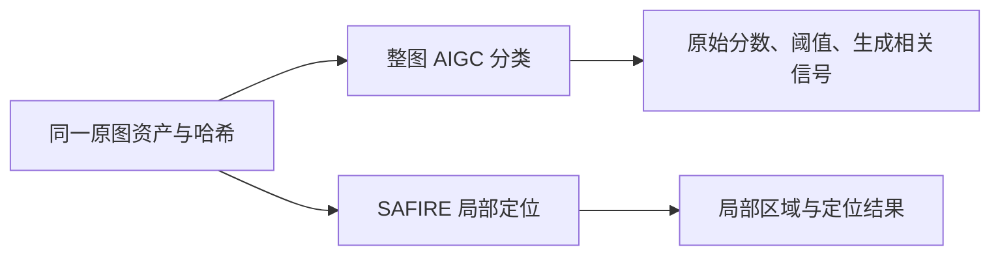

# Clear 整图 AIGC 检测：实施与真实评测报告

生成时间：2026-10-23T07:31:04.620381+00:00。本报告由固定证据生成，准确性资格状态为 **实验能力／未通过完整验收**。公开集结果不构成真实业务准确率声明。

已交付独立整图分类分支、三个可复用预训练适配器及候选页面，保留 SAFIRE 局部定位。生成文档样本缺失、生成器多样性不足及来源独立性限制阻止正式能力资格；工程成功记录不替代这些缺项。

## 交付与边界

| 项目 | 实际交付 |
|---|---|
| 源代码提交 | a50f8751127dcf897e65bd86a8cca9cf91e25bc4 |
| 候选 | F:\OCR\output\aigc-image-detection-20261022\delivery\Clear-0.19.0-aigc-image-candidate-001 |
| 页面 | /apps/forensics/aigc；Agent 工具 aigc_image_analyze；kind=aigc_image |
| 选择结果 | community_forensics384；No whole-generated document development samples; retain predeclared engineering default, without a document-recall winner claim |
| 资格 | 实验能力；不进入默认审计判断；不合成真实性总分 |
| 正式发行登记 | 9d0e94a797502d8a1fb732ddae88cdad6c58db5d49bdcb13695e3bdcbef71833；与基线逐字节哈希一致 |
| 独立候选服务 | http://127.0.0.1:8990；实际 health 为 service=ready，2026-10-23T07:25:01.3788825Z |
| 正式切换 | 未执行；独立候选端口 8990，恢复验证使用 8991 |



分数方向与预处理身份固定，原始分数不显示为 AI 生成概率；未检出不等于真实。无有效校准时阈值为空并返回无法判断。整图分类不生成定位热图；两条分支分别复核和导出。

独立候选最终服务检查见 [candidate-final-health.json](F:/OCR/output/aigc-image-detection-20261022/evidence/candidate-final-health.json)，记录了端口监听 PID 与封存候选、隔离 DATA 及创建时间匹配。health 只有 service=ready，ui／cpu／gpu／models 仍为 unknown；该检查不单独证明模型就绪，模型资格以实际 CUDA 推理和 API 证据为准。8991 仅用于恢复回读，验证后已停止；原 8990 候选保持运行。

## 来源、隔离与缺口

**本报告的主成绩采用许可允许的独立视图。** 原始冻结输入与已产生的原始分数作为实验历史保存；主成绩不沿用包含受限底图的统计分母。派生版本不增加独立来源数；来源记录数可能包含同组原图及局部编辑。主视图来源记录哈希：`d6ea01d619d55a72d2d4cebfb9964991d74cd53bdca360c08b75164400040a8c`。

| 范围 | 来源记录 | 独立来源组 | 变换记录 |
|---|---|---|---|
| 原始冻结／准备历史 | 6099 | 5599 | 30495 |
| 许可允许主视图 | 5329 | 5214 | 26645 |
| 剔除的受限／待核组 | 770 | 385 | 3850 |

原始工程准备记录 30,495/30,495 行就绪，失败 0、待处理 0；原始 30,495 文件及回执完整核验的证据保留。许可允许主视图继承相同像素与变换，状态为 {"ready": 26645, "pending_screenshot": 0, "failed": 0}。输入准备成功不表示模型验收通过。

| 集合／域／标签 | 原始记录 | 许可允许主记录 |
|---|---|---|
| calibration/document/normal | 1000 | 1000 |
| calibration/general/normal | 1000 | 1000 |
| development/document/normal | 100 | 100 |
| development/general/generated | 400 | 400 |
| development/general/local_edit | 100 | 21 |
| development/general/normal | 300 | 221 |
| test/document/normal | 1000 | 1000 |
| test/general/generated | 400 | 400 |
| test/general/local_edit | 400 | 94 |
| test/general/normal | 1399 | 1093 |

| 计划目标 | 要求独立组 | 许可允许独立组 | 缺口 |
|---|---|---|---|
| development/normal | 400 | 321 | 79 |
| development/generated | 400 | 400 | 0 |
| development/local_edit | 100 | 21 | 79 |
| calibration/document/normal | 1000 | 1000 | 0 |
| calibration/general/normal | 1000 | 1000 | 0 |
| test/document/normal | 1000 | 1000 | 0 |
| test/general/normal | 1000 | 1093 | 0 |
| test/document/generated | 800 | 0 | 800 |
| test/general/generated | 400 | 400 | 0 |
| test/local_edit | 400 | 94 | 306 |

**生成文档共 0 张，无法验证文档生成召回。** 整图生成器记录为 stable-diffusion-diffusiondb（1/6）；仅终测生成器 0/2。

公开数据许可：DocLayNet 为 CDLA-Permissive-1.0；DiffusionDB 为 CC0。MagicBrush 数据集自身为 CC BY 4.0，但这不能替代其底层 COCO 照片权利。逐图 COCO 元数据与来源 URL 已保存，摄影者展示名及元数据发布后的权利变化未独立确证；可用元数据也不是独立法律权利裁定。未读取业务资料，未将程序绘制文档或人工改图冒充生成模型样本。

| MagicBrush 底图许可分类 | 原始来源组数 |
|---|---|
| BY | 75 |
| BY-SA | 40 |
| NC | 360 |
| ND | 24 |
| other_requires_review | 1 |

500 个 MagicBrush 底图来源组中，仅 115 个有明确 BY／BY-SA 证据；385 个 NC／ND／其他待核来源组从验收统计剔除。原始输入、原始分数与审计清单保留，不用许可筛选改写原始成绩；筛选不依赖模型分数。许可允许统计的局部编辑开发／终测来源数分别为 21／94，低于计划 100／400。

许可审计发生在最初冻结之后，首两个候选的原始开发推理已有分数；这是事后纠正许可范围，并非事先按这些许可采样。纠正使用发布的许可与来源组，无模型分数参与、无新抽样或划分、无新图片与变换；前两候选分数只按确切允许键投影，第三候选与终测直接运行允许视图。主开发／校准每候选 13,710 行，主终测 12,935 行。原始受限媒体及其编辑衍生图不进入验收或候选再分发。

来源组隔离、原件 SHA-256 和感知候选检查已经记录，但不证明文档模板或语义提示词家族独立；归一化精确提示词哈希只能排查相同文本。中文文档覆盖、检测器原训练数据重叠尚未确证。真实扫描、中文票据与手机拍屏能力均不能由本轮公开样本外推。

感知检查：{"input_records": 6099, "output_records": 6099, "pixel_comparisons": 225, "cross_split_candidates": 126, "pruned_records": 0, "unresolved_candidates": 225}。低距离 dHash 是待审候选；严格全 RGB 检查未确认更多重复不代表已完成模板独立性复核。

- test/document/generated: independent source deficit 800
- Whole-generation generators 1/6; generator diversity incomplete
- Holdout-only whole-generation generators 0/2
- No publicly licensed generated-document samples; document generation recall cannot be accepted
- Original detector training-data overlap remains unknown
- Document template independence and Chinese-document coverage not independently established
- Unresolved perceptual similarity candidates require manual source/template independence review
- MagicBrush masks are requested-edit support proxies (alpha<128), not exact changed-pixel ground truth; SAFIRE localization metrics must carry this limitation
- DiffusionDB prompt_family currently hashes normalized exact prompt text; semantic prompt-family isolation across splits is not established
- development/normal: eligible independent source deficit 79
- development/local_edit: eligible independent source deficit 79
- test/document/generated: eligible independent source deficit 800
- test/local_edit: eligible independent source deficit 306
- This corrects license eligibility after the original freeze; it is not a claim that the original sampling was prospectively restricted to these licenses.
- MagicBrush dataset licensing does not replace original COCO photograph rights; excluded originals and edited derivatives stay outside acceptance and redistribution.
- Public-source URLs and published license metadata are retained; this is not an independent determination of legal rights.
- All earlier experimental inputs and raw scores remain unchanged; their metrics must be distinguished from these acceptance views.
- Template-family independence is unverified
- Only one whole-image generator is available
- Chinese document capability is unverified
- No business data has been evaluated
- Development source targets incomplete; no qualified product selection
- document/original: holdout source targets incomplete
- document/original: recall target not met
- document/jpeg90: holdout source targets incomplete
- document/jpeg90: recall target not met
- document/jpeg70: holdout source targets incomplete
- document/jpeg70: recall target not met
- document/half_jpeg70: holdout source targets incomplete
- document/half_jpeg70: recall target not met
- document/screenshot: holdout source targets incomplete
- document/screenshot: recall target not met
- general/worst_transform: normal-source FPR upper bound exceeds 1% or unavailable
- At least six generators and two holdout-only generators required
- Local-edit holdout source target incomplete
- Document template-family independence was not established
- No Chinese document capability claim can be made
- Public data does not validate business accuracy
- DiffusionDB prompt keyword filtering limits content representativeness
- MagicBrush masks describe requested edit support rather than exact changed-pixel boundaries

## 校准与候选比较

产品阈值为 **0.17296947538852692**，比较方式为严格 `score > threshold`（等于阈值不检出）。校准目标误报率 0.50%；每个正常来源先取五种变换的最大生成信号，再取两域更保守的共同阈值。阈值记录 `c8662fd11f17a0d44767cb04b360e9acf405023e3219ae1162535fe5117435a3`；模型选择记录 `2e0e0f666ac185eda8d9d38ae8589fbd6fecccc52e2e226b62afe28558b6ec1a`。终测未用于选模型或调阈值。

| 校准域 | 完整正常来源组 | 该域阈值 | 经验误报率 |
|---|---|---|---|
| document | 1000 | 0.018920209258794785 | 0.50% |
| general | 1000 | 0.17296947538852692 | 0.50% |

| 候选 | 开发组 | 生成来源组 | 召回 | 观察误报 | 失败／拒判 |
|---|---|---|---|---|---|
| community_forensics384 | document/half_jpeg70 | 0 | — | 0.00% | 0 |
| community_forensics384 | document/jpeg70 | 0 | — | 0.00% | 0 |
| community_forensics384 | document/jpeg90 | 0 | — | 0.00% | 0 |
| community_forensics384 | document/original | 0 | — | 0.00% | 0 |
| community_forensics384 | document/screenshot | 0 | — | 0.00% | 0 |
| community_forensics384 | general/half_jpeg70 | 400 | 56.00% | 0.90% | 0 |
| community_forensics384 | general/jpeg70 | 400 | 96.50% | 0.90% | 0 |
| community_forensics384 | general/jpeg90 | 400 | 98.50% | 0.45% | 0 |
| community_forensics384 | general/original | 400 | 99.00% | 0.00% | 0 |
| community_forensics384 | general/screenshot | 400 | 99.00% | 0.00% | 0 |
| spai | document/half_jpeg70 | 0 | — | 0.00% | 0 |
| spai | document/jpeg70 | 0 | — | 0.00% | 0 |
| spai | document/jpeg90 | 0 | — | 0.00% | 0 |
| spai | document/original | 0 | — | 0.00% | 0 |
| spai | document/screenshot | 0 | — | 0.00% | 0 |
| spai | general/half_jpeg70 | 400 | 0.00% | 0.00% | 0 |
| spai | general/jpeg70 | 400 | 0.00% | 0.00% | 0 |
| spai | general/jpeg90 | 400 | 0.00% | 0.00% | 0 |
| spai | general/original | 400 | 0.00% | 0.00% | 0 |
| spai | general/screenshot | 400 | 0.00% | 0.00% | 0 |
| univfd | document/half_jpeg70 | 0 | — | 0.00% | 0 |
| univfd | document/jpeg70 | 0 | — | 0.00% | 0 |
| univfd | document/jpeg90 | 0 | — | 0.00% | 0 |
| univfd | document/original | 0 | — | 0.00% | 0 |
| univfd | document/screenshot | 0 | — | 0.00% | 0 |
| univfd | general/half_jpeg70 | 400 | 4.75% | 0.00% | 0 |
| univfd | general/jpeg70 | 400 | 12.00% | 0.00% | 0 |
| univfd | general/jpeg90 | 400 | 10.00% | 0.00% | 0 |
| univfd | general/original | 400 | 26.00% | 0.00% | 0 |
| univfd | general/screenshot | 400 | 26.00% | 0.00% | 0 |

文档开发集没有生成正例时，不能按该域召回声称胜出；保留预先声明的工程默认候选。三个引擎不会同时作为产品评分集成，不融合分数，不做生成器归因。

## 独立终测

隔夜会话恢复检查时，最初的 `holdout-community-forensics-001` 目录为空，没有保存的请求、逐图分数或尝试日志；未观察到该任务进程，共享 GPU 账本 owner 与 pending 均为空。保留空目录与恢复回执，使用新目录 `holdout-community-forensics-002` 开展终测，未按分数挑选重跑。该证据只说明恢复时的可观察状态，不反推中断原因或不可观察的历史 GPU 活动。恢复回执见 [holdout-001-interruption-receipt.json](F:/OCR/output/aigc-image-detection-20261022/evidence/holdout-001-interruption-receipt.json)。

观察误报率以正常图观测数为分母；单侧 95% 误报上界按来源组计算，并将失败／拒判计入保守错误数。worst_transform 行汇总同来源五版，五版不能作为独立样本。生成召回包含失败／拒判且不能把它们当成功；召回置信区间按来源组 bootstrap。AUROC／AUPRC 仅在成功评分子集上计算，不能代替完整分母的验收指标。

| 域／版本 | 正常图观测 | 正常来源组 | 误报 | 观察误报率 | 组级上界95% | 生成图 | 检出 | 来源均衡召回 | 召回CI95% | 失败／总数 |
|---|---|---|---|---|---|---|---|---|---|---|
| document/half_jpeg70 | 1000 | 1000 | 1 | 0.10% | 0.47% | 0 | 0 | — | — | 0/1000 |
| document/jpeg70 | 1000 | 1000 | 0 | 0.00% | 0.30% | 0 | 0 | — | — | 0/1000 |
| document/jpeg90 | 1000 | 1000 | 0 | 0.00% | 0.30% | 0 | 0 | — | — | 0/1000 |
| document/original | 1000 | 1000 | 0 | 0.00% | 0.30% | 0 | 0 | — | — | 0/1000 |
| document/screenshot | 1000 | 1000 | 0 | 0.00% | 0.30% | 0 | 0 | — | — | 0/1000 |
| document/worst_transform | 5000 | 1000 | 1 | 0.02% | 0.47% | 0 | 0 | — | — | 0/5000 |
| general/half_jpeg70 | 1093 | 1093 | 6 | 0.55% | 1.08% | 400 | 239 | 59.75% | [55.00%, 64.50%] | 0/1587 |
| general/jpeg70 | 1093 | 1093 | 7 | 0.64% | 1.20% | 400 | 383 | 95.75% | [93.50%, 97.50%] | 0/1587 |
| general/jpeg90 | 1093 | 1093 | 1 | 0.09% | 0.43% | 400 | 394 | 98.50% | [97.25%, 99.50%] | 0/1587 |
| general/original | 1093 | 1093 | 0 | 0.00% | 0.27% | 400 | 398 | 99.50% | [98.75%, 100.00%] | 0/1587 |
| general/screenshot | 1093 | 1093 | 1 | 0.09% | 0.43% | 400 | 398 | 99.50% | [98.75%, 100.00%] | 0/1587 |
| general/worst_transform | 5465 | 1093 | 15 | 0.27% | 1.88% | 2000 | 1812 | 90.60% | [89.25%, 91.85%] | 0/7935 |

| 域／版本 | AUROC | AUPRC | 成功排序数 | 局部编辑 | AIGC响应数 |
|---|---|---|---|---|---|
| document/half_jpeg70 | — | — | 1000 | 0 | 0 |
| document/jpeg70 | — | — | 1000 | 0 | 0 |
| document/jpeg90 | — | — | 1000 | 0 | 0 |
| document/original | — | — | 1000 | 0 | 0 |
| document/screenshot | — | — | 1000 | 0 | 0 |
| document/worst_transform | — | — | 5000 | 0 | 0 |
| general/half_jpeg70 | 0.9829 | 0.9574 | 1493 | 94 | 7 |
| general/jpeg70 | 0.9991 | 0.9977 | 1493 | 94 | 3 |
| general/jpeg90 | 0.9999 | 0.9998 | 1493 | 94 | 7 |
| general/original | 1.0000 | 0.9999 | 1493 | 94 | 13 |
| general/screenshot | 0.9999 | 0.9999 | 1493 | 94 | 13 |
| general/worst_transform | 0.9970 | 0.9936 | 7465 | 470 | 43 |

局部编辑 AIGC 响应单列，不混入整图生成召回，也不充当正常负例。数字截图由外部 Chromium 固定显示设置生成；截图能力不替代手机拍屏或印刷拍照验证。

原始截图准备历史为 6,099 张，其中 6,097 张原生 1:1、2 张下缩。许可允许主视图保留 5,329 张截图，5,327 张原生 1:1、2 张因最大显示宽度 1280 下缩，未放大；文档域 2,100 张全部 1:1。像素、回执与记录字典均沿用原冻结版本，未因许可过滤重做截图。固定视口 1280×900、DPR 1，版本记录为 {"155.0.8059.85": 5329}。这些是真实外部浏览器图片元素截图，但 1:1 抓取不能称为困难缩放鲁棒性测试。

该单一协议未覆盖任意网页／应用界面、叠层、边框、文字标注、操作系统或移动端截图流程、平台重编码与任意裁剪；也未覆盖手机拍屏、印刷拍照、扫描或真实业务文档。表中 screenshot 召回只适用于本次固定协议，不能推广到所有截图样式。截图来源、原始与保留视图关联及显示范围见 [eligible-screenshot-scope-receipt.json](F:/OCR/output/aigc-image-detection-20261022/data/eligible-screenshot-scope-receipt.json)。

## SAFIRE 局部编辑定位

MagicBrush masks mark requested DALL-E edit support via transparent alpha; they are not exact masks of every generated pixel change. Proxy overlap scores must not be called ground-truth tamper-detection accuracy or document accuracy.

| 版本 | 应有记录 | 来源组 | 成功 | 失败含缺失 | 全分母IoU | 全分母像素F1 | 成功条件IoU | 成功条件F1 |
|---|---|---|---|---|---|---|---|---|
| aggregate | 470 | 94 | 470 | 0 | 0.0738 | 0.1035 | 0.0738 | 0.1035 |
| half_jpeg70 | 94 | 94 | 94 | 0 | 0.0059 | 0.0093 | 0.0059 | 0.0093 |
| jpeg70 | 94 | 94 | 94 | 0 | 0.0581 | 0.0862 | 0.0581 | 0.0862 |
| jpeg90 | 94 | 94 | 94 | 0 | 0.0817 | 0.1145 | 0.0817 | 0.1145 |
| original | 94 | 94 | 94 | 0 | 0.1118 | 0.1538 | 0.1118 | 0.1538 |
| screenshot | 94 | 94 | 94 | 0 | 0.1118 | 0.1538 | 0.1118 | 0.1538 |

主结果将缺失、失败或无效定位计零，来源宏平均及来源组 bootstrap CI 见原始报告。成功条件均值仅用于定位失败诊断，不作为验收成绩。请求编辑支持区域代理限制阻止把这些数字描述为精确改动像素的真实性定位能力。

## 资源、离线与异常证据

| 引擎 | 整次成功 | 父进程端到端秒 | worker秒 | 推理秒 | 峰值预留MiB | 清理确认 | 网络策略 |
|---|---|---|---|---|---|---|---|
| community_forensics384 | True | 13.235 | 7.640 | 0.140 | 116.00 | True | all_outbound_connections_denied |
| spai | True | 64.922 | 15.063 | 0.719 | 2152.00 | True | all_outbound_connections_denied |
| univfd | True | 20.844 | 13.765 | 0.235 | 1710.00 | True | all_outbound_connections_denied |

8MP 同一公开工程图的持久进程热运行 30/30 成功，P95 0.165 秒；只反映固定工程输入和记录计时边界，不反映准确率或产品全链路延迟。资源目标为预留显存 ≤12 GiB；热运行 P95 ≤15 秒；冷启动十次 P95 ≤60 秒须按下面实际计时定义判断。

冷启动原始摘要（保留测量边界、失败和实际样本数）：

```json
{
  "format": "clear-aigc-cold10-performance-v1",
  "attempt": "final-001-cold",
  "finalized": true,
  "engine": "community_forensics384",
  "expected": 10,
  "attempted": 10,
  "fresh_processes_started": 10,
  "finished_parents": 10,
  "succeeded": 10,
  "failed": 0,
  "censored": 0,
  "not_attempted": 0,
  "status": "passed",
  "p95_seconds": 33.266000000000076,
  "quantile_method": "nearest_rank",
  "timing_scope": "fresh qualifier parent launch through full exit, including binding verification and worker cleanup",
  "p95_policy": "only all ten whole attempts succeeding produce a P95; no successful-subset P95",
  "peak_reserved_memory_mib": 116.0,
  "p95_target_seconds": 60,
  "reserved_memory_target_mib": 12288,
  "passed": true,
  "safety_stop": null,
  "observations": [
    {
      "phase": "performance-cf-cold-01-final-001-cold",
      "returncode": 0,
      "parent_end_to_end_seconds": 33.266000000000076,
      "parent_pid": 12728,
      "parent_finished": true,
      "receipt": "F:\\OCR\\output\\aigc-image-detection-20261022\\evidence\\performance-cf-cold-01-final-001-cold\\receipt.json",
      "outcome": {
        "status": "succeeded",
        "returncode": 0,
        "error": null,
        "elapsed_seconds": 8.170999999999822
      },
      "cleanup_confirmed": true,
      "actual_device": "cuda",
      "worker_seconds": 8.171,
      "local_gpu_qualified": true,
      "performance": {
        "load_seconds": 1.312,
        "feature_batch_size": 32,
        "peak_memory_mib": 105.36,
        "peak_reserved_memory_mib": 116.0,
        "inference_seconds": 0.141
      },
      "receipt_error": null,
      "cancel_injected_after_gpu_load": false,
      "engineering_timeout_cancelled": false,
      "completion_time_lower_bound_seconds": null,
      "timeout_parent_termination": null,
      "unresolved_shared_ledger": null,
      "ledger_before": {
        "generation": 23,
        "owner_request_id": null,
        "owner": null,
        "expires_at": null,
        "pending": [],
        "ledger": "F:\\OCR\\output\\ai-audit-product-dev-20261004\\workspace\\gpu.sqlite3",
        "observed_unix": 1792737913.081793
      },
      "ledger_after": {
        "generation": 24,
        "owner_request_id": null,
        "owner": null,
        "expires_at": null,
        "pending": [],
        "ledger": "F:\\OCR\\output\\ai-audit-product-dev-20261004\\workspace\\gpu.sqlite3",
        "observed_unix": 1792737946.3372734
      }
    },
    {
      "phase": "performance-cf-cold-02-final-001-cold",
      "returncode": 0,
      "parent_end_to_end_seconds": 13.625,
      "parent_pid": 24492,
      "parent_finished": true,
      "receipt": "F:\\OCR\\output\\aigc-image-detection-20261022\\evidence\\performance-cf-cold-02-final-001-cold\\receipt.json",
      "outcome": {
        "status": "succeeded",
        "returncode": 0,
        "error": null,
        "elapsed_seconds": 8.077999999999975
      },
      "cleanup_confirmed": true,
      "actual_device": "cuda",
      "worker_seconds": 8.078,
      "local_gpu_qualified": true,
      "performance": {
        "load_seconds": 1.297,
        "feature_batch_size": 32,
        "peak_memory_mib": 105.36,
        "peak_reserved_memory_mib": 116.0,
        "inference_seconds": 0.156
      },
      "receipt_error": null,
      "cancel_injected_after_gpu_load": false,
      "engineering_timeout_cancelled": false,
      "completion_time_lower_bound_seconds": null,
      "timeout_parent_termination": null,
      "unresolved_shared_ledger": null,
      "ledger_before": {
        "generation": 24,
        "owner_request_id": null,
        "owner": null,
        "expires_at": null,
        "pending": [],
        "ledger": "F:\\OCR\\output\\ai-audit-product-dev-20261004\\workspace\\gpu.sqlite3",
        "observed_unix": 1792737946.3462803
      },
      "ledger_after": {
        "generation": 25,
        "owner_request_id": null,
        "owner": null,
        "expires_at": null,
        "pending": [],
        "ledger": "F:\\OCR\\output\\ai-audit-product-dev-20261004\\workspace\\gpu.sqlite3",
        "observed_unix": 1792737959.9764569
      }
    },
    {
      "phase": "performance-cf-cold-03-final-001-cold",
      "returncode": 0,
      "parent_end_to_end_seconds": 13.625,
      "parent_pid": 32052,
      "parent_finished": true,
      "receipt": "F:\\OCR\\output\\aigc-image-detection-20261022\\evidence\\performance-cf-cold-03-final-001-cold\\receipt.json",
      "outcome": {
        "status": "succeeded",
        "returncode": 0,
        "error": null,
        "elapsed_seconds": 8.030999999999949
      },
      "cleanup_confirmed": true,
      "actual_device": "cuda",
      "worker_seconds": 8.047,
      "local_gpu_qualified": true,
      "performance": {
        "load_seconds": 1.312,
        "feature_batch_size": 32,
        "peak_memory_mib": 105.36,
        "peak_reserved_memory_mib": 116.0,
        "inference_seconds": 0.141
      },
      "receipt_error": null,
      "cancel_injected_after_gpu_load": false,
      "engineering_timeout_cancelled": false,
      "completion_time_lower_bound_seconds": null,
      "timeout_parent_termination": null,
      "unresolved_shared_ledger": null,
      "ledger_before": {
        "generation": 25,
        "owner_request_id": null,
        "owner": null,
        "expires_at": null,
        "pending": [],
        "ledger": "F:\\OCR\\output\\ai-audit-product-dev-20261004\\workspace\\gpu.sqlite3",
        "observed_unix": 1792737959.9784577
      },
      "ledger_after": {
        "generation": 26,
        "owner_request_id": null,
        "owner": null,
        "expires_at": null,
        "pending": [],
        "ledger": "F:\\OCR\\output\\ai-audit-product-dev-20261004\\workspace\\gpu.sqlite3",
        "observed_unix": 1792737973.6094794
      }
    },
    {
      "phase": "performance-cf-cold-04-final-001-cold",
      "returncode": 0,
      "parent_end_to_end_seconds": 13.625,
      "parent_pid": 10228,
      "parent_finished": true,
      "receipt": "F:\\OCR\\output\\aigc-image-detection-20261022\\evidence\\performance-cf-cold-04-final-001-cold\\receipt.json",
      "outcome": {
        "status": "succeeded",
        "returncode": 0,
        "error": null,
        "elapsed_seconds": 8.108999999999924
      },
      "cleanup_confirmed": true,
      "actual_device": "cuda",
      "worker_seconds": 8.109,
      "local_gpu_qualified": true,
      "performance": {
        "load_seconds": 1.297,
        "feature_batch_size": 32,
        "peak_memory_mib": 105.36,
        "peak_reserved_memory_mib": 116.0,
        "inference_seconds": 0.156
      },
      "receipt_error": null,
      "cancel_injected_after_gpu_load": false,
      "engineering_timeout_cancelled": false,
      "completion_time_lower_bound_seconds": null,
      "timeout_parent_termination": null,
      "unresolved_shared_ledger": null,
      "ledger_before": {
        "generation": 26,
        "owner_request_id": null,
        "owner": null,
        "expires_at": null,
        "pending": [],
        "ledger": "F:\\OCR\\output\\ai-audit-product-dev-20261004\\workspace\\gpu.sqlite3",
        "observed_unix": 1792737973.6114793
      },
      "ledger_after": {
        "generation": 27,
        "owner_request_id": null,
        "owner": null,
        "expires_at": null,
        "pending": [],
        "ledger": "F:\\OCR\\output\\ai-audit-product-dev-20261004\\workspace\\gpu.sqlite3",
        "observed_unix": 1792737987.242317
      }
    },
    {
      "phase": "performance-cf-cold-05-final-001-cold",
      "returncode": 0,
      "parent_end_to_end_seconds": 13.827999999999975,
      "parent_pid": 25316,
      "parent_finished": true,
      "receipt": "F:\\OCR\\output\\aigc-image-detection-20261022\\evidence\\performance-cf-cold-05-final-001-cold\\receipt.json",
      "outcome": {
        "status": "succeeded",
        "returncode": 0,
        "error": null,
        "elapsed_seconds": 8.188000000000102
      },
      "cleanup_confirmed": true,
      "actual_device": "cuda",
      "worker_seconds": 8.188,
      "local_gpu_qualified": true,
      "performance": {
        "load_seconds": 1.312,
        "feature_batch_size": 32,
        "peak_memory_mib": 105.36,
        "peak_reserved_memory_mib": 116.0,
        "inference_seconds": 0.141
      },
      "receipt_error": null,
      "cancel_injected_after_gpu_load": false,
      "engineering_timeout_cancelled": false,
      "completion_time_lower_bound_seconds": null,
      "timeout_parent_termination": null,
      "unresolved_shared_ledger": null,
      "ledger_before": {
        "generation": 27,
        "owner_request_id": null,
        "owner": null,
        "expires_at": null,
        "pending": [],
        "ledger": "F:\\OCR\\output\\ai-audit-product-dev-20261004\\workspace\\gpu.sqlite3",
        "observed_unix": 1792737987.24376
      },
      "ledger_after": {
        "generation": 28,
        "owner_request_id": null,
        "owner": null,
        "expires_at": null,
        "pending": [],
        "ledger": "F:\\OCR\\output\\ai-audit-product-dev-20261004\\workspace\\gpu.sqlite3",
        "observed_unix": 1792738001.0747662
      }
    },
    {
      "phase": "performance-cf-cold-06-final-001-cold",
      "returncode": 0,
      "parent_end_to_end_seconds": 13.827999999999975,
      "parent_pid": 27476,
      "parent_finished": true,
      "receipt": "F:\\OCR\\output\\aigc-image-detection-20261022\\evidence\\performance-cf-cold-06-final-001-cold\\receipt.json",
      "outcome": {
        "status": "succeeded",
        "returncode": 0,
        "error": null,
        "elapsed_seconds": 8.108999999999924
      },
      "cleanup_confirmed": true,
      "actual_device": "cuda",
      "worker_seconds": 8.109,
      "local_gpu_qualified": true,
      "performance": {
        "load_seconds": 1.312,
        "feature_batch_size": 32,
        "peak_memory_mib": 105.36,
        "peak_reserved_memory_mib": 116.0,
        "inference_seconds": 0.141
      },
      "receipt_error": null,
      "cancel_injected_after_gpu_load": false,
      "engineering_timeout_cancelled": false,
      "completion_time_lower_bound_seconds": null,
      "timeout_parent_termination": null,
      "unresolved_shared_ledger": null,
      "ledger_before": {
        "generation": 28,
        "owner_request_id": null,
        "owner": null,
        "expires_at": null,
        "pending": [],
        "ledger": "F:\\OCR\\output\\ai-audit-product-dev-20261004\\workspace\\gpu.sqlite3",
        "observed_unix": 1792738001.0777678
      },
      "ledger_after": {
        "generation": 29,
        "owner_request_id": null,
        "owner": null,
        "expires_at": null,
        "pending": [],
        "ledger": "F:\\OCR\\output\\ai-audit-product-dev-20261004\\workspace\\gpu.sqlite3",
        "observed_unix": 1792738014.9119961
      }
    },
    {
      "phase": "performance-cf-cold-07-final-001-cold",
      "returncode": 0,
      "parent_end_to_end_seconds": 13.625,
      "parent_pid": 23832,
      "parent_finished": true,
      "receipt": "F:\\OCR\\output\\aigc-image-detection-20261022\\evidence\\performance-cf-cold-07-final-001-cold\\receipt.json",
      "outcome": {
        "status": "succeeded",
        "returncode": 0,
        "error": null,
        "elapsed_seconds": 8.047000000000025
      },
      "cleanup_confirmed": true,
      "actual_device": "cuda",
      "worker_seconds": 8.047,
      "local_gpu_qualified": true,
      "performance": {
        "load_seconds": 1.312,
        "feature_batch_size": 32,
        "peak_memory_mib": 105.36,
        "peak_reserved_memory_mib": 116.0,
        "inference_seconds": 0.141
      },
      "receipt_error": null,
      "cancel_injected_after_gpu_load": false,
      "engineering_timeout_cancelled": false,
      "completion_time_lower_bound_seconds": null,
      "timeout_parent_termination": null,
      "unresolved_shared_ledger": null,
      "ledger_before": {
        "generation": 29,
        "owner_request_id": null,
        "owner": null,
        "expires_at": null,
        "pending": [],
        "ledger": "F:\\OCR\\output\\ai-audit-product-dev-20261004\\workspace\\gpu.sqlite3",
        "observed_unix": 1792738014.9139967
      },
      "ledger_after": {
        "generation": 30,
        "owner_request_id": null,
        "owner": null,
        "expires_at": null,
        "pending": [],
        "ledger": "F:\\OCR\\output\\ai-audit-product-dev-20261004\\workspace\\gpu.sqlite3",
        "observed_unix": 1792738028.545616
      }
    },
    {
      "phase": "performance-cf-cold-08-final-001-cold",
      "returncode": 0,
      "parent_end_to_end_seconds": 13.625,
      "parent_pid": 5444,
      "parent_finished": true,
      "receipt": "F:\\OCR\\output\\aigc-image-detection-20261022\\evidence\\performance-cf-cold-08-final-001-cold\\receipt.json",
      "outcome": {
        "status": "succeeded",
        "returncode": 0,
        "error": null,
        "elapsed_seconds": 7.969000000000051
      },
      "cleanup_confirmed": true,
      "actual_device": "cuda",
      "worker_seconds": 7.969,
      "local_gpu_qualified": true,
      "performance": {
        "load_seconds": 1.297,
        "feature_batch_size": 32,
        "peak_memory_mib": 105.36,
        "peak_reserved_memory_mib": 116.0,
        "inference_seconds": 0.14
      },
      "receipt_error": null,
      "cancel_injected_after_gpu_load": false,
      "engineering_timeout_cancelled": false,
      "completion_time_lower_bound_seconds": null,
      "timeout_parent_termination": null,
      "unresolved_shared_ledger": null,
      "ledger_before": {
        "generation": 30,
        "owner_request_id": null,
        "owner": null,
        "expires_at": null,
        "pending": [],
        "ledger": "F:\\OCR\\output\\ai-audit-product-dev-20261004\\workspace\\gpu.sqlite3",
        "observed_unix": 1792738028.5476158
      },
      "ledger_after": {
        "generation": 31,
        "owner_request_id": null,
        "owner": null,
        "expires_at": null,
        "pending": [],
        "ledger": "F:\\OCR\\output\\ai-audit-product-dev-20261004\\workspace\\gpu.sqlite3",
        "observed_unix": 1792738042.1756034
      }
    },
    {
      "phase": "performance-cf-cold-09-final-001-cold",
      "returncode": 0,
      "parent_end_to_end_seconds": 13.639999999999873,
      "parent_pid": 27032,
      "parent_finished": true,
      "receipt": "F:\\OCR\\output\\aigc-image-detection-20261022\\evidence\\performance-cf-cold-09-final-001-cold\\receipt.json",
      "outcome": {
        "status": "succeeded",
        "returncode": 0,
        "error": null,
        "elapsed_seconds": 7.936999999999898
      },
      "cleanup_confirmed": true,
      "actual_device": "cuda",
      "worker_seconds": 7.937,
      "local_gpu_qualified": true,
      "performance": {
        "load_seconds": 1.281,
        "feature_batch_size": 32,
        "peak_memory_mib": 105.36,
        "peak_reserved_memory_mib": 116.0,
        "inference_seconds": 0.156
      },
      "receipt_error": null,
      "cancel_injected_after_gpu_load": false,
      "engineering_timeout_cancelled": false,
      "completion_time_lower_bound_seconds": null,
      "timeout_parent_termination": null,
      "unresolved_shared_ledger": null,
      "ledger_before": {
        "generation": 31,
        "owner_request_id": null,
        "owner": null,
        "expires_at": null,
        "pending": [],
        "ledger": "F:\\OCR\\output\\ai-audit-product-dev-20261004\\workspace\\gpu.sqlite3",
        "observed_unix": 1792738042.1776042
      },
      "ledger_after": {
        "generation": 32,
        "owner_request_id": null,
        "owner": null,
        "expires_at": null,
        "pending": [],
        "ledger": "F:\\OCR\\output\\ai-audit-product-dev-20261004\\workspace\\gpu.sqlite3",
        "observed_unix": 1792738055.8075671
      }
    },
    {
      "phase": "performance-cf-cold-10-final-001-cold",
      "returncode": 0,
      "parent_end_to_end_seconds": 13.625,
      "parent_pid": 20552,
      "parent_finished": true,
      "receipt": "F:\\OCR\\output\\aigc-image-detection-20261022\\evidence\\performance-cf-cold-10-final-001-cold\\receipt.json",
      "outcome": {
        "status": "succeeded",
        "returncode": 0,
        "error": null,
        "elapsed_seconds": 8.0
      },
      "cleanup_confirmed": true,
      "actual_device": "cuda",
      "worker_seconds": 8.0,
      "local_gpu_qualified": true,
      "performance": {
        "load_seconds": 1.297,
        "feature_batch_size": 32,
        "peak_memory_mib": 105.36,
        "peak_reserved_memory_mib": 116.0,
        "inference_seconds": 0.14
      },
      "receipt_error": null,
      "cancel_injected_after_gpu_load": false,
      "engineering_timeout_cancelled": false,
      "completion_time_lower_bound_seconds": null,
      "timeout_parent_termination": null,
      "unresolved_shared_ledger": null,
      "ledger_before": {
        "generation": 32,
        "owner_request_id": null,
        "owner": null,
        "expires_at": null,
        "pending": [],
        "ledger": "F:\\OCR\\output\\ai-audit-product-dev-20261004\\workspace\\gpu.sqlite3",
        "observed_unix": 1792738055.810072
      },
      "ledger_after": {
        "generation": 33,
        "owner_request_id": null,
        "owner": null,
        "expires_at": null,
        "pending": [],
        "ledger": "F:\\OCR\\output\\ai-audit-product-dev-20261004\\workspace\\gpu.sqlite3",
        "observed_unix": 1792738069.440705
      }
    }
  ],
  "scope": "8MP public example resized for resource engineering only; no accuracy qualification"
}
```

这十次分别使用新启动的 qualifier 父进程和原生 GPU worker，计时覆盖 qualifier 启动至完整退出，包含该流程的绑定校验、加载、推理及清理。计时不包含独立候选启动器的完整封包验证或 HTTP 服务启动延迟，不能据此声称整个应用在 33.266 秒内启动。测试之前已运行模型评测，Windows 系统文件缓存未主动清空；P95 33.266 秒仅符合本次新进程测量边界，不能宣称已验证断电、系统重启或清空磁盘缓存后的首次读取延迟。边界与每次进程身份见 [cold10-measurement-environment-final-001.json](F:/OCR/output/aigc-image-detection-20261022/evidence/cold10-measurement-environment-final-001.json)。

较早的 CF 开发首个父流程为 849.875 秒，worker 为 562.422 秒，差值 287.453 秒。该差值包含前置固定资产校验、调度／序列化及收尾等父流程开销，未作隔离计时，不能全部归因于纯哈希校验或已诊断根因；后续缓存条件下的较快记录不覆盖这个观察。原始 [父流程记录](F:/OCR/output/aigc-image-detection-20261022/results/development-calibration-001/sequence.json)、[worker 回执](F:/OCR/output/aigc-image-detection-20261022/results/development-calibration-001/community_forensics384/run-receipt.json) 及 [流程日志](F:/OCR/output/aigc-image-detection-20261022/logs/development-calibration-001.log) 均保留。

三候选官方预处理与适配器的同图 CPU 一致性记录：

| 引擎 | 分数绝对差 | 张量最大差 | 通过 |
|---|---|---|---|
| community_forensics384 | 0.0 | 0.0 | True |
| spai | 0.0 | 0.0 | True |
| univfd | 0.0 | 0.0 | True |

CPU 一致性只比较固定的 CF 官方仓库 `test_images/00000274.png` 一张工程图，共享解码后临时变为 448×448；三候选在该输入上的模型张量与评分差为零。该检查不证明任意图片、透明图或 EXIF 文件均与上游完整读图链一致，也不推断该工程图所属生成器。产品共享解码政策明确执行 EXIF 方向归正、将 alpha 合成白底，再保留各官方 RGB 模型变换；透明与 EXIF 读图链没有据此宣称未经对照的上游逐字节一致性。

冻结校准安装后的最终工程序列：

| 步骤／种类 | 父进程退出 | 父进程秒 | worker结果 | 清理确认 | 本机资格 | 整次成功 |
|---|---|---|---|---|---|---|
| qualify_safire_catnet/catnet | 0 | 18.438 | succeeded | True | True | True |
| qualify_safire_document_forensics/document_forensics | 0 | 18.640 | succeeded | True | True | True |
| qualify_cf/aigc_image | 0 | 13.235 | succeeded | True | True | True |

最终 CF 与 SAFIRE 的两个任务种类分别要求完整父进程、CUDA worker、清理和本机资格成立；失败及 retry01 均保留。实际研究 CLI 由共享账本调度，父进程与原生 worker 均成功；未标注的公开调用图不进入准确率统计。CLI 输出见 [cli-cuda-frozen-final-001.json](F:/OCR/output/aigc-image-detection-20261022/results/cli-cuda-frozen-final-001.json)，控制序列见 [control.json](F:/OCR/output/aigc-image-detection-20261022/evidence/post-evaluation-final-001/control.json)。

取消真实 GPU 的证据：`{"phase": "cancel-spai-gpu-005", "returncode": 2, "parent_end_to_end_seconds": 25.26599999999962, "receipt": "F:\\OCR\\output\\aigc-image-detection-20261022\\evidence\\cancel-spai-gpu-005\\receipt.json", "outcome": {"status": "cancelled", "returncode": null, "error": null, "elapsed_seconds": 11.671999999998661}, "cleanup_confirmed": true, "cancel_injected_after_gpu_load": true, "engineering_timeout_cancelled": false}`。产品 API 同一持久任务先取消第一代、清理检查后重试第二代，保持原件、公共模型身份与 CUDA：`{"before_cancel": {"status": "queued", "stage": "queued", "generation": 1}, "resumed_after_engineering_log_interruption": true, "control_responses_read_from_persistent_operations": true, "persisted_operation_evidence": "F:\\OCR\\output\\aigc-image-detection-20261022\\evidence\\api-persisted-operations-after-interruption-002.json", "persisted_operation_evidence_sha256": "e7d5222c862360894bb27c4e5c3bda212572bdc7b6d64381534726aab78f0b0f", "cancel_request": {"request_id": "engineeringCancel1792739141", "expected_generation": 1}, "cancel_trace": [{"status": "cancelling", "stage": "prepare", "generation": 1}, {"status": "cancelled", "stage": "cancelled", "generation": 1}], "persisted_cancelled": true, "generation_one_worker_started": true, "worker_ownership": {"format": "clear-gpu-owner-v1", "owner": {"requester": "manual", "launch_id": "manual9e45afda6b5145268d951683b4abc414", "instance_id": "manual229cde4bebd84d7fb7f52152e68c9ef7", "pid": 21256, "creation_time": "134372127555763012"}, "job_name": "Local\\ClearGpu-1a1e69444ad24ca494e9a826656ab181", "kill_on_close": true, "breakaway": false, "worker_epoch": "27fb6d687ff44538aa27dfb5a03f6c50", "job_id": "m5f56996d772744ddbb93d803371a0f5c", "generation": 1, "terminal_status": "cancelled", "process_tree_exited": true, "returncode": 1, "completed_at": 1792739156.0840874, "output_files": {}}, "cleanup_guard_admitted_retry": true, "retry_request": {"request_id": "engineeringSameJobRetry1792739141", "expected_generation": 1}, "draining_conflicts": [], "retry_generation": 2, "same_job_input_model_and_device": true, "no_new_cancel_or_retry_requested_during_final_continuation": true}`。取消发生在原生进程启动前时单独标记，不冒充加载后 GPU 取消测试。

保留失败／停止尝试：

| 尝试 | 实际原因 |
|---|---|
| qualify-spai-001 | Parent-authorized preflight stop after 348.86 seconds; no shared GPU request existed |
| qualify-univfd-002 | Bounded 180.391-second preflight timeout; no GPU request |
| qualify-univfd-003 | Native CUDA worker succeeded and cleaned up, but qualifier parent exited C0000005 during GPU binding hash/path resolution at the first 30-second faulthandler timer; whole attempt failed |
| retry-after-cancel-cf-005 | Bounded 180.297-second preflight hash-read timeout under concurrent dataset/browser I/O; no GPU request |

其中 UnivFD 父进程 C0000005 属整次失败，即使子进程成功且清理。首次诊断定时器与异常发生重合不构成已证实根因。资源／哈希预检超时和数据／浏览器并发 I/O 同样保留，不归零或以成功重跑覆盖。

## 工程验证与恢复

首次真实 API 工程脚本在输出取消进度日志时出现 `TypeError: emit() got multiple values for argument stage`，工程父脚本中断；原失败日志、当时脚本副本、取消状态及复核回执均保留。修正日志参数并增加匹配恢复入口后，严格沿用原 workspace、job、原件、模型绑定与 CUDA 设备，在确认第一代原生 worker 整棵进程树退出且账本为空后，继续同一持久任务的第二代重试与后续流程。没有以新任务替代同任务验证，没有修改封存产品或选择评分结果。此取消的 worker 已启动并退出，不据此声称模型已加载；加载后的真实 GPU 取消另见 SPAI 证据。原始失败见 [api-lifecycle-harness-interruption-001.json](F:/OCR/output/aigc-image-detection-20261022/evidence/api-lifecycle-harness-interruption-001.json)、[api-lifecycle-001.log](F:/OCR/output/aigc-image-detection-20261022/logs/api-lifecycle-001.log)；恢复运行见 [api-lifecycle-resume-002.log](F:/OCR/output/aigc-image-detection-20261022/logs/api-lifecycle-resume-002.log)。

第二段 API 工程脚本在两条实际 CUDA 任务均成功后，错误假定 SAFIRE 固定快照的 `model_identity` 内含 `engine`，触发 `KeyError`。实际历史 SAFIRE 快照使用权重哈希映射；验证脚本据此比对真实权重哈希、快照内容哈希及任务绑定，再沿用已经成功的 CF 第二代与 SAFIRE 任务完成剩余流程，不新发起推理、不增加 generation。真实持久库中的原始 create／cancel／retry 响应也逐项回读核验。第二次失败及脚本副本见 [api-lifecycle-harness-interruption-002.json](F:/OCR/output/aigc-image-detection-20261022/evidence/api-lifecycle-harness-interruption-002.json)、[api_lifecycle_smoke-before-safire-snapshot-fix-002.py](F:/OCR/output/aigc-image-detection-20261022/backups/api_lifecycle_smoke-before-safire-snapshot-fix-002.py)；最终续作日志见 [api-lifecycle-complete-003.log](F:/OCR/output/aigc-image-detection-20261022/logs/api-lifecycle-complete-003.log)，原始持久操作证据见 [api-persisted-operations-after-interruption-002.json](F:/OCR/output/aigc-image-detection-20261022/evidence/api-persisted-operations-after-interruption-002.json)。两次工程 helper 失败均计入验证经过，不能描述为首轮全部通过。

独立候选实际启动时，入口等待约 120 秒后返回 exit 1 并提示“启动尚未完成／未重复启动”；当时后台候选进程仍在、日志尚无输出，不能将入口等待超时等同于后台进程失败。后续只读进程检查观察到 CPU 时间和文件读取活动继续增加，尚无原生 GPU worker；读取字节数不是隔离的纯哈希计时，也不能据此给出单一耗时根因。持续检查真实 HTTP health，未重复启动或终止进程，待 health ready 才执行 API 验证。该实际启动观察、进展与后续就绪回执见 [startup-wait-observation-001.json](F:/OCR/output/aigc-image-detection-20261022/evidence/startup-wait-observation-001.json)、[startup-progress-observation-001.json](F:/OCR/output/aigc-image-detection-20261022/evidence/startup-progress-observation-001.json)、[startup-ready-observation-001.json](F:/OCR/output/aigc-image-detection-20261022/evidence/startup-ready-observation-001.json)。这也说明 qualifier 的新进程记录不代表独立候选完整启动时间。

最终只读代码复核见 [final-readonly-code-review.md](F:/OCR/output/aigc-image-detection-20261022/evidence/final-readonly-code-review.md)。该静态复核按冻结提交检查分派、历史绑定、读取能力、校准身份、取消及路径边界；结论只适用于记录的检查范围，不能替代下列实际 API、GPU、浏览器及恢复证据，也不改变准确率未通过的判定。

| 检查 | 实际证据 |
|---|---|
| Backend/contracts/Agent/legacy GPU dispatcher regression | 155 passed；7 subtests；354.85s；Run before final parallel hash/scandir optimization; no failures |
| Final AIGC contract/binding/tamper/pycache/source closure/compact API/history/dispatch tests | 20 passed；0 subtests；7.22s；After final production source freeze |
| SAFIRE proxy summary all-denominator/source-bootstrap correctness | 3 passed；0 subtests；2.02s； |

| 检查 | 实际结果 |
|---|---|
| 契约生成器 --check | passed |
| AIGC 页面测试 | Tests  11 passed (11) |
| 首次更广回归 | Tests  2 failed \| 44 passed (46) |
| 回归重跑 | Tests  1 failed \| 18 passed (19) |
| 显式 TypeScript 检查 | ["F:\\OCR\\output\\agent-harness-upgrade-20261015\\dependencies\\node-v24.22.0-win-x64\\node.exe", "F:\\OCR\\output\\frontend-workbench-20261015\\worktrees\\platform\\apps\\portal\\node_modules\\typescript\\bin\\tsc", "--project", "F:\\OCR\\output\\frontend-workbench-20261015\\worktrees\\platform\\apps\\portal\\tsconfig.json", "--noEmit", "--incremental", "--tsBuildInfoFile", "F:\\OCR\\output\\aigc-image-detection-20261022\\build\\portal-typecheck.tsbuildinfo"]；exit_code=0 |
| 生产构建 | Vite 日志包含成功 built in；警告见原始日志 |
| 原生图像入口测试 | 13 |
| 真实 API／导出／归集 | passed |
| 冷备份校验／恢复 | passed |
| 恢复数据 HTTP 回读 | passed |
| 旧读取程序 | True |

## 实际浏览器 UI 证据

首次外部浏览器工程 helper 用整块区域的正则检查，误将正确的“模型分数不是 AI 生成概率”免责声明识别为概率声明，验证失败；失败回执及截图均保留，浏览器已关闭。仅将 helper 改为分别核验正向结果摘要与独立免责声明，再对同一封存产品和实际 API 结果进行四视图验证；未修改产品或评分。首次失败见 [ui-smoke.json](F:/OCR/output/aigc-image-detection-20261022/evidence/ui-smoke.json)、[failure.png](F:/OCR/output/aigc-image-detection-20261022/evidence/ui-smoke/failure.png)。

外部 Chromium 对实际候选服务读取当前结果与固定历史快照，覆盖桌面和窄屏；未启动服务器或推理，浏览器已关闭。实际包哈希为 `9d3576bcfbe031bb8d1b488b15bd5b1e294ec85671a4b8c73a1c70c5c3d8ab4e`，页面构建哈希为 `b5191f0aceb1995762407292e373a08d9c2ebfa29c05a74e3b007f334a63dab2`。静态 node --check 与 11 个页面单测分别列证据，不能代替这次真实浏览器运行。

| 视图 | viewport／DPR | 横向宽度 | PNG尺寸 | 原始分数显示 | 预览SHA-256 | 实际截图 |
|---|---|---|---|---|---|---|
| aigc-current-desktop | [1440, 1000]/1 | 1440 | [1440, 1913] | 0.998781 | 2c0c111462e0b1fa027daf67518a36d6f976e29f3669378bd741e767734d51dd | [aigc-current-desktop.png](F:/OCR/output/aigc-image-detection-20261022/evidence/ui-smoke-002/aigc-current-desktop.png) |
| aigc-current-narrow | [390, 844]/1 | 390 | [390, 2946] | 0.998781 | 2c0c111462e0b1fa027daf67518a36d6f976e29f3669378bd741e767734d51dd | [aigc-current-narrow.png](F:/OCR/output/aigc-image-detection-20261022/evidence/ui-smoke-002/aigc-current-narrow.png) |
| aigc-frozen-desktop | [1440, 1000]/1 | 1440 | [1440, 1639] | 0.998781 | 2c0c111462e0b1fa027daf67518a36d6f976e29f3669378bd741e767734d51dd | [aigc-frozen-desktop.png](F:/OCR/output/aigc-image-detection-20261022/evidence/ui-smoke-002/aigc-frozen-desktop.png) |
| aigc-frozen-narrow | [390, 844]/1 | 390 | [390, 2547] | 0.998781 | 2c0c111462e0b1fa027daf67518a36d6f976e29f3669378bd741e767734d51dd | [aigc-frozen-narrow.png](F:/OCR/output/aigc-image-detection-20261022/evidence/ui-smoke-002/aigc-frozen-narrow.png) |

四个视图均核验实验能力说明、分数不为概率、同原图 SAFIRE 链接和无伪定位热图；当前与固定快照分别保持结果身份。截图实际文件 SHA-256、尺寸和视口与运行回执对应，截图哈希见证据索引。

保存截图的本地目视复核见 [ui-visual-qa-002.json](F:/OCR/output/aigc-image-detection-20261022/evidence/ui-visual-qa-002.json)；该记录为 Codex 工程视觉检查，不代表真人复核或真实性批准。390px 窄屏的共享历史表列有纵向换行，核心 AIGC 结果及固定快照控件仍可读，未为此扩改产品。

更广回归的历史失败与超时不会因 AIGC 定向测试通过而变成通过；原始日志包含的 React NaN 高度、分包体积等警告需保留。API 复核使用明确的自动工程夹具身份，不能视为人工签字或真实性批准。历史 SAFIRE／CAT-Net 任务保留原绑定和重试规则，不重算历史结果；缺少 aigc-image-v1 的旧读取能力被拒绝。

同一原图另建 SAFIRE 任务并返回独立结果：`{"job_id": "m8b5db5308abd43f7a93a407ac9b00a73", "kind": "document_forensics", "generation": 1, "result_hash": "e1c1e220bfc3f308d2e8569a7b31d8d3d68cf4be525ca4491130a401945442c8", "snapshot_id": "msab995925a6388e4ff0ea25c06e497a3a24e0b6062f133bd3", "snapshot_hash": "52c79046619a94b3f3fbaba2c2400a2844a2b643853e49135ef56302103e9e70", "source_sha256": "43a7b37d75eac6a04ab0b7b75655b7f12ea97f5de5055f6025b078a6cf36ba09", "device": "cuda", "engine": "safire", "snapshot_model_weight_hashes": {"safire": "65bdf6880380162d57f77d71b3fd367c3f16aebca316f942a821da16e9225b12", "sam": "ec2df62732614e57411cdcf32a23ffdf28910380d03139ee0f4fcbe91eb8c912"}, "reused_existing_succeeded_task": true, "independent_results": true, "aigc_result_unchanged": true}`。原 AIGC 结果与绑定不被覆盖。

已初始化隔离 DATA 在 8990 停止后使用标准平台备份与恢复流程处理；恢复实例 8991 回读原任务、固定快照及成果元数据，并实际下载 `result.json`，逐字节 SHA-256 与原成果相同，结果与模型身份保持一致。恢复下载证据见 [api-restored-artifact-result.json](F:/OCR/output/aigc-image-detection-20261022/evidence/api-restored-artifact-result.json)；恢复实例随后停止，原 8990 交付候选继续运行，清理与账本见 [restored-api-stopped-001.json](F:/OCR/output/aigc-image-detection-20261022/evidence/restored-api-stopped-001.json)。该流程未重新推理或创建新任务。

写入 AIGC 任务前的隔离 DATA 为未初始化目录，仅含资格与进程归属证据；预备份为明确标识的逐字节备份，未冒充标准已初始化平台备份。恢复到新目录后，实际旧版 0.18 读取描述（不包含 aigc-image-v1）兼容；原目录前后哈希一致且没有 AIGC 任务或读取能力标记。详见 [api-before-data-backup.json](F:/OCR/output/aigc-image-detection-20261022/evidence/api-before-data-backup.json)。这只证明隔离候选的回退证据，不是对业务 DATA 回退的验证。

原件、资产修订、权重、上游代码、运行时闭包、预处理与校准身份均固定。运行时封闭清单为 32572 文件、5479519711 字节。公开结果使用紧凑身份，私有数据保留完整绑定。显存不足只允许不改变评分语义的特征批量降低；仍失败则记录，不静默缩图或换模型。

## 许可、固定依赖与 F 盘边界

| 组件 | 版本／提交 | 许可 | 来源 |
|---|---|---|---|
| Community Forensics code | ee5b71d43db0f3779e1edd64ee927b13f2dd6ad4 | MIT | https://github.com/JeongsooP/Community-Forensics |
| Community Forensics 384 weights | 6076002bf0d9dd37537f965ee2f06f826c333b61 | MIT | https://huggingface.co/OwensLab/commfor-model-384 |
| SPAI code and weights | 8ff7b3b6779b4fcb43cf313471d9cb1c62d129a4 | Apache-2.0 | https://github.com/mever-team/spai |
| UniversalFakeDetect code and classifier head | 030495aea3300a8b54c0ec37ec7fe1dd7e63c619 | MIT | https://github.com/WisconsinAIVision/UniversalFakeDetect |
| OpenAI CLIP ViT-L/14 | b8cca3fd41ae0c99ba7e8951adf17d267cdb84cd88be6f7c2e0eca1737a03836 | MIT | https://github.com/openai/CLIP |
| einops | 0.8.1 | MIT | https://pypi.org/project/einops/0.8.1/ |
| ftfy | 6.3.1 | Apache-2.0 | https://pypi.org/project/ftfy/6.3.1/ |
| regex | 2025.11.3 | Apache-2.0 AND CNRI-Python | https://pypi.org/project/regex/2025.11.3/ |
| wcwidth | 0.2.14 | MIT | https://pypi.org/project/wcwidth/0.2.14/ |

固定推理运行时：`F:\OCR\output\aigc-image-detection-20261022\dependencies\runtime\python.exe`。导入根目录：

- `F:\OCR\output\aigc-image-detection-20261022\dependencies\python`
- `F:\OCR\output\aigc-image-detection-20261022\dependencies\runtime`
- `F:\OCR\release\Clear\versions\0.10.0\program\bundles\classification\runtimes\control\Lib\site-packages`
- `F:\OCR\release\Clear\versions\0.10.0\program\runtimes\catnet\Lib\site-packages`
- `F:\OCR\release\Clear\versions\0.10.0\program\runtimes\forensics\Lib\site-packages`

任务目录所有常规文件逻辑占用 19.219 GiB，90,596 文件；预算 30 GiB；生成报告前 F 盘空闲 223.537 GiB，要求至少 30 GiB。统计包含缓存、日志、样本、模型、备份、截图和候选；既有共享依赖只读复用并单独列路径，不计作任务内新复制。

| 任务子目录／文件 | GiB |
|---|---|
| RUNBOOK.md | 0.000 |
| aigc-inventory.json | 0.009 |
| aigc-licenses.json | 0.000 |
| backups | 0.089 |
| baseline | 0.000 |
| build | 0.006 |
| cache | 0.064 |
| data | 15.606 |
| delivery | 0.237 |
| dependencies | 0.099 |
| environment.ps1 | 0.000 |
| evidence | 0.380 |
| logs | 0.000 |
| models | 1.821 |
| results | 0.664 |
| runs | 0.156 |
| scripts | 0.000 |
| start-aigc.ps1 | 0.000 |
| start-restored-api.ps1 | 0.000 |
| temp | 0.045 |
| upstream | 0.041 |
| 启动整图AIGC实验候选.cmd | 0.000 |

全部项目产物、临时文件、缓存、浏览器 profile 与依赖在 F 盘；environment.ps1 设置子进程路径，不改写 HOME／CODEX_HOME。独立候选引用已固定 F 盘共享程序及模型，不能只复制候选文件夹后删除依赖。

## 资格判定与下一步

| 验收项 | 实际值 | 目标 | 结果 |
|---|---|---|---|
| document/source_any_transform_fpr_upper_95<=1% | 0.004734993575499861 | 0.01 | 通过 |
| document/original/fpr_upper_95<=1% | 0.002991249545095295 | 0.01 | 通过 |
| document/original/recall | — | 0.7 | 缺失／未通过 |
| document/original/failure<=1% | 0.0 | 0.01 | 通过 |
| document/jpeg90/fpr_upper_95<=1% | 0.002991249545095295 | 0.01 | 通过 |
| document/jpeg90/recall | — | 0.5 | 缺失／未通过 |
| document/jpeg90/failure<=1% | 0.0 | 0.01 | 通过 |
| document/jpeg70/fpr_upper_95<=1% | 0.002991249545095295 | 0.01 | 通过 |
| document/jpeg70/recall | — | 0.5 | 缺失／未通过 |
| document/jpeg70/failure<=1% | 0.0 | 0.01 | 通过 |
| document/half_jpeg70/fpr_upper_95<=1% | 0.004734993575499861 | 0.01 | 通过 |
| document/half_jpeg70/recall | — | 0.5 | 缺失／未通过 |
| document/half_jpeg70/failure<=1% | 0.0 | 0.01 | 通过 |
| document/screenshot/fpr_upper_95<=1% | 0.002991249545095295 | 0.01 | 通过 |
| document/screenshot/recall | — | 0.5 | 缺失／未通过 |
| document/screenshot/failure<=1% | 0.0 | 0.01 | 通过 |
| document/generated_sources | generated positives absent; recall cannot be accepted | 来源协议完整 | 缺失／未通过 |
| general/source_any_transform_fpr_upper_95<=1% | 0.0188435819679146 | 0.01 | 缺失／未通过 |
| general/original/fpr_upper_95<=1% | 0.0027370819929726235 | 0.01 | 通过 |
| general/original/recall | 0.995 | 0.7 | 通过 |
| general/original/failure<=1% | 0.0 | 0.01 | 通过 |
| general/jpeg90/fpr_upper_95<=1% | 0.0043327974904814395 | 0.01 | 通过 |
| general/jpeg90/recall | 0.985 | 0.5 | 通过 |
| general/jpeg90/failure<=1% | 0.0 | 0.01 | 通过 |
| general/jpeg70/fpr_upper_95<=1% | 0.011995563831135186 | 0.01 | 缺失／未通过 |
| general/jpeg70/recall | 0.9575 | 0.5 | 通过 |
| general/jpeg70/failure<=1% | 0.0 | 0.01 | 通过 |
| general/half_jpeg70/fpr_upper_95<=1% | 0.010805821617755725 | 0.01 | 缺失／未通过 |
| general/half_jpeg70/recall | 0.5975 | 0.5 | 通过 |
| general/half_jpeg70/failure<=1% | 0.0 | 0.01 | 通过 |
| general/screenshot/fpr_upper_95<=1% | 0.0043327974904814395 | 0.01 | 通过 |
| general/screenshot/recall | 0.995 | 0.5 | 通过 |
| general/screenshot/failure<=1% | 0.0 | 0.01 | 通过 |
| source_protocol_and_diversity | 数据协议缺口 | 来源协议完整 | 缺失／未通过 |

本轮只交付可运行实验候选与真实成绩。补齐具有许可与生成记录的文档正例、六生成器与两终测专属生成器、文档模板及提示词家族隔离后，必须另行冻结新开发／校准／终测协议；不得用这次终测反馈重调阈值并继续声称独立终测。真实业务适用性另行验证，正式发行切换另列任务。

## 原始证据索引

| 证据 | SHA-256 |
|---|---|
| [actual_ui_aigc-current-desktop](F:/OCR/output/aigc-image-detection-20261022/evidence/ui-smoke-002/aigc-current-desktop.png) | 08d343ebf7d6d6082e288c9f5ecd01350aece7258d9401c6129908d776544afe |
| [actual_ui_aigc-current-narrow](F:/OCR/output/aigc-image-detection-20261022/evidence/ui-smoke-002/aigc-current-narrow.png) | 261991e181acd72582610f109e2e7a4727c2eac37a6d9629c229f2bf24458f4e |
| [actual_ui_aigc-frozen-desktop](F:/OCR/output/aigc-image-detection-20261022/evidence/ui-smoke-002/aigc-frozen-desktop.png) | 386fe0ab338a96bb6bb3aef270eb208a98ed170673a67a9f4671f6156e4d37bb |
| [actual_ui_aigc-frozen-narrow](F:/OCR/output/aigc-image-detection-20261022/evidence/ui-smoke-002/aigc-frozen-narrow.png) | 59447643b788194cfc82a733351ce9469b093eb875dc3590ef1b75f54d3a10bb |
| [api](F:/OCR/output/aigc-image-detection-20261022/evidence/api-lifecycle.json) | b02f7815b8ab04a1e446b2c9457ed78f8b10b3da9a420dcc015671c17f02bd9d |
| [api_artifact_verified](F:/OCR/output/aigc-image-detection-20261022/evidence/api-artifact-result.json) | d2c4fa760f89a11c815e3a485bc860e2193d1fc8b7e56c684bc3d2080485cf84 |
| [api_completed_aigc](F:/OCR/output/aigc-image-detection-20261022/evidence/api-aigc-succeeded-after-helper-interruption-002.json) | cea906f41b039869df08b1618fd10b8e5211a5b80c9972b3e6c2a14fb7d00124 |
| [api_completed_safire](F:/OCR/output/aigc-image-detection-20261022/evidence/api-safire-succeeded-after-helper-interruption-002.json) | b882414a1694888c3cc56afc1c93075b4d0afd9276f6a4fcd29a5174f182eddd |
| [api_final_log](F:/OCR/output/aigc-image-detection-20261022/logs/api-lifecycle-complete-003.log) | a270f55f6345d372cdff58a0f29e1486148a97ac044b46680e64382421af0d93 |
| [api_generation_one_ownership](F:/OCR/output/aigc-image-detection-20261022/runs/candidate-data/manual-analysis/m5f56996d772744ddbb93d803371a0f5c/attempt-1/worker-ownership.json) | f4f7221759e83096865d7e7e6b2b7ef44568a1fd2f95deb39960ad769726a71d |
| [api_gpu_return](F:/OCR/output/aigc-image-detection-20261022/evidence/api-gpu-return-001.json) | 0cbc226b25a76c6b9a141f7474f8702c2f417af32ee9389720fb6245e45fb4bd |
| [api_harness_interruption](F:/OCR/output/aigc-image-detection-20261022/evidence/api-lifecycle-harness-interruption-001.json) | 22010667287d6ad97c199733822f85be5fa659a96a1ae0ddb559844e777f3483 |
| [api_helper](F:/OCR/output/aigc-image-detection-20261022/scripts/api_lifecycle_smoke.py) | c2057c7ea6a86a27a8a7861f8a71048ed5bcc6bbcd174b17f99159765065312d |
| [api_helper_before_fix](F:/OCR/output/aigc-image-detection-20261022/backups/api_lifecycle_smoke-before-emit-fix-001.py) | 51c2e8f6b25d78d87edfe75a2e1183d3929251830b03ee9a775a4185bd398b80 |
| [api_helper_before_snapshot_fix](F:/OCR/output/aigc-image-detection-20261022/backups/api_lifecycle_smoke-before-safire-snapshot-fix-002.py) | 92f7e9d2d52fa9e25b741886e9438714436361ff77c36e335a4daab3761248e2 |
| [api_helper_lifecycle_final](F:/OCR/output/aigc-image-detection-20261022/backups/api_lifecycle_smoke-before-restored-download-003.py) | e1728c3baad0f57a739205494176a302bc1f476dd5463f26bb060ba765d602f3 |
| [api_initial_log](F:/OCR/output/aigc-image-detection-20261022/logs/api-lifecycle-001.log) | 69ff5cb4012c516f0902f0e83281431a90a06a3aaf3c9b0c3aee0bdc5e3224eb |
| [api_interrupted_job](F:/OCR/output/aigc-image-detection-20261022/evidence/api-lifecycle-interrupted-job-001.json) | f5a386ec29d501433c6e5016e5656565a690ccf2c6d5b4fe248fbc6a7cdd652f |
| [api_persisted_operations](F:/OCR/output/aigc-image-detection-20261022/evidence/api-persisted-operations-after-interruption-002.json) | e7d5222c862360894bb27c4e5c3bda212572bdc7b6d64381534726aab78f0b0f |
| [api_resume_log](F:/OCR/output/aigc-image-detection-20261022/logs/api-lifecycle-resume-002.log) | 82cec0c69e968688a36a42f274b69122aca515d6317659ef10c9e8edc40372af |
| [api_second_interruption](F:/OCR/output/aigc-image-detection-20261022/evidence/api-lifecycle-harness-interruption-002.json) | a91113cd315702352a4aa347ba295527635819ec3302a817790d86b791f9f189 |
| [api_successful_ownership_0](F:/OCR/output/aigc-image-detection-20261022/runs/candidate-data/manual-analysis/m5f56996d772744ddbb93d803371a0f5c/attempt-2/worker-ownership.json) | 8f66966a19cd0b428653d61ee0485086ebd5579b337e62c1fc8a62932c663060 |
| [api_successful_ownership_1](F:/OCR/output/aigc-image-detection-20261022/runs/candidate-data/manual-analysis/m8b5db5308abd43f7a93a407ac9b00a73/attempt-1/worker-ownership.json) | 2326b878474e6c017c962a113aae18051106aba60bbe6a78ade7b5521c0f7836 |
| [backend](F:/OCR/output/aigc-image-detection-20261022/evidence/backend-verification.json) | 6f99cb57f61dea77e2b3362e041955695ed1b4f0e60ff1a6d4188df260d8f56d |
| [backup](F:/OCR/output/aigc-image-detection-20261022/evidence/api-backup-restore.json) | 797df0b876978bb489bd1b720e2e19d4a0906b5dc135144bf89cd92e190fb0ac |
| [build_log](F:/OCR/output/aigc-image-detection-20261022/logs/portal-build.log) | c2ba32f3ef9caacefbbca232e75763152ef361b629e8bddec1d7847324813cbb |
| [calibration](F:/OCR/output/aigc-image-detection-20261022/results/frozen-development-calibration/community_forensics384-calibration.json) | e6c7d8bc4663b7990bd8f608086c757bcb55b9c1f6a084f6ad960c2c5ed14fb6 |
| [candidate_final_health](F:/OCR/output/aigc-image-detection-20261022/evidence/candidate-final-health.json) | 21430e93f9e598116728094033594c382d718a0f02563c84a8b85fedcc17651e |
| [candidate_manifest](F:/OCR/output/aigc-image-detection-20261022/delivery/Clear-0.19.0-aigc-image-candidate-001/candidate.json) | 9d3576bcfbe031bb8d1b488b15bd5b1e294ec85671a4b8c73a1c70c5c3d8ab4e |
| [candidate_stop_before_backup_log](F:/OCR/output/aigc-image-detection-20261022/logs/candidate-stop-before-backup-001.log) | 2700996956bd224a1fef37a4f4fe28b106ea021d4d8188bcb41f835989c3f143 |
| [cli_owned_ownership](F:/OCR/output/aigc-image-detection-20261022/runs/research-cli-278504e9048e4f2c8ecffeee6dbca515/worker/worker-ownership.json) | f35c09de3767b70c372f6d382b3c128cf70d11baea8c76eb8b76bb77be8cf0c3 |
| [cli_owned_receipt](F:/OCR/output/aigc-image-detection-20261022/runs/research-cli-278504e9048e4f2c8ecffeee6dbca515/worker/run-receipt.json) | 379a3fd211c83e4b784871ed02b519acc18a6283635553b631dbcdcfee8466c9 |
| [cli_owned_result](F:/OCR/output/aigc-image-detection-20261022/runs/research-cli-278504e9048e4f2c8ecffeee6dbca515/worker/result.json) | bcb323d05985d0a9f9b799d6626a353758232d6f4bd0b7c4a41ce7d049da8597 |
| [cold](F:/OCR/output/aigc-image-detection-20261022/evidence/cold10-performance-summary.json) | d68bfb965d2a3a2078a638c3a699eeb8ef6024e2943c2eb4c3b56b2be6dde451 |
| [cold_environment](F:/OCR/output/aigc-image-detection-20261022/evidence/cold10-measurement-environment-final-001.json) | b77877ae64c6b04c4aa03cd90404d2c4f88aa474bdd75d0db95fee2fa689f1bb |
| [cold_original_attempt_summary](F:/OCR/output/aigc-image-detection-20261022/evidence/cold10-performance-summary-final-001-cold.json) | d68bfb965d2a3a2078a638c3a699eeb8ef6024e2943c2eb4c3b56b2be6dde451 |
| [cold_worker_ownership_0](F:/OCR/output/aigc-image-detection-20261022/evidence/performance-cf-cold-01-final-001-cold/worker-ownership.json) | be0f6a677abd2328a0c66a0427a3377f733e41e740629b16db35f51dfbeefae6 |
| [cold_worker_ownership_1](F:/OCR/output/aigc-image-detection-20261022/evidence/performance-cf-cold-02-final-001-cold/worker-ownership.json) | 7e7f1e2d3e5f494d8489d3381992e7e42d490c02b9544a79b98ddf1fa9ede0b5 |
| [cold_worker_ownership_2](F:/OCR/output/aigc-image-detection-20261022/evidence/performance-cf-cold-03-final-001-cold/worker-ownership.json) | 141f4f537889982e341d2bfb7e425973eb9c41c8b8875bcb5a4f036f9c929ebd |
| [cold_worker_ownership_3](F:/OCR/output/aigc-image-detection-20261022/evidence/performance-cf-cold-04-final-001-cold/worker-ownership.json) | 6e9b4ec7ac6b34ad86bc75ace2b08cbcb38277c14514696ef688d1ffb8dcf9ab |
| [cold_worker_ownership_4](F:/OCR/output/aigc-image-detection-20261022/evidence/performance-cf-cold-05-final-001-cold/worker-ownership.json) | cb413a5001d95035106693bb85dc90e7c0ac7848239115f651639fb464fe9c06 |
| [cold_worker_ownership_5](F:/OCR/output/aigc-image-detection-20261022/evidence/performance-cf-cold-06-final-001-cold/worker-ownership.json) | 3640f11f78a40a75a64fe5b3b71fee5fa6b6145fc428c9f3480dbce0ba9f78f3 |
| [cold_worker_ownership_6](F:/OCR/output/aigc-image-detection-20261022/evidence/performance-cf-cold-07-final-001-cold/worker-ownership.json) | a30e71898139171fb3e201feeadb7cf2d20ef71101be718891f0b71c98c4fec2 |
| [cold_worker_ownership_7](F:/OCR/output/aigc-image-detection-20261022/evidence/performance-cf-cold-08-final-001-cold/worker-ownership.json) | 8d61444de3bfeb21ea7d5eeb8fa1bf3542821ef9b1f170601bb4d009316ec6f6 |
| [cold_worker_ownership_8](F:/OCR/output/aigc-image-detection-20261022/evidence/performance-cf-cold-09-final-001-cold/worker-ownership.json) | ef9a4dc6fc574b548e20d8a9f8556e1a505624af579bef3c9e14706ea7afdaad |
| [cold_worker_ownership_9](F:/OCR/output/aigc-image-detection-20261022/evidence/performance-cf-cold-10-final-001-cold/worker-ownership.json) | f38c72e22b5e969f4ecf2d5f1a2901fbc590c1bc105cd5a626775f7bde243d9a |
| [development](F:/OCR/output/aigc-image-detection-20261022/results/frozen-development-calibration/development-comparison.json) | 5043b07964c5e534cd5ecaedadfde52bca2026e051068f6cc1d0007d17008cc2 |
| [development_cf_predictions](F:/OCR/output/aigc-image-detection-20261022/results/eligible-development-calibration-001/community_forensics384/predictions.jsonl) | 25ddcdb3377b0c72c0800ef11bff7b5e083ddadf2606c79fb92a0f37dce11392 |
| [development_cf_projection](F:/OCR/output/aigc-image-detection-20261022/results/eligible-development-calibration-001/community_forensics384/projection-receipt.json) | ca1a9900bd742ba1684f0fae3eeada7b3a6d7594da622b58273b9e9a31b9f52b |
| [development_spai_predictions](F:/OCR/output/aigc-image-detection-20261022/results/eligible-development-calibration-001/spai/predictions.jsonl) | 3879bd3dd0641f731c32fd4175d987f2707dd91612893cc4f4c98670e4aeeeb2 |
| [development_spai_projection](F:/OCR/output/aigc-image-detection-20261022/results/eligible-development-calibration-001/spai/projection-receipt.json) | f0900952a835ccf757912378e5d496ca1471f690cf97036b86092e4a7e2a7cc1 |
| [development_univfd_predictions](F:/OCR/output/aigc-image-detection-20261022/results/eligible-development-calibration-001/univfd/predictions.jsonl) | 8cc0c5bf063a233d021392c6d518d7f0fe2de5aa3cb2fc231d3bcf20899f11c5 |
| [eligible_development_manifest](F:/OCR/output/aigc-image-detection-20261022/data/evaluation-eligible-development-calibration.json) | 9826d689e928369f86ad8922880b514b5472b9de753010aac56c91a7b8f8ffb5 |
| [eligible_identity](F:/OCR/output/aigc-image-detection-20261022/data/eligible-view-identity.json) | ee1faf31b46b868e3196a29ed6b4e0c210706d0c5b13130ed867a47169de44e0 |
| [eligible_manifest_0](F:/OCR/output/aigc-image-detection-20261022/data/eligible-source-manifest.json) | c21e723babb6c4ce0c677bef4b246faceb6e2da5167dda0b10e3cc1cb3d206f0 |
| [eligible_manifest_1](F:/OCR/output/aigc-image-detection-20261022/data/evaluation-eligible-manifest.json) | c429f0ad52323d12314dcc05ee3d2bd2785931a0d022967a9fae437419cfdca2 |
| [eligible_manifest_2](F:/OCR/output/aigc-image-detection-20261022/data/eligible-source-development-calibration-manifest.json) | 8eac684077408d107def1a08d2351ba7d3b016654f6cc39c56fe73299e168503 |
| [eligible_manifest_3](F:/OCR/output/aigc-image-detection-20261022/data/evaluation-eligible-development-calibration.json) | 9826d689e928369f86ad8922880b514b5472b9de753010aac56c91a7b8f8ffb5 |
| [eligible_manifest_4](F:/OCR/output/aigc-image-detection-20261022/data/eligible-source-test-manifest.json) | 12f2cc8c95910a4b1fee4c971946dc78c923f9f6203a3787710dfdc2e7dbd823 |
| [eligible_manifest_5](F:/OCR/output/aigc-image-detection-20261022/data/evaluation-eligible-test.json) | b5ff1e90cfe2f168a283b234b66f366eea6c5bde8da70982ace2a5c63913bbfa |
| [eligible_screenshot_scope](F:/OCR/output/aigc-image-detection-20261022/data/eligible-screenshot-scope-receipt.json) | 8fea3750b0273ee7fac8928e1090f26bd41bf9d4e160d8ee1902469ffc950aba |
| [eligible_test_manifest](F:/OCR/output/aigc-image-detection-20261022/data/evaluation-eligible-test.json) | b5ff1e90cfe2f168a283b234b66f366eea6c5bde8da70982ace2a5c63913bbfa |
| [evaluation_manifest](F:/OCR/output/aigc-image-detection-20261022/data/evaluation-eligible-manifest.json) | c429f0ad52323d12314dcc05ee3d2bd2785931a0d022967a9fae437419cfdca2 |
| [final_readonly_review](F:/OCR/output/aigc-image-detection-20261022/evidence/final-readonly-code-review.md) | 7054980793f02ecfae908853fedf9214178900d6f4a50468ee27d722fb802c01 |
| [formal_before](F:/OCR/output/aigc-image-detection-20261022/baseline/formal-current.json) | 9d0e94a797502d8a1fb732ddae88cdad6c58db5d49bdcb13695e3bdcbef71833 |
| [formal_now](F:/OCR/release/Clear/current.json) | 9d0e94a797502d8a1fb732ddae88cdad6c58db5d49bdcb13695e3bdcbef71833 |
| [freeze](F:/OCR/output/aigc-image-detection-20261022/data/public-data-freeze-report.json) | 198a72185ec8542e63c6672cdb1752bb1eec528c3cd4cb9fca66999a48d59171 |
| [holdout](F:/OCR/output/aigc-image-detection-20261022/results/independent-holdout/report.json) | 46a2727ff2734d585637c9ca25283cf447d018a74f76d715117c6e8546f3dfd6 |
| [holdout_interruption](F:/OCR/output/aigc-image-detection-20261022/evidence/holdout-001-interruption-receipt.json) | 1beccba75c206a7ef3a0afa566610431f49ad4d0011638ea3a1b9e8b83772dc2 |
| [holdout_predictions](F:/OCR/output/aigc-image-detection-20261022/results/holdout-community-forensics-002/predictions.jsonl) | 6173428d2135383905a3da346f921e2fa08e65576a4d85a3a1952f7dde97f02c |
| [hot](F:/OCR/output/aigc-image-detection-20261022/evidence/hot30-performance-summary.json) | 9a9eb4f0d5e73b16dedd4ddf61555a7fd60666b52968857e405d2f396e0e2062 |
| [inventory](F:/OCR/output/aigc-image-detection-20261022/aigc-inventory.json) | 775c3f8def9a5ce54223d9505347d3cb157d0bcf7d3c30f051778739bab8ec93 |
| [license_policy](F:/OCR/output/aigc-image-detection-20261022/data/license-eligibility-policy.json) | beda4482f4a581d5a9ce2167c8554dee963f04898742ffc9938fd7e5042107eb |
| [licenses](F:/OCR/output/aigc-image-detection-20261022/aigc-licenses.json) | d0685406073e74df2d1bb957ebe4e941ad71f40fd27bfdb7406b1ef40075b382 |
| [native](F:/OCR/output/aigc-image-detection-20261022/evidence/native-model-engineering-summary.json) | 230fde19ea6fcafbf7a43f5ae2c9fc01d88f34a7b774722a07a065057d016c92 |
| [original_evaluation_manifest](F:/OCR/output/aigc-image-detection-20261022/data/evaluation-manifest.json) | 556329b98d9f845d43adce157e07bcc54d3262ae2b5da309c26b2cf0aed93979 |
| [original_license_audit](F:/OCR/output/aigc-image-detection-20261022/data/original-license-audit.json) | 6cf782d1c1448123ee3c4d30fb623defece84864c5651a0b7b9eac373c5dbbda |
| [original_source_manifest](F:/OCR/output/aigc-image-detection-20261022/data/frozen-source-manifest.json) | 3202a4f95a3cd230b4db4301f77169438c7b709b7938f33f65fa4fafc77bcd8c |
| [packaging](F:/OCR/output/aigc-image-detection-20261022/evidence/candidate-packaging.json) | 67a870ec5f84a3bd012b4f4b2fa24c2530eea888733d14f9b5b7df7f1785d397 |
| [post_engineering](F:/OCR/output/aigc-image-detection-20261022/evidence/post-evaluation-final-001/control.json) | 89298509fe2f533262557226a3cbe898fef0383a52e8baaba06a063b621d6cdb |
| [post_log_0](F:/OCR/output/aigc-image-detection-20261022/evidence/post-evaluation-final-001/install_frozen_calibration.log) | d85f4568b1ef645874ffa565825fc0cea44ee5059a3da595e48eaa7cab12e9ee |
| [post_log_1](F:/OCR/output/aigc-image-detection-20261022/evidence/post-evaluation-final-001/cold10.log) | ae17196c6754c6413e03313d564e7585d384407f5dcc86a90c7bd1956018c22a |
| [post_log_5](F:/OCR/output/aigc-image-detection-20261022/evidence/post-evaluation-final-001/cli_cuda.log) | feac88ffbc0eb537ff87376d852579f3687f9f265f44a9089a1501c1e7926536 |
| [post_log_6](F:/OCR/output/aigc-image-detection-20261022/evidence/post-evaluation-final-001/refresh_native_summary.log) | 6f8748e67ec88a1a1bfbc2c4722ef7826f40eb22d6137659795f8ca64bf833e7 |
| [pre_aigc_backup](F:/OCR/output/aigc-image-detection-20261022/evidence/api-before-data-backup.json) | 2885d6a659390cfce3a096ca4b311f8c7e0c8eabe7b56e6e4c067144bba66ce8 |
| [preparation_completion](F:/OCR/output/aigc-image-detection-20261022/data/public-data-preparation-completion.json) | 4b390e59b11cfe769bda9fe1c688e48a26d23e263b188f375b1116e24b0c3df6 |
| [prior_development_parent](F:/OCR/output/aigc-image-detection-20261022/results/development-calibration-001/sequence.json) | c3198756f358ee13fedd4150ae1881a80af6d7ae2d96804dde1420e361cb6626 |
| [prior_development_sequence_log](F:/OCR/output/aigc-image-detection-20261022/logs/development-calibration-001.log) | 6ab36ffb568956c3495679afe9839a0abfaffbb4d0fbbd04f0e45b70c483af90 |
| [prior_development_worker](F:/OCR/output/aigc-image-detection-20261022/results/development-calibration-001/community_forensics384/run-receipt.json) | 37ed4fb46113badf954219e16743810ff9c4be77cede61611b3f77b532cbb779 |
| [qualification_log_2](F:/OCR/output/aigc-image-detection-20261022/logs/qualify-safire-catnet-final-001.log) | fb63bf436247e1ca4b110f83934ec559657c1b2cc4caaf362f4db3b3c15bd4b7 |
| [qualification_log_3](F:/OCR/output/aigc-image-detection-20261022/logs/qualify-safire-document_forensics-final-001.log) | f4ca5d9359a770651aeb7eeffe187d59ae67956c0e46d0c52b1c8512618e59cf |
| [qualification_log_4](F:/OCR/output/aigc-image-detection-20261022/logs/qualify-community_forensics384-final-001.log) | c612bb76c60ecbec1ddd9edabcde2024beb24b5d2177e9c0e3971ff293e269a6 |
| [qualification_ownership_2](F:/OCR/output/aigc-image-detection-20261022/evidence/qualify-safire-catnet-final-001/worker-ownership.json) | bf9599a0bfe4dcac8f489df40c26196d9a28d93013adf466456b914141870fda |
| [qualification_ownership_3](F:/OCR/output/aigc-image-detection-20261022/evidence/qualify-safire-document_forensics-final-001/worker-ownership.json) | e8cd867f646dc2eaa9e04485a7c3cc61bea92910ab75acc98efb4e4d1e8352fa |
| [qualification_ownership_4](F:/OCR/output/aigc-image-detection-20261022/evidence/qualify-community_forensics384-final-001/worker-ownership.json) | 72b7a4f02935faed27ae0d494f1910936b87fde68ecd3ae18cd3df2c8e3dae1e |
| [qualification_receipt_2](F:/OCR/output/aigc-image-detection-20261022/evidence/qualify-safire-catnet-final-001/receipt.json) | 9ae4e49aef142fd14e613e4ddbbc684a55ab4ca82fc006883a451faa7d818e29 |
| [qualification_receipt_3](F:/OCR/output/aigc-image-detection-20261022/evidence/qualify-safire-document_forensics-final-001/receipt.json) | 3c074ccee97320dbc1075928db1c8bb9c006899c46f18be0607cd37511981dae |
| [qualification_receipt_4](F:/OCR/output/aigc-image-detection-20261022/evidence/qualify-community_forensics384-final-001/receipt.json) | 119f71a987f20dceeaec3d6b0264e876ef4a494f18b19106e0554b6b1f9dfab7 |
| [qualification_request_4](F:/OCR/output/aigc-image-detection-20261022/evidence/qualify-community_forensics384-final-001/request.json) | e51b860dc1a358c029dc561450f3827d5f73ba51c5185200d55a09f171b2a141 |
| [qualification_result_2](F:/OCR/output/aigc-image-detection-20261022/evidence/qualify-safire-catnet-final-001/result.json) | f944bc8b73b1781cdba31970f386e232520ac6cdb0614056fb06d986cc31d262 |
| [qualification_result_3](F:/OCR/output/aigc-image-detection-20261022/evidence/qualify-safire-document_forensics-final-001/result.json) | 4b16ce2387c17b1baa4398177b6aea288fd1c4e25b83438c94ec2168278fd4fb |
| [qualification_result_4](F:/OCR/output/aigc-image-detection-20261022/evidence/qualify-community_forensics384-final-001/result.json) | ec46575888f68290e1231fe333f253f8c920b4569351345f4496e2d201dc5420 |
| [raw_development_community_forensics384](F:/OCR/output/aigc-image-detection-20261022/results/development-calibration-001/community_forensics384/predictions.jsonl) | 36d1261bcb5b6c9f32624ba199e99c9b5f6202d75cb8d4b4d4d1587b62d97fde |
| [raw_development_spai](F:/OCR/output/aigc-image-detection-20261022/results/development-calibration-001/spai/predictions.jsonl) | b065c48639da464939667dff24e63948d5f3fcece289f37bc6e0f7f69d54b1cc |
| [regression_log](F:/OCR/output/aigc-image-detection-20261022/logs/portal-regression-tests.log) | fd414c416bc86301656b8639f4b2d76f0691a39fa6ab469494f2b81e1e289b43 |
| [regression_rerun](F:/OCR/output/aigc-image-detection-20261022/logs/portal-regression-rerun.log) | 24b925afa49508c67dced07579442b62b6d06fe0bfbd904efaa1746c8a9a1823 |
| [restored](F:/OCR/output/aigc-image-detection-20261022/evidence/api-restored-http.json) | 0df1f4b81579217c5e46d2b7eae1763cceeb4bdb7f58e993dd356f2f763ba7e9 |
| [restored_artifact](F:/OCR/output/aigc-image-detection-20261022/evidence/api-restored-artifact-result.json) | d2c4fa760f89a11c815e3a485bc860e2193d1fc8b7e56c684bc3d2080485cf84 |
| [restored_cleanup](F:/OCR/output/aigc-image-detection-20261022/evidence/restored-api-stopped-001.json) | e9a67c428ed3ddf078011139615d67118a38e9163366481605f39f68895e6b8f |
| [restored_descriptor](F:/OCR/output/aigc-image-detection-20261022/delivery/restored-api-001/registration-restored-api.json) | 7d819d996b28269f71e68952e1cb09a7fb09c747b7bcdbde577a6c86aadaed3a |
| [restored_http_log](F:/OCR/output/aigc-image-detection-20261022/logs/api-restored-http-001.log) | cdaad29dfd3bae199321df868a96e7d56b9dd821363a3dc948bc98def974e80c |
| [restored_prepare_log](F:/OCR/output/aigc-image-detection-20261022/logs/restored-api-prepare-001.log) | 8cbef345c3696549792704168fdabfa024642c676a85616a271e29efd6e3b9ff |
| [restored_registration](F:/OCR/output/aigc-image-detection-20261022/evidence/restored-api-registration.json) | e4548f5bcd34ccbad152ca80ca9b3e79fd1e74de86e271cd577cf60e472fdf46 |
| [restored_start_log](F:/OCR/output/aigc-image-detection-20261022/logs/restored-api-start-001.log) | 8cbef345c3696549792704168fdabfa024642c676a85616a271e29efd6e3b9ff |
| [restored_startup_wait](F:/OCR/output/aigc-image-detection-20261022/evidence/restored-startup-wait-observation-001.json) | c7237e4cdd62655c22628d9bb12a738583696ec81106703da5ef36e5fa2d4adc |
| [restored_stop_log](F:/OCR/output/aigc-image-detection-20261022/logs/restored-api-stop-001.log) | c6781625cc84f8cec9dcaed5dcb60b3b94f686f2650b058f8a25b2ee8ae08719 |
| [safire](F:/OCR/output/aigc-image-detection-20261022/results/safire-local-edit-report/report.json) | 7da00de4d12591ad2ab6059ecae2d05406d083595159c54b7e5f2f08b669a550 |
| [scheduled_cli](F:/OCR/output/aigc-image-detection-20261022/results/cli-cuda-frozen-final-001.json) | 650010190e90ea5cf79587a84bcfdd4100ebf806092270eddbc7c92cc18df5db |
| [screenshot_scope](F:/OCR/output/aigc-image-detection-20261022/data/screenshot-scope-receipt.json) | b72144f881fe86c76f07f0bb25668f2b751fffe8589314168ec5ed5bd0733b5b |
| [selection](F:/OCR/output/aigc-image-detection-20261022/results/frozen-development-calibration/selection.json) | e224ed900687ddaae0986485fcdd4a0068df79ec67e975e5ca2153925b0c0ce1 |
| [source_commit](F:/OCR/output/aigc-image-detection-20261022/evidence/source-commit.json) | 94871cee93e7dca86e57668761463ebbebd26a80eb8c55a1dbbfd1efab4f202e |
| [source_manifest](F:/OCR/output/aigc-image-detection-20261022/data/eligible-source-manifest.json) | c21e723babb6c4ce0c677bef4b246faceb6e2da5167dda0b10e3cc1cb3d206f0 |
| [startup_progress](F:/OCR/output/aigc-image-detection-20261022/evidence/startup-progress-observation-001.json) | aedee9fa6d93678b82c9fe029f7f914839eebff3a6ce861de9df64af6232401c |
| [startup_ready](F:/OCR/output/aigc-image-detection-20261022/evidence/startup-ready-observation-001.json) | 25749fd5728fe99a567f483958919c5bd6a2c8d9c9225c1b27b58edd60df714b |
| [startup_wait](F:/OCR/output/aigc-image-detection-20261022/evidence/startup-wait-observation-001.json) | 2873f59f5ca2b945ddefd8608b6e90b32cdcf89945bb2675d6c9187a5dc6335c |
| [typecheck](F:/OCR/output/aigc-image-detection-20261022/evidence/portal-typecheck.json) | d5c5c2139edde0ca72624991b95373ee11b8a13e722db3055541dc9fc59f8799 |
| [ui_current_desktop](F:/OCR/output/aigc-image-detection-20261022/evidence/ui-smoke-002/aigc-current-desktop.png) | 08d343ebf7d6d6082e288c9f5ecd01350aece7258d9401c6129908d776544afe |
| [ui_current_narrow](F:/OCR/output/aigc-image-detection-20261022/evidence/ui-smoke-002/aigc-current-narrow.png) | 261991e181acd72582610f109e2e7a4727c2eac37a6d9629c229f2bf24458f4e |
| [ui_frozen_desktop](F:/OCR/output/aigc-image-detection-20261022/evidence/ui-smoke-002/aigc-frozen-desktop.png) | 386fe0ab338a96bb6bb3aef270eb208a98ed170673a67a9f4671f6156e4d37bb |
| [ui_frozen_narrow](F:/OCR/output/aigc-image-detection-20261022/evidence/ui-smoke-002/aigc-frozen-narrow.png) | 59447643b788194cfc82a733351ce9469b093eb875dc3590ef1b75f54d3a10bb |
| [ui_helper_assertion_fix](F:/OCR/output/aigc-image-detection-20261022/evidence/ui-helper-assertion-fix-001.json) | 7bdd64b827f728963df55b53cf66983191f2872b79a021adc44ce8dff805a133 |
| [ui_helper_before_assertion_fix](F:/OCR/output/aigc-image-detection-20261022/backups/verify_aigc_ui-before-assertion-fix-001.mjs) | eb5f1ce96575958f9641f5582c456e9e285aa3b1f27a29b7f177b41cb842ca98 |
| [ui_helper_script](F:/OCR/output/aigc-image-detection-20261022/scripts/verify_aigc_ui.mjs) | 22c68eb5679c770e00d49ab462c4bc32a64446ed3cc3844bfaeae747fb29f117 |
| [ui_helper_static](F:/OCR/output/aigc-image-detection-20261022/evidence/ui-helper-static-check-v3.json) | 270fad4b16b6441d9d772fe11730144a0d7e99cd0d16dde429ee8d38a4466f65 |
| [ui_helper_static_log](F:/OCR/output/aigc-image-detection-20261022/logs/ui-helper-static-check-v3.log) | e3b0c44298fc1c149afbf4c8996fb92427ae41e4649b934ca495991b7852b855 |
| [ui_initial_failure](F:/OCR/output/aigc-image-detection-20261022/evidence/ui-smoke.json) | 761ebaf77fb342b46d70442c34cf3c3e958268c4bebed88b822e55f3049c8476 |
| [ui_initial_failure_png](F:/OCR/output/aigc-image-detection-20261022/evidence/ui-smoke/failure.png) | 08d343ebf7d6d6082e288c9f5ecd01350aece7258d9401c6129908d776544afe |
| [ui_log](F:/OCR/output/aigc-image-detection-20261022/logs/portal-aigc-ui-tests.log) | 9e09a994357b5bdde3b7684d594f810778fcc0357df8ba24e987793ce3e64edf |
| [ui_smoke](F:/OCR/output/aigc-image-detection-20261022/evidence/ui-smoke-002.json) | 5dee783bc41ac5d3dce54966e63668fba4280e4eeea37d26f110bd023673a47b |
| [ui_visual_qa](F:/OCR/output/aigc-image-detection-20261022/evidence/ui-visual-qa-002.json) | 4133f2f41097e7989660389a30d771fc4cb9a2d95ac8cdc5a9dc2fc303523f62 |
| [variant_validation](F:/OCR/output/aigc-image-detection-20261022/data/variant-validation.json) | cbf2db71da16ef5fd2342cc6791600c3db0ecf12f8f56bc33d7f95eda1e3adff |

启动、停止、依赖及恢复步骤见 [RUNBOOK.md](F:/OCR/output/aigc-image-detection-20261022/RUNBOOK.md)。机器可读交付与证据哈希见同目录 DELIVERY.json；本报告完成只表示证据归集完成，不表示能力通过验收。
