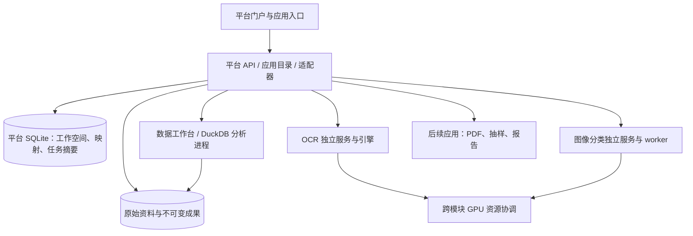

# 多功能专业作业平台：开源选型与开发方案

日期：2026-09-25。状态：设计建议，尚未实施。

详细执行方式见 [自动化开发执行手册](platform-automation/README.md)：包含 47 项任务、46 类检查、接口契约、任务选择与证据校验工具，以及中断恢复和分层交付规则。

定位：一个统一入口承载多个平级的专业工作台。现有 OCR、图像分类分别成为独立应用；新应用可以处理 Excel、CSV、PDF、图片或业务数据，不要求先经过 OCR。审计是重要应用场景，平台基础层不绑定某一种审计流程。

本方案依据两个本地仓库、21 个候选仓库的 GitHub 元数据，以及官方文档、许可证和 npm 元数据。另核验了 React Flow 的仓库与许可。未安装、运行或性能测试这些第三方平台。在线资料的来源、响应文本摘要及哈希见 [调研索引](../research/platform-architecture-20260925/source-index.json)；`main`、`next`、`develop` 文档不等于已发布稳定版本。

## 1. 建议采用的路线

新建一个轻量的平台项目，承载应用目录、工作空间、资料引用、任务聚合和成果管理。现有两套应用保留各自运行时、数据库和发布包，通过适配器接入。首个新增业务应用做“表格清洗与比对”。

首版目标是 **3 个独立可用的应用 + 一套共享入口与资料/任务能力**：

1. OCR 工作台：继续发挥识别、校对、表格和来源追踪的能力。
2. 图像分类工作台：继续发挥标注、数据版本、训练、模型管理、分类及复核能力。
3. 数据清洗与比对工作台：直接处理 Excel/CSV/Parquet，提供可重放的清洗、匹配和差异结果。

采用 React/TypeScript 前端、FastAPI 平台服务、本地 SQLite 元数据、独立模块进程和 DuckDB 分析进程。Backstage、OpenRefine、Power Query、MLflow 等用于提供经过实践的设计参考。第一阶段不把微前端框架、分布式工作流、BI 服务器和 AI 平台全部打包进入产品。

默认部署假设沿用现有项目：Windows、单用户、本地运行，模型包可离线使用。多人内网版是单独里程碑，不通过改监听地址直接开启。

## 2. 现有系统的接入条件

| 事项 | OCR 仓库 | 图像分类仓库 | 对平台的影响 |
|---|---|---|---|
| 前端 | React 19.2、Vite 7.3、Fluent UI v9 | React 19.1、Vite 7.1、Ant Design 5、TanStack Query 5 | 新门户可独立构建，现有工作台不必同步升级 |
| 后端 | FastAPI、SQLite、隔离 OCR 引擎环境 | FastAPI、SQLite、PyTorch/timm、ONNX Runtime | 通过 HTTP 适配，保留运行时隔离 |
| 项目语义 | 文档与处理结果的组织范围 | 固定类别集、数据集和模型的组织范围 | 不能按同名或同 ID 自动合并 |
| 启动地址 | CLI 默认 8765；正式托盘启动器动态选择空闲端口 | 启动脚本默认 8765，支持指定端口 | 平台需发现/分配地址，不能写死两张卡的 URL |
| 接入防护 | 本机 Host/Origin 校验、Bearer、CSP | 本机 Host/Origin 校验、写请求头 | 桥接需要保持各自边界，不能简单开放 CORS |
| 嵌入限制 | CSP 明确 `frame-ancestors 'none'` | 独立管理页面 | OCR 无法原样放入 iframe；嵌入需要专门适配 |
| GPU | 进程内 GPU 互斥和引擎管理 | 本工作台任务租约及 GPU worker | 两套锁互不协调，必须补跨模块资源管理 |
| 验证边界 | 核心工作台有既有验证；助手仍是受限实验能力 | 有公开花卉评测；真实文档分类效果待验证 | 平台接入不自动提升模块的生产资格 |

源码依据：[OCR 入口与 CSP](../src/ocr_workbench/service.py)、[OCR 启动器](../src/ocr_workbench/launcher.py)、[OCR 依赖](../frontend/package.json)、[分类说明](E:/project/image-classification-platform/README.md)、[分类 API](E:/project/image-classification-platform/src/image_platform/api.py)、[分类依赖](E:/project/image-classification-platform/apps/web/package.json)。

这也修正前次口头构想中的两个细节：端口冲突发生在默认 CLI/脚本配置下，OCR 正式启动器并非固定 8765；iframe 只是可选的后续接入方式，不是现成零改造方案。

## 3. 开源方案比较与取舍

选型依据是产品匹配、维护状态、可复用边界、Windows/离线部署成本和许可证。仓库活跃或关注数不能替代目标机验证。

| 方案与官方来源 | 优秀实践 / 适用点 | 本平台的决定 | 许可与边界 |
|---|---|---|---|
| [Backstage](https://backstage.io/docs/overview/what-is-backstage/) / [应用描述](https://backstage.io/docs/features/software-catalog/descriptor-format/) | Spotify 发起、CNCF 孵化项目；统一目录、应用元数据和扩展约定 | 借鉴应用注册清单、负责人、版本、状态和入口；不直接采用整套开发者门户 | Apache-2.0；其产品重心是软件研发门户 |
| [Refine Core](https://github.com/refinedev/refine) | React 的资源管理、data/auth/access-control provider 分层 | 后续管理页面较多时可试点；首版门户使用常规 React 组合即可 | MIT；不能据此把特殊编辑器自动变为 CRUD 页面 |
| [single-spa](https://single-spa.js.org/) / [qiankun](https://github.com/umijs/qiankun) | 独立应用生命周期与按需加载；qiankun 补充沙箱和隔离机制 | 暂不引入；多个团队独立发布、完整页面跳转确实造成问题时再评估 | MIT；qiankun `next` 的原生 ESM/CSS scope 描述不可当作稳定 2.10.16 已具备 |
| [Module Federation](https://github.com/module-federation/core) | 多前端共享模块、运行时和依赖 | 只有出现明确的跨应用组件共享需求时再用 | MIT；共享 React 单例和版本兼容会增加耦合 |
| [DuckDB](https://duckdb.org/docs/current/clients/python/overview.html) | 本地进程内分析、CSV/Parquet、SQL join/aggregate | 直接采用，为数据工作台提供计算内核 | MIT；采用单分析写进程或每作业独立数据库，不让多个 worker 任意共写 |
| [OpenRefine](https://openrefine.org/docs/manual/running) | 分面筛选、清洗、撤销历史、可导出/重用操作 | 借鉴“操作配方＋逐步预览”；不把整个 Java 应用嵌入首版 | BSD-3-Clause；其操作历史并不自动等于不可篡改审计记录 |
| [GX Core](https://github.com/fivetran/great_expectations) | Expectations、数据质量验证结果与文档 | 第二阶段接入数据质量规则适配器；首批明确规则可先用 DuckDB 实现 | Apache-2.0；数据质量断言不等于审计意见 |
| [Apache Superset](https://github.com/apache/superset) | 数据集、图表、SQL 探索和仪表板 | 有多人数据看板需求后，作为独立 BI 应用接入 | Apache-2.0；独立服务及权限运维成本高于几张内置图表 |
| [MLflow](https://mlflow.org/docs/latest/ml/model-registry/) | 实验到模型版本的关联、标签、别名、生命周期 | 借鉴模型版本与发布状态；分类平台已具备模型库，不重复建设；多训练器时再接入服务 | Apache-2.0；托管平台的治理能力不能自动算作社区版能力 |
| [Label Studio](https://github.com/HumanSignal/label-studio) | 多类型标注、预测与人工标注区分、模型辅助标注 | 出现检测框、分割、实体标注需求时，作为新工作台接入 | Apache-2.0；企业版能力单独核验，不替换现有简单分类标注 |
| [FiftyOne](https://github.com/voxel51/fiftyone) | 图片集可视化、错误分析、相似数据和样本探索 | 面向模型维护者的可选实验室；普通使用者首页不暴露复杂模型诊断 | Apache-2.0；企业服务另有范围，附加运行依赖需单独打包 |
| [Node-RED](https://nodered.org/about/) | IBM 起源、OpenJS 基金会项目；节点组合、JSON 流程导入导出 | 借鉴流程模板；若需要连接设备/外部服务，可独立接入受控节点 | Apache-2.0；可视化流程编辑不自动提供长任务事务恢复 |
| [React Flow](https://reactflow.dev/) | React 节点画布与流程编辑交互 | 等固定流程模板被真实使用后，再用于可视化编辑器 | MIT；它是界面库，不是任务执行引擎 |
| [Temporal](https://github.com/temporalio/temporal) | 持久执行、恢复和跨步骤编排 | 当流程跨机器、持续数天且故障恢复复杂时启用；单机首版沿用持久作业与显式步骤 | MIT；服务端部署和工作流版本维护有成本 |
| [Keycloak](https://www.keycloak.org/) | OIDC/SAML、单点登录、LDAP/AD 联接 | 多人内网阶段使用；已有单位 IdP 时优先对接它 | Apache-2.0；身份认证不能替代应用中的项目授权 |
| [OPA](https://github.com/open-policy-agent/opa) | 策略与业务服务分离 | 权限规则跨多服务变复杂后再用；首版不增加策略服务 | Apache-2.0 |
| [Paperless-ngx](https://github.com/paperless-ngx/paperless-ngx) | 原件与检索副本并存、标签、文档类型、自定义字段、搜索 | 借鉴资料库元数据；其 OCR 与当前工作台重叠，首版不整套引入 | GPLv3；合法开源，修改/再分发时需要履行相应义务，不等同于禁止商用 |

### 需要单独处理许可的候选

| 候选 | 本次实际看到的条款 | 设计决定 |
|---|---|---|
| [n8n](https://github.com/n8n-io/n8n/blob/master/LICENSE.md) | Sustainable Use License；限制部分使用/分发，另有企业代码条款 | 可研究连接器与运行历史体验，不把它标成无条件可再分发的 MIT/Apache 组件 |
| [Dify](https://github.com/langgenius/dify/blob/main/LICENSE) | 修改版 Apache-2.0；包含多租户服务及前端 LOGO/版权的附加条件 | 保留为未来 AI 应用候选；先评估具体使用方式，现阶段不作为平台底座 |
| [Stirling PDF](https://github.com/Stirling-Tools/Stirling-PDF/blob/main/LICENSE) | 根 LICENSE 有 MIT 部分，也明确排除多个目录；当前 `engine/LICENSE` 要求生产使用具备有效 User License | 当前版本不按“整包纯 MIT”嵌入。PDF 工具优先复用现有许可已核对的本地库；若需要该产品再评估版本与授权 |

上述是代码选型边界，不是法律意见或对所有历史版本的统一判断。正式交付时记录精确版本、源码哈希、许可证文本及分发内容。

### 两个值得借鉴的成熟商业工具实践

- [Microsoft Power Query Applied Steps](https://learn.microsoft.com/en-us/power-query/applied-steps)：用户点击每一步即可看到当时结果，支持重命名、解释和调整步骤。数据工作台采用相似的信息结构，但自行实现，不复制其专有代码。
- [Caseware IDEA](https://www.caseware.com/products/idea/)：围绕全量数据测试、异常/断号/重复、抽样、可重复程序和结果历史组织产品。借鉴其“一个测试产生一个可复核结果集”的方式，不把异常直接写成审计结论。

## 4. 产品结构：卡片是入口，工作台有自己的空间

平台全局导航建议为：**首页、工作空间、应用、资料、任务、成果、设置**。

首页默认展示常用应用、最近工作、需要处理的失败/复核事项。应用卡片显示名称、能做什么、可用状态和继续上次工作；未实现的构想不进入正式应用区。不要用模型名作为业务入口。

每个工作台内使用自己的二级导航。OCR 可保留原有双栏编辑布局；分类工作台可区分“使用已有模型”和“标注/训练”；数据工作台使用“输入表 → 操作步骤 → 预览 → 差异结果”。返回平台时恢复工作空间与资料选择。

平台支持直接打开工具而不先新建工作空间。只有需要归集资料、任务和成果时再关联工作空间，避免把简单转换工具强制变为繁琐项目流程。

| 应用 | 核心输出 | 建议顺序 |
|---|---|---|
| OCR 与文档处理 | 可编辑文本、表格、可搜索 PDF、来源记录 | 接入已有 |
| 图像分类 | 类别、待复核记录、分类结果、模型版本 | 接入已有 |
| 数据清洗与比对 | 标准化表、匹配/未匹配清单、差异表、操作配方 | 第一个新应用 |
| PDF 实用工具 | 合并、拆分、旋转、页码重排、提取页面 | 小型独立应用；不依赖识别模型 |
| 数据抽样与测试 | 可重现样本、重复/断号等测试结果 | 数据工作台之后；抽样方法经业务确认 |
| 资料检索与证据整理 | 标签、搜索、选中资料包、出处链接 | 先做共享基础，后补全文和语义检索 |
| 标注与模型实验室 | 检测/分割标注、错误样本分析 | 出现明确新视觉任务时接入 Label Studio/FiftyOne |
| 底稿与报告 | 模板文档、证据引用、复核记录 | 审计场景扩展；不作为前三个应用的前提 |
| 自动化流程 | 多工具步骤、人工确认、执行记录 | 固定模板先行，节点画布后置 |

横向使用示例：一位用户直接上传两份供应商台账进行差异比对；另一位用户只做图片分类；第三位用户把 PDF 拆页后送 OCR。各应用都能独立完成工作。

## 5. 技术架构与前端路线



### 前端决定

- **门户与新应用**：React 19、TypeScript、Vite、React Router、TanStack Query、Ant Design。Ant Design 更贴近分类工作台已有的数据管理界面，新应用统一使用一个组件体系。
- **现有 OCR**：继续 Fluent UI，先增加受控的进入/返回导航和工作空间上下文。独立页面期间不会与 Ant Design 共享 DOM/CSS。
- **前端状态**：Router 管导航；Query 管服务器数据；局部编辑草稿留在组件/reducer。无需首期再叠加全局 Redux，也不让 Query 与 Router 各缓存一套相同业务数据。
- **新门户候选版本**：本次 npm `latest` 观察到 React 19.3.0、Ant Design 6.6.5、Vite 8.3.1、React Router DOM 7.18.4、TanStack Query 5.103.2。这只是待验证组合，P0 通过构建/浏览器兼容检查后才写入版本锁。
- **既有应用升级单独进行**：Vite 8 使用 Rolldown/Oxc，需要检查构建插件及产物；Ant Design 6 使用现代浏览器与 CSS variables，分类平台的 v5 迁移需专项回归。门户采用新版本不要求两个旧工作台同时升级。
- 不需要为本机平台引入 Next.js/SSR；Node 是构建依赖，静态前端交付后无需用户安装 Node。

来源：[React Router 模式](https://reactrouter.com/start/modes)、[Query](https://tanstack.com/query/latest/docs/framework/react/overview)、[Vite 迁移](https://vite.dev/guide/migration)、[Ant Design v6 迁移](https://ant.design/docs/react/migration-v6/)。

### 应用接入方式

| 方式 | 使用阶段 | 需要解决的内容 |
|---|---|---|
| 独立页面，统一启动/返回平台 | P1/P2 默认 | 动态端口、服务发现、上下文交接、草稿保存、浏览器返回 |
| 平台地址下独立前端构建，由固定路由网关转发 | 有单地址体验要求时 | Vite base、API base、深链接刷新、下载与 SSE 转发、Host/Origin、会话隔离 |
| 显式嵌入模式 iframe | 需要常驻门户导航时的可选项 | OCR 的 frame-ancestors、精确允许的父源、消息协议和生命周期；iframe 样式隔离不等于权限隔离 |
| qiankun / Module Federation | 多团队独立发布或组件共享成为真实需求后 | 固定稳定版本、全局副作用、弹窗门户、CSS、React 依赖以及卸载释放 |

路由网关只允许代理注册的本机服务，不接受任意目标 URL。FastAPI `mount` 是同进程子应用机制，不等于远程代理，不用于强行合并两套 Python 环境。[官方说明](https://fastapi.tiangolo.com/advanced/sub-applications/)

## 6. 平台与应用的最小契约

平台先实现少量稳定接口，再接第三个应用。应用注册不是任意代码插件市场，首版仅加载随包发布、经过验证的适配器。

### 应用注册

每个应用提供版本化的 `app-manifest.json`：`schemaVersion`、`appId`、`name`、`version`、`minPlatformVersion`、`entryMode`、`capabilities`、`inputTypes`、`outputTypes`、`resources`、`health`、`dataSchemaVersion`、`licenseRefs`。

启动命令与可执行文件由本地受信安装记录绑定，不能由用户上传的清单指定任意 shell 命令。健康检查区分“可打开界面”“可用 CPU 功能”“GPU/模型已准备”，模型尚未加载不等于整个应用不可用。

### 适配接口

| 契约 | 作用 | 约束 |
|---|---|---|
| `describe` / `health` | 能力、版本、运行状态 | 未准备的能力明确报告 |
| `openContext` | 打开指定工作空间/资料集 | 只接收映射 ID；校验范围，不能凭 URL 任意读文件 |
| `importAssetSet` | 交接选中资料 | 输入清单和哈希、请求幂等键、逐项结果 |
| `submit` / `getJob` | 创建并跟踪模块任务 | 返回原生任务 ID；拒绝不支持的操作 |
| `cancel` / 可选 `pause,resume,retry` | 控制任务 | 分类训练暂不具备的恢复能力不能在平台伪装成支持 |
| `listArtifacts` / `resolveSource` | 获取成果与原件出处 | 绑定成果版本、内容哈希和模块内定位 |

### 数据所有权

- `Workspace`：平台工作空间；通过 `ModuleProjectLink` 对应 OCR 项目或分类项目。一个工作空间可对应多个不同类别集的分类项目。
- `Asset`：一次资料登记的业务身份；`Blob`：内容哈希对应的实际字节。同内容的两个来源可以共享 blob，但不能合并来源身份。
- `AssetSet`：一组固定版本输入的清单。分类、清洗、OCR 任务都能接收符合能力的资料集，不强制全平台单一路径。
- `JobRef`：平台对原生任务的引用及状态投影。原生模块仍是该任务状态的权威来源。
- `Artifact`：输出文件/表/报告的不可变版本，记录输入集、参数、应用版本、模型/规则版本和哈希。
- `SourceLocator`：原件页码、表号、行列或图像区域。没有可靠定位时明确降级，不能伪造精确框。

平台不直接写两套应用的业务表。OCR 人工修订、分类标签与模型版本仍由原系统管理；平台通过适配 API 查询。连接映射和成果引用需要可导出，以便将来独立恢复或迁移。

### 跨应用交接和失败恢复

交接按“固定输入清单 → 本地交接记录 → 目标幂等导入 → 回执 → 完成”执行。平台数据库保存待提交记录，网络失败时先按请求 ID 查询目标状态；无法确认则显示“待核实”，不能当作失败重新创建一整批任务。

目标模块需新增持久化接收去重能力；仅在平台前端生成 UUID 不足以解决目标已接受而响应丢失的问题。不承诺跨三个 SQLite 库的原子事务。

新成果先写临时文件，完整写入并校验哈希后发布为不可变版本。平台索引可重建，原文件和人工编辑不能依赖一个可随时清理的任务缓存。

## 7. GPU、任务与运行时管理

平台拥有服务进程登记与资源协调器，按需启动应用，首页读取状态不加载大模型。OCR 的各引擎与分类的 PyTorch/ORT 继续使用独立运行时。

第一版使用一个跨进程 GPU 独占名额：训练、GPU 分类和 OCR 推理都在真正加载模型之前取得名额。CPU 清洗、界面编辑、下载和允许的网络审校可同时执行。

资源接入必须覆盖应用内部 worker、维护自检和平台允许的 CLI 路径；只禁用首页按钮不能阻止两个后台同时占显存。无法接入协调器的旧包，以“一个 GPU 应用独占运行”的兼容模式使用。

停止/租约超时不直接代表 GPU 已释放。协调器结合受管进程树、持有者身份和释放确认，再允许下一个应用加载；不能仅凭心跳超时自动发放第二份所有权。保留已提交的任务结果，取消操作先请求模块按自身规则收尾。

平台任务中心统一显示应用、阶段、成功/失败/未处理数量、等待资源原因及可用操作。保留原模块错误详情和 native status；部分完成不能映射成全部成功。首页可同时显示“分类训练运行中”和“OCR 等待 GPU”，解释必须对用户有意义。

## 8. 首个新增应用：数据清洗与比对

选择理由：它可独立处理业务台账，服务于对账、审计、资料管理等多种场景；既不依赖 OCR，也可接收 OCR 导出的表格。DuckDB 提供计算内核，OpenRefine/Power Query 提供成熟的交互参考。

### 第一版范围

| 能力 | 具体行为 |
|---|---|
| 导入 | XLSX、CSV、Parquet；选择工作表/表头/编码/分隔符；预览列类型和异常值 |
| 类型保护 | 保留原始文字；编号默认文本、金额使用 Decimal/DECIMAL；空值、空字符串、零分别处理 |
| 清洗 | 去首尾空白、显式日期/金额转换、列改名、值映射、筛选、按选定字段识别重复 |
| 比对 | 选择左右表和匹配键；输出相同、差异、仅左、仅右；重复键单列提示，避免默默产生笛卡尔积 |
| 操作配方 | 每步显示输入/输出行数、参数和样本预览；可撤销、另存版本、在新数据上重跑 |
| 来源 | 每条结果保留输入文件、sheet、原行号及必要单元格位置；合并后保留两侧出处 |
| 导出 | 差异表、清洗结果、运行摘要、规则/配方版本；允许重新下载固定版本 |

XLSX 第一版不计算任意公式：分别保留公式及可获得的缓存值，缓存缺失/过期不能冒充计算结果；Excel 已经损失的长编号精度也不能靠导入恢复。CSV/XLSX 导出需防止未经确认的文本成为执行公式。

DuckDB 使用本地受控文件和固定算子；第一版不开放任意 SQL 执行入口。官方明确提示 SQL 能以执行进程权限访问资源，因此文件允许列表、扩展安装/联网策略和工作目录边界必须落实到 worker。[依据](https://duckdb.org/docs/current/operations_manual/securing_duckdb/overview.html)

分析 worker 使用有界内存、磁盘临时目录和取消检查。输入转为固定快照/Parquet 后再运行；平台事务库继续 SQLite。按 DuckDB 的进程内并发模型，控制写者进程，不把分析数据库放共享盘供多个进程任意写入。[依据](https://duckdb.org/docs/current/connect/concurrency.html)

暂不纳入：复杂财务报表自动判断、完整 Excel 外观/公式引擎、实时协作表格、任意 Python 节点、无条件自动模糊匹配。后续可增加“待人工确认的相似匹配”，与精确匹配分开统计。

## 9. 工程组织、升级和交付

建议为平台新建独立仓库，例如 `E:\project\professional-workbench-platform`。这是建议位置，本次未创建。现有两个仓库继续独立发布，平台安装清单锁定它们的版本与内容哈希。

```text
platform/
  apps/portal/                平台首页、工作空间、任务和成果
  services/platform_api/      目录、身份上下文、资料引用、适配器
  services/supervisor/        本地进程与资源协调
  modules/data_workbench/     新的数据清洗与比对
  adapters/ocr/               OCR 接入、状态与成果映射
  adapters/classification/    分类接入、状态与成果映射
  packages/contracts/        manifest、API 和消息 schema
  packages/ui/               新应用共用导航、主题、表格规范
  packaging/                 Windows 运行时、离线清单、更新回退
  tests/contract/            模块接入契约与兼容性
  tests/integration/         交接、恢复、GPU 互斥和备份恢复
```

这是代码组织边界，首版服务可由少量本地进程承载，不要求把每个目录部署为微服务。平台适配器不通过直接 import 把两套 Python 环境装进同一个解释器。

正式包分基础门户与可选应用包。先检查应用能力再显示“可用”；缺少分类模型时仍可使用 OCR 和 CPU 数据工具。所有静态资源、字体、运行依赖本地化，联网能力按应用显式配置。

升级采取“校验新包 → 备份 → 独立迁移验证 → 切换 → 冒烟 → 保留旧包”。回滚需同时考虑代码与数据 schema；新 schema 不能让旧程序盲读。多个数据库和成果文件的一致备份需要暂停写入/快照协调，不能只复制正在运行的 SQLite 主文件而遗漏 WAL 或外部原图。

首版日志用于操作追踪，不宣称达到不可篡改档案要求。后续如果要正式签批和归档，再增加版本锁定、签署身份、保留策略以及与管理员权限隔离的归档机制。

## 10. 分阶段开发与验收

下表是规划估算，假设一名熟悉 React/Python 的全职工程师、有可用业务样本和定期业务反馈；不包含全部模型重新评测与多人企业部署。预计 35–51 人日，考虑反馈和集成迭代约 8–12 个自然周。P0 结束后按实际接入复杂度重估。

| 阶段 | 工作与交付 | 通过条件 | 估算 |
|---|---|---|---|
| P0 接入设计与基线 | 冻结两仓版本/数据备份；确定 app/asset/job 契约；新门户依赖兼容小试验 | 两套原应用独立基线通过；深链接、动态地址、Origin/CSP、GPU 入口有明确清单 | 3–4 人日 |
| P1 平台门户 | 首页、应用目录、工作空间、最近访问；两应用启动/发现/返回；服务异常显示 | 卡片打开正确应用；未启动/缺包可解释；重启、浏览器返回和中文路径通过 | 5–7 人日 |
| P2 模块适配与资源 | 适配 API、原生任务状态投影、跨模块 GPU 互斥；兼容模式 | GPU 同时申请不会双加载；模块退出不拖垮门户；训练暂停/恢复能力如实显示 | 7–10 人日 |
| P3 资料与成果 | 资料引用/快照、模块项目映射、幂等交接、成果下载与追踪 | 响应丢失后不重复导入；同内容多来源不丢；源文件改变被发现；输出可回溯 | 6–9 人日 |
| P4 数据工作台 | XLSX/CSV/Parquet、清洗步骤、精确匹配、差异结果及来源导出 | 长编号/金额/公式/空值/重复键反例通过；相同输入与配方可重跑；完全独立于 OCR 使用 | 10–15 人日 |
| P5 业务试点与离线包 | 实际资料试用、目标机测量、崩溃恢复、备份恢复、离线交付与说明 | 三应用闭环可用；目标包清单与测试一致；无开发环境设备能安装/启动并读取备份 | 4–6 人日 |

P1 可单独交付“平台入口版”；P4/P5 完成后才称为“多功能工作平台首版”。P2/P3 中的资源与交接属于平台能力，其工程通过不代替 OCR 或分类模型的业务精度验收。

### 首版关键验收场景

1. 用户只打开数据工作台，比对两份 Excel，导出带左右来源的差异表，全程无 OCR 依赖。
2. OCR 与分类可分别继续旧项目；原编辑、标签、数据集划分和模型版本保持可读取。
3. 两个应用同时申请 GPU，只有一个取得资源；另一个显示真实等待原因；取消后正确释放。
4. 交接在目标接收后断开响应，再次进入能核实原任务，不重建一批重复资料。
5. 对相同字节但不同来源的两份资料保留两个来源登记；后续结果分别可追踪。
6. 一个应用异常退出，门户、其他 CPU 工具和已完成产物仍可使用；异常状态不能继续显示“运行正常”。
7. 任务页状态来自持久记录；刷新、断流、重启后恢复，不以 AI 回复作为完成证据。
8. 离线环境不请求 CDN、下载扩展或模型；缺包给出明确能力状态。
9. 从一致备份恢复工作空间、原件、模块映射与成果；哈希和抽样下载读回一致。
10. 中文、空格、长路径与实际 Edge/Chrome 版本通过。测试数据包含两字中文检索，不能仅以英文搜索通过推断中文体验。

性能目标在 P0 固定机器与样本后设定。建议先以实际 1 万资料目录、10 万行双表、目标 OCR/分类样本测量首页、分页、比对、取消和峰值内存，再决定是否扩到 100 万行；这些是建议测试规模，非已取得的性能成绩。

## 11. 后续演进触发条件

| 出现的需求 | 对应演进 |
|---|---|
| 多人同时操作，要求项目隔离和复核身份 | OIDC/Keycloak、服务端授权、PostgreSQL、HTTPS、并发编辑冲突处理；单位已有 IdP 则直接接入 |
| 多机器 GPU 或远程批量计算 | 独立计算节点、持久队列与统一资源调度；模块保留原始任务 ID |
| 流程跨机器、持续数天、人工等待和故障恢复复杂 | 评估 Temporal；先固定动作契约与幂等语义 |
| 多套训练器、模型团队需要统一实验与发布 | MLflow 适配，继承已有模型版本和评估证据 |
| 检测框、分割或实体级标注 | Label Studio 独立应用；明确社区版和企业版边界 |
| 分析看板需要共享、定期刷新和权限控制 | Superset 独立应用，与平台身份和数据访问联接 |
| 出现正式底稿、签批、审计发现管理需求 | 新增审计作业应用，引用平台资料和成果，不把所有工具改成审计程序 |

第一批稳定流程模板可先是“资料选择 → 一次工具执行 → 人工复核 → 成果发布”。等用户反复组合相同工具，再提供 React Flow 画布；节点必须调用已注册动作，不能让画布直接执行任意 shell/SQL。

## 12. 建议先做的具体开发批次

首个开发批次完成 P0 与 P1：新平台仓库、应用注册 schema、两个现有应用的只读能力/健康适配、动态启动发现、卡片入口、返回导航和工作空间映射。由此得到可实际打开的统一门户。

下一批补齐 GPU 协调与资料/成果契约，随后开发独立的数据清洗比对应用。这样既能尽早使用现有成果，又能通过第三个真正不同的应用检验平台是否支持横向扩展。
