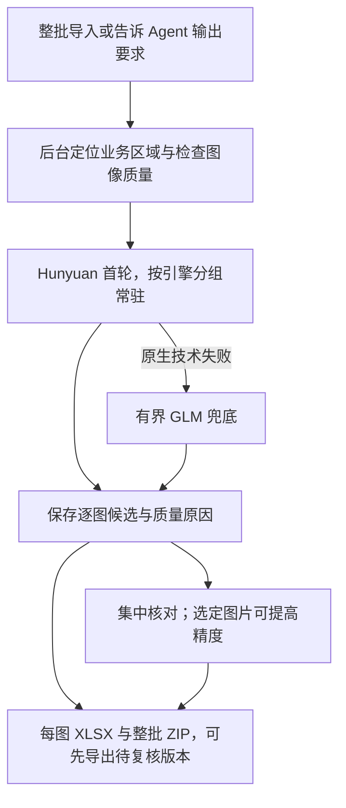

# 批量屏拍表格 OCR 与 Agent：最终方案与模拟评估

日期：2026-10-07。业务范围：通常 200 张以上手机拍摄电脑 Excel 的图片；去除电脑界面干扰，保留业务标题、单位、表注；**每张图片一个 XLSX，同图多表分工作表，整批 ZIP**。

本方案依据当前源码和实际模拟推理收敛，不沿用“GLM 主表、轻量 OCR 补漏”的固定组合。旧模型组合只是用户当时内网可用条件。没有真实屏拍样本，本轮采用已有公开标注表格、中文合成业务表和屏拍退化模拟，不能据此承诺真实业务准确率或比旧 DeepSeek harness 快多少倍。

原实施计划及全部验收条件已保留为[实施计划 v1 历史原文](F:/OCR/output/ocr-daily-workflow-review-20261007/完善提升方案-实施计划v1-历史.md)。本报告登记实测结论、已实施范围和剩余工作；没有达到的质量条件继续列为缺口，不通过缩减分母或改变“完成”的定义消除。

本轮完成的是模型路线探索、模拟评估和候选流程的工程验证；免校对自动化、完整 UI/元信息清理及降低人工校对负担尚未通过验收。后续计划以这些实测缺口为起点。

## 1. 结论与日常路线

平台应承担整批调度、模型执行、检查点、结果比较与 Excel 交付。Agent 理解目标、发起一次批次、处理少量异常组和中途要求，后台按规则推进，减少逐图模型思考。用户从导入到下载、复核都在平台内完成。

**Agent 调度已达到普通大批次的低轮数目标，可以承担原外部 harness 的批次组织工作。OCR 内容可靠性和校对便利度仍需改善。** 240 张实际模拟运行只用 4 轮主控，但整批仍耗时约 53 分 35 秒，说明继续减少主控思考次数不是当前唯一提速手段；后台首产出、结构错误和复核量更值得优先处理。

现阶段适合提供**自动提取候选、集中核对、逐图交付**。质量检查还会漏掉合并范围等问题，不能将“模型运行成功”或“自动检查通过”解释为可免校对。默认候选需要人工确认；明确选择“包含待复核文件”即可先下载。全批标待复核保护了结果状态，但不代表已达到减少人工校对量的目标。

冻结的日常策略为 Hunyuan 首轮、仅在原生技术失败且没有成功候选时用 GLM 兜底一次。首轮有结果但质量可疑时保留候选、进入复核；对明确选定图片启动 GLM 精度子批次，保留原结果供比较。PaddleOCR-VL 保留为结构复杂案例的独立候选，不让全部图片固定串行跑三个模型。

这是当前证据支持的首版日常提取配置，不能解释为 Hunyuan 对所有语言和版式都最好。公开论文表格上的关键字段，GLM、PaddleOCR-VL 更有优势；中文开发样本上的整图可用程度支持先试 Hunyuan。默认配置依据开发/验证证据冻结，最终保留集只用于验收。

## 2. 已有实测如何影响选择

72 张筛选图片用统一 CPU ROI v2 输入比较，GLM 的 9 个输入事故项已按原清单独立恢复，失败原记录保留。下表使用完整唯一图片成绩，不把原首轮和恢复时间拼成连续批次耗时。

| 完整模型 | 整图表格核验全通过率 | 关键字段逐格精确 |
|---|---:|---:|
| Hunyuan | 48.61% | 78.60% |
| GLM | 37.50% | 86.30% |
| PaddleOCR-VL | 34.72% | 88.23% |

“关键字段精确”要求含数字的字段在 NFC 归一且忽略全部空白后，文字、格位与合并跨度同时一致；不修正数字、标点或负号字形。这比纯数值正确更严格，但不衡量空白排版是否逐字保留。它包括编号、混合文字和 Unicode 符号差异，不能把全部失败格说成金额数字错。

本报告的“整图表格核验全通过”要求成功、全部参考表格格值与跨度正确、形状及额外/重复格无误、固定九类 UI 文本标记无泄漏、指定标题/单位目标字符串命中。它没有逐字核对全部 caption 或完整业务说明的文字、类别与顺序，也未穷尽所有 UI 干扰，不能解释为照片全部业务信息无误。下文“整图”比例及净收益均沿用此限定口径；完整元信息与 UI 排除仍须专项验证。

68 张验证包括 60 张公开表格与 8 张中文开发源表变体。Hunyuan 整图 19.12%、关键字段 65.04%；GLM 整图 14.71%、关键字段 84.64%。广泛质量触发的 H→GLM 升级 58 次，整图仅提高到 20.59%，额外条件 OCR 用时 1,231.16 秒；这是实际已有推理记录的条件求和，不能当作实测连续路线墙钟。中文 8 张上 Hunyuan 为 75% 整图、100% 关键字段，GLM 为 25%、87.30%，升级没有净收益。这 8 张来自已见开发模板，不能证明对新部门版式的泛化。

自动分流曾在 Hunyuan 的 10 张“通过”图片中漏掉 3 张错误：两张丢失合并范围，另一张 32 格为数学负号 `−` 转成 ASCII `-`，没有数值或正负方向变化。验证中 1,329 个关键字段错误仅有 4 个局部标记，说明“整图有提示”还远不能代替具体错格定位。

因此默认取消广泛自动升级，也暂不开启数字自动改写。可靠定位下的局部 Qwen 实验已实际跑 4 图、8 个完整单元格，8 个读取均正确，但原 Paddle 候选也全部正确，**修复 0、新错 0、主结果修改 0**；只证明这些定位输入可用，尚未证明纠错收益。TableFormer、RapidTable 的本轮登记依赖缺失，不能把未执行能力列为默认路线。

完整试验与独立来源绑定见 [评测证据目录](F:/OCR/output/ocr-screen-benchmark-20261007/evidence)。

新增能力的使用方向如下；模型越强并不意味着必须全批叠加运行。

| 能力 | 首版定位及后续验证 |
|---|---|
| Hunyuan、GLM、PaddleOCR-VL | 平等参加首轮与版式对照；本轮冻结 H 日常首轮、GLM 技术兜底/手动精度，PaddleVL 保留独立复杂结构候选 |
| PP-DocLayoutV3、PP-OCRv6 | 布局和独立文字位置证据；下一轮按空间归属清理业务说明、检查漏行和 UI，而非把所有辅助文字复制到说明页 |
| SLANeXt、RT-DETR 单元格检测 | 对合并跨度、网格错位和漏行列做定向结构候选；先验证真实错例的净修复，检测框不能直接证明文字正确 |
| Qwen3.5-4B | 可靠格位上的局部独立读取与冲突裁决；当前实验零净修复，保留验证角色，不默认全批视觉审校 |
| Qwen3.6-35B-A3B、TableFormer、RapidTable | 后续候选：35B 本轮登记缺权重/视觉组件，后两者本轮缺登记依赖；补齐并实测后再决定采用，不能将配置存在当作已运行 |
| UVDoc、透视/分块预处理 | 平面电脑屏幕先验证透视校正；仅在真实形变或密集小字问题组上试其它处理，保存原图和坐标映射 |

## 3. 已实施的批处理与 Agent 能力

原生 OCR 与平台 Agent 使用同一批次服务：1–1000 张固定输入、每输入独立身份与最终版本、按模型分组执行、失败重试、暂停恢复、精度子批次、逐图 XLSX/ZIP。完全相同图片共享 OCR 与上下文计算，仍给每个输入独立成果；CPU 预处理目前仍逐输入执行。相似图片、滚动照片不自动去重丢弃。

每图预算 360 秒、单次调用上限 180 秒、整批预算 36,000 秒；每次实际调用还受剩余预算限制。引擎分组大小 32。批次保存策略与来源版本，旧持久批次保留原语义；重试与重复提交不因默认配置变化悄悄创建另一批。修改保护阻止旧结果覆盖新编辑。

区域处理保存原图、透视映射与质量原因；业务标题、单位和说明作为独立信息保留，不按关键词删“看起来像 UI”的数字。验证区域保留 6,140/6,140 个可见格；部分图片仍有少量 UI 几何交叠，这只能证明可见格没有被几何裁掉，不能证明文本识别或 UI 排除已完全正确。标题几何阈值的一个边界失败实际仍完整返回标题，不能误报为已发生文字遗漏。

Agent 接收批次引用和摘要，OCR 单元格保存在业务服务中；等待期间不用主控逐图轮询。支持先导出已处理部分、暂停/继续、只重试失败项及指定图片提高精度。确认状态与候选状态分开，主控不能代签人工确认。

Excel 默认以文本忠实保存实际候选内容，防止导出再次丢掉前导零、长编号、负号或把公式样文本执行成公式；它不能恢复识别阶段已经丢失的原值。因此 XLSX 读回的一致性与候选对原图真值的准确率分别验收。同图多表分 sheet，另列业务说明与来源索引。只有人工确认后才能明确选择金额/数量列按数值导出；不从图片编造原 Excel 公式。失败、无成果和未完成项在清单中保留，不生成伪成功空文件。

原图复核支持 100% 显示、缩放、拖动和双向滚动。预计剩余时间只覆盖当前已排队的相同阶段、引擎与识别轮次；排除本批首个冷样本，至少有 3 个热态成功样本才按 P75 估计。后续处理、模型切换、导出与人工等待另列，这不是整批交付时间承诺。

## 4. 冻结验收与采用边界

模拟集共 404 张：筛选 72、公开验证 60、中文开发验证 8、最终主批次 240、挑战 24。最终主批次为 120 个公开文档与 60 份中文合成源表的两种变体，中文保留 4 个模板族；240 张不是 240 个独立业务样本。挑战覆盖遮挡、裁断、极小字和无表格。

最终验收使用固定源码与策略，逐项核对真实运行、Excel 读回、ZIP/原图映射、主控请求、预算、恢复及候选包。路线侧与首轮 H 基线使用同一实际首轮回执配对；没有技术失败时两侧计算重合，不声称完成了两次独立整批推理。

最终 240 张已由真实平台 Agent、原生队列与实际引擎执行：240 个上下文任务、270 个 Hunyuan OCR 任务均成功，240 项终态均为待复核、人工确认 0。没有技术失败兜底，路线与同批首轮 H 的 240 个实际候选完全相同，配对净增为 0；没有再做第二次独立 H 整批运行。

| 最终模拟分组 | 图片 | 表格核验全通过率 | 关键字段精确率 |
|---|---:|---:|---:|
| 中文常规 | 60 | 98.33% | 99.08% |
| 中文困难 | 60 | 100.00% | 100.00% |
| 公开常规 | 60 | 8.33% | 78.92% |
| 公开困难 | 60 | 11.67% | 63.08% |
| 全批 | 240 | 54.58%（131/240） | 74.09%（6,143/8,291） |

中文两种变体合计 119/120 图核验全通过、866/870 关键字段精确，但只来自 60 份源表和 4 个保留模板族，不能当作新部门真实屏拍准确率。公开两组使用不同文档，困难组比例较高不能推导退化提升识别。整批另有漏表 2、额外表 1、形状错误 46、额外格 2,036；指定的 202 个标题/单位目标均命中，但完整元信息未逐字核验。按文档/模板族聚合的区间估计保留在原报告。

实际 ZIP 清单涵盖全部 240 个输入；238 本 XLSX 的全格原值、类型、合并、说明页及十项来源索引直接对实际数据库/候选读回通过。另 2 个公开困难输入没有可交付表格，明确列为 `no_book`，未生成空白伪成功文件。这证明导出没有再次改变候选，不代表 238 本都识别正确，也说明“一图一文件”的内容交付尚有两项缺口。免校对自动交付覆盖仍为 0。

真实 Agent 为 4 轮逻辑主控请求、3 次批次级工具调用，等待期间请求计数稳定，已核实候选 ZIP 交付。4 个实际 provider 请求跨度合计 36.33 秒，应用层未自动重试；这是网络、供应商处理与流式传输成本，不是纯思考计时，也未观测网关或供应商内部请求。Agent 终态墙钟 3,215.09 秒（53.58 分钟）；加入后置导出与证据采集为 3,252.03 秒。最终状态为 `partial`，因为全部成果未经人工确认且两项没有可交付表；候选提取完成与人工审核完成分开。

交付文案审计发现：最后生成的回复已经指出 238/240，但最终交付事件仍沿用较早的 240 张整批导出摘要。收口修正让纯拍屏交付按实际清单生成文件数、缺文件数和待复核数；有明确 `export_error` 的无文件终态可以计入范围，缺少原因的遗漏不能直接结束。新回归使用确定性主控，不能把它的三轮结果说成新的真实 240 张主控测量，原实际四轮证据保持不变。

成果引用核实证明固定快照及文件身份，不证明它仍是当前最新复核版本。同批次的旧 ZIP 如果输入数和状态数相同，仅计数比较仍可能允许交付；独立反例已保留。下一轮须核对逐输入的选定结果、修订号、复核状态及原图版本，过期导出标记为历史成果并要求重新导出。本轮最终实际 ZIP 由当轮新导出生成，但不能据此宣称所有历史 ZIP 都已有新鲜度门禁。

首次有表实际 OCR 候选于 440.22 秒（7 分 20 秒）完成，Agent 首个 Excel ZIP 于 3,181.79 秒完成；其导出操作生命周期为 20.67 秒。独立取证的后置导出为 13.43 秒，已包含在 36.91 秒证据采集中，不能重复相加。Hunyuan 270 次实际任务的原始 elapsed 成本合计 2,510.78 秒，一个驻留 session 的 load 为 1.75 秒；geometry 原始 inference 成本 150.22 秒、load 6.67 秒，240 图 preparation 成本合计 111.70 秒。这些任务/会话成本与墙钟分开，没有独立 H inference 或供应商思考计时，不能求和充当第二条路线时间。混合模拟批次时间也不直接换算日常 200 张中文屏拍。

24 张挑战也由真实 Agent 完成，4 轮主控请求、3 次工具调用，终态墙钟 329.04 秒；全部待复核。18 本实际 XLSX 读回通过，6 张真实无表图片均没有生成伪表或空工作簿。按实际可见内容计分，114/135 格正确（84.44%），关键字段 48/57 正确（84.21%）；9 个可见关键字段错误集中在两张裁断图。严格全图参考包含不可见内容，因此其 2/24 全通过只作诊断，不代替可见内容质量。

挑战专项提示覆盖裁断 6/6、无表 6/6，遮挡 0/6、小字 0/6；“全部待复核”不能代替具体原因提示。原离线评分器没有匹配产品实际的 `image_edge_cutoff`，曾错误报告裁断专项为 0；已保存旧脚本和原报告，经 15 项 CPU 正反例验证后生成新的 002 报告，未重新推理或覆盖原记录。遮挡、裁断和小字的不确定/不可见区域仍有非空输出，分别为 42/65、11/32、88/116 个参考格；这些是应复核的风险，不能仅凭与隐藏真值相等或不同就判定为可靠恢复或编造。

恢复与完全重复复用的最终 8 输入实测通过：7 张独立图，受控停服、重建服务后，不重算已成功项，确认中断的在途项以新 attempt 恢复；重复图共享上下文与 OCR 计算，但保留独立输入和成果身份。墙钟 140.12 秒，8 本 XLSX 及十项来源读回通过。原严格检查器、实际 IPC 发布回执审计均通过，17 条发布回执涵盖 15 次实际请求和 2 次停止；这是提交证据，不是内部模型/kernel 次数。工作者、作业与 GPU 锁及两次服务生命周期均释放。它验证受控停止/恢复，未模拟操作系统崩溃；样本仍未经人工确认。先前 003 的 IPC 轮询证据缺失和严格检查失败保留，不能回填为通过。

没有旧 harness 同条件计时或人工计时，仍不报告提速倍数与节省校对工时。

先前 ready240 回放为 4 个真实主控请求、3 个工具调用、一次提交，使用 50 个独立 OCR 回执重复至 240；中途指令回放已完成暂停、部分 ZIP、恢复与最终 8 项候选交付。这些属于历史调度证据；上述最终 240 张质量来自独立输入的实际推理。

证据：[240 张实际质量](F:/OCR/output/ocr-screen-benchmark-20261007/evidence/final240-actual-native-quality-001.json)、[首轮与路线配对](F:/OCR/output/ocr-screen-benchmark-20261007/evidence/final240-actual-native-quality-001.paired.json)、[全量 Excel 读回](F:/OCR/output/ocr-screen-benchmark-20261007/evidence/final240-actual-native-quality-001.xlsx-readback.json)、[实际性能](F:/OCR/output/ocr-screen-benchmark-20261007/evidence/final240-actual-native-performance-001.json)、[实际 Agent 交付](F:/OCR/output/ocr-screen-benchmark-20261007/platform-validation/agent-final240-native-001/agent-native-summary.json)、[挑战最终评分](F:/OCR/output/ocr-screen-benchmark-20261007/evidence/challenge24-actual-native-quality-002.json)、[评分修正来源链](F:/OCR/output/ocr-screen-benchmark-20261007/evidence/challenge24-quality-correction-chain-001.json)、[恢复重复复用严格核验](F:/OCR/output/ocr-screen-benchmark-20261007/evidence/native-recovery-repeat8-final-004-reuse-check.json)。

实际推理来源绑定：[final-route-002](F:/OCR/output/ocr-screen-benchmark-20261007/source-snapshots/final-route-002/freeze.json)，OCR `9709c2c`、平台 `c931b31`、分类 `d90707b`。产品收口绑定：[final-route-003](F:/OCR/output/ocr-screen-benchmark-20261007/source-snapshots/final-route-003/freeze.json)，平台更新为 `9c26bd4`，包含只读备份 `694e8f2`、活跃路径冷恢复 `b03f08b`、交付计数 `9c26bd4`；另两模块不变。两次冻结的 170 个原生文件 inventory 均为 `5f7decd3ea8ed613a9cb1e6b4c7fce94c4c29c74e9fe262bbd9639335c5ce8b5`，策略 SHA256 均为 `9b024924fd72e577b2252f7944d7fb93b8175e02f57f67129c11e53da185e0ca`。不重复运行已经完结的 240/24 推理；新增平台修复以 CPU 专项验收，未冒称旧真实主控已使用新摘要代码。全部新写入只在 F 盘。

工程验证已覆盖策略冻结及历史兼容、初始“提高精度”选择、预算与停服竞态、Windows IPC 短共享锁重试。最终候选 v0.9.4-final-003 的 2,092 文件、8 共享身份、冻结原字节/策略、三前端 source/dist、随包独立空数据启动且 Agent enabled、未来数据库版本 19 拒绝均实际通过。OCR 数据库版本 18、分类版本 5。旧读取器拒绝 OCR 18、旧版 17 的迁移和旧包回退属于分别保留的历史验收，未冒称 003 又完整重跑。使用旧包回退须恢复兼容数据备份，不能只换程序。受控 Ctrl+Break 后启动器退出码为 3，console helper 为 0、日志确认关闭且 owned 端口关闭；不写成启动器 exit 0。包资格与内容质量分开，正式版本仍为 v0.9.3。

原 actual240 harness 根的生产冷备保留失败：其平台布局不符合产品白名单，且备份源的普通 SQLite 连接关闭时触发自身 WAL checkpoint，导致源变化门禁拒绝；业务 rows 未变，但源 DB 物理字节曾改变。修复只读源连接后，6 项必要 CPU 检查通过；活跃路径冷恢复的 11 个不同场景通过。这个历史物理变化不能隐藏在“没有修改业务数据”的陈述中。

最终实际冷恢复使用明确登记的正式布局派生副本：逐文件 hash 复制，240 个资产由外部引用登记为副本内 managed，1,309 个活跃路径字段显式映射到副本；原推理结果、来源和 Agent 历史不泛改。003 随包生产备份/恢复及独立启动后，240 原图、240 输入版本、799 预处理文件、240 managed 资产通过实际管理器读取与 hash 核对，平台 API 返回 240 批次项、预处理图片及两份实际成果文件。源副本业务 rows、持久字节与正式 current 登记保持；受控退出后 owned 端口关闭。该结论是规范化实际平台/OCR 副本恢复通过，原 harness 原样冷备仍失败；本 actual 没有分类业务数据，分类只核验独立空启动。

收口证据：[003 候选 CPU 资格汇总](F:/OCR/output/ocr-screen-benchmark-20261007/final-candidate-validation-003/qualification-summary.json)、[003 包绑定](F:/OCR/output/ocr-screen-benchmark-20261007/final-candidate-validation-003/package-001/phase-summary.json)、[规范化实际冷恢复](F:/OCR/output/ocr-screen-benchmark-20261007/final-candidate-validation-003/actual240-cold-qualified-001/receipt.json)、[实际交付计数 CPU 核验](F:/OCR/output/ocr-screen-benchmark-20261007/evidence/actual240-production-delivery-counts-001.json)、[交付新鲜度独立边界](F:/OCR/output/ocr-screen-benchmark-20261007/evidence/final-screen-delivery-peer-review-001.json)。

在隔离恢复副本上的实际数值授权 QA，先前已读回 8 个工作簿的 1,006 个业务格；明确选择真实数量/长度三列并模拟确认后，83 格转为数值，其余 923 格保留原值。最终 003 又逐格核对实际 240 清单/238 book 的 14,980 个业务格：12,531 个非空原值按文本保存，2,449 个空格保持空。在独立 QA 副本模拟确认中文金额/编号列及公开百分比列后，3 格金额、28 格百分比转为可计算数值，其余 14,949 格保留原值（12,500 个非空文本及 2,449 个空格）。原 helper 的 `text_cells` 计数包括空字符串，不等于全部 XLSX 格的类型都是 `s`。选中的前导零编号仍保留原字符串。未确认、旧复核 revision、编辑后的旧导出和保留未确认候选四种情形均实际拒绝。

实际候选中读回覆盖 366 个前导零编号字符串、122 个百分比字符串、10 个公式样字符串（含以 `+` 开头的原文，只有一个 `=0.8`），这些是实际候选出现次数，不是独立业务样本数。默认及未授权列原文保留；百分比只有明确选列且实际转为数值的 28 格列为转换证据。实际候选没有超过 15 位的纯数字 ID，该类别仍缺真实模型输出覆盖，不能拿工程 fixture 当作已实测。数值 QA 不衡量 OCR 真值质量，也没有用户人工确认、GUI 审核或主控请求。证据：[003 实际数值授权 QA](F:/OCR/output/ocr-screen-benchmark-20261007/final-candidate-validation-003/actual240-numeric-qa-v3-001/receipt.json)。

实际恢复样本还暴露元信息整理问题：一个工作簿的“业务说明”有 194 条，其中 168 条与业务格内容精确重复，并混入 B、C、D 等 Excel 列标尺字符。完整导出读回可以证明忠实于候选，却不能证明这些内容适合日常使用。该问题必须在下一轮专项修复，不能由表格评分器的有限 UI 标记代替验收。

## 5. 下一轮优先完善什么

| 优先级 | 完善内容 | 采用条件 |
|---|---|---|
| 第一 | 可靠单元格定位与结构校验：将独立检测框映射到实际业务表，重点查合并跨度、漏行列、错位和 UI 假表；业务说明只整理独立标题、单位和表注，排除标尺/UI及与业务格重复的文字 | 用实际错误案例验证修复与新错；辅助 OCR 全量保留作证据，按空间关系整理默认说明页，不能靠关键词误删业务信息。6,140 格几何保留不能代替元信息文本准确及 UI 漏检定位 |
| 第一 | 让复核缩小到具体格：原图局部、当前值、独立候选与原因并排；长编号、小数点、负号、百分号及单位专项比较 | 同时报告错误定位召回与误报、需要核对的图片/格数量；不能只让所有图片显示待复核 |
| 第一 | 导出快照与当前最终版本逐项核对，拒绝把同数量的旧 ZIP 当作当前成果 | 核对输入版本、结果 ID/修订号、当前选择和复核状态；覆盖“数量不变但编辑/换候选/重新确认”的反例，固定历史成果仍可明确访问 |
| 第一 | 缩短首个候选等待：量实际准备、上下文、交接与持久化的等待，比较有限分组推进与整批先处理上下文的取舍 | 本轮首次有表需 7 分 20 秒。保留 GPU 互斥、耐久检查点和固定策略；同时记录首个产出、整体墙钟与额外加载成本，不能只让进度条更早变化 |
| 第二 | 按版式及具体失败选择精度路线：中文明细、宽表、多级表头、密集小字、同图多表，以及“检测有表但首轮空表”分别对照 H/GLM/PaddleVL | 在开发/验证组先证明相同剩余错误下更快或相近时间下更准确，冻结后再验收；不根据最终保留集调当前策略，不把空输出自动认作真实无表 |
| 第二 | 有界局部复识与视觉裁决：先独立读取原图，再比较候选，优先可靠格位上的实际冲突 | 净修复为正、没有新增静默关键错误、耗时有明确收益；不让全部图片承担审校成本 |
| 第二 | 透视、反光、摩尔纹与密集分块按真实原因处理，保存原分辨率和重叠的全局行列关系 | 不损失小数点/细线、不切断合并表头；遮挡或裁断内容只能提示不完整，不补猜隐藏值 |
| 后续 | 对固定部门版式建立小型策略档与真实屏拍回归；补录人工校对时间和旧 harness 对照 | 收到真实照片后按设备/模板分组；本轮无需等待样本，也不提前承诺倍速或免复核 |

下一轮目标应是减少实际校对负担，而不是继续增加全批模型轮次。以整图正确、关键字段精确、错格定位、新增错误、实际批次时间和人工时间共同决定采用。新模型只有实际改善这些指标才进入默认。

执行时先冻结一组开发错误案例，覆盖合并跨度、漏行列、数字字形、标题单位与界面干扰，给每个问题保存原图局部及正确格位。先完善定位和复核页，再对实际错误运行局部文字、结构或视觉候选；每一步单独计算净修复、新错和耗时。版式路由及预处理的改动在开发/验证集选择，下一版使用新的保留样本验收，避免反复用本轮 240/24 张决定策略。

日常可先使用候选提取模式：整批导入，说明“每图一个 Excel，包含待复核版本”，等后台完成后下载 ZIP；选定疑难图片提高精度、比较原图并确认。涉及财务金额时，人工确认前保持文本导出；明确确认并选择金额/数量列后，再生成可计算版本。研究原图、真值及评测缓存不进入产品安装包。

## 6. Git 与交付登记

原开发目录中的既有修改已按运行逻辑、界面、运维配置分类提交，源码文件字节保持：OCR `b85129b`、平台 `8318e18`、分类 `4221555`。核验记录见 [既有改动分类提交](F:/OCR/output/ocr-screen-benchmark-20261007/evidence/existing-development-commits-001.json)。任务新增实现也独立分类提交，并已整合回本主仓 `codex/ocr-agent`；平台和分类保留各自模块仓库。

主仓与冻结源码的 170 个文件内容一致，其中 67 个文件只有 LF/CRLF 行尾差异。实际运行与包的原字节绑定以冻结目录和候选 manifest 为准，不将主仓工作副本的原字节哈希冒作同一个冻结指纹。

最终候选与 Git clean、构建身份、实际测试资格一起登记。当前正式登记 v0.9.3 不因生成 v0.9.4 候选而自动变更；评测不写用户业务工作区。所有历史失败、事故恢复、原回执和新回执均保留。

交付副本：[最终完善提升方案](F:/OCR/output/ocr-daily-workflow-review-20261007/完善提升方案.md)。工程与业务边界：[逐项需求审计](F:/OCR/output/ocr-screen-benchmark-20261007/evidence/final-requirement-audit-draft.md)。最终七仓的 HEAD、分支、clean 和 F 盘实际 Git 元数据见[Git 收口记录](F:/OCR/output/ocr-screen-benchmark-20261007/evidence/final-git-state-001.json)。
