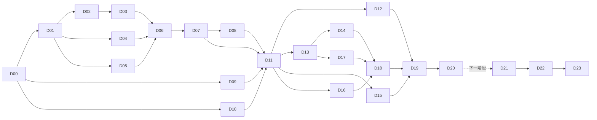

# 审计平台自动化开发执行计划

版本：3（任务清单 revision 24）。更新：2026-10-03，Asia/Hong_Kong。用户当前方向：**选择项目 → 选择 Clear 工具 → 开始处理与输出**，快速落地与稳定优先。新增 Q01 简化日常入口、轻量项目、工具承接和直接输出；当前结果以 state/NEXT 和[简化开发记录](项目与Clear工具简化开发记录-20261003.md)为准。

**原生工具接通（N01）：** ClearOCR / ClearClassify 已接真实 F 盘运行时，实际启动、当前关联项目打开与简化返回均通过。旧占位配置不再作为本机开发入口；模型推理与独立交付保留原范围。详见[简化开发记录](项目与Clear工具简化开发记录-20261003.md)。

**本次范围调整优先于下文旧流程要求：** 工作程序、调查证据、编制/复核和底稿降为可选高级功能，不再作为普通工具使用和下载前置。后续集中完成实际工具安装/启动、项目隔离、异常恢复、文件下载和独立交付；不继续扩大证据审批或重复模型评测。此前 16/21（76.2%）只表示旧审计流程任务的历史完成数，不代表简化后产品的进度。以下旧执行安排保留为历史和高级功能维护资料。

**2026-10-03 进度核对：** 本轮 M1/M2 共 21 项，已有 12 项（D00–D11）完成，按任务数为 57.1%，不是按工时加权的产品完成率。全量异常索引、版本化处置、分类/OCR 人工修订采用、复核成果及门户、启动约束与一致冷备已有源码和检查记录。D12 登记的 r4 构建进程已不存在，没有退出回执，只有未发布的 pending 目录；因此独立候选交付未完成。D13–D20 在本次续作前仅有契约/驱动准备材料，不能计为业务功能完成。运行事实以 [state.json](/F:/OCR/output/audit-platform-dev-20261002/state.json) 和 [NEXT.md](/F:/OCR/output/audit-platform-dev-20261002/NEXT.md) 为准。

**本次推进调整：** 用户要求优先推动业务主线、避免细枝末节与重复测试。已通过 D11 的源码可直接用于 M2 开发，D13/D15/D16 的开发前置改为 D11；D12 保留为 D19/D20 最终交付门禁。旧 M1 冻结快照、候选和证据只读保留，M2 源码解除旧冻结。当前优先完成“审计项目→工作程序→实际差异→调查解释与结论→编制/复核→可读底稿”的可操作切片，不重复构建大包或扫描未变模型。新增功能仅执行受影响的主线和正确性检查，源码验收不冒充候选验收。

**本次结果：** 上述业务切片已落地并通过真实两表执行、项目/程序/多证据调查、解释结论、编制复核、不可变双格式底稿和新领域冷备恢复检查；门户操作及正式构建通过。已完成任务数从 12 增至 14。详见[本次进度核对](审计平台开发进度核对-20261003.md)、[合成底稿样例](/F:/OCR/output/audit-platform-dev-20261002/evidence/D13/1/demo-workpaper/workpaper.md)与[源码预览说明](/F:/OCR/output/audit-platform-dev-20261002/deliveries/M2-development/使用说明.md)。D16/D17/D18、D19/D20 与 D12 交付门禁仍未完成，不将 HTTP 读回或 UI mock 当成候选真实浏览器保存。

**业务优先续作（revision 21）：** D16 已实现同页两表首配、可读模板摘要和稳定请求逐文件上传恢复；D17 已实现全工作空间的 SQL 待办筛选/排序/分页、稳定定位及实际原文/采用值证据。新增上传后端 20 例、首配/上传 UI 4 例、86 条持久事项待办集成 1 例均通过；深页按 item_id 直接读取新接口 1 例通过。旧大数据、原生 CPU、模型、候选和浏览器保存检查均按未变范围复用。D18 已接统一待办入口、连续确认、字段与来源对照及原生返回上下文；3 项新增待办交互、10 项证据界面检查和唯一最终生产构建均通过，源码预览已刷新读回。首次/重复操作、改判、上传故障、服务恢复与保存的六类真实用户任务记录，连同原生冷启动、独立包、冷备和浏览器保存留在最终集中验收；不虚构操作数或效率指标。
**用户追加图像取证接入（revision 22 / I01）：** 已完成“资料选图→六项经典本地工具→原图/热图与限制审阅→版本化人工说明→审计调查固定证据→统一待办→编制复核→正式底稿”的源码切片，并接任务/成果中心和新领域冷备。研究模型不作默认能力；独立运行时归集保留 M2 最终交付门禁。I01 是追加功能，不重算原 21 项核心任务。详见[接入开发记录](图像取证接入开发记录-20261003.md)。

**导航与应用统一（revision 23）：** 图像取证采用 ClearForensics 品牌，四个 Clear 工具统一应用目录及卡片层级。一级导航按审计作业、资料处理、应用工具、平台管理分组；不按单个工具增列。新前端入口 `/apps/forensics`，旧入口保留上下文跳转。详见[导航与 Clear 应用规划](审计平台导航与Clear应用规划-20261003.md)。

**固定方向：把 Clear 系列做成可以从工作程序、资料处理、异常判断一直走到复核底稿交付的单机审计辅助平台。** 本轮完成 M1「正确性与交付闭环」和 M2「审计主流程与操作简化」，达到门槛后交付并停止。PDF 与提取后比对保留为 M3 下一阶段，不自行扩入本轮。

本文件是下一次实施的执行入口；[机器任务清单](audit-development-tasks-20261002.json)与本文件共同约束任务、依赖和验收。事实依据保留在[现状审查与提升计划](审计平台完整性易用性与可操作性提升计划-20261002.md)，不再重新做全项目审计。已完成的 N00–N06、品牌与返回入口继续复用。

原始请求为制定计划；后续已授权实施并完成 D00–D11。本次继续开展 M1/M2，按已获得授权自主推进，不逐阶段例行等待批准。

## 1. 本轮范围与唯一产品主线

正常操作固定为：**选择审计项目/工作程序 → 选资料和已确认模板 → 看规则摘要 → 开始处理 → 集中处理异常 → 采用修订并形成结论 → 生成复核版成果/底稿 → 保存与归档。** 可以直接处理两表，不要求所有资料依次经过分类和 OCR。

| 纳入本轮 | 明确后移 |
|---|---|
| 全量异常覆盖、人工修订回流、处置版本与历史、复核版成果 | PDF 批次与限定提取比对作为 M3；任意票据自动入表继续后移 |
| 启动互斥、F 盘真实写入边界、实际浏览器保存 | 通用拖拽流程设计器、目录监控、定时运行、云服务 |
| 最小审计项目、工作程序、调查事项、结论和复核底稿 | 多人组织权限、复杂审批、整改管理和电子签名体系 |
| 原生自动准备、模板首配/摘要、上传恢复、统一待办与字段对照 | 新模型、训练策略、组件库迁移、品牌重做、装饰动画 |

第一次配置保留必要确认；确定性成功阶段由后端自动连续执行。人工介入集中在映射歧义、规则冲突、采用修订、调查解释和结论，分类自动接受继续默认关闭。模型分数不作为审计风险或结论认可的替代。

## 2. 运行基线与全部 F 盘落点

| 用途 | 登记路径/身份 |
|---|---|
| 平台源码 | `F:/OCR/output/clear-automation-dev-20261002/worktrees/platform`；基线 `cbcfd6d40e2bb3d9ad9595b283c4a81b96dbeccf` |
| OCR 源码 | `F:/OCR/output/clear-automation-dev-20261002/worktrees/ocr`；基线 `946d830df91b3e7d83bdad1d054f9121f997f21e` |
| 分类源码 | `F:/OCR/output/clear-automation-dev-20261002/worktrees/classification`；基线 `15387bd55e8dd7f73e7b99043376821dcc0553da` |
| 旧候选，只读保留 | `F:/OCR/output/clear-automation-preview-20261002` |
| 本轮状态、检查与隔离数据 | `F:/OCR/output/audit-platform-dev-20261002` 下 `state.json`、`NEXT.md`、`checks/`、`fixtures/`、`data/`、`backups/`、`restores/` |
| 本轮依赖/缓存/临时目录 | 优先复用已核对的 F 盘依赖；新增使用上述运行根的 `cache/`、`temp/`、`appdata/`；Paddle 使用登记的 F 盘 ASCII 临时目录 |
| M1/M2 独立候选 | `F:/OCR/output/audit-platform-m1-preview-20261002`、`F:/OCR/output/audit-platform-m2-preview-20261002` |
| M3 预留候选 | `F:/OCR/output/audit-platform-m3-preview-20261002`；本轮不创建 |

规划路径不代表目录已经创建。D00 在任何写入前检查真实目标、磁盘容量、junction、Git 元数据、已有改动和运行进程。优先复用上述合适源码；确需隔离时在运行根下建 F 盘工作树并登记实际路径。不得复制活动用户数据作为测试工作区，不得覆盖非空候选目录或清理用户改动。

每个会写文件的进程和子进程显式配置 TEMP/TMP、APPDATA/LOCALAPPDATA、npm/pnpm、模型缓存、日志、浏览器 profile/下载/截图到 F 盘；核对实际子进程环境及输出清单，不以根脚本设置代替证明。禁止改 HOME、CODEX_HOME 或系统用户目录；盘外已安装工具只能只读使用。F 盘不可用即停止相关写入，不回退其他盘。

现有平台 `scripts/run_check.py` 会改写 HOME/USERPROFILE，旧任务 JSON 还有盘外默认路径；本轮默认绕开旧 runner，以受控独立会话执行已绑定工具和参数。不把修建新运行框架作为前置。需要复用旧工具时，先最小修正违规环境及默认路径，再证明实际落点。详见[存储规范](/F:/OCR/docs/项目文件存储规范.md)。

## 3. 一次冻结的实现约定

D01 只冻结以下与正确性相关的语义，最长半天形成可评审切片；不开展多套架构比较。现有 SQLite、FastAPI、React 和三套组件库继续使用，只有现有实现明确不能满足硬验收时才记录小范围替代。

1. **覆盖与索引。** 事项采用持久行级索引、稳定 item_id、分页读取；批次记录索引检查点与覆盖数。输入文件数、左右行数、结果行数、应处置数和各处置数分别定义。未入索引或仍有未解决/暂缓事项不能复核完成。不得只放大 LIMIT 或继续把全部事项塞进单个 JSON。
2. **版本化处置。** 分开保存原始输出、当前采用结果、人工处置和交付版本。每次写入携带用户所见 expected_revision、稳定 request_id、操作身份与说明；同请求同内容返回原回执，不同内容冲突；两窗口旧版本不能静默覆盖。
3. **跨库恢复。** 先持久化操作意图，再调用原生条件写入，最后记平台回执；用 operation_id 核对原生成功、平台未记账或响应丢失，不承诺跨 SQLite 原子提交。可核对后继续，不可核实时保留待核实，禁止盲目重发。
4. **采用修订。** 分类允许明确采用人工类别 B；OCR 允许采用 revision 2。保存原始版本和旧新关系，重新核对原件、原生项目/实例和结果身份；旧建议不能覆盖人工判断，不能删除版本检查来清错误。
5. **复核版成果。** 完成全部准备与验证后才发布新 artifact/bundle ID；旧包不修改。M1 至少交付采用结果、`review.json`、处置历史、可读复核摘要和来源/版本清单，复用已有固定原件及格式。生成中断不暴露半成品，重试复用同一语义请求。重开后明确标记既有交付落后于当前复核状态。
6. **最小业务层。** M2 的审计项目绑定工作空间及对象/期间/目标；工作程序关联范围、规则、批次和覆盖；调查事项关联证据、说明、结论及编制/复核记录。底稿默认输出可读 `workpaper.md` 和关系明细 `workpaper.json`，引用已有复核成果与 XLSX 明细；内容固定为目标/范围、规则与覆盖、发现与解释、结论、编制复核记录及证据索引。技术错误与审计发现分别表示。单机身份来源明确，不把手填姓名宣传为组织认证。
7. **完成与交付。** 执行结束、索引完整、复核完成、成果生成/归集、底稿交付分开。未解决事项可生成带清单的中间材料；只有满足定义的工作程序完成条件才显示正式复核完成。不能通过隐藏失败或默认自动确认来达标。

API/契约来源只维护一处，schema、OpenAPI、前端类型按既有生成命令同步。不直接手改生成物；变更采用关系、状态或定位语义时更新契约版本与兼容规则。技术实现选择由负责人按这些约定解决，无需反复找用户选择。

## 4. 固定任务与依赖

下表是人类阅读索引，机器清单给出每项完整写入范围、步骤、交付物、验收和替代路线。D 任务只对应本轮增量，不重写正式 T 台账或旧 N 任务状态。

| 任务 | 唯一交付 | 前置 | 默认负责人 |
|---|---|---|---|
| D00 | 基线、真实 F 路径、环境/工具、进程与权限范围绑定 | 无 | 统筹 |
| D01 | 覆盖、处置、采用、恢复与成果契约及验收夹具约定 | D00 | 统筹/接口负责人 |
| D02 | 全量持久事项索引、覆盖守恒、分页与恢复 | D01 | 泳道 A |
| D03 | 平台处置账本、历史、请求去重、条件写入与迁移 | D02 | 泳道 A |
| D04 | 分类原生条件处置/历史与分类适配器 | D01 | 泳道 B |
| D05 | OCR 修订身份/历史与 OCR 适配器 | D01 | 泳道 C |
| D06 | 平台采用与处置 API、跨库核对和恢复 | D03、D04、D05 | 泳道 A |
| D07 | 不可变复核版成果、后继关系与发布 | D02、D06 | 泳道 A |
| D08 | 采用修订、冲突、历史和复核成果门户操作 | D06、D07 | 泳道 C |
| D09 | 启动互斥、真实子进程环境与 F 盘路径约束 | D00 | 泳道 B |
| D10 | 既有下载根因诊断及目标浏览器保存基线 | D00 | 统筹，预约浏览器 |
| D11 | M1 受影响集成、迁移/一致冷备恢复、源码冻结 | D02–D10 | 统筹 |
| D12 | M1 候选、清单、首次/缓存启动、复核成果实际保存 | D11 | 统筹 |
| D13 | 最小审计项目/工作程序/调查事项业务域与 API | D11（源码开发）；D12（最终交付） | 泳道 A |
| D14 | 业务界面及一项差异生成可读底稿 | D13 | 泳道 C |
| D15 | 原生自动准备、能力一致性和可执行恢复 | D11（源码开发）；D12（最终交付） | 泳道 B |
| D16 | 模板摘要/首配引导与逐文件上传恢复 | D11（源码开发）；D12（最终交付） | 泳道 C |
| D17 | 跨批次待办和可解释字段/来源后端 | D13 | 泳道 A |
| D18 | 统一待办、字段对照和回原生后的事项上下文 | D14、D16、D17 | 泳道 C |
| D19 | M2 主流程集成、新业务域冷备恢复与源码冻结 | D12、D14–D18 | 统筹 |
| D20 | M2 独立候选、完整流程证据和最终交付 | D19 | 统筹 |
| D21 | PDF 逐页批次与同一版本/处置/成果闭环 | D20，M3 后移 | 泳道 B |
| D22 | 一个限定场景的字段提取到比对模板 | D21，M3 后移 | 泳道 A |
| D23 | M3 集成、候选与限定场景交付 | D22，M3 后移 | 统筹 |

D02/D03 顺序安排，避免同时改平台 store；D04/D05 可并行。D09 和 D04 由同一泳道择先完成，D10 不等待成果功能。D07 的后端可先验收，D08 再接操作界面。D14/D16 同泳道串行，其他泳道继续工作。依赖和实际写入锁同时满足才领取，不能因表中排在前面就越过依赖。

## 5. 文件责任与并行规则

最多三条开发泳道加一位统筹。任务的 `write_scopes` 是允许编辑范围；目录必须显式列出，公共文件由一个负责人处理。发现需要范围外的小改动，统筹登记任务边界后安排唯一写者，这是正常实现协调，不增加用户审批。

| 负责人 | 主要写入范围 | 明确规则 |
|---|---|---|
| 泳道 A：平台闭环与业务 | 平台 `batches/{store,data,service,routes}.py` 及新局部存储；`data_api/`、`artifacts/`、`modules/data_workbench/`、新增 `audit/`/调查业务域；对应测试 | D02→D03→D06→D07 顺序修改；D13→D17 顺序推进。新增领域必须列入迁移与备份。 |
| 泳道 B：分类与运行 | 分类 `src/image_platform/{store,api,backup}.py`；平台 `adapters/classification/`、分类原生作业桥；随后平台启动/监督/候选脚本、OCR `windows_paths.py` | D04 与 D09 不同时领取。未经影响分析不改 GPU 所有权或训练算法。 |
| 泳道 C：OCR 与交互 | OCR `src/ocr_workbench/{store,service}.py` 及局部修订实现，平台 `adapters/ocr/`、OCR 原生作业桥；随后门户 `features/batches/`、`features/audit/`、待办与证据局部组件 | D05 结束后转 D08；M2 D14/D16/D18 顺序修改交互热点，不往全局 CSS 末尾连续堆覆盖。 |
| 统筹/公共负责人 | 平台 `packages/contracts/`、生成物、`app.py`、门户全局路由/外壳；备份脚本、计划/state/NEXT；冻结、候选、清单与检查索引 | 共享需求集中归并；其他泳道通过已有局部接口工作，不自行修改公共文件或旧台账。 |

平台 `batches/native.py` 是跨库热点，D06 由泳道 A 单独修改；M2 D15 修改前由统筹显式移交给泳道 B。2026-10-03 已按主线优先调整，在 D11 源码验收后完成移交与写入锁登记；D12 仍是最终交付门禁。不能让两个负责人各自理解处置版本。

同一仓库可在已登记的不相交文件中开发，Git index/提交、同一前端构建和候选更新必须串行。更稳妥时复用/建立 F 盘独立工作树，统筹按 D01 → D02/D03、D04/D05/D09 → D06 → D07/D08 → D11 的依赖顺序集成。不重置、stash 或删除用户已有改动；提交只含本任务文件。

独占资源：公共契约生成、各仓库 Git index、每个前端的 dist/构建、真实原生运行/GPU、浏览器及 profile/下载、候选目录/清单、三组件一致冷备与恢复。CPU 单元检查在不同输出目录可并行。候选构建时其输入源码冻结；禁止边编辑边打包。

源文件写入 claim 覆盖该文件的编辑周期；Git index、构建、浏览器、原生运行/GPU和备份锁只在对应操作阶段持有，操作结束即释放，不能整张任务长期占用。D04/D05 的代码与 CPU 检查可并行，实际原生操作排队执行。

## 6. 自动推进、断点与失败处理

机器任务清单是规格，供 Codex/代理读取，不声称已安装自动执行器；它不兼容旧 `platform_plan.py` 台账格式，本轮不调用旧 selector 的默认计划，也不迁移 47 个历史任务回执。

D00 仅创建一份运行 `state.json` 和一份短 `NEXT.md`，由统筹单写。静态 JSON 不保存完成百分比。每个动态任务记录：status、owner、attempt、checkpoint、source_revision、outputs、checks、blocker、next_action。状态使用 pending/running/verifying/done/blocked/failed；done 只在硬验收通过后使用。计划新增 revision 时只重新评估实际受影响任务，不让全局摘要变化作废所有已通过证据。

自动循环固定为：

1. 优先续接 running/verifying，核对 checkpoint、源码与实际产物；对失联任务先查进程/结果身份，不能直接再提交。
2. 否则只从当前里程碑的 pending 中选择依赖 done、资源可用、写入锁无冲突的最高优先级任务；同优先级按 ID，单泳道一次一任务。failed/blocked 只有代码、假设或解除条件发生实质变化后，才由统筹登记原因并转回 pending。
3. 落实一个可运行切片，跑受影响检查，登记失败或通过的原始结果；每半天至少留下可操作切片或具体阻断，不只更新台账。
4. 满足 acceptance 后标 done，释放锁并选下项；所有门槛满足才推进 M1→M2。已获得的实施授权持续有效，不逐阶段再问。
5. 每个切片完成或约 30 分钟有效工作后更新 NEXT；不用不停截图、轮询或写长报告充当进展。

断点续作只读本计划、机器清单、state/NEXT 与当前任务相关文件；确认实际路径和活动进程后继续。源码未变且检查适用时复用结果，不因换聊天、代理或上下文压缩重跑全部流程。

若当前范围全部完成则交付结束；若仍有未完成任务却无可执行任务，保存 state/NEXT，列明具体解除条件并结束当前执行回合。不空转、盲目重试或自行创建周期提醒；资源恢复或用户续作后按保存状态继续。

| 阻碍 | 继续工作与解除条件 |
|---|---|
| 缺 GPU 或某个原生运行时 | 继续 Data、迁移、处置/适配器 CPU 夹具和 UI 开发；相关真实原生验收保持待验证。仅校对实例可验证已有 OCR 修订，但不能冒充新识别。 |
| 下载 canceled 或浏览器工具不可用 | D10 区分 HTTP、浏览器保存与工具事件；换已核实的实际目标浏览器/受控外部 Chromium。保存门槛未通过不标候选完成，其他功能继续。 |
| F 盘不可写/空间不足 | 停止相关写入并给具体路径和需要空间；可继续只读分析，禁止盘外回退。 |
| 共享接口不满足 | 交公共负责人做最小兼容修订；原生/门户用固定夹具继续独立切片，最终联调必须接真实接口。 |
| 不可核实的跨库成功/取消 | 保留操作身份与意图，重试查询并核对；不重新生成 ID、不把 unknown 直接改失败或成功。 |
| 旧构建/发布/备份工具依赖历史 state | 核对本轮所需输入并用既有功能最小适配；不把旧索引改路径后当新证据，不扩建通用发布系统。 |
| 独立设备/真实业务样本尚不可用 | 继续本轮工程；资格保持未验证，正式 T052–T057 不改为完成，不要求补样本才能做其余开发。 |

**相同输入、相同源码、相同失败最多重复两次。** 第三次前必须形成新原因、修复或不同验证路线；有实质诊断进展可登记新 attempt，不通过反复清零掩盖循环。阻断只影响其依赖任务，状态记录具体解除条件后继续其他工作。

## 7. 检查采用少量硬反例

原生/后端检查使用 D00 绑定的工具路径、F 盘临时/缓存与隔离数据。pytest 禁用默认缓存或将缓存移到 F 盘，显式把 basetemp 指向本次检查专用临时子目录；Python 使用 `-B`。pnpm store、npm 缓存、Playwright profile/下载/报告显式配置到 F 盘。下面均为已存在的检查入口，新反例由相应任务补到这些文件或登记的新测试文件，不能说旧测试已覆盖新功能。

| cwd，相对已绑定源码根 | 定向检查入口 |
|---|---|
| platform | `python -B -m packages.contracts.generate --check`；`tests/contract/` |
| platform | `python -B -m pytest -p no:cacheprovider tests/integration/test_processing_batches.py tests/integration/test_native_batches.py -q` |
| platform | `tests/adapters/test_classification.py`、`tests/adapters/test_ocr.py`、`tests/integration/test_ocr_adapter_export.py` |
| platform | `tests/integration/test_artifact_integrity.py`、`test_artifact_center_api.py`、`test_classification_artifacts.py`、`test_ocr_artifacts.py`；`tests/data/test_export_readback.py` |
| platform | `tests/integration/test_candidate_bootstrap.py`、`test_app_launch.py`、`test_supervisor.py`、`test_platform_backup.py` |
| platform/apps/portal | `pnpm run test -- tests/batches.test.tsx`；受影响时补 navigation/catalog/native-window；`pnpm run build` |
| ocr | `python -B -m unittest discover -s tests -p test_store.py -v`；按改动补 test_editing.py、test_service_audit.py、test_windows_paths.py、test_adapter_runtime_path.py |
| ocr/frontend | 按实际改动选择已有测试；`pnpm run build` |
| classification | `python -B -m pytest -p no:cacheprovider tests/test_result_dispositions.py tests/test_api.py -q`；备份变化补 tests/test_backup.py |
| classification/apps/web | `pnpm run build`；只有事件绑定/操作改动才补受影响现有 e2e |

目录/文件条目在运行时补为完整 pytest 参数数组，机器清单提供核对过的参数。D00 核实运行时依赖，不盲用开发机默认 Python。纯可逆样式不写镜像测试；数据、版本、跨库恢复和副作用必须有有效反例。

| 验收组 | 必须证明的反例与完成标准 |
|---|---|
| C1 全量覆盖 | 左右各 50,001 不相交行的 100,002 异常全部入索引且分页可访问；相同/差异/重复键/空键混合守恒；中途重启无重复遗漏，索引未完成/暂缓存在时不能复核完成 |
| C2 修订与处置 | 分类 A→B 后平台采用 B；OCR revision 1→2 后采用 2；两窗口旧 revision 冲突；同请求同内容复用、异内容拒绝；原建议/原件/旧包保持原身份 |
| C3 跨库恢复 | 原生写入成功、平台记账前中断以及响应丢失；恢复核对原 operation，只生成一个有效事件，历史、状态和采用版本一致；不可核实时保持待核实 |
| C4 成果一致 | 新成果采用正确版本，含覆盖、处置历史与来源；生成中断无半成品下载；重试不改旧包；重开后标记原交付落后；有未解决项仅输出明确中间材料 |
| C5 启动与路径 | 并发/重复启动、占用端口、同包不同数据根/端口，不改旧指针配置；F 盘中文/空格目录与原生子进程实际环境核对；临时不可写、非法盘外路径/junction 逃逸无回退 |
| C6 实际保存 | 用户目标浏览器把 CSV/XLSX/来源 JSON 与复核版文件保存到 F 盘并重开，身份与内容正确；取消/同名/重试/缺失有明确行为；HTTP 200 不替代此项 |
| C7 一致冷备 | 停止本轮受管三个组件，在同一窗口备份；恢复到全新 F 盘目录，保留输入、事项索引、历史、请求去重、未完成操作、采用关系与新旧成果；迁移失败有明确恢复路径 |
| C8 审计主线 | 一项真实执行产生的合成两表差异，从项目期间/目标到工作程序、调查解释、结论、复核记录和可读底稿完整关联；技术失败不冒充业务发现 |
| C9 操作简化 | 冷启动不需先记住服务顺序；模板规则/角色可解释；10 文件第 4 个失败能看见 1–3 成功、4 失败、5–10 未提交，恢复不重复登记 |
| C10 待办与证据 | 工作空间跨批次全局筛选/排序真实；不用读 JSON 可说明字段差异、原行、文件与采用规则；保存下一项、回原生再返回保持正确事项和筛选 |

大数据量完整性反例不要求用户手工点十万次：测试接口分批生成/处置，核对计数及末尾记录，页面只验证分页/筛选/明确范围操作。工程夹具结果不扩大为真实审计准确率；使用指标记录首次、重复、改判、失败恢复和下载全过程，不宣传未经测量的改善百分比。

## 8. 两轮独立交付门槛

**M1 / D11–D12：** D00–D10 通过相关硬反例；三仓源码冻结；新增存储迁移与三组件一致冷备恢复通过；构建一个独立候选，绑定源码/生成物/运行时输入与清单，按既有策略正常首次完整校验，再做一次缓存重启。实际操作分类改判、OCR 校对采用、复核成果保存并重开。C1–C7 无阻断问题才交付并进入 M2。

**M2 / D19–D20：** 最小业务层、自动准备、首配上传与统一待办形成连续流程；C8–C10 和本轮受影响 C1–C7 通过；新业务域加入备份并真实恢复；源码冻结后统一生成一个 M2 候选，核对包内页面与身份，执行该候选必要校验/缓存与保存读回。交付可读底稿、使用说明、源码与候选身份、检查索引、已知限制及回退步骤。全部通过后结束本轮，不自动进入 M3。

首次全验耗时按实际记录，不复制旧包数字或伪造/平移成功缓存。候选失败回到具体问题修复，仅重新验证受影响项；程序/清单改变后执行现策略要求的资格检查。不得因为“只改了页面”保留过期清单。

浏览器集中检查由一位负责人执行，优先外部 Chromium，F 盘 profile/缓存/下载/截图并带 `--disable-gpu --disable-gpu-compositing`；主要视口 1440×900、1280×720 和 390px。每轮最多五张必要截图，其余场景用实际结果记录；已有相同适用证据可复用。内置浏览器严格按 AGENTS.md 停止其他活动、截图后关闭活动并等待稳定，不常规重启 Codex。

每轮交付包包含：唯一 Start 入口、演示数据的隔离位置、当前可用范围、来源与版本解释、最多一份检查摘要和原始日志索引、备份/恢复/回退说明。旧程序只能配匹配旧冷备恢复到新目录，新领域不能自动合并回旧版；保留新旧数据，不把复制覆盖当回退。

干净 Windows、真实内网设备与业务效果独立保留资格状态，不阻止其余工程推进，也不被本轮冒烟替代。M3 后续只有限定场景通过相同版本/来源/覆盖验收才扩大，仍不承诺任意票据无人值守。

## 9. 防止反复纠结的执行纪律

- **方向只定一次。** 不重选品牌、字体、颜色、组件库、存储技术或流程工具。实现取最小兼容路线，差异通过真实反例判断。
- **每项交付可运行切片。** 契约冻结后各泳道独立推进，不等三个仓库全部完成才展示；不能连续两个检查点只有台账或工具工作。
- **非阻断细节只修一轮。** 集成时集中归并一次间距/文案/图标问题；不影响阅读或操作的 1–2px 差异、换行、动画写入后移清单，不再次开精修。
- **已通过就推进。** 没有源码、输入、环境或风险变化，不重复同一测试/截图，不重新校验未受影响模型，也不追求旧台账全绿。
- **正确性不能时间盒放行。** 异常遗漏、错误版本、覆盖人工判断、数据丢失、盘外回退、启动副作用、成果不能保存、假完成或包内身份不一致必须解决。时间盒用于产出诊断与换路线，不能把失败标完成。
- **源码阶段轻量，冻结后统一出包。** 各泳道不独立复制三十多 GB 候选，不每个切片触发全模型扫描；相同内容不反复打大包。
- **不把计划变成框架项目。** 不新增调度器、审批系统、复杂证据账本或自动新聊天；一份 state、NEXT 和任务日志足够，旧历史回执只读引用。
- **不制造例行确认。** 已授权实施后自主完成本轮必要的可逆开发/检查；新增破坏性生产操作、付费外发等按实际会话授权处理，正常边界协调不请用户逐项批准。
- **门槛通过立即交付。** 不自启第二轮外观精修、额外模型基准、资格征集或周期监控。M2 是本轮终点。

## 10. 首个工作批次与估算

收到实施指令后的首个批次明确为：D00 核实路径/运行环境 → D01 冻结最小语义 → 泳道 A 开 D02、泳道 B 开 D09 后 D04、泳道 C 开 D05；统筹在不占用开发资源时推进 D10。随后 A 顺接 D03/D06/D07，C 接 D08，统一通过 D11/D12。没有需要用户再选的技术路线。

沿用现状计划初估：M1 约 **7–12 人日**，M2 约 **8–14 人日**，核心合计 **15–26 人日**。任务拆分用于责任和自动推进，不逐张重复叠加工时。D00 核对迁移和工具链后修正估算；最多三泳道可暂按 2–3 个工作周安排，单人约 3–5 个工作周，不包含设备等待或未知重大迁移问题，也不作为硬截止。

本计划完成标准：任务清单可读、依赖无环、源码和新增产物只指向 F 盘、每项有唯一责任/边界/验收/恢复路线、两轮交付门槛明确。原始计划制定状态已结束；当前实施进度见顶部核对及运行 state/NEXT。
